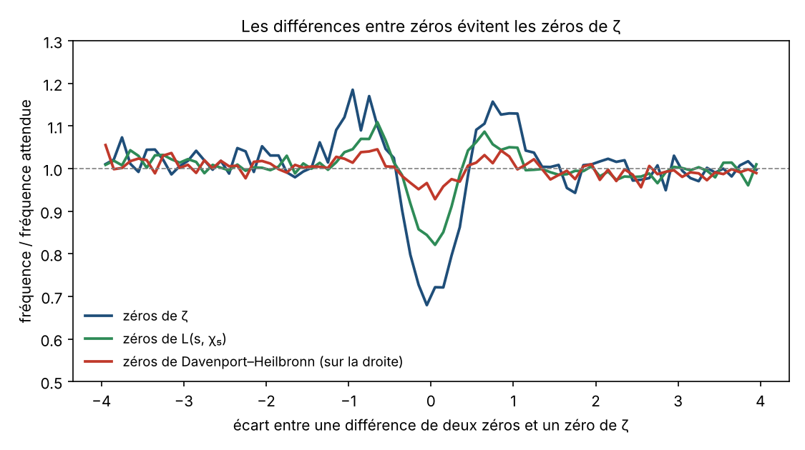
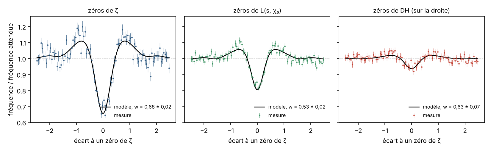
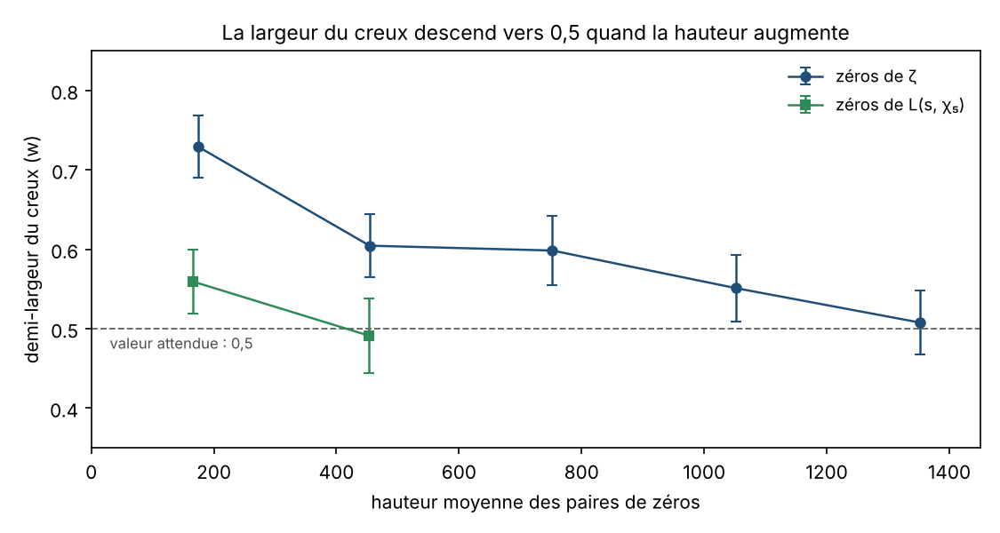

# V6.3d/e/f — Ce que chaque instrument voit réellement

**Date :** 7 octobre 2026 (§7.4 ajouté en V6.3e, complété en V6.3f le 8 octobre)  
**Statut :** classement des instruments V6 par recoupement numérique. Aucune revendication sur RH.  
**Suite de :** `23_AUDIT_V6_3B_FORMULE_EXPLICITE.md` (DUAL-LOCK ne voit que les zéros).

## 1. La question

La V6.3b/c a établi que DUAL-LOCK calcule une compression de la forme de Weil [Wei52] : il mesure la position des zéros et rien d'autre. Restaient deux questions.

1. TOMO-2, TOMO-3 et PRIME-LOCK voient-ils autre chose que les zéros ?
2. Le verrou local (produit d'Euler) peut-il forcer le signe global (zéros sur la droite) ?

## 2. Réponse courte

| Instrument | Ce qu'il mesure, lu sur les zéros | Recoupement | Statut proposé |
|---|---|---|---|
| DUAL-LOCK | la position de chaque zéro : sur la droite ou non | V6.3b/c | validé, expliqué |
| TOMO-2 | la hauteur et le poids de chaque zéro (un zéro = un ton) ; un zéro hors droite = un ton qui enfle | signal reconstruit à 1,1·10⁻⁸ près (§5) | expliqué ; sépare L de DH par les zéros hors droite, comme DUAL-LOCK |
| TOMO-3 brut | les relations additives γ_a + γ_b = γ_c entre zéros, et non la multiplicativité | §7.1 | clos : le résultat nul était attendu |
| Bispectre dans le canal t | le défaut multiplicatif lui-même | §7.2 | tautologie, classée comme reformulation |
| PRIME-LOCK | une propriété collective : l'arrangement des zéros n'a de « fréquences » qu'aux log p^k | §4 | validé ; **indépendant du signe global** |
| Différences de zéros (nouveau dans le corpus, connu dans la littérature) | l'empreinte du produit d'Euler, lisible sur les zéros de la droite seuls | §7.3 | diagnostic à garder |

Réponse à la question 2 : **non, pas sous la forme mesurée par PRIME-LOCK.** Deux témoins explicites occupent les deux coins manquants du tableau « verrou local × signe global » (§4).

En route, la reconstruction a révélé une **erreur de la V6.3b** : deux zéros bas de Davenport–Heilbronn [DH36b] [DH36a] manquaient (§6).

## 3. Le principe

Par la formule explicite, la liste des zéros d'une fonction F et la liste des coefficients Λ_F(n) de −F′/F portent la même information : chacune est la transformée de Fourier de l'autre, à des termes explicites près (pôle, facteur gamma). « Ne voir que les zéros » n'est donc pas un défaut d'instrument. La bonne question est : **quelle propriété de la configuration des zéros l'instrument teste-t-il ?**

- une propriété **individuelle** : où se trouve chaque zéro (DUAL-LOCK, TOMO-2) ;
- une propriété **collective** : comment les zéros sont arrangés entre eux (PRIME-LOCK, différences de zéros).

RH est une propriété individuelle. Le produit d'Euler est une propriété collective.

## 4. Les quatre coins : verrou local et signe global sont indépendants

Deux témoins de la forme F(s) = P(s)·ζ(s), avec la même équation fonctionnelle que ζ à un conducteur près (vérifiée à 10⁻¹³) :

- **F6** : P(s) = 1 + 6^(1/2−s), conducteur 6. Pas de produit d'Euler : a(2)·a(3) = 1 mais a(6) = 1 + √6. Les zéros de P sont s = 1/2 + i(2k+1)π/log 6 : tous **sur** la droite.
- **E2** : P(s) = (1 − 2^(0,8−s))(1 − 2^(0,2−s)), conducteur 4. Coefficients multiplicatifs (produit d'Euler, seul le facteur en 2 est modifié). Les zéros de P sont s = 0,8 + 2πik/log 2 et s = 0,2 + 2πik/log 2 : **hors** de la droite.

| Objet | défaut multiplicatif | fuite hors p^k | défaut de tour | plus petit λ_G (fenêtres testées) | zéros hors droite |
|---|---:|---:|---:|---:|---|
| ζ | 0 | 0 | 0 | +1,4·10⁻⁵ | non |
| L(s, χ₅) | 0 | 0 | 0 | +1,96 | non |
| **F6** | 0,137 | 0,089 | 0 | **+0,018** | non |
| **E2** | 0 | 0 | 0,704 | **−1,50** | oui |
| DH | 0,425 | 0,911 | 0,798 | −1,52 | oui |

(N = 32 768 pour les trois mesures locales ; défaut multiplicatif sur les couples premiers entre eux ≤ 48 ; λ_G : dimension 5, demi-largeur 2,5.)

| | zéros sur la droite | zéros hors de la droite |
|---|---|---|
| **fuite nulle** (−F′/F porté par les p^k) | ζ, L(s, χ₅) | **E2** |
| **fuite non nulle** | **F6** | Davenport–Heilbronn |

**Recoupement côté premiers / côté zéros** (zéros de ζ + zéros de P, calculés en formule fermée) :

| Objet | T | écart relatif | λ_G côté premiers | λ_G côté zéros |
|---|---:|---:|---:|---:|
| F6 | 20 | 3,1·10⁻⁹ | +0,01821 | +0,01821 |
| F6 | 31 | 2,5·10⁻⁹ | +0,11478 | +0,11478 |
| F6 | 50 | 2,6·10⁻⁹ | +0,81306 | +0,81306 |
| E2 | 18 | 1,9·10⁻⁹ | −1,42788 | −1,42788 |
| E2 | 27 | 1,9·10⁻⁹ | −1,49964 | −1,49964 |
| E2 | 45 | 2,0·10⁻⁹ | −1,37967 | −1,37967 |
| E2 | 50 | 4,0·10⁻⁹ | +0,03446 | +0,03446 |

Pour E2, chaque direction négative est portée par un seul quadruplet de zéros de P :

| T | λ_G | part des zéros de ζ | quadruplet responsable | sa part | autres zéros de P |
|---:|---:|---:|---|---:|---:|
| 18 | −1,428 | +0,074 | 0,8 + 18,129i | **−1,506** | +0,004 |
| 27 | −1,500 | +0,082 | 0,8 + 27,194i | **−1,587** | +0,006 |
| 45 | −1,380 | +0,128 | 0,8 + 45,324i | **−1,512** | +0,004 |

**Lecture.**

- F6 : un **peigne** de zéros régulièrement espacés de 2π/log 6 sur la droite. Sa transformée de Fourier est un peigne aux multiples de log 6 : c'est exactement la fuite Λ_F(6^k) = (−1)^(k+1)·6^(k/2)·log 6. La fuite est donc une périodicité de l'arrangement des zéros, pas un déplacement hors de la droite. La forme de Weil reste positive.
- E2 : la fuite est nulle et le défaut multiplicatif aussi, mais le facteur local en 2 est trop gros (Λ_F(2^k) croît comme 2^(0,8k)). PRIME-LOCK ne le voit que par le défaut de tour. La forme de Weil est négative.

**Conséquence.** Ni « fuite nulle », ni « coefficients multiplicatifs » ne forcent le signe. Il faut en plus une borne de taille sur chaque facteur local (condition de type Ramanujan [Ram16]). Avec l'équation fonctionnelle de degré 1, un produit d'Euler de degré 1 et cette borne, il ne reste que ζ et les fonctions L de Dirichlet, à un décalage imaginaire près (classification de Kaczorowski–Perelli, Acta Math. 1999 [KP99], citée de mémoire), et la question du signe y est exactement l'hypothèse de Riemann généralisée. Le verrou local, pris au complet, ne raccourcit donc pas le chemin : il délimite la classe où la question se pose.

Les deux témoins sont des produits de ζ par des éléments de degré 0 de la classe de Selberg étendue (polynômes de Dirichlet auto-réciproques). Rien de nouveau mathématiquement ; ce sont des pièces de banc d'essai.

## 5. TOMO-2 : le signal reconstruit à partir des zéros seuls

Le signal de TOMO est g_F(u) = e^(−u/2)·C_F(e^u). Par la formule de Perron, C_F(x) est la somme des résidus de G_F(s)·x^s/s, et chaque zéro simple ρ donne un pôle double de G_F. D'où

  g_F(u) = Σ_ρ e^((ρ−1/2)u)·(A_ρ·u + B_ρ) + termes des zéros triviaux et de s = 0,  A_ρ = 2/ρ.

Chaque zéro sur la droite est un **ton pur** de fréquence γ_ρ et d'amplitude 2u/|ρ| ; chaque zéro hors droite est un ton dont l'amplitude enfle comme e^((β−1/2)u). TOMO-2, qui ne garde que le spectre de puissance, mesure donc les hauteurs et les poids des zéros.

Vérification : g_F lissé (gaussienne d'écart-type σ en u, appliquée exactement des deux côtés) calculé par les coefficients c_F(n), contre la somme sur les zéros. Fenêtre u ∈ [2 ; log 32 768], 4 096 points.

| Objet | σ | zéros utilisés | écart relatif | entropie TOMO-2, coefficients | entropie TOMO-2, zéros |
|---|---:|---:|---:|---:|---:|
| ζ | 0,04 | 600 | 7,9·10⁻¹¹ | 0,4483 | 0,4483 |
| ζ | 0,02 | 600 | 3,2·10⁻¹¹ | 0,5832 | 0,5832 |
| ζ | 0,01 | 600 | 1,1·10⁻⁸ | 0,6969 | 0,6969 |
| L(s, χ₅) | 0,04 | 988 | 1,9·10⁻¹¹ | 0,3673 | 0,3673 |
| L(s, χ₅) | 0,02 | 988 | 1,4·10⁻¹¹ | 0,4470 | 0,4470 |
| L(s, χ₅) | 0,01 | 988 | 1,7·10⁻¹⁰ | 0,5105 | 0,5105 |
| DH | 0,04 | 988 | 6,6·10⁻¹¹ | 0,3684 | 0,3684 |
| DH | 0,02 | 988 | 3,4·10⁻¹¹ | 0,4672 | 0,4672 |
| DH | 0,01 | 988 | 2,3·10⁻¹⁰ | 0,5932 | 0,5932 |

Les deux côtés coïncident (écart ≤ 1,1·10⁻⁸). L'écart résiduel vient de la troncature des listes de zéros.

**Ce qui sépare L(s, χ₅) de DH dans TOMO-2.** En retirant de la somme les seuls zéros hors droite de DH :

| σ | part d'énergie des zéros hors droite | entropie DH, tous les zéros | entropie DH, sans les zéros hors droite | entropie L(s, χ₅) |
|---:|---:|---:|---:|---:|
| 0,02 | 2,5 % | 0,467 | 0,438 | 0,447 |
| 0,01 | 17,9 % | 0,593 | 0,494 | 0,511 |

Sans ses zéros hors droite, DH retombe au niveau de L(s, χ₅), et même un peu en dessous. Dans cette fenêtre, l'excès d'entropie de DH est donc porté par ses zéros hors droite : TOMO-2 et DUAL-LOCK lisent la même information.

Les entropies de ce tableau diffèrent de celles du document 17 (ζ 0,868 ; L 0,635 ; DH 0,778) : le signal est ici lissé et la fenêtre commence à u = 2. La version brute fait intervenir des zéros au-delà des listes.

Pour les suites de Steinhaus (pas d'équation fonctionnelle), il n'y a pas de zéros à droite de 1/2 : le spectre n'est plus fait de tons. C'est pourquoi TOMO-2 n'y suit pas la même loi, comme le document 17 l'avait constaté.

## 6. Une erreur trouvée en route : deux zéros de DH manquaient

Au premier passage, la reconstruction de DH donnait un écart de **89 %**, contre moins de 10⁻⁶ pour ζ et L(s, χ₅). Cause : `data/dh_zeros.csv` ne contenait pas les deux zéros les plus bas,

  t = 5,094160 et t = 8,939914 (tous deux sur la droite),

parce que la recherche d'origine partait de t = 10. Ces zéros portent les tons les plus forts (poids 1/|ρ|²).

- Le comptage annoncé en V6.3b (« 129 zéros jusqu'à t = 200, en accord avec la formule asymptotique ») était donc **faux**. Comptage exact par le principe de l'argument, bande par bande : **130 zéros** pour 0 < t ≤ 200,5 (`data/dh_zero_count_audit.csv`).
- L'audit DUAL-LOCK n'en est pas affecté (changement ≤ 7·10⁻⁷) : ses fenêtres, centrées à T ≥ 86, ne voient pas les zéros bas. C'est aussi pourquoi il ne pouvait pas détecter le manque.
- L'identification de modes de la v4.4 (`generator_real_signal.csv`) trouvait déjà des modes à 5,091 et 8,907 ; le tableau les rattachait à tort au zéro 12,134. Fichier régénéré.
- L'entrée E12 du banc d'audit donnait comme « vérité » que l'écart 125/129,5 était compatible avec le terme d'erreur. C'était l'erreur. Entrée réécrite.

Leçon : un accord avec une formule asymptotique ne prouve pas qu'une liste est complète. Le principe de l'argument, lui, compte.

**Nouvelles listes** (`scripts/compute_zeros_numpy.py`, sans mpmath, complétude contrôlée dans 90 bandes) : L(s, χ₅), 988 zéros pour |t| ≤ 600, tous sur la droite ; DH, 494 zéros pour 0 < t ≤ 600, dont 15 paires hors droite (partie réelle maximale 0,8695 ; aucune au-delà de 1).

## 7. TOMO-3 : pourquoi le résultat nul était attendu, et où regarder

### 7.1 Dans le canal u, un bispectre teste l'addition des zéros

Puisque g_F est une somme de tons aux fréquences γ_ρ, son bispectre ne répond qu'aux triades γ_a + γ_b = γ_c. La multiplicativité a(mn) = a(m)a(n) vit dans l'autre variable : elle additionne des **positions** log m + log n, pas des fréquences. Le « principe de fermeture multiplicative » du document 15 (§7) croisait les deux variables. La bicohérence de C_F devait donc rester à son niveau de bruit, ce que le document 17 a mesuré (z = −1,65 ; +0,01 ; +1,59).

### 7.2 Dans le canal t, la fermeture ternaire est le défaut multiplicatif

Dans le signal t ↦ F(σ + it), les fréquences sont les log n, et log m + log n = log(mn) est une résonance exacte. Le coefficient de Fourier–Bohr à la fréquence log n vaut a(n)·n^(−σ). Le défaut de fermeture ternaire mesuré redonne donc Δ_F :

| Objet | défaut de fermeture mesuré | défaut multiplicatif des coefficients |
|---|---:|---:|
| ζ | 8,2·10⁻¹¹ | 0 |
| L(s, χ₅) | 8,0·10⁻¹¹ | 0 |
| Steinhaus | 6,5·10⁻¹¹ | 0 |
| DH | 0,7482 | 0,7482 |

(40 triades, n ≤ 60, σ = 1 ; coefficients de Bohr mesurés à 5·10⁻⁵ près.) La question posée au §10 du document 15 reçoit la deuxième des trois réponses prévues : **relation tautologique, à classer comme reformulation.**

### 7.3 La statistique qui porte une information : les différences de zéros

Il existe pourtant, dans le canal des zéros, une trace du produit d'Euler. On prend toutes les différences γ_c − γ_b entre zéros d'une fonction, et on compte celles qui tombent à moins de δ d'un zéro de ζ. On compare au même comptage pour des cibles décalées au hasard (400 tirages).

| Expérience | zéros | rapport, δ = 0,05 | rapport, δ = 0,15 | écart (δ = 0,15) |
|---|---:|---:|---:|---:|
| différences des zéros de ζ, contre les zéros de ζ | 300 | 0,721 ± 0,025 | 0,701 ± 0,016 | −19,0 σ |
| différences des zéros de **L(s, χ₅)**, contre les zéros de ζ | 494 | 0,834 ± 0,014 | 0,834 ± 0,008 | −19,8 σ |
| différences des zéros de **DH** (sur la droite), contre les zéros de ζ | 464 | 0,965 ± 0,014 | 0,953 ± 0,007 | −6,4 σ |
| témoin : différences des zéros de ζ, contre les zéros de L(s, χ₅) | 300 | 0,995 ± 0,019 | 0,995 ± 0,013 | −0,4 σ |
| témoin : différences des zéros de L(s, χ₅), contre ses propres zéros | 494 | 1,002 ± 0,011 | 1,016 ± 0,007 | +2,3 σ |
| témoin : différences des zéros de DH, contre ses propres zéros | 464 | 0,979 ± 0,011 | 0,988 ± 0,006 | −1,9 σ |

- Les différences entre zéros de ζ **évitent** les zéros de ζ : déficit de 30 %.
- Les différences entre zéros de L(s, χ₅) évitent **aussi les zéros de ζ** (déficit de 17 %), et non les zéros de L(s, χ₅) elle-même (témoin : rapport 1,00).
- Pour DH, mêmes hauteurs, même conducteur, zéros de la droite seulement : déficit de 5 %. L'écart entre L(s, χ₅) et DH vaut 10,7 fois l'incertitude.

Le phénomène est connu pour ζ et les fonctions L : observé numériquement (Pérez-Marco [PM11], arXiv:1112.0346), expliqué et étendu aux fonctions L par Ford et Zaharescu [FZ15] (arXiv:1305.2520 ; je n'en ai lu que le résumé, l'énoncé précis pour L(s, χ) reste à vérifier). L'heuristique : pour un produit d'Euler à facteurs de module 1, le terme arithmétique de la corrélation de paires fait apparaître ζ(1 + ir), dont les creux sont aux zéros de ζ. Le profil mesuré (creux de demi-largeur ≈ 0,5, épaules vers ±1) a la forme attendue.

Ce qui est propre à ce document : la comparaison avec DH. À hauteur et conducteur égaux, l'empreinte est nette pour le produit d'Euler et presque effacée pour le sosie. Je n'ai pas trouvé cette comparaison dans la littérature, mais je n'ai pas cherché à fond.

C'est la réponse à la question du document 17 (§7) : « quelle représentation rend la loi multiplicative visible ? ». Pas un ordre statistique plus élevé : une statistique d'ordre 2 sur les zéros, sondée aux zéros de ζ. Elle distingue L de DH **sans utiliser les zéros hors droite**, ce que ni DUAL-LOCK ni TOMO-2 ne font.

### 7.4 (V6.3e) Une idée hors cadre, testée : la largeur du creux

Idée : les zéros se mesurent entre eux. D'après l'heuristique de la corrélation de paires (terme proportionnel à Re (ζ′/ζ)′(1 + ir), cité de mémoire), un zéro ρ = β + iγ de ζ creuse autour de γ un profil

  −p·w²(w² − x²)/(w² + x²)²,  de demi-largeur **w = 1 − β**,

c'est-à-dire la distance du zéro à la droite Re s = 1. Sur la droite critique, w = 0,5 ; un zéro hors droite donnerait un creux plus étroit et plus profond. La forme du creux relierait ainsi une propriété individuelle (la position d'un zéro bas) à une propriété collective (les écarts entre zéros hauts).

**Ajustement complet** (`run_dip_width_full.py`, avec les 300 premiers zéros de ζ) : le profil théorique est sommé sur tous les zéros de ζ voisins, avec la largeur w commune comme paramètre libre ; trois fenêtres d'ajustement (±1,5 ; ±2,5 ; ±3,5).

| Zéros | demi-largeur w | incertitude statistique | amplitude ajustée | amplitude attendue (ordre de grandeur) | χ²/ddl | χ²/ddl si w imposé à 0,5 |
|---|---:|---:|---:|---:|---:|---:|
| ζ | 0,68 à 0,71 | ± 0,02 | 0,238 à 0,263 | 0,142 | 1,9 à 1,9 | 2,7 à 4,0 |
| L(s, χ₅) | 0,53 à 0,54 | ± 0,02 | 0,074 à 0,076 | 0,068 | 1,4 à 1,5 | 1,4 à 1,5 |
| DH (sur la droite) | 0,63 à 0,67 | ± 0,08 | 0,036 à 0,042 | 0,068 | 0,9 à 1,1 | 0,9 à 1,1 |

- **L(s, χ₅) : accord.** Largeur 0,53 ± 0,02 pour 0,5 attendu, amplitude à 10 % environ de la valeur attendue.
- **ζ, avec les 300 premiers zéros : désaccord.** Largeur 0,68 à 0,71, amplitude presque double de la valeur attendue. Imposer w = 0,5 dégrade nettement l'ajustement.
- **DH :** largeur 0,63 à 0,67 ± 0,08, amplitude environ moitié de celle d'un produit d'Euler. Trop bruité pour conclure.

**Le désaccord de ζ tient aux basses hauteurs (V6.3f).** Les zéros de ζ ont été calculés jusqu'à t = 1500 (`compute_zeta_zeros_numpy.py` : 1 070 zéros, tous sur la droite, complétude contrôlée dans 75 bandes ; les 300 premiers coïncident avec l'ancienne liste à 10⁻¹² près). Le même ajustement est refait par tranches de hauteur de largeur 300 (`run_dip_width_heights.py`) :

| Zéros, tranche de hauteur | zéros | hauteur moyenne des paires | demi-largeur w | amplitude ajustée | amplitude attendue | χ²/ddl | χ²/ddl si w = 0,5 |
|---|---:|---:|---:|---:|---:|---:|---:|
| ζ, 0 à 300 | 138 | 174 | 0,73 ± 0,04 | 0,355 | 0,197 | 1,4 | 1,9 |
| ζ, 300 à 600 | 203 | 454 | 0,60 ± 0,04 | 0,142 | 0,110 | 1,1 | 1,2 |
| ζ, 600 à 900 | 228 | 752 | 0,60 ± 0,04 | 0,111 | 0,088 | 1,2 | 1,3 |
| ζ, 900 à 1200 | 244 | 1051 | 0,55 ± 0,04 | 0,086 | 0,076 | 1,1 | 1,1 |
| ζ, 1200 à 1500 | 257 | 1351 | 0,51 ± 0,04 | 0,068 | 0,069 | 0,8 | 0,8 |
| L(s, χ₅), 0 à 300 | 214 | 166 | 0,56 ± 0,04 | 0,106 | 0,089 | 1,5 | 1,5 |
| L(s, χ₅), 300 à 600 | 280 | 453 | 0,49 ± 0,05 | 0,049 | 0,058 | 1,0 | 1,0 |
| ζ, paires entre 700 et 1500, cibles sous 150 | 656 | 1116 | 0,53 ± 0,03 | 0,079 | 0,075 | 0,9 | 0,9 |
| ζ, liste entière (hauteurs mélangées) | 1070 | 833 | 0,61 ± 0,01 | 0,128 | 0,089 | 3,5 | 6,0 |

- Pour ζ, la largeur descend de 0,73 à 0,51 quand la hauteur monte. Dans la tranche la plus haute, la largeur (0,51 ± 0,04) et l'amplitude (0,068 pour 0,069) sont celles attendues.
- L(s, χ₅) suit la même pente, plus tôt. Lecture probable : son conducteur 5 la place à une hauteur effective plus grande.
- Avec des paires hautes et des cibles basses, régime où l'heuristique est censée valoir, ζ donne 0,53 ± 0,03.
- La liste entière mélange les hauteurs et donne une valeur intermédiaire, mal ajustée : ce n'est pas la bonne mesure.

**Ajustement simplifié** (`run_dip_width.py`) : un seul profil isolé, six réglages (pas 0,05 ou 0,1 ; fenêtre ±1,2, ±1,6 ou ±2,0).

| Zéros | demi-largeur ajustée | incertitude statistique | χ²/ddl, w imposé à 0,3 | w imposé à 0,5 | w imposé à 0,7 |
|---|---:|---:|---:|---:|---:|
| ζ | 0,51 à 0,63 | ± 0,02 | 7,8 à 23,2 | 3,1 à 6,2 | 2,2 à 9,3 |
| L(s, χ₅) | 0,41 à 0,47 | ± 0,02 | 3,8 à 9,7 | 2,3 à 5,3 | 4,5 à 10,8 |
| DH (sur la droite) | 0,47 à 0,60 | ± 0,08 | 1,3 à 2,4 | 1,0 à 1,4 | 1,0 à 1,8 |

Ce modèle ignore les creux des zéros voisins (χ²/ddl de 2 à 6 pour ζ et L). C'est le moins fiable des deux ; il est gardé comme trace de la première mesure. Les deux modèles s'accordent sur un point : une largeur de 0,3 est exclue pour ζ et L.

**Statut : le test passe, aux hauteurs atteintes.** Pour ζ comme pour L(s, χ₅), la largeur rejoint la valeur attendue quand la hauteur monte. Ce que cela établit : l'heuristique décrit bien les données, pour des zéros que l'on sait déjà sur la droite. Ce que cela n'établit pas : quoi que ce soit sur RH. C'est une reformulation de RH (chaque zéro vu depuis la droite Re s = 1), pas un progrès. Le lien entre ce profil et les différences de zéros est heuristique et suppose probablement RH pour les zéros hauts, ce qui le rendrait circulaire. Le test décisif serait de voir le creux rétrécir quand un zéro quitte la droite ; aucun témoin du banc ne le permet tel quel (il faudrait un produit d'Euler à facteurs de module 1 ayant un zéro hors droite, et on n'en connaît pas).

Deux autres pistes hors cadre, notées et non exécutées : (a) le programme de Dyson [Dys09] (classer les « quasi-cristaux » à une dimension ; le Peigne en est le cas trivial ; ceux de Kurasov–Sarnak [KS20], à zéros réels pour une raison connue, feraient un cinquième témoin ; cité de mémoire) ; (b) sortir du sujet : l'actif reproductible du corpus est le double comptage, qui a trouvé trois erreurs en trois versions.

## 8. Limites

- Tout ceci est du recoupement numérique. Rien ne touche RH : la positivité de F6 aux hauteurs testées repose sur les zéros connus de ζ.
- Quatre coins : dimension 5, sept fenêtres ; les mesures locales dépendent de N (la fuite de F6 saute à chaque puissance de 6).
- TOMO-2 : comparaison sur signal lissé (σ ≥ 0,01) et fenêtre u ≥ 2 ; le TOMO-2 brut du document 17 n'est pas reproduit chiffre pour chiffre.
- Différences de zéros : 300 zéros de ζ, environ 480 zéros positifs pour L et DH ; ζ n'a ni le même conducteur ni la même plage de hauteurs, seule la comparaison L / DH est à armes égales. Le déficit résiduel de DH (5 %) n'est pas expliqué.
- Les évaluations de F sont en double précision (Euler–Maclaurin), validées contre les listes existantes (|F(ρ)| ≤ 10⁻⁷) et contre les valeurs tabulées de ζ″/ζ′ (3·10⁻¹²).
- Largeur du creux (§7.4) : modèle heuristique ; cinq tranches seulement pour ζ, incertitude ± 0,04 par tranche ; rien ne dit que la descente s'arrête à 0,5 au-delà de t = 1500 ; aucun cas hors droite pour voir le creux rétrécir.
- Tests : 77 exécutés et réussis sur 84. Dans cette session, mpmath n'a pas pu être installé (registre de paquets bloqué). Les 37 tests hors `test_identities.py` tournent normalement ; 40 des 47 tests de `test_identities.py` ont été lancés avec un module de remplacement (constante d'Euler en double précision, factorisation par divisions) ; les 7 restants exigent mpmath et n'ont pas été relancés. Ils portent sur du code non modifié. **Mise à jour V6.4.1 :** mpmath a été installé depuis un fichier fourni par l'auteur ; ces 7 tests ont été relancés et réussissent, et les listes de zéros de ce document ont été recoupées par mpmath (30 chiffres).
- Références lues sur titres et résumés seulement.

## 9. Décisions proposées

1. **TOMO-2** : statut « expliqué ». C'est le spectre des zéros. À garder comme illustration, pas comme détecteur indépendant.
2. **TOMO-3 brut** : clos. La sous-branche « pont multiplicativité ↔ bispectre » est fermée par la règle d'arrêt n° 3 du document 15 (signature entièrement expliquée par un invariant connu).
3. **PRIME-LOCK et DUAL-LOCK** : deux diagnostics indépendants. La question « le verrou local force-t-il le signe global ? » est tranchée par les quatre coins : pas sous cette forme, et sous sa forme complète c'est GRH.
4. **Différences de zéros** : à garder comme détecteur de produit d'Euler sur les zéros seuls. Suite possible, modeste et sans lien avec RH : suivre le déficit le long de la trajectoire χ₅ → DH.
5. **Banc d'audit** : F6 et E2 rejoignent le Sosie comme témoins. E2 : tout argument qui déduirait la position des zéros de la seule fuite nulle, ou de la seule multiplicativité des coefficients, est faux, car il s'appliquerait à E2. F6 : tout instrument qui conclurait à des zéros hors droite à partir de l'absence de produit d'Euler se trompe sur F6.
6. **Contrôle des listes de zéros** : le principe de l'argument devient le test de complétude de référence.

## 10. Noms proposés pour le registre (document 20)

| Nom | Image | Énoncé exact | Où l'image casse |
|---|---|---|---|
| **Les Quatre coins** | Une table à deux entrées dont on a rempli les quatre cases. | ζ, L / E2 / F6 / DH : verrou local et signe global sont indépendants (§4). | Les témoins sont fabriqués ; ils ne disent rien des fonctions L « naturelles ». |
| **Le Peigne** | Des dents régulières sur la droite critique. | Zéros de 1 + 6^(1/2−s) : pas 2π/log 6 ; fuite Λ_F(6^k). | Le peigne est posé à côté des zéros de ζ, il ne les déplace pas. |
| **L'Empreinte en creux** | Les zéros de ζ laissent leur moule dans les écarts entre zéros des produits d'Euler. | Déficit des différences de zéros près des zéros de ζ : 30 % (ζ), 17 % (L), 5 % (DH) (§7.3). | Phénomène connu ; seule la comparaison avec le Sosie est propre au corpus. |
| **Le Tour du propriétaire** | On fait le tour de la parcelle et on compte les tours de l'aiguille. | Principe de l'argument : nombre exact de zéros dans un rectangle (§6). | Compte les zéros, ne les localise pas. |
| **Le Pied à coulisse** | Les zéros hauts servent de règle pour mesurer les zéros bas. | Demi-largeur du creux = 1 − β (heuristique) ; pour ζ, 0,73 aux basses hauteurs, 0,51 ± 0,04 entre 1200 et 1500, pour 0,5 attendu (§7.4). | Reformulation de RH, probablement circulaire ; ne mesure que des zéros déjà connus sur la droite. |

## Fichiers

- Code : `src/lock_witnesses.py`, `src/zero_reconstruction.py`.
- Scripts : `run_lock_independence.py`, `run_tomo_zero_reconciliation.py`, `run_tomo3_channels.py`, `run_zero_difference_resonances.py`, `run_dip_width.py`, `run_dip_width_full.py`, `run_dip_width_heights.py`, `compute_zeros_numpy.py`, `compute_zeta_zeros_numpy.py`, `audit_dh_zero_count.py`.
- Données : `lock_independence_*.csv`, `tomo_zero_reconciliation.csv`, `tomo_zero_attribution_DH.csv`, `tomo3_bohr_closure.csv`, `zero_difference_resonances.csv`, `zero_difference_profile.csv/.png`, `zero_difference_dip_width.csv`, `zero_difference_width*.csv/.png`, `zeta_zeros_1500.csv`, `zeta_zeros_1500_count_audit.csv`, `L_chi5_zeros_600.csv`, `dh_zeros_600.csv`, `zeros_600_count_audit.csv`, `dh_zero_count_audit.csv`.
- Tests : `tests/test_v63d_classification.py` (16 tests).

<!-- references:debut -->

## Références

Format : [clé] auteurs, *titre*, publication, lien. Fiches complètes et état de vérification : document 42 (registre des sources).

- [DH36a] H. Davenport, H. Heilbronn. *On the zeros of certain Dirichlet series*. J. London Math. Soc. 11 (1936), no. 3, 181–185. <https://doi.org/10.1112/jlms/s1-11.3.181> — partiellement vérifié
- [DH36b] H. Davenport, H. Heilbronn. *On the zeros of certain Dirichlet series. II*. J. London Math. Soc. 11 (1936), no. 4, 307–312. <https://doi.org/10.1112/jlms/s1-11.4.307> — partiellement vérifié
- [Dys09] F. J. Dyson. *Birds and frogs*. Notices Amer. Math. Soc. 56 (2009), no. 2, 212–223. — partiellement vérifié
- [FZ15] K. Ford, A. Zaharescu. *Unnormalized differences between zeros of L-functions*. Compositio Math. (DOI 10.1112/S0010437X14007659) ; arXiv:1305.2520 (2015). <https://arxiv.org/abs/1305.2520> — partiellement vérifié
- [KP99] J. Kaczorowski, A. Perelli. *On the structure of the Selberg class, I: 0 ≤ d ≤ 1*. Acta Math. 182 (1999), 207–241. <https://doi.org/10.1007/BF02392574> — vérifié en ligne
- [KS20] P. Kurasov, P. Sarnak. *Stable polynomials and crystalline measures*. J. Math. Phys. 61 (2020), 083501 ; DOI 10.1063/5.0012286 ; arXiv:2004.05678. <https://arxiv.org/abs/2004.05678> — partiellement vérifié
- [PM11] R. Pérez-Marco. *Statistics on Riemann zeros*. arXiv:1112.0346 (2011). <https://arxiv.org/abs/1112.0346> — vérifié en ligne
- [Ram16] S. Ramanujan. *On certain arithmetical functions*. Trans. Cambridge Philos. Soc. 22 (1916), 159–184. <https://encyclopediaofmath.org/wiki/Ramanujan_function> — partiellement vérifié
- [Wei52] A. Weil. *Sur les « formules explicites » de la théorie des nombres premiers*. Comm. Sém. Math. Univ. Lund, vol. suppl. dédié à M. Riesz (1952), 252–265. <https://en.wikipedia.org/wiki/Weil%27s_criterion> — partiellement vérifié

<!-- references:fin -->
