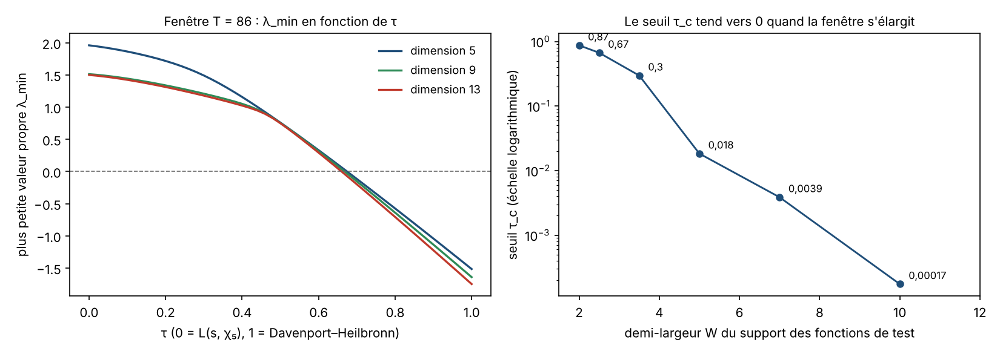

# V6.4 — Le seuil τ_c : exécution du test prioritaire de l'Atlas

**Date :** 8 octobre 2026  
**Statut :** test exécuté, verdict rendu. Aucune revendication sur RH.  
**Répond à :** `25_Atlas_metaphores_physique_mathematique_V6.pdf` (§2, §5, §6 et « Priorité proposée »).

## 1. Ce que l'Atlas demandait

Garder la partie globale fixe (facteur gamma, conducteur 5) et remplacer progressivement la clé locale de L(s, χ₅) par celle de Davenport–Heilbronn [DH36b] [DH36a] (DH) :

  M_T(τ) = M_∞(T) + M_q(T) + (1 − τ)·M_loc^L(T) + τ·M_loc^DH(T),  M_T(τ)·v = λ·G·v.

Le seuil τ_c est le point où la plus petite valeur propre λ_min(T, τ) s'annule. L'Atlas fixe la règle : « rejet immédiat si la racine τ_c n'est pas stable ».

| Protocole de l'Atlas (§5) | Fait |
|---|---|
| Fenêtres T = 86, 113, 167, 176 | oui |
| Balayage de τ puis recherche de la racine | oui (racine à 10⁻¹² près) |
| Dimensions 5, 7, 9, conditionnement enregistré | oui, étendu à 11 et 13 |
| Deux quadratures indépendantes | oui, plus un troisième calcul par les zéros |
| Même protocole pour le contrôle L(s, χ₅) | L(s, χ₅) est le point τ = 0 du trajet |
| Carte à deux clés (τ, δ) (§6) | oui |

## 2. Résultat en bref

1. **Le seuil existe et il est unique**, pour une raison élémentaire : λ_min(τ) est concave.
2. **Il est reproductible** : le calcul par les zéros et le calcul par les premiers (Gauss–Legendre) donnent le même nombre à six chiffres ; la quadrature adaptative s'en écarte à la quatrième décimale dans une fenêtre.
3. **Ce n'est pas un invariant.** Il baisse quand la dimension augmente, il change d'une fenêtre à l'autre (0,66 à 0,96), et il tend vers 0 quand le support des fonctions de test s'élargit (0,87 à W = 2 ; 0,0002 à W = 10).
4. **Ce n'est pas une transition de phase.** Quand τ varie, aucun zéro ne bouge : τ ne fait que changer le poids relatif de deux listes de zéros fixes.
5. **La carte à deux clés n'apporte rien** : elle est la courbe 1D décalée, exactement.

Selon la règle de l'Atlas, le « seuil du vide » ne survit pas comme observable intrinsèque. Il reste une mesure exacte de ce que la fenêtre choisie arrive à voir.

## 3. Le seuil, par trois calculs

Côté premiers par quadrature adaptative, côté premiers par Gauss–Legendre, et côté zéros (somme directe sur les zéros de L(s, χ₅) et de DH jusqu'à |t| = 600) :

| T | dimension | τ_c, premiers (adaptative) | τ_c, premiers (Gauss–Legendre) | τ_c, zéros | conditionnement de G |
|---:|---:|---:|---:|---:|---:|
| 86 | 5 | 0,674248 | 0,674248 | 0,674248 | 1,1·10⁴ |
| 86 | 7 | 0,671913 | 0,671913 | 0,671913 | 5,3·10⁵ |
| 86 | 9 | 0,667617 | — | 0,667617 | 2,3·10⁷ |
| 113 | 5 | 0,909962 | 0,909962 | 0,909962 | 1,1·10⁴ |
| 113 | 7 | 0,906774 | 0,906774 | 0,906774 | 5,3·10⁵ |
| 113 | 9 | 0,902366 | — | 0,902366 | 2,3·10⁷ |
| 176 | 5 | 0,872239 | 0,872239 | 0,872239 | 1,1·10⁴ |
| 176 | 7 | 0,859510 | 0,859481 | 0,859481 | 5,3·10⁵ |
| 176 | 9 | 0,828736 | — | 0,828311 | 2,3·10⁷ |

Écart maximal avec le côté zéros : 1,2·10⁻⁷ pour Gauss–Legendre, 4,3·10⁻⁴ pour la quadrature adaptative (à T = 176).

Au passage : l'écart de 1,4·10⁻⁶ relevé à T = 176 dans le document 23 venait de la quadrature adaptative, pas du conditionnement ni de la liste de zéros. Gauss–Legendre y coïncide avec les zéros à 2·10⁻⁹ près.

## 4. Pourquoi le seuil existe toujours, et ce qu'il vaut

Les termes globaux sont communs aux deux objets (même conducteur, même parité). Donc

  M_T(τ) = (1 − τ)·M^L(T) + τ·M^DH(T),

et, par la formule explicite (V6.3b/c), chaque forme est une somme sur des zéros :

  M_T(τ) = (1 − τ)·Σ_{zéros de L} H_i(γ)H_j(γ) + τ·Σ_{zéros de DH} H_i(γ)H_j(γ).

Trois conséquences exactes :

- **Les zéros ne bougent pas.** Le trajet τ ne décrit pas une fonction dont les zéros quitteraient la droite. Il mélange, avec les poids 1 − τ et τ, les zéros de L (tous sur la droite) et ceux de DH (dont une paire hors droite par fenêtre).
- **λ_min(τ) est concave** : c'est le minimum, sur les directions v, de fonctions linéaires de τ. Positive en τ = 0, négative en τ = 1, elle coupe zéro une fois et une seule. Vérifié sur les 12 courbes calculées (différence seconde toujours négative).
- **Le seuil est un rapport de masses.** Sur la direction critique v, λ = (1 − τ)·a + τ·b, d'où τ_c = a/(a − b), avec a la part des zéros de L et b celle des zéros de DH.

| T | a : zéros de L | zéros de DH sur la droite | zéros de DH hors droite | τ_c = a/(a − b) |
|---:|---:|---:|---:|---:|
| 86 | +3,036 | +0,037 | **−1,504** | 0,674 |
| 113 | +3,057 | +0,051 | **−0,353** | 0,910 |
| 167 (W = 3,5) | +3,717 | +0,009 | **−0,183** | 0,955 |
| 176 | +3,737 | +0,253 | **−0,801** | 0,872 |

(dimension 5.) Le seuil dit combien pèse, vue par la fenêtre, la paire de zéros hors droite de DH contre les zéros de L.

## 5. Stabilité : ce qui tient, ce qui ne tient pas

**En méthode : oui.** Voir §3.

**En dimension : dérive lente, toujours vers le bas.**

| T | dim. 5 | dim. 7 | dim. 9 | dim. 11 | dim. 13 | variation |
|---:|---:|---:|---:|---:|---:|---:|
| 86 | 0,674 | 0,672 | 0,668 | 0,660 | 0,660 | −2,1 % |
| 113 | 0,910 | 0,907 | 0,902 | 0,900 | 0,899 | −1,2 % |
| 167 (W = 3,5) | 0,955 | 0,952 | 0,948 | 0,940 | 0,937 | −1,9 % |
| 176 | 0,872 | 0,859 | 0,828 | 0,822 | 0,819 | −6,1 % |

Cette baisse n'est pas un artefact numérique. Les espaces de test sont emboîtés : en ajouter ne peut que faire baisser λ_min, donc τ_c.

**En largeur de fenêtre : non.** Même centre (T = 85,7, sur le zéro hors droite 0,8085 + 85,699i), dimension 9, demi-largeur W du support variable :

| W | premiers utilisés jusqu'à | λ_min pour L | λ_min pour DH | τ_c |
|---:|---:|---:|---:|---:|
| 1,5 | 20 | +3,0811 | +1,63 | aucun |
| 2,0 | 54 | +2,4375 | −0,42 | 0,872 |
| 2,5 | 148 | +1,5128 | −1,62 | 0,669 |
| 3,5 | 1 096 | +0,6674 | −5,33 | 0,297 |
| 5,0 | 22 026 | +0,0184 | −17,56 | 0,018 |
| 7,0 | 1 202 604 | +0,0006 | −10,63 | 0,00387 |
| 10,0 | 485 165 195 | +0,0001 | −4,59 | 0,00017 |

- À W = 1,5 (premiers jusqu'à 20), la fenêtre ne voit pas le zéro hors droite : DH y paraît positif, il n'y a pas de seuil.
- Plus la fenêtre s'élargit, plus le seuil s'effondre.

C'est le critère de Weil [Wei52] : dès que τ > 0, le mélange contient des zéros hors droite avec un poids positif, et une fonction de test assez fine finit par les isoler. Sur l'espace de toutes les fonctions de test, le seuil vaut 0. **Les valeurs finies de τ_c mesurent le pouvoir de résolution de la fenêtre, pas une propriété de L ou de DH.**

## 6. La carte à deux clés (τ, δ)

L'Atlas (§6) propose M(T; τ, δ) = M_∞ + (1 + δ)·M_q + … Or M_q = log(q/π)·F₀ et F₀ est la matrice de Gram G elle-même. Ajouter δ·M_q revient donc à ajouter δ·log(5/π)·G, ce qui décale toutes les valeurs propres généralisées de la même quantité :

  λ_min(T; τ, δ) = λ_min(T; τ) + δ·log(5/π),  log(5/π) ≈ 0,465.

Vérifié sur 100 points (écart maximal 9,9·10⁻¹³). La « frontière DUAL-LOCK » dans le plan (τ, δ) est la courbe δ = −λ_min(τ)/0,465 : la courbe 1D redessinée. L'étape 4 de l'arbre de décision ne peut rien apprendre de plus.

## 7. Autres témoins : le seuil suit les zéros hors droite, pas le produit d'Euler

Même test entre ζ et les deux témoins du document 24 (dimension 5, W = 2,5 ; ici les conducteurs diffèrent, on interpole les formes entières) :

| Trajet | T | λ_min pour ζ | λ_min pour le témoin | τ_c |
|---|---:|---:|---:|---:|
| ζ → E2 | 18 | 3,1·10⁻⁶ | −1,428 | 7,5·10⁻⁶ |
| ζ → E2 | 27 | 7,7·10⁻⁵ | −1,500 | 1,5·10⁻⁴ |
| ζ → E2 | 45 | 5,9·10⁻⁴ | −1,380 | 2,6·10⁻² |
| ζ → F6 | 18 | 3,1·10⁻⁶ | +0,009 | aucun |
| ζ → F6 | 27 | 7,7·10⁻⁵ | +0,006 | aucun |
| ζ → F6 | 45 | 5,9·10⁻⁴ | +0,012 | aucun |

- ζ → E2 (produit d'Euler, zéros hors droite) : il y a un seuil.
- ζ → F6 (pas de produit d'Euler, zéros sur la droite) : aucun seuil, λ_min reste positive sur tout le trajet. C'est forcé par la concavité.

Le seuil ne détecte donc pas la « compatibilité entre clé locale et clé globale ». Il détecte la présence de zéros hors droite à l'arrivée.

## 8. Verdict, dans l'arbre de décision de l'Atlas

| Étape | Question de l'Atlas | Réponse |
|---|---|---|
| 1. Instrument | Formule, conventions, coefficients, quadratures vérifiés ? | Oui : V6.3b/c (premiers = zéros) et ici (trois calculs). |
| 2. Seuil 1D | τ_c stable en dimension et en méthode ? | En méthode oui. En dimension il dérive, en largeur il s'effondre. Selon la règle de l'Atlas : pas un observable intrinsèque. |
| 3. Contrôles | Distingue-t-il L(s, χ₅) de DH, résiste-t-il à d'autres témoins ? | Il distingue les objets qui ont des zéros hors droite des autres (§7). Rien de plus que DUAL-LOCK. |
| 4. Carte 2D | La frontière a-t-elle une forme stable ? | Sans objet : translation exacte de la courbe 1D (§6). |
| 5. Théorie | Loi de stabilité démontrable ? | Celle qui existe est le critère de Weil. Le test y ramène. |

## 9. Audit de l'Atlas

| Affirmation de l'Atlas | Statut |
|---|---|
| Rodgers–Tao [RT20] : Λ ≥ 0 ; RH ⟺ Λ = 0 (§5) | Exact. |
| Facteurs de cancellation ≈ 6, 30, 52, 17 après V6.3a (§3.2) | Exact (6,4 ; 29,8 ; 52,3 ; 17,1 dans `dual_lock_audit_canonical.csv`). |
| « Un zéro hors droite vient avec ses partenaires » (§4.2) | Exact, et vérifié : chaque direction négative est portée par un quadruplet (V6.3b, et §4 ici). |
| « τ_c mesure combien il faut déformer la clé locale avant qu'une direction négative apparaisse dans cette compression » (§2) | Exact tel qu'écrit. Les mots « dans cette compression » portent tout : le nombre dépend de la compression. |
| « Il ne nécessite pas de supposer où se trouvent les zéros » (§5) | Exact pour la construction. Mais le résultat est, à 10⁻⁹ près, une somme sur les zéros. |
| « Transition de phase », « seuil du vide » (§5) | L'image casse : rien ne transite, les zéros sont fixes. La ressemblance avec de Bruijn–Newman [DeB50] [New76] est formelle (là, les zéros bougent et se rencontrent). |
| Carte à deux clés (§6) | Triviale (§6 ici). |
| Question directrice : pourquoi la compatibilité premiers/global interdirait-elle un zéro hors droite ? | Déjà répondu en V6.3d : sous la forme mesurable (produit d'Euler + équation fonctionnelle), elle ne l'interdit pas (témoin E2). Il faut en plus une borne de taille locale, et la question redevient GRH. |
| Entropie : ne pas en inventer (§4.3) | D'accord. |
| Étape 1 : « certifiés » | À remplacer par « vérifiés par recoupement », comme dans le document 22. |

L'Atlas s'arrête à l'audit V6.3a et ne cite pas les documents 23 et 24 (V6.3b à V6.3f). Plusieurs de ses questions ouvertes y ont déjà une réponse.

## 10. Propositions

1. **Registre (document 20)** : « Transition de phase / seuil du vide » passe de « test prioritaire » à « testé, non intrinsèque ». « Vide arithmétique » reste une paraphrase du critère de Weil.
2. **Ce qui peut être gardé** : la **portée de détection**. À fenêtre donnée, quelle largeur W (donc combien de nombres premiers) faut-il pour voir un zéro hors droite ? Ici entre 1,5 et 2,0 pour le zéro de DH à 85,7, soit des premiers jusqu'à 20 à 54. C'est une propriété de l'instrument, utile pour le banc d'audit, sans portée sur RH.
3. **Atlas** : mettre à jour la question directrice et le §7 avec les quatre coins (document 24), retirer la carte à deux clés.
4. **Ne pas lancer** de variante du seuil (autre base, autre déformation) : la concavité et le critère de Weil donnent le résultat d'avance.

**Suite (V6.5) :** la version correcte de la « transition de phase », où les zéros bougent vraiment et où les seuils sont intrinsèques, est dans le document 27.

## 11. Limites

- Listes de zéros jusqu'à |t| = 600 ; pour W ≥ 5 le côté premiers n'a pas été calculé (trop de termes), seul le côté zéros l'a été.
- Conditionnement de G jusqu'à 4·10¹⁰ en dimension 13 à W = 2,5 : les deux dernières dimensions n'ont que le côté zéros.
- Le balayage en largeur est fait sur une seule fenêtre.
- « Sur l'espace de toutes les fonctions de test, le seuil vaut 0 » est le critère de Weil appliqué au mélange ; je ne l'ai pas redémontré, seulement observé la tendance.

## Fichiers

- Script : `3_Preuves_et_calculs/scripts/run_tau_threshold.py` (environ 4 minutes ; `--figure` pour la figure seule).
- Données : `tau_threshold.csv`, `tau_threshold_curve.csv`, `tau_threshold_2d.csv`, `tau_threshold_width.csv`, `tau_threshold_witnesses.csv`, `tau_threshold.png`.
- Tests : `tests/test_v64_tau_threshold.py` (6 tests).

## Correctif V6.7 (document 29)

- Le point 3 du résumé (« il tend vers 0 quand le support s'élargit ») n'a été mesuré qu'à la hauteur 85,7, où il reste vrai (0,87 à W = 2 ; 0,0002 à W = 10). Aux trois autres zéros hors droite de DH (114,2 ; 166,5 ; 176,7), le seuil n'est pas monotone en W et remonte à 0,5–0,97 pour W = 10.
- Le seuil se calcule sans balayage : τ_c = −1/μ_min, μ_min plus petite valeur propre de (M_DH − M_L)·v = μ·M_L·v (accord à 10⁻⁹ avec la bissection, 26 cas sur 26).
- C'est un seuil de la forme (interpolation des matrices). En interpolant les fonctions elles-mêmes, les quatre paires hors droite de DH apparaissent à des seuils fixes θ = 0,602 ; 0,646 ; 0,937 ; 0,280, sans fenêtre (document 29, §7).

<!-- references:debut -->

## Références

Format : [clé] auteurs, *titre*, publication, lien. Fiches complètes et état de vérification : document 42 (registre des sources).

- [DeB50] N. G. de Bruijn. *The roots of trigonometric integrals*. Duke Math. J. 17 (1950), 197–226. <https://en.wikipedia.org/wiki/De_Bruijn%E2%80%93Newman_constant> — partiellement vérifié
- [DH36a] H. Davenport, H. Heilbronn. *On the zeros of certain Dirichlet series*. J. London Math. Soc. 11 (1936), no. 3, 181–185. <https://doi.org/10.1112/jlms/s1-11.3.181> — partiellement vérifié
- [DH36b] H. Davenport, H. Heilbronn. *On the zeros of certain Dirichlet series. II*. J. London Math. Soc. 11 (1936), no. 4, 307–312. <https://doi.org/10.1112/jlms/s1-11.4.307> — partiellement vérifié
- [New76] C. M. Newman. *Fourier transforms with only real zeros*. Proc. Amer. Math. Soc. 61 (1976), 245–251. <https://en.wikipedia.org/wiki/De_Bruijn%E2%80%93Newman_constant> — partiellement vérifié
- [RT20] B. Rodgers, T. Tao. *The De Bruijn–Newman constant is non-negative*. Forum Math. Pi 8 (2020), e6 ; arXiv:1801.05914. <https://arxiv.org/abs/1801.05914> — vérifié en ligne
- [Wei52] A. Weil. *Sur les « formules explicites » de la théorie des nombres premiers*. Comm. Sém. Math. Univ. Lund, vol. suppl. dédié à M. Riesz (1952), 252–265. <https://en.wikipedia.org/wiki/Weil%27s_criterion> — partiellement vérifié

<!-- references:fin -->
