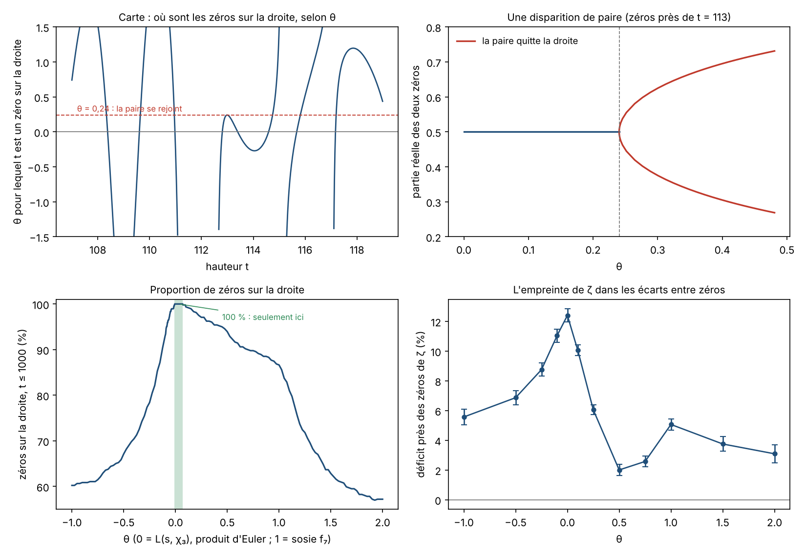

# V6.5 — Là où les zéros bougent : RH ne tient qu'au point d'Euler

**Date :** 8 octobre 2026  
**Statut :** expérience exécutée. Ce qui est mesuré et ce qui est supposé sont séparés au §7 ; ce qui est démontré, au §8 (ajouté en V6.5.1).  
**Origine :** piste 1 tirée de l'Atlas (document 25), après l'échec du seuil τ_c (document 26).

## 1. La question, formulée avec l'hypothèse de l'auteur

Hypothèse de travail du programme : *RH n'existe que parce qu'elle est nécessaire à quelque chose de plus grand, qui la rend nécessaire.*

Version testable : prendre une famille de fonctions où **tout ce qui est visible globalement reste constant** (même équation fonctionnelle, même facteur gamma, même conducteur, coefficients réels, même premier coefficient), et où une seule chose varie : la présence d'un produit d'Euler. Si RH tenait pour des raisons globales, elle tiendrait partout dans la famille. Si elle ne tient qu'au point où la structure supplémentaire existe, c'est cette structure qui la porte.

Le test du document 26 ne pouvait pas répondre : aucun zéro n'y bougeait. Ici, ils bougent.

## 2. La famille

Modulo 7, il y a trois caractères impairs : un réel, χ₃ (le symbole de Legendre), et deux complexes conjugués, χ₁ et son conjugué.

- **L(s, χ₃)** a un produit d'Euler.
- **f₇ = (L(s, χ₁) + ε·L(s, χ̄₁))/(1 + ε)**, avec ε le nombre racine de χ₁, est un sosie de type Davenport–Heilbronn [DH36b] [DH36a] : coefficients réels, pas de produit d'Euler.
- Les deux vérifient la **même** équation fonctionnelle : Λ(s) = (7/π)^((s+1)/2)·Γ((s+1)/2)·F(s) = Λ(1 − s).

La famille est **F_θ = (1 − θ)·L(s, χ₃) + θ·f₇**. Elle garde l'équation fonctionnelle pour tout θ ; le produit d'Euler n'existe qu'en θ = 0.

| Objet | θ | défaut d'équation fonctionnelle | défaut multiplicatif |
|---|---:|---:|---:|
| L(s, χ₃) | 0,0 | 6,7·10⁻¹⁴ | 0 |
| F₀,₅ (mélange à parts égales) | 0,5 | 4,3·10⁻¹⁴ | 0,484 |
| f₇ | 1,0 | 6,4·10⁻¹⁴ | 0,455 |

Recoupé par mpmath (écart 10⁻¹²). À cause de l'équation fonctionnelle et des coefficients réels, les zéros ne peuvent quitter la droite critique qu'en se rencontrant deux à deux.

**La carte.** Sur la droite, F_θ se ramène à une fonction réelle Z_θ(t) = (1 − θ)·Z₀(t) + θ·Z₁(t), linéaire en θ. Un point t est un zéro pour exactement une valeur de θ :

  θ*(t) = Z₀(t)/(Z₀(t) − Z₁(t)).

Le graphe de θ* est donc la carte complète des zéros sur la droite (premier panneau de la figure). Entre deux zéros voisins de L(s, χ₃), il forme soit une branche qui part à l'infini, soit une **bosse** de hauteur finie h. Dans ce second cas, les deux zéros se rejoignent et quittent la droite quand θ atteint h. Ces seuils ne dépendent d'aucune fenêtre ni d'aucune base.

## 3. Résultat 1 — RH ne tient qu'autour du point d'Euler, et la plage se referme

L(s, χ₃) a 958 zéros pour t ≤ 1000, tous sur la droite (comptage par le principe de l'argument jusqu'à 200 : 140 sur 140). Plage de θ où **tous** les zéros jusqu'à la hauteur T restent sur la droite :

| Hauteur T | zéros | borne côté θ < 0 | borne côté θ > 0 | largeur de la plage |
|---:|---:|---:|---:|---:|
| 25 | 10 | −0,2486 | +1,316 | 1,565 |
| 50 | 24 | −0,2486 | +0,657 | 0,906 |
| 100 | 59 | −0,0157 | +0,617 | 0,632 |
| 200 | 140 | −0,0157 | +0,240 | 0,256 |
| 400 | 325 | −0,0107 | +0,182 | 0,193 |
| 700 | 630 | −0,0107 | +0,095 | 0,106 |
| 1000 | 958 | −0,0096 | +0,072 | 0,081 |

Pour 958 zéros, RH ne tient plus que pour θ entre −0,0096 et +0,072. Chaque nouvelle tranche de hauteur peut resserrer la plage, jamais l'élargir.

Proportion de zéros sur la droite (t ≤ 1000, sur 958) :

| θ | zéros sur la droite | proportion |
|---:|---:|---:|
| −1,00 | 577 | 60,2 % |
| −0,50 | 643 | 67,1 % |
| −0,10 | 891 | 93,0 % |
| −0,02 | 948 | 99,0 % |
| 0 (produit d’Euler) | 958 | 100,0 % |
| +0,05 | 958 | 100,0 % |
| +0,10 | 952 | 99,4 % |
| +0,25 | 930 | 97,1 % |
| +0,50 | 900 | 93,9 % |
| +1,00 | 830 | 86,6 % |
| +2,00 | 548 | 57,2 % |

Contrôle du total par le principe de l'argument (t ≤ 200) : en θ = 0,5, 140 zéros dont 4 hors droite ; pour le sosie, 140 dont 18 hors droite. Le nombre total de zéros ne change pas : ils se déplacent.

## 4. Résultat 2 — comment un zéro quitte la droite

Toujours de la même façon : deux zéros voisins se rapprochent, se touchent, puis partent de part et d'autre de la droite (deuxième panneau). Exemple suivi : les zéros 112,80 et 113,40 se rejoignent pour θ = 0,240.

- Après la rencontre, l'écart à la droite croît comme la **racine** de (θ − θ_c) : exposant mesuré 0,50, pour 0,5 attendu.
- **Le seuil d'une paire suit l'écart entre ses deux zéros.** Sur les 451 bosses : corrélation de rang 0,71 ; le seuil varie comme l'écart à la puissance 1,76 (attendu : 2). Les cinq seuils les plus bas appartiennent aux paires de rang 1, 2, 3, 4 et 8 par ordre d'écart.

C'est la « Distance de sécurité » du registre, vue de l'extérieur : ce sont les zéros les plus proches qui cèdent en premier, et comme il existe des paires de plus en plus serrées quand on monte, la plage de survie se referme.

## 5. Résultat 3 — le danger vient d'un seul côté

Sur les 100 seuils les plus bas, **89 sont du côté θ < 0** (sur l'ensemble des bosses : moitié-moitié). S'éloigner du sosie est bien plus dangereux pour les paires serrées que s'en approcher.

Explication probable : les deux fonctions ont le même terme principal. Au milieu d'une bosse, Z₁ a le signe de Z₀ dans 85 % des cas, et 89 % pour les 100 seuils les plus bas. Ajouter un peu de f₇ soutient donc la bosse ; en retrancher la creuse. Le point d'Euler n'est pas au milieu de sa plage de survie : il est près du bord.

## 6. Résultat 4 — l'empreinte de ζ culmine au point d'Euler

Même statistique que le document 24 (§7.3) : parmi les différences entre zéros (sur la droite) de F_θ, combien tombent près d'un zéro de ζ, par rapport au hasard ?

| θ | zéros utilisés | déficit près des zéros de ζ |
|---:|---:|---:|
| −1,00 | 577 | 5,6 % ± 0,5 |
| −0,50 | 643 | 6,9 % ± 0,5 |
| −0,25 | 751 | 8,8 % ± 0,4 |
| −0,10 | 891 | 11,0 % ± 0,4 |
| 0 (produit d’Euler) | 958 | 12,4 % ± 0,4 |
| +0,10 | 952 | 10,1 % ± 0,4 |
| +0,25 | 930 | 6,1 % ± 0,3 |
| +0,50 | 900 | 2,0 % ± 0,4 |
| +0,75 | 860 | 2,6 % ± 0,4 |
| +1,00 | 830 | 5,1 % ± 0,4 |
| +1,50 | 602 | 3,8 % ± 0,5 |
| +2,00 | 548 | 3,1 % ± 0,6 |

Le déficit est maximal en θ = 0 (12,4 %), tombe à 2,0 % en θ = 0,5 et vaut 5,1 % pour le sosie, comme pour Davenport–Heilbronn au document 24.

Deux propriétés différentes culminent donc au même point : la **position** de chaque zéro (100 % sur la droite) et l'**arrangement collectif** des zéros (ils « connaissent » ceux de ζ).

## 7. Lecture selon l'hypothèse

**Ce qui est mesuré.**

1. La symétrie globale ne rend pas RH nécessaire. Dans une famille qui la conserve entièrement, RH tombe dès qu'on quitte le point d'Euler, et la marge se referme avec la hauteur.
2. Au point d'Euler, et là seulement, les zéros de L(s, χ₃) portent au maximum la trace d'une autre fonction, ζ.
3. La marge est déjà presque nulle d'un côté (0,0096 pour 958 zéros) et elle diminue avec la hauteur. Si elle tend vers zéro, ce qui rend RH nécessaire ne peut pas être une inégalité avec du jeu : il faut quelque chose d'exact.

**Ce qui est supposé.**

- Que la plage se referme jusqu'à zéro. C'est attendu (résultats de Bombieri–Hejhal [BH95] sur les combinaisons de fonctions L, cités de mémoire), mais je ne l'ai observé que jusqu'à t = 1000.
- Que la trace de ζ soit la signature du « plus grand ». Voici pourquoi c'est une candidate sérieuse : le produit de χ₃ par lui-même est le caractère trivial, donc L(s, χ₃) « au carré tensoriel » redonne ζ (à un facteur près). Un produit d'Euler n'est jamais seul : il vit dans une famille fermée par produit, dont ζ est l'unité. Le sosie f₇ n'appartient à aucune famille de ce genre.

Dans les quatre cas où un analogue de RH est un théorème, il découle d'une structure plus grande : positivité sur une surface (courbes sur les corps finis), stabilité par produits tensoriels (Deligne), opérateur auto-adjoint (Selberg) [Sel56], interactions ferromagnétiques (Lee–Yang) [LY52]. Ce que montre la famille modulo 7 va dans le sens du deuxième mécanisme : ce qui disparaît quand on quitte le point d'Euler, c'est l'appartenance à une famille fermée par produit, et la trace de ζ disparaît avec.

## 8. Ce qui rend une RH nécessaire, là où c'est prouvé

Question de l'auteur : qu'est-ce qui, parmi les choses démontrées, rend RH nécessaire ?

Pour ζ, rien de démontré ne rend RH entière nécessaire. Mais des morceaux de RH sont démontrés, et des analogues complets aussi. Voici ce qui les force (énoncés classiques, cités de mémoire) :

| Résultat démontré | Ce qu'il force | Ce qui le rend nécessaire |
|---|---|---|
| Hadamard, de la Vallée Poussin (1896) [Had96] | aucun zéro de ζ (ni d'une fonction L de Dirichlet) sur Re s = 1 | le produit d'Euler, plus un carré : 3 + 4cos x + cos 2x = 2(1 + cos x)² ≥ 0 [Mer98] |
| Hardy (1914) [Har14], Selberg (1942) [Sel42], Levinson (1974) [Lev74], Conrey (1989) [Con89] ; 2026 selon le document 13 | une infinité, puis une proportion (1/3, 2/5, 2/3) de zéros sur la droite | l'équation fonctionnelle (fonction réelle sur la droite) et le produit d'Euler (pour amortir) |
| Weil (1948) [Wei48] | RH entière pour les courbes sur les corps finis | une positivité sur un objet plus grand : la surface « courbe × courbe » |
| Deligne (1974) [Del74] | RH entière pour les variétés sur les corps finis | les puissances tensorielles de l'objet, et la positivité de leurs coefficients |
| Selberg (1956) | les zéros de sa fonction zêta sur la droite | un opérateur auto-adjoint : son spectre est réel |
| Lee, Yang (1952) | les zéros d'une fonction de partition sur le cercle | le caractère ferromagnétique des interactions |
| Rodgers, Tao (2018) | si RH est vraie, c'est sans marge (Λ ≥ 0) | — |

**Le schéma est toujours le même.** Trois ingrédients : (1) un objet plus grand que la fonction, obtenu en la multipliant par elle-même ou par ses variantes (un produit, une surface, un espace) ; (2) sur cet objet, une positivité qui est un théorème ; (3) un zéro mal placé rendrait négatif ce qui est positif. RH n'est jamais démontrée « en regardant les zéros » : elle tombe comme conséquence.

**Où cela s'arrête pour ζ.** Le premier mécanisme est démontré et donne la droite Re s = 1. Pour descendre jusqu'à 1/2, les cas résolus disposent d'un objet de plus : une surface (Weil), une famille géométrique (Deligne), un espace de Hilbert (Selberg). Pour ζ, cet objet n'est pas construit. C'est la « Scène manquante » du registre.

**Vérification dans la famille modulo 7.** Le morceau démontré de RH, « aucun zéro à droite de 1 », tient-il ailleurs qu'au point d'Euler ? Comptage par le principe de l'argument, 0 < t ≤ 1000 :

| θ | zéros à droite de Re s = 0,75 | zéros à droite de Re s = 1 | zéro le plus à droite |
|---:|---:|---:|---|
| −1 | 173 | **139** | 1,693 (t = 51,1) |
| −0,5 | 127 | **71** | 1,354 (t = 51,1) |
| 0 (produit d’Euler) | 0 | **0** | 0,5 : tous sur la droite |
| +0,5 | 12 | **0** | 0,882 (t = 249,6) |
| +1 (sosie f₇) | 50 | **5** | 1,061 (t = 249,4) |

Au point d'Euler, rien à droite de 1, comme le théorème l'exige ; et rien non plus à droite de la droite critique, ce qui est observé et non démontré. Le sosie f₇ a 5 zéros à droite de 1 (le plus à droite est confirmé par mpmath à 30 chiffres). Même la partie démontrée de RH disparaît donc avec le produit d'Euler : c'est bien lui, et la positivité qu'il permet, qui la rend nécessaire.

**Lien avec les instruments du corpus.** PRIME-LOCK mesure l'hypothèse du premier mécanisme (les coefficients de −F′/F portés par les puissances de premiers, avec la bonne taille). DUAL-LOCK mesure la positivité dont la démonstration manque. L'empreinte de ζ (§6) montre le produit de L(s, χ₃) par elle-même.

## 9. Suites proposées

1. **Apprendre la signature d'une nécessité connue.** Refaire les deux mesures (plage de survie, empreinte) dans le Modèle réduit du registre, une courbe sur un corps fini, où l'on sait pourquoi RH est vraie. Si la signature y a la même forme, on saura quoi chercher du côté de ζ. **Fait en V6.6 : document 28.**
2. **Mesurer la fermeture de la plage.** Pousser à t = 5000 et comparer la vitesse de fermeture à ce que donne la répulsion entre zéros (seuil ∝ écart², plus petit écart parmi N zéros ∝ N^(−1/3)).
3. **Mettre à jour l'Atlas** : « transition de phase » et « création de paire » ont ici un pendant exact, avec des seuils intrinsèques.

## 10. Limites

- Une seule famille, un seul conducteur, t ≤ 1000.
- Le tableau du §8 résume des théorèmes classiques de mémoire ; les mécanismes y sont décrits en une ligne, donc simplifiés.
- L'empreinte est calculée sur les seuls zéros restés sur la droite.
- L'explication de l'asymétrie (§5) est un argument de signe, pas une démonstration.
- Évaluations en double précision, recoupées par mpmath sur un échantillon.

## 11. Noms proposés pour le registre

| Nom | Image | Énoncé exact | Où l'image casse |
|---|---|---|---|
| **Le Point d'Euler** | Le seul endroit de la route où tout est aligné. | θ = 0 dans F_θ : seul point où 100 % des zéros sont sur la droite et où l'empreinte de ζ est maximale. | Une seule famille testée. |
| **La Plage de survie** | La bande de terrain sec qui rétrécit quand la marée monte. | Intervalle de θ où tous les zéros jusqu'à T restent sur la droite : [−0,0096 ; +0,072] pour T = 1000. | Observée, pas démontrée, au-delà de 1000. |
| **La Rencontre** | Deux danseurs se rejoignent sur la ligne et la quittent ensemble. | Deux zéros voisins se touchent en θ_c, puis s'écartent de la droite comme √(θ − θ_c). | Aucune « annihilation » : le nombre de zéros est conservé. |

## Fichiers

- Code : `src/family_mod7.py`, `scripts/run_family_mod7.py` (environ 2 minutes 30 ; `--figure` pour la figure seule), `scripts/run_family_mod7_proved_part.py` (environ 13 minutes).
- Données : `family_mod7_checks.csv`, `_intervals.csv`, `_survival.csv`, `_proportion.csv`, `_pair.csv`, `_imprint.csv`, `_diagram.csv`, `_right_count.csv`, `_rightmost.csv`, `family_mod7.png`.
- Tests : `tests/test_v65_family_mod7.py` (7 tests), plus un recoupement dans `tests/test_v64_mpmath_crosscheck.py`.

<!-- references:debut -->

## Références

Format : [clé] auteurs, *titre*, publication, lien. Fiches complètes et état de vérification : document 42 (registre des sources).

- [BH95] E. Bombieri, D. A. Hejhal. *On the distribution of zeros of linear combinations of Euler products*. Duke Math. J. 80 (1995), 821–862. <https://arxiv.org/abs/0704.3448> — partiellement vérifié. **Correctif V6.18 :** Bombieri–Hejhal montrent (sous RH pour chaque fonction et une hypothèse d'espacement) que 100 % des zéros, en densité, sont sur la droite ; la fermeture de la plage de survie n'en découle pas directement : elle reste une attente du corpus.
- [Con89] J. B. Conrey. *More than two fifths of the zeros of the Riemann zeta function are on the critical line*. J. reine angew. Math. 399 (1989), 1–26 ; annonce : Bull. AMS 20 (1989), 79–81. <https://www.ams.org/bull/1989-20-01/S0273-0979-1989-15704-2/> — partiellement vérifié
- [Del74] P. Deligne. *La conjecture de Weil. I*. Publ. Math. IHÉS 43 (1974), 273–307 ; DOI 10.1007/BF02684373. <https://www.numdam.org/item/PMIHES_1974__43__273_0/> — vérifié en ligne
- [DH36a] H. Davenport, H. Heilbronn. *On the zeros of certain Dirichlet series*. J. London Math. Soc. 11 (1936), no. 3, 181–185. <https://doi.org/10.1112/jlms/s1-11.3.181> — partiellement vérifié
- [DH36b] H. Davenport, H. Heilbronn. *On the zeros of certain Dirichlet series. II*. J. London Math. Soc. 11 (1936), no. 4, 307–312. <https://doi.org/10.1112/jlms/s1-11.4.307> — partiellement vérifié
- [Had96] J. Hadamard ; Ch.-J. de la Vallée Poussin. *Sur la distribution des zéros de la fonction ζ(s) et ses conséquences arithmétiques ; Recherches analytiques sur la théorie des nombres premiers*. Bull. SMF 24 (1896), 199–220 ; Ann. Soc. Sci. Bruxelles 20 (1896), 183–256 (non vérifiés). <https://people.math.harvard.edu/~elkies/M259.06/free.pdf> — partiellement vérifié. **Correctif V6.18 :** Le théorème est d'Hadamard et de la Vallée Poussin (1896) ; l'inégalité 3 + 4 cos x + cos 2x ≥ 0 est la version de Mertens (1898) [Mer98].
- [Har14] G. H. Hardy. *Sur les zéros de la fonction ζ(s) de Riemann*. C. R. Acad. Sci. Paris 158 (1914), 1012–1014. <https://proofwiki.org/wiki/Critical_Line_Theorem> — partiellement vérifié
- [Lev74] N. Levinson. *More than one third of zeros of Riemann's zeta-function are on σ = 1/2*. Adv. Math. 13 (1974), 383–436. <https://www.proofwiki.org/wiki/At_Least_One_Third_of_Zeros_of_Riemann_Zeta_Function_on_Critical_Line/Historical_Note> — partiellement vérifié
- [LY52] T. D. Lee, C. N. Yang. *Statistical theory of equations of state and phase transitions. II. Lattice gas and Ising model*. Phys. Rev. 87 (1952), 410–419 ; DOI 10.1103/PhysRev.87.410. <https://link.aps.org/doi/10.1103/PhysRev.87.410> — partiellement vérifié
- [Mer98] F. Mertens. *Über eine Eigenschaft der Riemannschen ζ-Function*. Sitzungsber. Kais. Akad. Wiss. Wien, Math.-Naturwiss. Cl. 107 (1898), 1429–1434 (non vérifié). <https://people.math.harvard.edu/~elkies/M259.06/free.pdf> — partiellement vérifié
- [Sel42] A. Selberg. *On the zeros of Riemann's zeta-function*. Skr. Norske Vid. Akad. Oslo I, no. 10 (1942), 1–59. <https://en.wikipedia.org/wiki/Selberg%27s_zeta_function_conjecture> — partiellement vérifié
- [Sel56] A. Selberg. *Harmonic analysis and discontinuous groups in weakly symmetric Riemannian spaces with applications to Dirichlet series*. J. Indian Math. Soc. 20 (1956), 47–87. <https://informaticsjournals.com/index.php/jims/article/view/16985> — partiellement vérifié
- [Wei48] A. Weil. *Sur les courbes algébriques et les variétés qui s'en déduisent*. Actualités Sci. Ind. 1041, Hermann, Paris (1948). <https://denisevellachemla.eu/Weil-courbes-varietes.pdf> — partiellement vérifié. **Correctif V6.18 :** Le mémoire Sur les courbes… établit directement la positivité par correspondances, intersections et Riemann–Roch. La fiche précédente le résumait trop exclusivement par la jacobienne ; ne pas confondre ce mémoire et celui sur les variétés abéliennes.

<!-- references:fin -->
