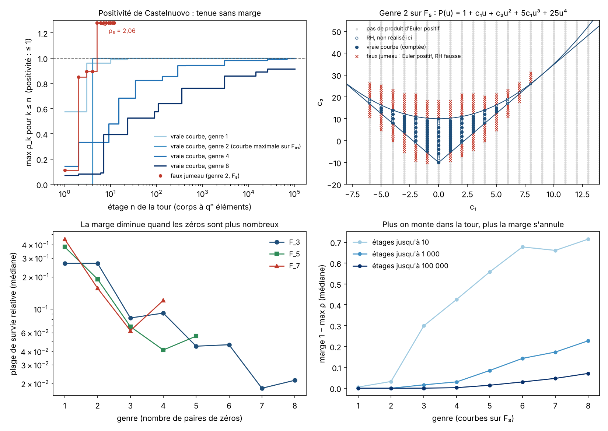

# V6.6 — Le Modèle réduit : à quoi ressemble une nécessité démontrée

**Date :** 8 octobre 2026  
**Statut :** expérience exécutée sur un terrain où RH est un théorème. Les parallèles avec ζ sont au §7 ; ce qui est mesuré et ce qui est supposé, au §8.  
**Suite de :** document 27, §9, proposition 1.

## 1. La question

Le document 27 a montré que, dans une famille qui conserve toute la structure globale, RH ne tient qu'au point d'Euler, avec une marge qui se referme. Le §8 du même document a établi que, dans tous les cas démontrés, ce qui rend une RH nécessaire est une positivité sur un objet plus grand.

Ici, on se place là où cet objet existe et où la positivité est un théorème : les courbes sur les corps finis. On cherche **la signature d'une nécessité démontrée**, pour savoir quoi chercher du côté de ζ.

## 2. Le modèle

Une courbe C : y² = f(x) sur le corps fini à q éléments, f de degré 2g + 1 sans facteur carré (genre g).

- **Comptages** : N_n = nombre de points de C sur le corps à qⁿ éléments.
- **Fonction zêta** : Z(u) = P(u)/((1 − u)(1 − qu)), avec P(u) = Π(1 − α_i u), polynôme de degré 2g. En posant u = q^−s^, les zéros de P sont sur la droite Re s = 1/2 exactement quand |α_i| = √q.
- **Équation fonctionnelle** : P(u) = q^g^·u^2g^·P(1/(qu)).
- **Produit d'Euler** : Z(u) = Π_d (1 − u^d^)^−a_d^, où a_d est le nombre de points fermés de degré d, un entier positif ou nul.
- **RH** est un théorème (Weil, 1948).
- **Ce qui la rend nécessaire** : sur la surface C × C, le graphe du Frobenius itéré n fois et la diagonale ont une forme d'intersection qui doit être positive (inégalité de Castelnuovo [MT58] [Wei48]). Pour chaque étage n, cela s'écrit

  Q_n(r, s) = g·r² − (N_n − qⁿ − 1)·r·s + g·qⁿ·s² ≥ 0,  soit ρ_n = |N_n − qⁿ − 1| / (2g·q^n/2^) ≤ 1.

  Si ρ_n ≤ 1 à tous les étages, RH suit ; et RH implique ρ_n ≤ 1. La suite des corps à qⁿ éléments est la **tour**.

## 3. Résultat 1 — les vraies courbes

425 courbes tirées au hasard : genre 1 à 8 sur F₃, 1 à 5 sur F₅, 1 à 4 sur F₇, 25 par cas.

- N_1, …, N_g sont comptés directement, P(u) en est déduit, puis N_(g+1) est **recompté** et comparé à la prédiction : 425 sur 425 exacts.
- RH : écart maximal ||α|/√q − 1| = 7,9·10⁻⁹ (arrondi du calcul des racines).
- Positivité de Castelnuovo, en arithmétique entière exacte, à tous les étages jusqu'à 60 : 425 sur 425.

## 4. Résultat 2 — équation fonctionnelle et produit d'Euler ne suffisent pas

On parcourt tous les polynômes P à coefficients entiers qui vérifient l'équation fonctionnelle (genre 1 et 2, sur F₃ et F₅), et on garde ceux dont le produit d'Euler a des comptages a_d entiers positifs ou nuls (vérifié jusqu'à d = 200). Ce sont des « courbes » parfaitement plausibles du point de vue local et global. Parmi elles :

| Cas | polynômes examinés | produit d'Euler positif | dont RH vraie | vraies courbes trouvées | **faux jumeaux** (Euler positif, RH fausse) | démasqués à l'étage |
|---|---:|---:|---:|---:|---:|---:|
| F_3, genre 1 | 13 | 8 | 7 | 7 | **1** | 1 |
| F_3, genre 2 | 915 | 74 | 57 | 32 | **17** | 2 à 5 |
| F_5, genre 1 | 21 | 12 | 9 | 9 | **3** | 1 |
| F_5, genre 2 | 1 785 | 326 | 127 | 81 | **199** | 2 à 5 |

- Aucun faux jumeau n'est une courbe : le théorème de Weil l'interdit, et aucune des courbes comptées n'en donne un.
- En genre 2, tous les faux jumeaux respectent la borne de Weil à l'étage 1 : rien ne les trahit au premier comptage.
- **Ce que le produit d'Euler positif donne à lui seul** : pour les 216 faux jumeaux de genre 2 (17 sur F₃, 199 sur F₅), |α| < q, c'est-à-dire aucun zéro sur Re s = 1. C'est exactement le niveau du théorème de de la Vallée Poussin [Had96] pour ζ (document 27, §8).

**Exemple.** P(u) = 1 + u − 8u² + 5u³ + 25u⁴ sur F₅ :

| étage n | N_n | a_n (points fermés de degré n) | ρ_n |
|---:|---:|---:|---:|
| 1 | 7 | 7 | 0,11 |
| 2 | 9 | 1 | 0,85 |
| 3 | 166 | 53 | 0,89 |
| 4 | 545 | 134 | 0,81 |
| 5 | 3 587 | 716 | 2,06 **> 1** |
| 6 | 14 742 | 2 429 | 1,77 **> 1** |

Des comptages entiers et positifs à tous les étages, une équation fonctionnelle exacte, et pourtant RH est fausse. La positivité de Castelnuovo le révèle à l'étage 5.

## 5. Résultat 3 — la positivité tient, mais sans marge

Pour une vraie courbe, ρ_n ≤ 1 à tous les étages. Mais le maximum de ρ_n sur les étages se rapproche de 1 quand on monte dans la tour (marge médiane 1 − max ρ, courbes sur F₃) :

| genre | étages ≤ 10 | étages ≤ 1 000 | étages ≤ 100 000 | plage de survie relative (§6) |
|---:|---:|---:|---:|---:|
| 1 | 0,006 | 0,000 | 0,0000 | 0,268 |
| 2 | 0,032 | 0,000 | 0,0000 | 0,268 |
| 3 | 0,300 | 0,016 | 0,0003 | 0,082 |
| 4 | 0,426 | 0,031 | 0,0027 | 0,092 |
| 5 | 0,557 | 0,085 | 0,0144 | 0,045 |
| 6 | 0,677 | 0,143 | 0,0303 | 0,046 |
| 7 | 0,661 | 0,173 | 0,0472 | 0,018 |
| 8 | 0,715 | 0,228 | 0,0711 | 0,021 |

- La marge s'annule dans la tour, d'autant plus tard que le genre est grand.
- Elle peut même être **exactement nulle** à un étage fini. La courbe y² = x⁵ + x³ + 1 sur F₃ (genre 2, P(u) = 1 + 9u⁴) a N_4 = 118 = 3⁴ + 1 + 2·2·3² points sur le corps à 81 éléments : l'inégalité devient une égalité.

C'est la propriété « RH vraie, mais sans marge » (Rodgers–Tao [RT20] pour ζ, plage qui se referme au document 27), **sur un terrain où RH est démontrée**. Ce qui la démontre ne laisse aucun jeu : c'est une inégalité exacte de géométrie, qui peut être saturée.

## 6. Résultat 4 — la plage de survie

Perturbation qui conserve l'équation fonctionnelle (déplacement du coefficient central de P, écrit sous forme symétrique) : pour chaque courbe, la plage où les 2g zéros restent sur la droite est **positive**, puisqu'il y a un nombre fini de zéros. Elle diminue quand le genre augmente (dernière colonne du tableau ci-dessus, et troisième panneau de la figure) : plus il y a de zéros, plus il y a de paires serrées, plus la marge est mince. Pour ζ, avec une infinité de zéros, la marge se referme (document 27).

## 7. Le Modèle réduit et ζ, côte à côte

| Signature | Modèle réduit (RH démontrée) | ζ et L(s, χ) |
|---|---|---|
| Équation fonctionnelle | oui | oui |
| Produit d'Euler à comptages positifs | oui | oui |
| Ces deux propriétés suffisent-elles ? | non : 220 faux jumeaux entiers | non : E2 (document 24) |
| Ce que le produit d'Euler positif donne seul | aucun « zéro sur Re s = 1 » | aucun zéro sur Re s = 1 (1896) |
| Positivité indexée par une tour | Q_n ≥ 0 à chaque étage n (démontré) | forme de Weil [Wei52] positive dans chaque fenêtre T (équivaut à RH, non démontré) |
| Les faux sont démasqués à un étage fini | oui (étages 2 à 5) | oui : DUAL-LOCK voit DH dans des fenêtres finies (documents 23, 26) |
| La marge tend vers 0 | oui, le long de la tour | oui : Λ ≥ 0 ; plage qui se referme (document 27) |
| L'objet qui porte la positivité | la surface C × C | **non construit** |

## 8. Lecture selon l'hypothèse

**Mesuré.** Dans le Modèle réduit, la nécessité de RH a une signature en quatre traits : (1) l'équation fonctionnelle et le produit d'Euler ne suffisent pas ; (2) une positivité indexée par une tour démasque les faux à un étage fini ; (3) cette positivité tient sans marge, parfois exactement ; (4) elle vient d'un objet d'un étage au-dessus, la surface C × C, sur laquelle vivent toutes les itérations du Frobenius à la fois.

Pour ζ, les traits (1), (2) et (3) sont observés dans le corpus. **ζ présente toutes les signatures observables d'une nécessité démontrée, sauf l'objet qui la porte.**

**Supposé.** Que cet objet existe pour ζ. C'est précisément ton hypothèse, et c'est aussi le programme de plusieurs mathématiciens (Connes [Con99], Consani et d'autres, cités de mémoire), qui cherchent l'analogue de C × C pour les entiers.

**Une question divergente qui en sort : quel est l'étage n de ζ ?** Dans le modèle, la tour est faite des itérations du Frobenius, et c'est ce qui rend la positivité contraignante. Pour ζ, il n'y a pas de Frobenius. Candidats : les fenêtres T de DUAL-LOCK (déjà mesurées, mais leur positivité n'est pas démontrée), les corps de nombres de plus en plus grands (dont les fonctions zêta contiennent ζ comme facteur), ou un flot continu qui remplacerait les itérations (la piste de Connes). **Réponse partielle en V6.8 (document 30, §8) : dans les espaces de fonctions à équation fonctionnelle commune, la hauteur T joue le rôle de l'étage.** **Suite en V6.9 (document 32) : le flot continu est le chaînon F = q^D ; la tour se lit dans les zéros comme spectre des longueurs, et ce qui manque à ζ est la métrique positive, pas l'opérateur.**

## 9. Suites proposées

1. **La forme de Weil du modèle.** Construire, pour une courbe, l'analogue exact de DUAL-LOCK (formule explicite, fonctions de test) et vérifier qu'elle se ramène aux formes de Castelnuovo. Cela relierait l'instrument du corpus à la positivité démontrée, terme à terme. **Fait en V6.7 en version discrète (matrice de Toeplitz des comptages) : document 29.**
2. **La tour cyclotomique.** Pour ζ, suivre une mesure de positivité le long des corps cyclotomiques (fonctions zêta de Dedekind, qui contiennent ζ et les L(s, χ)), comme un candidat d'« étage n ».

## 10. Limites

- Les « vraies courbes trouvées » sont celles qui ont un modèle de degré impair ; d'autres courbes de genre 2 existent. Cela ne change rien pour les faux jumeaux : ils violent RH, donc aucune courbe ne les donne.
- La positivité des a_d est vérifiée jusqu'à d = 200 ; au-delà, elle est garantie par |α| < q, sauf pour les cas « vides » (N_1 = 0) du genre 1.
- Genre au plus 8 ; une seule perturbation pour la plage de survie.
- Inégalité de Castelnuovo et théorème de Weil cités de mémoire, sous leur forme classique.

## 11. Noms proposés pour le registre

| Nom | Image | Énoncé exact | Où l'image casse |
|---|---|---|---|
| **La Tour** | Les étages d'un immeuble, chacun contrôlé par la même règle. | Les corps à qⁿ éléments ; à chaque étage, Q_n ≥ 0. | Pour ζ, on ne sait pas ce que sont les étages. |
| **La Positivité saturée** | Une poutre chargée exactement à sa limite, qui tient. | Courbe 1 + 9u⁴ sur F₃ : ρ_4 = 1 exactement. | Saturation à un étage, pas à tous. |
| **Le Faux jumeau entier** | Un faux billet avec un vrai filigrane. | Équation fonctionnelle, comptages entiers positifs, RH fausse ; démasqué à l'étage 2 à 5. | Ne vient d'aucune géométrie. |

## Fichiers

- Code : `src/function_field.py` (corps finis par tables, comptage de points, fonction zêta, formes de Castelnuovo, plage de survie), `scripts/run_reduced_model.py` (environ 15 secondes ; `--figure` pour la figure seule).
- Données : `reduced_model_curves.csv`, `reduced_model_fakes.csv`, `reduced_model_example.csv`, `reduced_model_tower.csv`, `reduced_model.png`.
- Tests : `tests/test_v66_reduced_model.py` (7 tests).

<!-- references:debut -->

## Références

Format : [clé] auteurs, *titre*, publication, lien. Fiches complètes et état de vérification : document 42 (registre des sources).

- [Con99] A. Connes. *Trace formula in noncommutative geometry and the zeros of the Riemann zeta function*. Selecta Math. (N.S.) 5 (1999), 29–106 ; arXiv:math/9811068. <https://arxiv.org/abs/math/9811068> — vérifié en ligne
- [Had96] J. Hadamard ; Ch.-J. de la Vallée Poussin. *Sur la distribution des zéros de la fonction ζ(s) et ses conséquences arithmétiques ; Recherches analytiques sur la théorie des nombres premiers*. Bull. SMF 24 (1896), 199–220 ; Ann. Soc. Sci. Bruxelles 20 (1896), 183–256 (non vérifiés). <https://people.math.harvard.edu/~elkies/M259.06/free.pdf> — partiellement vérifié. **Correctif V6.18 :** Le théorème est d'Hadamard et de la Vallée Poussin (1896) ; l'inégalité 3 + 4 cos x + cos 2x ≥ 0 est la version de Mertens (1898) [Mer98].
- [MT58] A. Mattuck, J. Tate. *On the inequality of Castelnuovo–Severi*. Abh. Math. Sem. Univ. Hamburg 22 (1958), 295–299 (volume et pages non confirmés en ligne). <https://arxiv.org/abs/1210.7459> — partiellement vérifié
- [RT20] B. Rodgers, T. Tao. *The De Bruijn–Newman constant is non-negative*. Forum Math. Pi 8 (2020), e6 ; arXiv:1801.05914. <https://arxiv.org/abs/1801.05914> — vérifié en ligne
- [Wei48] A. Weil. *Sur les courbes algébriques et les variétés qui s'en déduisent*. Actualités Sci. Ind. 1041, Hermann, Paris (1948). <https://denisevellachemla.eu/Weil-courbes-varietes.pdf> — partiellement vérifié. **Correctif V6.18 :** Le mémoire Sur les courbes… établit directement la positivité par correspondances, intersections et Riemann–Roch. La fiche précédente le résumait trop exclusivement par la jacobienne ; ne pas confondre ce mémoire et celui sur les variétés abéliennes.
- [Wei52] A. Weil. *Sur les « formules explicites » de la théorie des nombres premiers*. Comm. Sém. Math. Univ. Lund, vol. suppl. dédié à M. Riesz (1952), 252–265. <https://en.wikipedia.org/wiki/Weil%27s_criterion> — partiellement vérifié

<!-- references:fin -->
