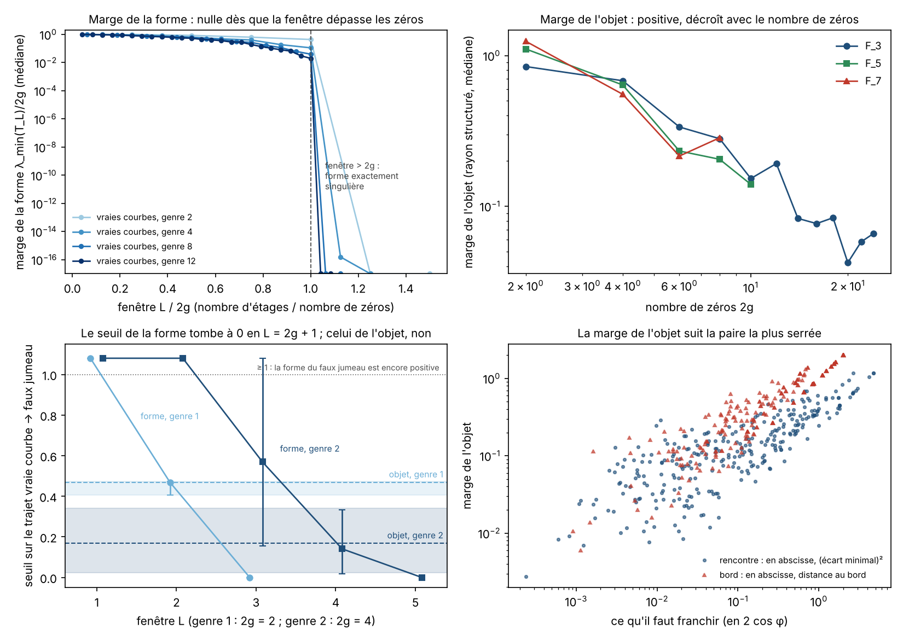
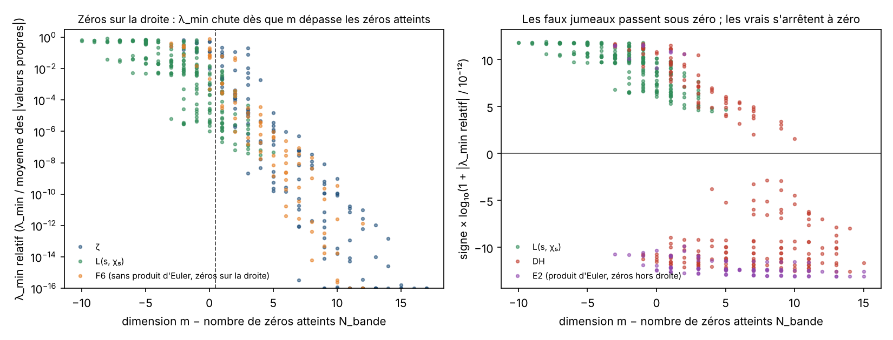
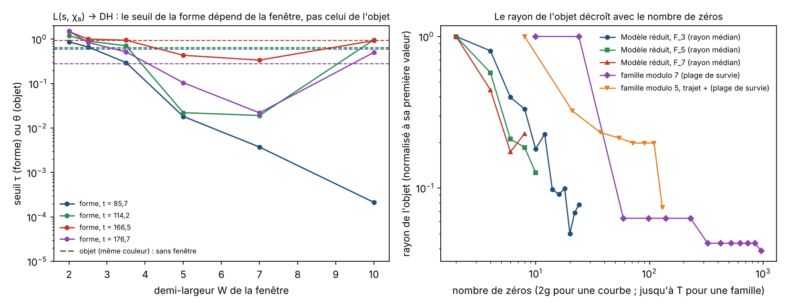

# V6.7 — STABILITY-RADIUS : la marge de la forme et la marge de l'objet

**Date :** 8 octobre 2026  
**Statut :** expériences exécutées (Modèle réduit, ζ, L(s, χ₅), Davenport–Heilbronn [DH36b] [DH36a], témoins F6 et E2). Ce qui est mesuré et ce qui est supposé sont séparés au §9.  
**Origine :** programme STABILITY-RADIUS, proposé dans une réponse reçue par l'auteur (rédigée sans la V6.6) : « quelle est la marge de stabilité de la positivité de Weil [Wei52] face à une déformation du côté local ? ».

## 1. La question et les trois issues annoncées

La proposition posait une question d'échelle : quand la fenêtre grandit, la distance d'une forme de Weil positive au bord des formes positives suit-elle une loi ? Elle annonçait trois issues :

1. pas de loi : le « vide critique » n'était qu'une image ;
2. une loi, identique pour tous les objets : un phénomène analytique universel ;
3. une loi qui sépare les vraies fonctions L des faux jumeaux et qui se rattache au produit d'Euler : un objet digne d'étude.

On l'a testée d'abord là où l'on connaît la réponse (le Modèle réduit du document 28, où RH est un théorème), puis pour ζ, L(s, χ₅), DH et les témoins.

## 2. Deux marges, deux seuils

| | Ce qu'on perturbe | Ce que c'est |
|---|---|---|
| **Marge de la forme** | n'importe quelle perturbation de la matrice de Weil | sa plus petite valeur propre λ_min (inégalité de Weyl [Wey12]) ; elle majore le λ*(L) de Zhu, infimum sur toutes les fonctions test (correctif V6.18) [Zhu26] (arXiv:2608.24827) |
| **Marge de l'objet** | seulement les données locales (comptages, coefficients), équation fonctionnelle conservée | la plus petite telle perturbation qui fait perdre la positivité (rayon structuré) |
| **Seuil de la forme** | interpolation des matrices (1 − τ)·M_L + τ·M_DH (document 26) | forme close : τ_c = −1/μ_min, avec (M_DH − M_L)·v = μ·M_L·v ; vérifiée sur les 26 cas du document 26 (accord à 10⁻⁹) |
| **Seuil de l'objet** | interpolation des fonctions elles-mêmes | le θ où une paire de zéros quitte la droite ; aucune fenêtre, aucune base |

La forme close du seuil était juste. Mais elle mesure la forme, pas l'objet. Toute la suite tient dans cette distinction.

## 3. Résultat 1 — Modèle réduit : la marge de la forme est exactement nulle au-delà du nombre de zéros

Pour une courbe de genre g (2g zéros), la forme de Weil fenêtrée est la matrice de Toeplitz T_L = (p_|m−n|), p_k = S_k/q^k/2^, construite depuis les seuls comptages de points ; la fenêtre L est le nombre d'étages de la tour.

525 courbes : les 425 du document 28, plus 100 nouvelles sur F₃ en genre 9 à 12 (recomptées à l'étage g + 1 : 525 sur 525 exactes).

- Pour L ≤ 2g, la forme est positive (marge médiane à L = 2g, sur F₃ : 0,42 en genre 1, 0,11 en genre 4, 0,02 en genre 12).
- **Dès L = 2g + 1, elle est exactement singulière** : |λ_min| ≤ 1,8·10⁻¹⁵, pour les 525 courbes. Raison : T_L = V*V, avec V la matrice de Vandermonde des 2g zéros ; son rang ne dépasse pas 2g.

**Loi d'inertie.** À la fenêtre L = 2g, le nombre de valeurs propres négatives de T_L est exactement la moitié du nombre de zéros hors de la droite. Vérifié en 60 chiffres sur 900 polynômes tirés au hasard (900 sur 900) et sur les 220 faux jumeaux (220 sur 220). En double précision, 833 sur 900 seulement : les écarts sont des arrondis, tous corrigés en 60 chiffres. La fenêtre 2g − 1 ne décide RH que dans 789 cas sur 900 : la fenêtre 2g est la plus petite qui décide toujours. (Retrouvée en V6.9 sur l'opérateur reconstruit depuis les comptages : une direction négative par paire de zéros hors cercle pour chacun des 220 faux jumeaux ; document 32, §4.)

**La marge de la forme d'un objet vrai est donc nulle, exactement, dès que la fenêtre a plus d'étages que l'objet n'a de zéros. Et RH y est démontrée.**

## 4. Résultat 2 — Modèle réduit : la marge de l'objet est positive, et c'est la paire la plus serrée qui la fixe

On n'autorise plus que les perturbations des données locales b_1, …, b_g (le polynôme normalisé reste palindromique, donc l'équation fonctionnelle est conservée). Avec l'écriture de Chebyshev B(u) = u^g^·H(u + 1/u), RH revient à dire que les g racines de H sont réelles dans [−2, 2]. On sort de cette région soit quand deux zéros se rencontrent (racine double de H), soit quand un zéro atteint le bord (racine de H en ±2). Les deux conditions sont linéaires dans la perturbation, d'où une distance en forme close, contrôlée de part et d'autre : à 0,999 fois le rayon, RH tient (525 sur 525) ; à 1,001 fois, des zéros sont hors du cercle (524 sur 524 courbes à rayon positif). Dans les tests, aucune de 300 directions tirées au hasard ne sort plus près.

Marge de l'objet médiane :

| genre | 1 | 2 | 3 | 4 | 5 | 6 | 7 | 8 | 9 | 10 | 11 | 12 |
|---|---:|---:|---:|---:|---:|---:|---:|---:|---:|---:|---:|---:|
| F₃ | 0,85 | 0,68 | 0,34 | 0,28 | 0,15 | 0,19 | 0,08 | 0,08 | 0,08 | 0,04 | 0,06 | 0,07 |
| F₅ | 1,11 | 0,64 | 0,23 | 0,20 | 0,14 | | | | | | | |
| F₇ | 1,24 | 0,55 | 0,22 | 0,28 | | | | | | | | |

- Mécanisme : en genre 1, toujours le bord ; dès le genre 6, la rencontre de deux zéros dans 80 à 92 % des cas. La marge suit l'écart le plus serré (corrélation de rang 0,82 avec le carré de l'écart minimal) ou la distance au bord (0,94).
- **Elle peut être exactement nulle pour une vraie courbe.** Une courbe sur 525 tirées au hasard a deux zéros confondus (F₅, genre 3). Parmi les 81 polynômes P réalisés par les courbes de genre 2 y² = f(x) (f de degré 5) sur F₅, 4 sont sur le bord de la région RH : P(u) = (1 + 5u²)², (1 ∓ 2u + 5u²)² (zéros confondus), (1 − 5u²)² (zéros au bord). RH y reste un théorème.
- **Le produit d'Euler ne protège presque rien.** Pour 501 courbes sur 525, la sortie la plus proche garde des comptages de points fermés positifs. Pour les 24 autres (dont 15 de genre 1 sur F₃), la sortie la plus proche imposerait un comptage négatif au degré 2, et la sortie permise est 1,1 à 29 fois plus loin.

## 5. Résultat 3 — Modèle réduit : sur le trajet vers un faux jumeau, le seuil de la forme tombe à 0, pas celui de l'objet

Pour chacun des 220 faux jumeaux, on part de la vraie courbe la plus proche et on compare les deux seuils :

| fenêtre L (genre 2, 2g = 4) | 2 | 3 | 4 | 5 |
|---|---:|---:|---:|---:|
| seuil de la forme, médiane | > 1 (aucune perte) | 0,57 | 0,14 | **0 exactement** (216 sur 216) |
| seuil de l'objet, médiane | 0,17 | 0,17 | 0,17 | 0,17 |

En genre 1 : seuil de la forme 0,47 à L = 2 (égal à celui de l'objet, la forme y étant linéaire), 0 à L = 3. Le seuil de l'objet est nul pour 47 faux jumeaux sur 216 : ceux dont la vraie courbe la plus proche est une des 4 courbes à marge nulle.

## 6. Résultat 4 — ζ, L(s, χ₅), DH, F6, E2 : la loi de rang

Même expérience sur les compressions DUAL-LOCK (côté zéros, tentes modulées de pas 0,6 autour de T, demi-largeur W, dimension m de 3 à 25 ; 725 mesures). N_bande est le nombre de zéros atteints par le lobe principal des fonctions de test. La matrice de Gram est désormais calculée en forme close : elle coïncide avec la quadrature à 10⁻¹⁵ pour T ≤ 200, mais la quadrature se dégrade aux grandes hauteurs (défaut de 6·10⁻⁵ et fausse valeur propre négative à T = 1400). Aucun résultat antérieur n'utilisait ces hauteurs.

- **Objets à zéros sur la droite** (ζ, L(s, χ₅), et F6, qui n'a pas de produit d'Euler) : λ_min n'est jamais négatif. Il chute géométriquement dès que la dimension m dépasse N_bande. C'est la version adoucie du rang 2g du Modèle réduit : avec une infinité de zéros, la forme n'est jamais exactement singulière.

| pente (décades de λ_min par dimension excédentaire) | W = 2,5 | W = 5 | W = 10 |
|---|---:|---:|---:|
| ζ | −0,85 | −0,81 | −1,14 |
| L(s, χ₅) | | −0,91 | −0,48 |
| F6 (sans produit d'Euler) | | −0,79 | −1,20 |

Dispersion autour de chaque droite : 0,55 à 1,0 décade. Les pentes sont voisines à W = 5, plus dispersées à W = 10. **F6 ne se distingue pas de ζ** : la loi de décroissance ne voit pas le produit d'Euler.

- **DH** : négatif dès m = 3 (pour W = 5 et 10) dans les quatre fenêtres centrées sur ses zéros hors droite. Loin de tout zéro hors droite, il devient négatif quand la dimension dépasse les zéros atteints de 4 à 9 : à T = 100 (zéro hors droite à 14,2), m = 7 pour W = 10 ; à T = 300 (20,9), m = 15 ; à T = 500 (20,9), m = 19. **E2** : négatif dans 78 fenêtres sur 87.

## 7. Résultat 5 — De L(s, χ₅) à DH : le seuil de l'objet est un nombre, celui de la forme dépend de la fenêtre

L(s, χ₅) n'est pas autoduale. A(s) = e^−iφ^·L(s, χ₅), avec φ la phase de la racine carrée du nombre racine (calculée par la somme de Gauss et recoupée sur la fonction elle-même), a une fonction de Hardy réelle, comme DH. Les deux trajets F_θ = (1 − θ)·(±A) + θ·DH conservent la symétrie des zéros par rapport à la droite (défaut d'imaginaire ≤ 1,2·10⁻⁹).

**Trajet +** : le nombre de zéros sur la droite pour t ≤ 200 décroît régulièrement de 130 à 122. Exactement quatre paires quittent la droite, et ce sont les quatre paires hors droite de DH :

| paire hors droite de DH | rencontre sur le trajet + | seuil de l'objet θ |
|---|---|---:|
| 0,8085 + 85,699 i | t = 85,90 | 0,602 |
| 0,6508 + 114,163 i | t = 114,34 | 0,646 |
| 0,5744 + 166,479 i | t = 166,50 | 0,937 |
| 0,7243 + 176,702 i | t = 176,97 | 0,280 |

**Trajet −** (l'autre signe de la racine carrée) : turbulent. 29 rencontres avant d'arriver à DH ; vers θ = 0,45, il ne reste que 76 zéros sur la droite sur 130, puis 129 reviennent vers θ = 0,65, et l'arrivée en garde 122. C'est l'analogue de la dissymétrie du document 27 (danger côté θ < 0).

**Seuil de la forme aux mêmes hauteurs** (dimension 9) :

| hauteur | W = 2 | 2,5 | 3,5 | 5 | 7 | 10 | seuil de l'objet |
|---|---:|---:|---:|---:|---:|---:|---:|
| 85,7 | 0,87 | 0,67 | 0,30 | 0,018 | 0,0037 | 0,0002 | 0,602 |
| 114,2 | 1,20 | 0,91 | 0,71 | 0,022 | 0,019 | 0,97 | 0,646 |
| 166,5 | 1,48 | 1,00 | 0,95 | 0,43 | 0,34 | 0,93 | 0,937 |
| 176,7 | 1,51 | 0,84 | 0,52 | 0,10 | 0,022 | 0,50 | 0,280 |

**Correctif au document 26.** « Le seuil tend vers 0 quand le support s'élargit » n'était vrai qu'à la hauteur 85,7, la seule mesurée. Aux trois autres zéros hors droite de DH, le seuil de la forme n'est pas monotone et remonte à 0,5–0,97 pour W = 10. Le seuil de la forme est une propriété de la fenêtre ; celui de l'objet, une propriété de l'objet.

## 8. Résultat 6 — La marge de l'objet selon le nombre de zéros

| source | ce qui est mesuré | pente log-log |
|---|---|---:|
| Modèle réduit, F₃ / F₅ / F₇ | rayon de l'objet médian contre 2g (norme des coefficients) | −1,25 / −1,33 / −1,22 |
| famille modulo 7 (document 27) | plage de survie contre nombre de zéros jusqu'à T | −0,70 |
| famille modulo 5, trajet + | plage de survie contre nombre de zéros jusqu'à T | −0,70 |

Les deux familles de type ζ ont la même pente, −0,70. C'est proche de −2/3, ce que donnerait une marge proportionnelle au carré du plus petit écart entre zéros si les écarts suivaient la statistique des matrices aléatoires : heuristique, non démontré. Le Modèle réduit est mesuré dans une autre norme ; seule la décroissance se compare.

## 9. Réponse aux trois issues, et lecture selon l'hypothèse

**Mesuré.**

- *Y a-t-il une loi d'échelle ?* Oui, pour la marge de la forme : elle chute géométriquement dès que la dimension dépasse le nombre de zéros atteints. Dans le Modèle réduit, la chute est totale et exacte (rang 2g).
- *Est-elle la même pour tous ?* Oui : ζ, L(s, χ₅) et F6 (sans produit d'Euler) suivent la même loi. C'est l'issue 2, un phénomène analytique : il compte les zéros, il ne voit pas l'arithmétique.
- *Sépare-t-elle les vrais des faux ?* Par le signe, oui : les vrais s'arrêtent à zéro, les faux passent dessous (DH, E2, les 220 faux jumeaux). Par la loi de décroissance, non.
- *Se rattache-t-elle au produit d'Euler ?* La marge de la forme, non. La marge de l'objet, à peine : dans le modèle, le produit d'Euler ne bloque la sortie la plus proche que pour 24 courbes sur 525.

**Ce que le Modèle réduit ajoute.** Là où RH est nécessaire, démontrée par la surface C × C, les deux marges peuvent être nulles : celle de la forme toujours, dès que la fenêtre dépasse les zéros ; celle de l'objet pour les courbes dont deux zéros se confondent. Aucune vraie courbe ne sort pour autant. Ce qui rend RH nécessaire n'agit donc pas en éloignant les objets du bord. Il interdit le passage : aucune perturbation qui sort de la région RH ne correspond à une courbe.

**Lecture selon l'hypothèse.** Le « vide critique » de la proposition est exact, mais pour la forme, et il est le régime normal d'une positivité qui vient d'un étage au-dessus. La question utile n'est donc plus « quelle est la marge ? ». C'est « qu'est-ce qui interdit le passage ? ». Dans le modèle, c'est l'objet d'en haut. Pour ζ, c'est la même place vide qu'au document 28.

**Supposé.** Que, pour ζ aussi, la nécessité de RH soit une interdiction de passage et non une distance au bord. Rien ici ne le démontre ; c'est ce que dit le modèle, et c'est compatible avec tout ce qui est mesuré pour ζ.

**Question divergente.** Dans le modèle, une courbe à zéros confondus est au bord, et pourtant aucune courbe voisine n'est de l'autre côté. Pour ζ : parmi les déformations qui gardent l'équation fonctionnelle et qui sortent de la droite, y en a-t-il une seule qui garde un produit d'Euler ? Dans les deux familles testées (modulo 7, document 27 ; L → DH, ici), seul le point de départ a un produit d'Euler : aucune des directions de sortie testées n'en garde un.

## 10. Suites proposées

1. **La forme de Weil du modèle en fonctions de test continues.** Reprendre le cadre de Zhu (fenêtre [−L, L] centrée en 0) dans le Modèle réduit, pour voir sa loi en N(T*) devenir la chute exacte au rang 2g.
2. **Interdiction de passage pour ζ.** Dans l'espace des fonctions à équation fonctionnelle fixée (conducteurs 5 et 7), chercher la direction de sortie la plus proche, puis tester si elle peut garder un produit d'Euler (multiplicativité des coefficients) au premier ordre. **Fait en V6.8 : document 30 (réponse : non ; dans ces espaces, RH implique le produit d'Euler).**
3. **Le trajet turbulent.** Expliquer pourquoi l'un des deux signes de la racine carrée donne un transport propre et l'autre 29 rencontres.

## 11. Limites

- Modèle réduit : genre au plus 12, courbes hyperelliptiques de degré impair seulement ; la marge de l'objet est mesurée dans la norme des coefficients du polynôme normalisé (une autre norme changerait les valeurs, pas les zéros exacts).
- Le contrôle d'Euler au point de sortie porte sur les sorties candidates (minima locaux et bords), pas sur tout le bord de la région RH.
- ζ, L, DH : compressions côté zéros, listes de zéros jusqu'à 600 (L, DH) ou 1 500 (ζ) ; N_bande est un comptage approché du lobe principal ; une dimension n'est mesurée que si sa matrice de Gram a un conditionnement inférieur à 10¹⁰.
- Trajets L → DH : deux trajets, t ≤ 200.
- Les exposants du §8 sont ajustés sur peu de points ; la comparaison avec −2/3 est heuristique.

## 12. Noms proposés pour le registre

| Nom | Image | Énoncé exact | Où l'image casse |
|---|---|---|---|
| **Le Rang** | Plus d'inconnues que d'équations : il reste des directions libres. | Fenêtre L > 2g : la forme de Weil d'une vraie courbe est exactement singulière ; pour ζ, chute géométrique de λ_min avec la dimension excédentaire. | Pour ζ, la chute n'est jamais totale. |
| **Le Recensement** | Un appel où chaque absent répond « absent ». | À la fenêtre 2g, nombre de valeurs propres négatives = zéros hors droite / 2 (900 sur 900, 220 sur 220). | Exact dans le modèle seulement ; pour DH, une direction par quadruplet (document 23). |
| **La Rencontre figée** | Deux danseurs arrêtés au moment où ils se rejoignent. | Vraie courbe à deux zéros confondus : marge de l'objet nulle, RH démontrée. | Aucune courbe voisine ne franchit : la rencontre ne se poursuit pas. |
| **Le Passage interdit** | Une porte au ras du mur, mais murée. | Marge nulle sans sortie : aucune perturbation qui sort de RH n'est une courbe. | Formulé dans le modèle ; pour ζ, c'est la question ouverte. |

## Fichiers

- Code : `src/stability_radius.py` (forme de Weil fenêtrée, écriture de Chebyshev, rayon structuré en forme close, seuils de la forme et de l'objet, comptages d'Euler réels), `src/family_mod5.py` (trajets L(s, χ₅) → DH), `src/dual_lock_audit.py` (ajout : `gram_matrix_closed`).
- Scripts : `scripts/run_stability_model.py` (environ 5 minutes, plus 3 minutes la première fois pour compter les courbes de genre 9 à 12), `scripts/run_rank_law.py` (quelques secondes), `scripts/run_object_vs_form.py` (quelques secondes ; lit les sorties du premier). Chacun accepte `--figure`.
- Données : `stability_model_*.csv`, `rank_law*.csv`, `family_mod5_intervals.csv`, `object_vs_form.csv`, `structured_scaling.csv`, figures `stability_model.png`, `rank_law.png`, `object_vs_form.png`.
- Tests : `tests/test_v67_stability_radius.py` (8 tests).

<!-- references:debut -->

## Références

Format : [clé] auteurs, *titre*, publication, lien. Fiches complètes et état de vérification : document 42 (registre des sources).

- [DH36a] H. Davenport, H. Heilbronn. *On the zeros of certain Dirichlet series*. J. London Math. Soc. 11 (1936), no. 3, 181–185. <https://doi.org/10.1112/jlms/s1-11.3.181> — partiellement vérifié
- [DH36b] H. Davenport, H. Heilbronn. *On the zeros of certain Dirichlet series. II*. J. London Math. Soc. 11 (1936), no. 4, 307–312. <https://doi.org/10.1112/jlms/s1-11.4.307> — partiellement vérifié
- [Wei52] A. Weil. *Sur les « formules explicites » de la théorie des nombres premiers*. Comm. Sém. Math. Univ. Lund, vol. suppl. dédié à M. Riesz (1952), 252–265. <https://en.wikipedia.org/wiki/Weil%27s_criterion> — partiellement vérifié
- [Wey12] H. Weyl. *Das asymptotische Verteilungsgesetz der Eigenwerte linearer partieller Differentialgleichungen*. Math. Ann. 71 (1912), 441–479 (non vérifié). — non vérifié
- [Zhu26] X. Zhu. *Weil positivity in compact windows: a finite reduction, certified two-sided bounds, and a Landau–Widom decay law*. arXiv:2608.24827 (v2, sept. 2026). <https://arxiv.org/abs/2608.24827> — vérifié en ligne. **Correctif V6.18 :** λ*(L) est un infimum variationnel sur toutes les fonctions test de support [−L, L] ; la plus petite valeur propre d'une matrice de Weil de taille finie en est un majorant (Zhu, remarque 2.2).

<!-- references:fin -->
