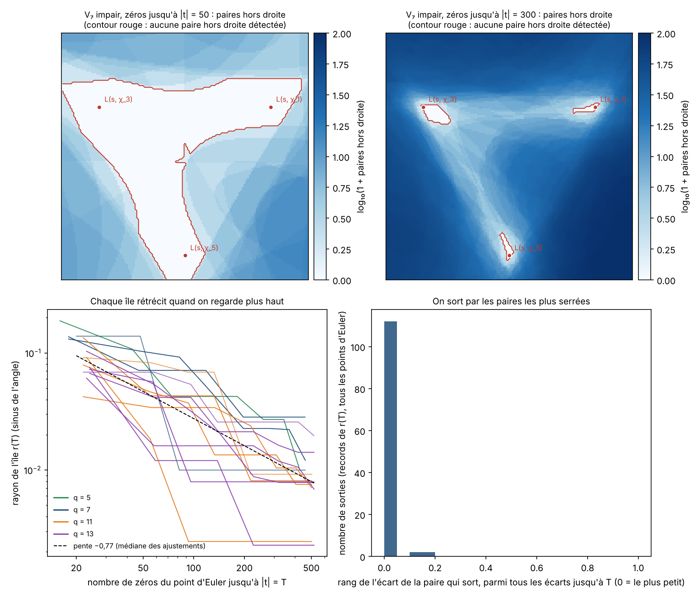

# V6.8 — L'Archipel d'Euler : parmi les fonctions qui ont l'équation fonctionnelle, RH n'existe qu'aux points d'Euler

**Date :** 9 octobre 2026  
**Statut :** résultats démontrés (cités ou prouvés ici, §3) et expériences exécutées (§4 à §7). Ce qui est mesuré et ce qui est supposé sont séparés au §9.  
**Suite de :** document 29, §10, suite 2 : « dans l'espace des fonctions qui ont l'équation fonctionnelle, chercher la sortie la plus proche, puis tester si elle peut garder un produit d'Euler ».

## 1. La question

Le document 29 a montré que, là où RH est démontrée (Modèle réduit), la nécessité n'éloigne pas les objets du bord : elle interdit le passage. Pour ζ, la question devenait : parmi les fonctions qui ont la même équation fonctionnelle, existe-t-il une sortie de RH qui garde un produit d'Euler ?

## 2. Le terrain : les espaces V_q

Pour q premier et une parité fixée, V_q est l'ensemble des combinaisons réelles

  F_c(s) = Σ_χ c_χ · e^−iφ_χ^ · L(s, χ),

sur les caractères primitifs χ modulo q de cette parité, où φ_χ est la moitié de l'argument du nombre racine. Toutes ces fonctions ont la même équation fonctionnelle (symétrie de Hardy) : leurs zéros sont symétriques par rapport à la droite critique, et une paire ne peut quitter la droite qu'en passant par un zéro double. Les **points d'Euler** sont les axes : une seule L(s, χ). Ailleurs, pas de produit d'Euler. Le trajet de L(s, χ₅) à DH (document 29) et la famille modulo 7 (document 27) sont des chemins dans ces espaces.

| q | parité | dimension | caractères (indice k : χ(g^j^) = e^2πijk/(q−1)^, g racine primitive) |
|---:|---|---:|---|
| 1 | paire | 1 | ζ |
| 3 | impaire | 1 | 1 (réel) |
| 5 | paire | 1 | 2 (réel) |
| 5 | impaire | 2 | 1, 3 |
| 7 | paire | 2 | 2, 4 |
| 7 | impaire | 3 | 1, 3 (réel), 5 |
| 11 | paire | 4 | 2, 4, 6, 8 |
| 11 | impaire | 5 | 1, 3, 5 (réel), 7, 9 |
| 13 | paire | 5 | 2, 4, 6 (réel), 8, 10 |
| 13 | impaire | 6 | 1, 3, 5, 7, 9, 11 |

Au total, 27 points d'Euler dans les espaces de dimension au moins 2.

## 3. Ce qui est démontré

**3.1. ζ n'a pas de voisine.** Une série de Dirichlet qui a l'équation fonctionnelle de ζ ((s − 1)^m^·F(s) entière d'ordre fini ; correctif V6.18) est un multiple de ζ (Hamburger, 1921 [Ham21]). Dans son propre espace, ζ est seule : aucune déformation qui garde la série de Dirichlet et l'équation fonctionnelle. Dans V₃ impair et V₅ pair, de dimension 1, il n'y a pas non plus d'autre direction **à l'intérieur de V_q** ; mais parmi toutes les séries de Dirichlet de conducteur 5 et de parité paire, (1 + 5^1/2−s^)·ζ(s) a la même équation fonctionnelle que L(s, (·/5)) (avec un pôle) *(correctif V6.13, pré-relecture : la phrase précédente, « même chose dans V₅ pair », était fausse hors de V_q)*. (V_q ne contient que les L(s, χ) primitives ; l'espace complet des fonctions à équation fonctionnelle de conducteur q contient aussi des produits par des polynômes de Dirichlet, comme (1 + q^1/2−s^)·ζ(s), le type du témoin F6.)

**3.2. Le produit d'Euler et l'équation fonctionnelle ensemble ne se déforment pas.** En degré 1, les seules fonctions de la classe de Selberg sont les L(s + iθ, χ), χ primitif (Kaczorowski–Perelli [KP99], 1999). La seule déformation continue qui garde les deux structures est la translation verticale, qui laisse les zéros sur la droite.

**3.3. Proposition (prouvée ici ; élémentaire, sans antécédent trouvé) : rigidité au premier ordre dans V_q.** En un point d'Euler a = u·χ, la perturbation dans la direction b = u'·χ' (χ' ≠ χ) a pour défaut de multiplicativité au premier ordre

  a(1)·b(mn) + b(1)·a(mn) − a(m)·b(n) − b(m)·a(n) = u·u'·(χ' − χ)(m)·(χ' − χ)(n),  (m, n) = 1.

*Preuve.* Développer, en utilisant χ(mn) = χ(m)χ(n). Pour une combinaison Σ c_χ' u_χ' χ', le défaut est la fonction (a, b) ↦ Σ c_χ' u_χ' (χ' − χ)(a)(χ' − χ)(b) sur les classes inversibles modulo q (toutes atteintes par des nombres premiers distincts). Le coefficient de χ'⊗χ' n'y vient que du terme χ' : par orthogonalité des caractères de (Z/qZ)* × (Z/qZ)*, le défaut est nul seulement si tous les c_χ' le sont. ∎

**Dans V_q, aucune direction qui garde l'équation fonctionnelle ne garde le produit d'Euler, même au premier ordre**, en dehors de l'échelle. (Hors de V_q, d'autres directions gardent l'équation fonctionnelle, comme (1 + q^1/2−s^)·ζ(s) en parité paire.) *Pré-relecture V6.13 : la formule vaut pour tous m, n, pas seulement premiers entre eux ; pour une direction transverse b = Σ~χ′≠χ~ β~χ′~ u~χ′~ χ′ (β réels) au point d'Euler λ·u~χ~·L(s, χ), la moyenne du carré du défaut sur les paires de classes inversibles mod q vaut exactement λ²·(3·Σβ² + |Σβu|²) ≥ 3λ²·Σβ², ce qui vaut mieux que les valeurs propres tronquées ci-dessous.* Vérifié pour les 27 points d'Euler : plus petite valeur propre du défaut entre 2,36 et 3,27, contre 10⁻²⁸ pour l'échelle.

**3.4. Hors des points d'Euler, RH est fausse, et massivement.** Pour une série de Dirichlet à coefficients périodiques qui n'est pas de la forme P(s)·L(s, χ) (P polynôme de Dirichlet), il existe η > 0 tel que, pour tous 1/2 < σ₁ < σ₂ < 1 + η, le nombre de zéros dans σ₁ < Re s < σ₂, |Im s| ≤ T, est compris entre c₁T et c₂T (Saias–Weingartner [SW09], 2009). Dans V_q (q premier), P(s)·L(s, χ₀) n'est atteint que par les multiples d'une seule L : en comparant les coefficients aux grands nombres premiers ℓ, il faudrait Σ c_χ χ(ℓ) = p(1)·χ₀(ℓ) ; comme il y a des nombres premiers dans toutes les classes (théorème de Dirichlet), cela vaut pour toutes les classes modulo q, et l'orthogonalité des caractères donne c_χ = p(1) pour le seul χ qui coïncide avec χ₀, 0 pour les autres.

*Correctif V6.13 (pré-relecture) : cette déduction a un trou comblable (les phases u_χ ont disparu des formules ; le caractère χ₀ de Saias–Weingartner peut avoir un module quelconque, d'où la nécessité de travailler modulo ppcm(q, Q) ; les cas p(1) = 0, χ₀ trivial ou de mauvaise parité, c = 0 ne sont pas traités). Le plus simple est de citer directement leur Théorème 2 : une combinaison d'au moins deux L(s, ψ) primitives, à coefficients polynômes de Dirichlet non nuls, a ≫ T zéros distincts dans σ₁ < Re s < σ₂ pour tous 1/2 ≤ σ₁ < σ₂ ≤ 1 + η.*

**Conséquence.** Dans V_q, toute fonction qui vérifie RH (et même toute fonction sans zéro dans Re s > 1) est un point d'Euler ; pour c ≠ 0, c'est même une équivalence : pas de zéro dans Re s > 1 ⟺ point d'Euler. C'est démontré, sans hypothèse, mais **ce n'est pas nouveau** : c'est un cas particulier immédiat de Saias–Weingartner (2009, Théorème 2), et aussi de Booker–Thorne [BT14] (2014, Théorème 1.2). La réciproque (tout point d'Euler vérifie RH) est l'hypothèse de Riemann généralisée pour les L(s, χ), vérifiée numériquement ici jusqu'à |t| = 300 et bien au-delà par d'autres.

## 4. Mesuré : les îles

Autour de chaque point d'Euler e_χ, on cherche la fonction la plus proche (en angle) qui a un zéro double de hauteur |t| ≤ T. Un zéro double à la hauteur t s'écrit A(t)·c = 0, avec A(t) la matrice 2 × d des fonctions de Hardy et de leurs dérivées. La distance de e_χ à ce sous-espace est donc en forme close : sin(angle) = √(rᵀ(AAᵀ)⁻¹r), r = A·e_χ. En dimension 2, il faut les zéros du wronskien. On minimise sur t, chaque minimum local étant raffiné par évaluation directe. **Rayon de l'île : r(T).**

Contrôles à T = 300, pour les 27 points d'Euler :

- à 0,95·r, les zéros sur la droite sont les mêmes (27 sur 27), et dans 100 directions tirées au hasard sur 100 ;
- à 1,05·r, la paire quitte la droite (27 sur 27) ;
- le nombre de zéros sur la droite des points d'Euler égale le comptage lisse (T/π)·log(qT/2πe) à ±1,4 près ;
- χ et χ̄ ont la même île, avec la sortie en miroir (t ↔ −t).

| T | 25 | 50 | 75 | 100 | 150 | 200 | 250 | 300 |
|---|---:|---:|---:|---:|---:|---:|---:|---:|
| zéros (médiane) | 22 | 56 | 93 | 133 | 218 | 310 | 405 | 503 |
| rayon de l'île (médiane des 27) | 0,091 | 0,047 | 0,037 | 0,022 | 0,013 | 0,010 | 0,010 | 0,008 |

| espace | points d'Euler | rayon à T = 300 (min / médiane / max) | pente log r / log N (médiane) |
|---|---:|---|---:|
| V₅ impair | 2 | 0,010 / 0,010 / 0,010 | −0,76 |
| V₇ pair | 2 | 0,028 / 0,028 / 0,028 | −0,53 |
| V₇ impair | 3 | 0,010 / 0,012 / 0,012 | −0,95 |
| V₁₁ pair | 4 | 0,0075 / 0,0078 / 0,0081 | −0,91 |
| V₁₁ impair | 5 | 0,0024 / 0,0071 / 0,0092 | −0,77 |
| V₁₃ pair | 5 | 0,0079 / 0,014 / 0,020 | −0,58 |
| V₁₃ impair | 6 | 0,0023 / 0,0069 / 0,0078 | −0,93 |

**Chaque île rétrécit quand on regarde plus haut** : pente médiane −0,77 (quartiles −0,94 et −0,60), dans la même zone que les familles à un paramètre du document 29 (−0,70). En extrapolant la loi médiane (r ≈ 0,95·N^−0,77^, ordre de grandeur seulement), une fonction à un dixième d'angle d'un point d'Euler perd une paire avant une vingtaine de zéros, à un centième avant environ 370, à un millième avant environ 7 400.

## 5. La paire qui sort

Les records successifs de r(T) donnent 116 sorties. Dans 112 cas, la paire qui sort est parmi les 5 % de paires voisines les plus serrées jusqu'à T (rang médian : 0,004). **On sort d'une île par la Rencontre** (document 27) de la paire la plus serrée. La direction de sortie ne va pas toujours vers le caractère conjugué : 10 fois sur 27, dont les 4 points des espaces de dimension 2, où il n'y a pas d'autre choix.

## 6. La carte : un continent à basse hauteur, un archipel plus haut

V₇ impair est de dimension 3 : ses fonctions forment un plan projectif, avec trois points d'Euler, L(s, χ₁), L(s, χ₃) (réel) et L(s, χ₅). Sur une carte de 141 × 141 points, on compte les paires hors droite.

- Jusqu'à |t| = 50, 32 % de la carte n'a aucune paire hors droite détectée. C'est un continent qui relie les trois points d'Euler.
- Jusqu'à |t| = 150 : 2,6 %. Jusqu'à |t| = 300 : 1,0 %, en trois îles séparées autour des points d'Euler (le comptage a un bruit d'une paire, d'où des îles un peu plus larges que leur rayon).
- Entre les îles, des chenaux plus clairs suivent certains grands cercles d'un point d'Euler à l'autre : comme pour les deux trajets du document 29, l'un des deux signes de la combinaison perd beaucoup moins de zéros que l'autre.

## 7. Hors des points d'Euler, même la partie démontrée disparaît

Zéros dans Re s > 1 et dans Re s > 0,75, pour |t| ≤ 300 (principe de l'argument sur un rectangle), aux deux points milieux (e₁ ± e₂)/√2 de chaque espace et en un point d'Euler (témoin) :

| espace | point | \|a(1)\| | zéros dans Re s > 1 | zéros dans Re s > 0,75 |
|---|---|---:|---:|---:|
| V₅ impair | milieu (e₁ + e₂)/√2 | 1,36 | 0 | 4 |
| V₅ impair | milieu (e₁ − e₂)/√2 | 0,39 | 72 | 78 |
| V₅ impair | point d'Euler e₁ | 1,00 | 0 | 0 |
| V₇ pair | milieu (e₁ + e₂)/√2 | 1,38 | 0 | 2 |
| V₇ pair | milieu (e₁ − e₂)/√2 | 0,32 | 84 | 94 |
| V₇ pair | point d'Euler e₁ | 1,00 | 0 | 0 |
| V₇ impair | milieu (e₁ + e₂)/√2 | 1,35 | 0 | 3 |
| V₇ impair | milieu (e₁ − e₂)/√2 | 0,41 | 66 | 73 |
| V₇ impair | point d'Euler e₁ | 1,00 | 0 | 0 |
| V₁₁ pair | milieu (e₁ + e₂)/√2 | 1,41 | 0 | 0 |
| V₁₁ pair | milieu (e₁ − e₂)/√2 | 0,09 | ≥ 53 | ≥ 61 (bord 0,755) |
| V₁₁ pair | point d'Euler e₁ | 1,00 | 0 | 0 |
| V₁₁ impair | milieu (e₁ + e₂)/√2 | 1,25 | 0 | 7 (bord 0,755) |
| V₁₁ impair | milieu (e₁ − e₂)/√2 | 0,67 | 42 | 64 |
| V₁₁ impair | point d'Euler e₁ | 1,00 | 0 | 0 |
| V₁₃ pair | milieu (e₁ + e₂)/√2 | 1,39 | 0 | 0 |
| V₁₃ pair | milieu (e₁ − e₂)/√2 | 0,27 | ≥ 89 | ≥ 109 |
| V₁₃ pair | point d'Euler e₁ | 1,00 | 0 | 0 |
| V₁₃ impair | milieu (e₁ + e₂)/√2 | 1,41 | 0 | 0 |
| V₁₃ impair | milieu (e₁ − e₂)/√2 | 0,09 | ≥ 64 | ≥ 73 |
| V₁₃ impair | point d'Euler e₁ | 1,00 | 0 | 0 |

« ≥ » : |a(1)| < 0,29, des zéros au-delà de Re s = 3 ne sont pas exclus ; « bord 0,755 » : un zéro trop proche de Re s = 0,75, le bord a été décalé.

Aux points d'Euler, aucun zéro à droite de 0,75, comme le veut le théorème de 1896 (Re s ≥ 1) et ce qu'on observe pour la droite critique. Aux points milieux qui ont un petit premier coefficient |a(1)|, des dizaines de zéros apparaissent à droite de Re s = 1 dès |t| ≤ 300 : la région que le produit d'Euler protège (document 27, §8) est perdue. Les autres points milieux n'en ont pas sous |t| = 300, mais ont 0 à 7 zéros dans Re s > 0,75 (et des paires hors droite plus près de la droite) ; Saias–Weingartner garantissent des zéros dans Re s > 1 pour eux aussi, plus haut.

## 8. Le lien avec le Modèle réduit : la hauteur joue le rôle de l'étage

Dans le Modèle réduit (documents 28 et 29), une courbe a 2g zéros. La région RH y garde une taille fixe : elle contient des courbes et des polynômes qui n'en sont pas. Ce qui interdit aux faux de devenir des courbes, c'est la géométrie : la surface C × C et la positivité de Castelnuovo [MT58] à chaque étage n de la tour.

Dans V_q, chaque fonction a une infinité de zéros. Chaque hauteur T resserre l'île autour de chaque point d'Euler, et un point qui n'est pas d'Euler est démasqué à une hauteur finie, d'autant plus haute qu'il est proche. Quand T tend vers l'infini, il ne reste que les points d'Euler (§3.4). C'est la structure exacte de la tour du Modèle réduit (les faux démasqués à un étage fini), avec **la hauteur à la place de l'étage**. On tient là une réponse partielle à la question du document 28, « quel est l'étage n de ζ ? » : dans ces espaces, c'est la hauteur, et chaque étage est une loi de rétrécissement mesurée (pente −0,77).

## 9. Lecture selon l'hypothèse

**Démontré.** Dans V_q, RH implique le produit d'Euler (§3.4). Les points d'Euler sont exactement les L-fonctions de caractères, c'est-à-dire de représentations de dimension 1 : des objets. Les combinaisons ne viennent d'aucun objet, et RH y est fausse pour une infinité de zéros. Aucune direction qui garde l'équation fonctionnelle ne garde le produit d'Euler, même au premier ordre (§3.3). En degré 1, les deux structures ensemble ne se déforment pas (§3.2). La réponse à la question du document 29 est donc non, pour ces espaces : le passage est interdit dès le premier pas.

**Mesuré.** Les îles autour des points d'Euler rétrécissent avec la hauteur selon une loi commune (pente −0,77), et on en sort toujours par la paire la plus serrée.

**Lecture.** Dans cet espace, la forme de l'hypothèse de l'auteur est exacte : RH n'existe que là où un objet se tient derrière la fonction. Elle n'y est pas une propriété qu'on pourrait avoir par chance, à côté d'un objet : à toute distance non nulle d'un point d'Euler, elle finit par tomber.

**Supposé.** Que les points d'Euler eux-mêmes vérifient RH (l'hypothèse de Riemann généralisée), et que ce qui la rend nécessaire en eux soit, comme dans le Modèle réduit, un objet d'un étage au-dessus. Le présent travail montre où RH peut vivre ; il ne dit pas pourquoi elle vit là. La place de l'objet reste vide, comme aux documents 28 et 29.

**Question divergente.** Le rayon r(T) d'une île dépend du point d'Euler (de 0,002 à 0,028 à T = 300). Les îles les plus petites sont celles de caractères dont deux zéros sont exceptionnellement proches. Le rayon d'une île est-il une signature de l'objet (de son caractère), et non seulement de la statistique de ses zéros ?

## 10. Suites proposées

1. **Le degré 2.** Espaces de formes modulaires de même poids et même niveau, de dimension au moins 2 (par exemple poids 24, niveau 1) : les points d'Euler y sont les formes propres de Hecke [Hec37]. L'archipel a-t-il la même loi ? La classification de Kaczorowski–Perelli n'y est plus aussi simple.
2. **La loi du rayon.** Monter à |t| = 2 000 et comparer la pente −0,77 à un modèle des plus petits écarts entre zéros (matrices aléatoires).
3. **Les sorties de ζ.** ζ n'ayant pas de voisine parmi les séries de Dirichlet, ses seules sorties passent par des fonctions qui n'en sont pas, comme le flot de la chaleur de de Bruijn–Newman [DeB50] [New76]. Rodgers–Tao [RT20] (Λ ≥ 0) disent que, si RH est vraie, le rayon de ζ dans cette direction est exactement nul.

## 11. Limites

- Espaces V_q restreints aux L(s, χ) primitives de conducteur q premier ≤ 13 ; |t| ≤ 300.
- Le rayon r(T) ne compte que les sorties par un zéro double de hauteur |t| ≤ T (un zéro hors droite qui descendrait d'au-dessus de T n'est pas compté) ; c'est la définition intrinsèque, et les contrôles du §4 la confirment.
- La carte du §6 compte les zéros sur une grille de pas 0,01 ; le déficit a un bruit d'une paire.
- Les comptages du §7 supposent qu'aucun zéro n'a Re s ≥ 3 ; c'est garanti quand |a(1)| > √2·(ζ(3) − 1) ≈ 0,29, ce qui n'est pas le cas de trois points milieux (|a(1)| = 0,09 ; 0,27 ; 0,09) : leurs comptages sont des minimums.
- Résultats de Hamburger, Kaczorowski–Perelli et Saias–Weingartner cités ; énoncé de Saias–Weingartner vérifié sur le résumé de l'article.
- Les extrapolations du §4 (hauteur de démasquage) ne sont que des ordres de grandeur.

## 12. Noms proposés pour le registre

| Nom | Image | Énoncé exact | Où l'image casse |
|---|---|---|---|
| **L'Archipel d'Euler** | Des îles dans une mer qui monte. | Dans V_q, la région RH jusqu'à la hauteur T est faite d'îles autour des points d'Euler, de rayon ≈ N^−0,77^ ; à l'infini, il ne reste que les points (Saias–Weingartner). | La « mer » n'est pas uniforme : chenaux le long de certains grands cercles. |
| **L'Île sans mer** | Une île seule au monde : rien autour où se noyer. | Espaces de dimension 1 : ζ (Hamburger), L(s, (·/3)), L(s, (·/5)) : aucune voisine qui garde l'équation fonctionnelle. | « Sans voisine » parmi les séries de Dirichlet seulement. |
| **Le Continent bas** | À marée basse, les îles sont reliées. | À |t| ≤ 50, les trois points d'Euler de V₇ impair sont dans une même région sans paire hors droite (32 % de la carte). | Dépend de la carte et de la hauteur. |

## Fichiers

- Code : `src/euler_archipelago.py` (caractères, nombres racines, fonctions de Hardy vectorisées, distance au zéro double en forme close, wronskien, raffinement, défaut d'Euler au premier ordre).
- Scripts : `scripts/run_euler_archipelago.py` (environ 5 minutes), `scripts/run_euler_right_of_one.py` (environ 15 minutes).
- Données : `archipelago_spaces.csv`, `archipelago_rigidity.csv`, `archipelago_radius.csv`, `archipelago_exits.csv`, `archipelago_scaling.csv`, `archipelago_validation.csv`, `archipelago_map_q7.csv`, `archipelago_map_q7_euler.csv`, `archipelago_right_of_1.csv`, figure `archipelago.png`.
- Tests : `tests/test_v68_euler_archipelago.py` (6 tests).

<!-- references:debut -->

## Références

Format : [clé] auteurs, *titre*, publication, lien. Fiches complètes et état de vérification : document 42 (registre des sources).

- [BT14] A. R. Booker, F. Thorne. *Zeros of L-functions outside the critical strip*. Algebra Number Theory 8 (2014), no. 9, 2027–2042 ; DOI 10.2140/ant.2014.8.2027 ; arXiv:1306.6362 ; correction ANT 8:9. <https://arxiv.org/abs/1306.6362> — vérifié en ligne
- [DeB50] N. G. de Bruijn. *The roots of trigonometric integrals*. Duke Math. J. 17 (1950), 197–226. <https://en.wikipedia.org/wiki/De_Bruijn%E2%80%93Newman_constant> — partiellement vérifié
- [Ham21] H. Hamburger. *Über die Riemannsche Funktionalgleichung der ζ-Funktion*. Math. Z. 10 (1921), 240–254. <https://gdz.sub.uni-goettingen.de/download/pdf/PPN266833020_0010/PPN266833020_0010.pdf> — vérifié en ligne
- [Hec37] E. Hecke. *Über Modulfunktionen und die Dirichletschen Reihen mit Eulerscher Produktentwicklung I, II*. Math. Ann. 114 (1937), 1–28 et 316–351 (non vérifié). — non vérifié
- [KP99] J. Kaczorowski, A. Perelli. *On the structure of the Selberg class, I: 0 ≤ d ≤ 1*. Acta Math. 182 (1999), 207–241. <https://doi.org/10.1007/BF02392574> — vérifié en ligne
- [MT58] A. Mattuck, J. Tate. *On the inequality of Castelnuovo–Severi*. Abh. Math. Sem. Univ. Hamburg 22 (1958), 295–299 (volume et pages non confirmés en ligne). <https://arxiv.org/abs/1210.7459> — partiellement vérifié
- [New76] C. M. Newman. *Fourier transforms with only real zeros*. Proc. Amer. Math. Soc. 61 (1976), 245–251. <https://en.wikipedia.org/wiki/De_Bruijn%E2%80%93Newman_constant> — partiellement vérifié
- [RT20] B. Rodgers, T. Tao. *The De Bruijn–Newman constant is non-negative*. Forum Math. Pi 8 (2020), e6 ; arXiv:1801.05914. <https://arxiv.org/abs/1801.05914> — vérifié en ligne
- [SW09] É. Saias, A. Weingartner. *Zeros of Dirichlet series with periodic coefficients*. Acta Arith. 140 (2009), no. 4, 335–344 ; DOI 10.4064/aa140-4-4 ; arXiv:0807.0783. <https://arxiv.org/abs/0807.0783> — vérifié en ligne

<!-- references:fin -->
