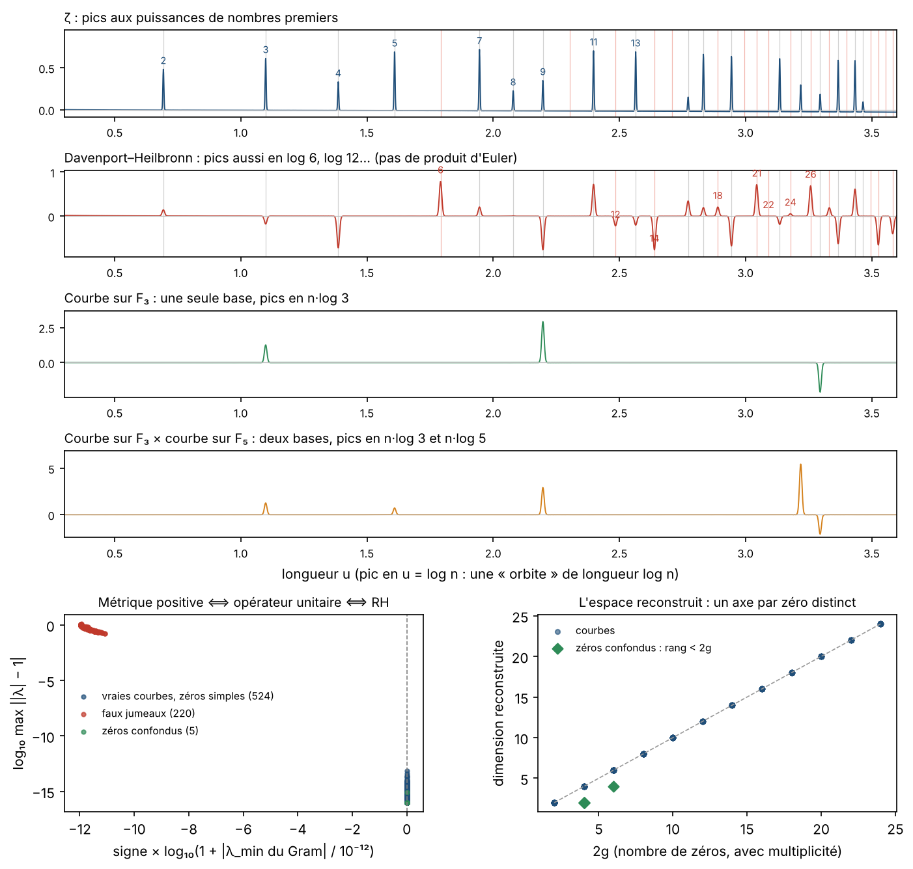

# V6.9 — Le chaînon : du Frobenius discret au flot continu

**Date :** 9 octobre 2026  
**Statut :** expériences exécutées (§4 et §5) ; résultats classiques cités (§2, §3, §6), sans relecture des textes originaux dans cette session. Ce qui est mesuré et ce qui est supposé sont séparés au §8.  
**Suite de :** une remarque de l'auteur : « C'est comme s'il manquait un opérateur symbolique entre la version discrète/réduite et la version continue/complète. »

## 1. La question

Dans le Modèle réduit (documents 28 et 29), RH est un théorème parce qu'un opérateur existe : le Frobenius F, qui agit sur un espace de dimension 2g. Pour ζ, on connaît les deux bouts, les nombres premiers et les zéros, et la formule explicite qui les relie, mais pas d'opérateur entre les deux. Qu'est-ce qui, exactement, ne passe pas du discret au continu ? On a fait l'essai dans le Modèle réduit, où tout est calculable : reconstruire l'opérateur à partir des seuls nombres, puis regarder chaque structure de la chaîne pour voir laquelle se transporte et laquelle ne se transporte pas.

## 2. Le chaînon dans le Modèle réduit : F = q^D^

Pour une courbe C sur F~q~, P(u) = det(1 − u·F) et les zéros de ζ~C~(s) sont les s tels que q^−s^·α~j~ = 1. Si l'on pose

  **F = q^D^ = e^(log\ q)·D^**, c'est-à-dire D = log~q~ F,

les zéros sont exactement le spectre de D, répété avec la période 2πi / log q. L'« opérateur symbolique » de l'intuition a donc une forme précise : c'est le **générateur** D, dont le pas discret F est l'exponentielle. C'est l'écriture du calcul symbolique classique (Lagrange, Boole), où le décalage E f(x) = f(x + h) s'écrit E = e^hD^ avec D = d/dx.

Deux conséquences :

- La version discrète ne voit D qu'à 2πi / log q près : les zéros de ζ~C~ sont périodiques en hauteur. La version continue (ζ) n'a pas de période : il n'y a pas de pas unique, il faudrait le flot entier e^tD^, t réel.
- Les traces des puissances comptent les orbites : Tr F^n^ = q^n^ + 1 − N~n~, où N~n~ est le nombre de points de C sur F~q^n^~. Une orbite fermée de degré n a la longueur n·log q. La formule explicite est une formule des traces : somme sur les zéros = somme sur les orbites.

## 3. Les trois structures (et une quatrième)

Ce qui fait de F un opérateur pour lequel RH est vraie tient en quatre structures. Chacune a une trace dans les zéros, qu'on peut chercher pour ζ.

| Structure | Modèle réduit (théorème) | Comment elle se voit dans les nombres | Pour ζ |
|---|---|---|---|
| Finitude (rationalité) | dim H^1^ = 2g ; P est un polynôme | rang du Gram de Krylov (§4) | infinité de zéros : espace de dimension infinie |
| Traces (la tour) | Tr F^n^ = q^n^ + 1 − N~n~ | pics du spectre des longueurs en n·log q (§5) | pics en log p^k^ ⟺ produit d'Euler |
| Symétrie (dualité de Poincaré) | α ↦ q/α | spectre stable par λ ↦ 1/λ (§4) | équation fonctionnelle |
| Métrique positive invariante (indice de Hodge sur C×C) | U = F/√q unitaire | Gram ≥ 0 (§4) | RH (critère de Weil) |

## 4. Résultat 1 : l'opérateur se reconstruit depuis les seuls comptages

**Méthode.** Les traces normalisées p~n~ = (q^n^ + 1 − N~n~)/q^n/2^ s'écrivent p~n~ = ⟨U^n^v, v⟩ pour U = F/√q et un vecteur v. Avec le Gram de Krylov G~mn~ = p~|n−m|~ et la matrice décalée S~mn~ = p~|n+1−m|~ (taille 2g + 4), le faisceau S x = λ G x redonne les valeurs propres de U sur l'espace engendré par v (construction de type GNS, Naimark ; Carathéodory–Toeplitz [Toe11] [Car11] pour la positivité). On n'utilise que les nombres N~1~, …, N~2g+5~ (ici obtenus à partir de P par les identités de Newton, ce qui revient aux comptages de points recoupés à l'unité au document 28).

**Mesuré** (`chain_gns.csv`) :

| Objets | Nombre | Dimension reconstruite | Écart aux vraies valeurs propres | Opérateur unitaire | Gram ≥ 0 | Directions négatives | Symétrie λ ↦ 1/λ |
|---|---:|---|---|---|---|---|---|
| Vraies courbes, zéros simples (F~3~, F~5~, F~7~, genres 1 à 12) | 524 | = 2g pour les 524 | ≤ 1,0·10^−13^ | 524 sur 524 | 524 sur 524 | 0 | ≤ 1,4·10^−13^ |
| Faux jumeaux (document 28) | 220 | = 2g pour les 220 | ≤ 2,3·10^−14^ | 0 sur 220 (écart de 0,18 à 1,24) | 0 sur 220 | = zéros hors cercle / 2 (220 sur 220) | ≤ 4,8·10^−14^ |
| Zéros confondus | 5 | < 2g pour les 5 : un axe par zéro distinct | ≤ 2,2·10^−8^ | 5 sur 5 | 5 sur 5 | 0 | ≤ 1,4·10^−15^ |

Les cinq objets à zéros confondus sont une vraie courbe de genre 3 sur F~5~ (P = 1 + u + 7u^2^ − 2u^3^ + 35u^4^ + 25u^5^ + 125u^6^) et quatre polynômes de Weil carrés ((1 + 5u^2^)^2^, (1 ∓ 2u + 5u^2^)^2^, (1 − 5u^2^)^2^). Leur écart de 10^−8^ vient des racines de référence elles-mêmes (une racine double n'est calculable qu'à la racine carrée de la précision machine), pas de la reconstruction.

**Ce que dit le tableau.**

1. **L'opérateur existe toujours.** Pour les vraies courbes comme pour les faux jumeaux, les nombres suffisent à reconstruire l'opérateur et sa symétrie d'équation fonctionnelle, à la précision de la machine.
2. **Seule la métrique sépare.** Les 220 faux jumeaux ont l'opérateur, la symétrie, et des comptages positifs (un produit d'Euler) ; il ne leur manque que la positivité du Gram. Une direction négative par paire inverse (β, 1/β) hors du cercle : c'est la loi d'inertie du document 29, retrouvée ici sur l'opérateur.
3. **Un axe par zéro distinct ; la multiplicité devient une masse.** Quand deux zéros coïncident, l'espace reconstruit est plus petit que 2g. La multiplicité ne disparaît pas : elle reparaît comme masse de la mesure spectrale (masses 2, 2 pour (1 + 5u^2^)^2^ ; 2, 2, 1, 1 pour la courbe de genre 3 ; vérifié dans `test_v69_frobenius_chain.py`). Les nombres voient la mesure ; la dimension 2g vient de la géométrie (semi-simplicité du Frobenius sur la jacobienne).

## 5. Résultat 2 : le spectre des longueurs se lit dans les zéros

**Méthode.** Avec un poids gaussien de largeur s,

  S(u) = −(√(2π)/s) · Σ~γ~ e^−(γ/s)²/2^ · e^iγu^

ne dépend que des zéros ρ = ½ + iγ. Par la formule explicite, S a des pics en u = log n, de hauteur c(n)/√n, où c(n) est le coefficient de −F′/F (pour ζ, c(n) = Λ(n), la fonction de von Mangoldt). **Produit d'Euler ⟺ c(n) nul hors des puissances de nombres premiers ⟺ pics seulement en log p^k^.** Pour une courbe sur F~q~, les pics sont en n·log q, de hauteur −(log q)·p~n~ : le nombre de points de la courbe sur F~q^n^~, lu dans ses zéros.

**Données :** ζ, 1 070 zéros jusqu'à t = 1 500 (s = 500) ; L(s, χ~5~) et Davenport–Heilbronn [DH36b] [DH36a] (DH), 988 zéros chacune jusqu'à |t| = 600, dont 60 hors droite pour DH (s = 200) ; courbes : zéros exacts, périodiques, jusqu'à |γ| = 600.

| Objet | Longueurs contrôlées | Écart max mesure / prédiction | Signal hors des puissances de nombres premiers (ou hors du réseau) | Lecture |
|---|---:|---|---|---|
| ζ | 35 (n ≤ 36) | 0,045 | 4,4 % : fond lisse (pôle et zéros triviaux, non retirés) | produit d'Euler |
| L(s, χ~5~) | 28 (n ≤ 36, 5 ∤ n) | 0,006 | 0,1 % | produit d'Euler |
| DH | 28 | 0,005 | **45,6 %** : pics en log 6, 12, 14, 18, 21, 24, 26, 28, 34, 36 | pas de produit d'Euler, lu dans les seuls zéros |
| Courbe de genre 2 sur F~3~ | 3 (n·log 3) | 0,011 | plus grand \|S\| hors réseau 0,002 (pics jusqu'à 2,9) | une base |
| Faux jumeau sur F~5~ | 2 (n·log 5) | 0,016 | 0,005 (pics jusqu'à 5,5) | réseau intact : le faux jumeau ne se voit pas ici |
| Deux courbes (F~3~ et F~5~) | 5 | 0,018 | 0,005 | deux réseaux superposés |

*En haut, quatre spectres des longueurs calculés à partir des zéros seuls. ζ : un pic à chaque log p^k^ (traits gris), rien aux autres log n (traits rouges). DH : des pics aux log n composites (6, 12, 14…), c'est-à-dire l'absence de produit d'Euler, lue dans les zéros. Courbe sur F~3~ : un seul réseau n·log 3. Deux courbes : deux réseaux. En bas à gauche : écart à l'unitarité contre plus petite valeur propre du Gram ; les vraies courbes sont toutes en bas à droite (métrique positive, opérateur unitaire), les faux jumeaux en haut à gauche. En bas à droite : dimension reconstruite contre 2g.*

Le panneau « deux courbes » est un produit d'Euler à deux nombres premiers. ζ est la même construction avec tous les nombres premiers : chaque facteur (1 − p^−s^)^−1^ est la fonction zêta d'un point sur F~p~, avec son réseau de longueurs k·log p. Le premier panneau est la superposition de ces réseaux.

## 6. Où le passage casse

On peut maintenant passer chaque structure de la chaîne au crible.

1. **Plusieurs bases : ne casse pas.** Deux réseaux de longueurs incommensurables (log 3 / log 5 irrationnel) se lisent aussi bien qu'un seul. Mais il n'y a plus de pas commun : aucun F unique dont les puissances donnent toutes les orbites. Il faut un temps continu, un flot dont les orbites fermées ont les longueurs log p^k^. C'est le programme de Deninger, et le flot adélique de Connes (cités de mémoire) [Con99].
2. **Dimension infinie : ne casse pas la construction.** La reconstruction n'a pas besoin d'un nombre fini de zéros : un axe par zéro distinct. Pour ζ, la suite p~n~ devient la distribution Σ~γ~ e^iγu^ en u continu (la formule explicite), le Gram de Toeplitz devient un noyau de convolution, Carathéodory–Toeplitz devient Bochner [Boc32]. Dans une fenêtre finie, on ne voit que les zéros atteints (loi de rang, document 29).
3. **Positivité : c'est ici que tout se joue.** Par Bochner puis Stone : la distribution des zéros est de type positif ⟺ il existe un espace de Hilbert et un groupe unitaire e^itH^, H autoadjoint de spectre les γ (un opérateur de Hilbert–Pólya [Pol82]) ⟺ positivité de Weil [Wei52] ⟺ RH. La construction fournit l'opérateur dès que RH est vraie ; elle ne la fournit pas. Dans le Modèle réduit, la positivité vient d'ailleurs : de la surface C×C (indice de Hodge), indépendamment des zéros.

**Ce qui manque n'est pas l'opérateur, c'est la métrique.** L'opérateur symbolique se construit à partir des nombres, même pour les imposteurs : pour les 220 faux jumeaux, et pour DH comme opérateur dans une métrique indéfinie, avec une direction négative par paire de zéros hors droite (document 29 ; attribution V6.3b).

### Mise à jour du dictionnaire de v3.7

Le mémo P2.2 (v3.7) concluait qu'aucun des trois ingrédients de la preuve sur F~q~ n'avait d'image pour ζ. V6.8 et V6.9 révisent ce verdict, ingrédient par ingrédient.

| Ingrédient | Verdict de v3.7 pour ζ | Ce que montrent V6.8 et V6.9 |
|---|---|---|
| (I) Rationalité | pas d'analogue | Confirmé : pas de dimension finie. Mais la reconstruction n'en a pas besoin ; ce n'est pas le maillon qui casse. |
| (II) La tour | pas d'analogue (« log p n'est pas une dimension ») | **Révisé :** la tour, ce sont les orbites, et elles se lisent dans les zéros comme des longueurs (35 longueurs pour ζ, écart 0,045). Avec une base par nombre premier. Et la hauteur joue le rôle de l'étage (V6.8). |
| (III) Positivité | Q est positive automatiquement, donc sans contenu | Précisé : la bonne positivité est celle du Gram de la reconstruction (la forme de Weil), qui n'est pas automatique : elle équivaut à RH. Dans le Modèle réduit, elle vient de C×C. C'est la case vide. |

## 7. Lecture selon l'hypothèse

L'hypothèse de l'auteur : RH n'existe que parce qu'elle est nécessaire à quelque chose de plus grand qui la rend nécessaire.

V6.9 dit **à quel maillon** ce « plus grand » agit. Pas sur l'opérateur : il se reconstruit à partir des nombres seuls, imposteurs compris. Pas sur la symétrie : l'équation fonctionnelle se lit dans tous les spectres. Pas sur les longueurs : le produit d'Euler se lit dans les zéros, et le faux jumeau a un réseau parfait. **Il agit sur la métrique.** Dans le Modèle réduit, la métrique qui rend F unitaire sur la courbe est induite par la forme d'intersection de la surface C×C, un étage au-dessus, et le théorème de l'indice de Hodge y est vrai pour toutes les surfaces. RH pour la courbe est la restriction d'une positivité qui est nécessaire là-haut. C'est exactement la forme de l'hypothèse.

Pour ζ, l'opérateur et les longueurs sont déjà là, mesurés, des deux côtés. La place de l'objet est maintenant précisément située : c'est lui qui devrait porter la métrique. L'intuition de l'opérateur symbolique se trouve confirmée et déplacée : le chaînon entre discret et continu est l'exponentielle F = e^(log\ q)D^, et cette exponentielle passe sans difficulté au continu dès que la métrique existe.

## 8. Démontré, mesuré, supposé

**Classique (cité).** F = q^D^ et la formule des traces dans le Modèle réduit ; la reconstruction GNS et Carathéodory–Toeplitz ; Bochner et Stone ; le critère de Weil ; la formule explicite.

**Mesuré.** §4 : 749 objets ; l'opérateur, la symétrie et la dimension (un axe par zéro distinct) sont reconstruits depuis les comptages pour tous ; la métrique est positive pour toutes les vraies courbes et pour aucun faux jumeau. §5 : le spectre des longueurs, lu dans les zéros, retrouve les puissances de nombres premiers (ζ, L) et révèle l'absence de produit d'Euler de DH (45,6 % du signal aux longueurs composites) ; dans le Modèle réduit, il retrouve les réseaux n·log q.

**Supposé.** Que la métrique de ζ vienne, comme dans le Modèle réduit, d'un objet d'un étage au-dessus. Que le flot de Deninger ou de Connes soit le bon support du générateur.

**Question divergente : la multiplicité.** Dans le Modèle réduit, l'espace reconstruit depuis les nombres a un axe par zéro distinct ; quand des zéros coïncident, la géométrie porte plus de dimensions que les nombres n'en voient (§4, point 3). Pour ζ, on conjecture que tous les zéros sont simples (tous ceux calculés le sont ; plus de 40 % sont démontrés simples, Conrey 1989 [Con89], cité de mémoire). Dans l'image de ce document, « tous les zéros de ζ sont simples » se lit : **l'espace de ζ est engendré par le seul vecteur des nombres premiers.** La simplicité des zéros serait alors l'énoncé que les nombres suffisent à engendrer l'objet entier. Un zéro double serait une dimension que l'objet aurait et que les nombres premiers ne verraient pas.

## 9. Suites proposées

1. **Le générateur depuis les nombres premiers.** Dans les fenêtres DUAL-LOCK, construire le Gram à partir du seul côté des premiers (formule explicite), reconstruire le faisceau et suivre ses valeurs propres quand la fenêtre grandit : l'opérateur des premiers converge-t-il vers les zéros atteints (loi de rang du document 29) ? C'est le chaînon pour ζ, dans une fenêtre finie, avec la métrique testée directement. **Fait en V6.10 (document 33) : 226 zéros de ζ avec les premiers ≤ 439, 284 avec ≤ 23 862 ; métrique positive pour ζ et L, deux directions négatives par quadruplet hors droite de DH.**
2. **Bases q et q².** Voir une courbe sur F~q~ comme courbe sur F~q²~ : F devient F², la période de D est divisée par deux, mais D reste le même. Le vérifier numériquement montrerait que c'est D, et non F, l'objet intrinsèque : le générateur ne dépend pas de la base. **Fait en V6.11 (document 35) : D intrinsèque sur 525 courbes ; la descente efface un signe par facteur irréductible.**
3. **Le degré 2** (reporté, choix de l'auteur) : l'Archipel dans un espace de formes modulaires (poids 24, niveau 1).

## 10. Limites

- Reconstruction à taille fixe 2g + 4, rang décidé avec une tolérance relative de 10^−9^.
- Spectre des longueurs : fenêtre gaussienne finie, listes de zéros finies (ζ jusqu'à t = 1 500 ; L et DH jusqu'à |t| = 600), longueurs jusqu'à log 36 ; le fond lisse de ζ (pôle, zéros triviaux) n'est pas retiré.
- Un seul faux jumeau (P = 1 + u − 8u^2^ + 5u^3^ + 25u^4^ sur F~5~) et une seule paire de courbes au §5 ; le produit de deux courbes n'est pas la fonction L d'un seul objet.
- Les résultats classiques (Naimark, Carathéodory–Toeplitz, Bochner, Stone, Weil, Deninger, Connes, Conrey, semi-simplicité du Frobenius) sont cités de mémoire.

## 11. Noms proposés pour le registre

| Nom | Image | Énoncé exact | Où l'image casse |
|---|---|---|---|
| **Le Chaînon** | Le pas discret est l'exponentielle d'un générateur continu. | F = q^D^ ; les zéros de ζ~C~ sont le spectre de D répété avec la période 2πi / log q. | Dans le Modèle réduit, D n'est défini qu'à cette période près. |
| **Le Spectre des longueurs** | Les zéros chantent les longueurs des orbites. | S(u), calculé sur les zéros seuls, a des pics en log n de hauteur c(n)/√n ; produit d'Euler ⟺ pics seulement en log p^k^. | Fenêtre finie ; fond lisse non retiré. |
| **L'Axe par zéro distinct** | Les nombres construisent un axe par note, pas par instrument. | Le rang du Gram de Krylov est le nombre de zéros distincts ; la multiplicité y est une masse. | Pour ζ, la simplicité des zéros n'est que conjecturée. |
| **La Métrique manquante** | La machine est là ; il manque la règle qui mesure. | Les 220 faux jumeaux ont l'opérateur, la symétrie et le réseau ; seul leur Gram est indéfini. | Pour ζ, « là » veut dire dans une fenêtre finie. |

## Fichiers

- Code : `src/frobenius_chain.py` (traces, reconstruction GNS/Krylov, masses spectrales, symétrie, spectre des longueurs, coefficients de −F′/F, zéros périodiques d'une courbe).
- Script : `scripts/run_frobenius_chain.py` (quelques secondes ; sorties identiques au bit près à la réexécution).
- Données : `chain_gns.csv`, `chain_length_spectrum.csv`, `chain_lengths.csv`, figure `chain.png`.
- Tests : `tests/test_v69_frobenius_chain.py` (4 tests).

<!-- references:debut -->

## Références

Format : [clé] auteurs, *titre*, publication, lien. Fiches complètes et état de vérification : document 42 (registre des sources).

- [Boc32] S. Bochner. *Vorlesungen über Fouriersche Integrale*. Akademische Verlagsgesellschaft, Leipzig, 1932. — partiellement vérifié
- [Car11] C. Carathéodory. *Über den Variabilitätsbereich der Fourier'schen Konstanten von positiven harmonischen Funktionen*. Rend. Circ. Mat. Palermo 32 (1911), 193–217 ; DOI 10.1007/BF03014795. <https://doi.org/10.1007/BF03014795> — partiellement vérifié
- [Con89] J. B. Conrey. *More than two fifths of the zeros of the Riemann zeta function are on the critical line*. J. reine angew. Math. 399 (1989), 1–26 ; annonce : Bull. AMS 20 (1989), 79–81. <https://www.ams.org/bull/1989-20-01/S0273-0979-1989-15704-2/> — partiellement vérifié
- [Con99] A. Connes. *Trace formula in noncommutative geometry and the zeros of the Riemann zeta function*. Selecta Math. (N.S.) 5 (1999), 29–106 ; arXiv:math/9811068. <https://arxiv.org/abs/math/9811068> — vérifié en ligne
- [DH36a] H. Davenport, H. Heilbronn. *On the zeros of certain Dirichlet series*. J. London Math. Soc. 11 (1936), no. 3, 181–185. <https://doi.org/10.1112/jlms/s1-11.3.181> — partiellement vérifié
- [DH36b] H. Davenport, H. Heilbronn. *On the zeros of certain Dirichlet series. II*. J. London Math. Soc. 11 (1936), no. 4, 307–312. <https://doi.org/10.1112/jlms/s1-11.4.307> — partiellement vérifié
- [Pol82] G. Pólya (lettre à A. M. Odlyzko, 3 janvier 1982), archive A. M. Odlyzko. *Correspondence about the origins of the Hilbert–Pólya conjecture*. Page web d'A. M. Odlyzko (University of Minnesota) (1982). <https://www-users.cse.umn.edu/~odlyzko/polya/index.html> — vérifié en ligne
- [Toe11] O. Toeplitz. *Über die Fourier'sche Entwickelung positiver Funktionen*. Rend. Circ. Mat. Palermo 32 (1911), 191–192. — non vérifié
- [Wei52] A. Weil. *Sur les « formules explicites » de la théorie des nombres premiers*. Comm. Sém. Math. Univ. Lund, vol. suppl. dédié à M. Riesz (1952), 252–265. <https://en.wikipedia.org/wiki/Weil%27s_criterion> — partiellement vérifié

<!-- references:fin -->
