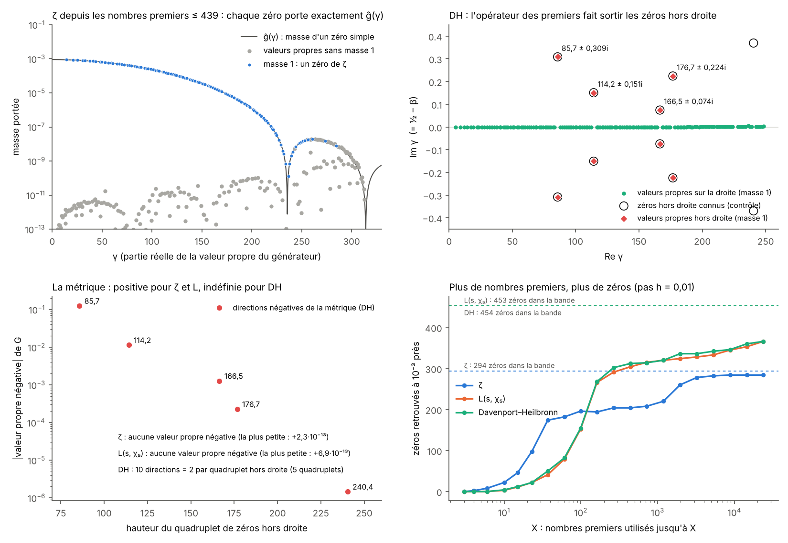

# V6.10 — Le générateur des premiers : l'opérateur de ζ reconstruit sans aucun zéro

**Date :** 10 octobre 2026  
**Statut :** expériences exécutées (§3 à §7) ; résultats classiques cités (§2), sans relecture des textes originaux dans cette session. Ce qui est mesuré et ce qui est supposé est séparé au §9.  
**Suite de :** document 32, §9, suite 1. Les trois suites ont été prises « par priorité explicative » ; celle-ci passe en premier parce qu'elle porte le chaînon du Modèle réduit jusqu'à ζ.

## 1. La question

Dans le Modèle réduit, l'opérateur F se reconstruit à partir des seuls comptages de points, et sa métrique sépare les vraies courbes des imposteurs (document 32). Pour ζ, le document 32 laissait une question : dans une fenêtre finie, peut-on construire l'opérateur à partir des seuls nombres premiers, sans utiliser aucun zéro, et mesurer sa métrique ?

## 2. La construction

**Un pas choisi.** ζ n'a pas de base q, donc pas de pas naturel. On en choisit un, h > 0, et l'on cherche l'opérateur de translation F~h~ = e^hD^. Ses « traces » sont

  t~n~ = Σ~γ~ ĝ(γ) · e^iγnh^,

où la somme porte sur les zéros ρ = ½ + iγ (γ complexe si le zéro est hors de la droite). ĝ est la transformée de Fourier de g = φ ∗ φ, avec φ(u) = cos^4^(πu/2a) sur [−a, a]. On a donc ĝ = φ̂^2^ ≥ 0 : c'est le poids, ou la « masse », que porte chaque zéro.

**Sans aucun zéro.** La formule explicite (Weil) donne t~n~ par l'autre côté :

  t~n~ = [pôle] + (1/2π) ∫ ĝ(r) e^irnh^ [log(q/π) + Re ψ((½ + a~χ~)/2 + ir/2)] dr − Σ~m~ [c(m) g(log m − nh) + c̄(m) g(−log m − nh)] / √m,

où c(m) sont les coefficients de −F′/F : Λ(m) pour ζ, Λ(m)χ(m) pour L(s, χ~5~), et les coefficients généraux pour Davenport–Heilbronn [DH36b] [DH36a] (DH). Comme g est à support [−2a, 2a], seuls les nombres m ≤ e^Nh+2a^ interviennent.

**L'opérateur et sa métrique.** On forme la matrice de Toeplitz G~jk~ = t~j−k~, qui est la métrique, et la matrice décalée S~jk~ = t~j−k+1~. Le faisceau S x = λ G x donne λ = e^iγh^, donc γ = log λ / (ih). C'est exactement la construction du Modèle réduit (document 32, §4), avec q^n^ remplacé par e^nh^ et les comptages de points remplacés par les nombres premiers.

**Le test d'objet, lui aussi sans zéro.** Une vraie valeur propre porte exactement la masse ĝ(γ), multipliée par la multiplicité du zéro. On calcule donc, pour chaque valeur propre, sa masse relative m = (poids reconstruit) / ĝ(γ). On la déclare **vraie** si |m − 1| < 1 %, ce qui correspond à un zéro simple (document 32 : « la multiplicité reparaît comme masse »). Les listes de zéros connus ne servent qu'au contrôle.

## 3. Audit

Les traces calculées par les nombres premiers coïncident avec les sommes sur les zéros connus, à 3,5·10^−14^ pour ζ (zéros jusqu'à t = 1 500) et à 1,5·10^−10^ pour L(s, χ~5~) et DH. Pour ces deux dernières, l'écart vient de la troncature de leurs listes de zéros à |t| = 600.

## 4. Résultat 1 : l'opérateur

Fenêtre principale : a = 0,04, pas h = 0,01, taille N = 600. Elle utilise **les nombres premiers jusqu'à 439**.

| Objet | Valeurs propres « vraies » (masse 1 ± 1 %) | à ≤ 10^−3^ d'un vrai zéro | entre 10^−3^ et 7,9·10^−3^ | fausses | hauteur atteinte | directions négatives de la métrique |
|---|---:|---:|---:|---:|---:|---:|
| ζ | 226 | 204 | 22 | **0** | 285 | **0** |
| L(s, χ~5~) | 334 | 304 | 30 | **0** | 263 | **0** |
| DH | 330 | 312 | 18 | **0** | 248 | **10** |

- **Les premiers zéros de ζ** sortent à quelques 10^−10^ près : 14,134725 (5·10^−10^), 21,022040 (3·10^−10^), 25,010858 (7·10^−10^), 30,424876 (2·10^−9^), 32,935062, 37,586178.
- **Aucune fausse détection.** Toute valeur propre de masse 1 tombe à moins de 7,9·10^−3^ d'un vrai zéro. Les autres valeurs propres portent un poids inférieur à 3·10^−8^.
- **Des zéros simples.** Pour les valeurs propres retenues, la masse vaut 1 à 0,8–1 % près, et à 10^−6^ près pour les zéros bas.

## 5. Résultat 2 : la métrique

- **ζ et L(s, χ~5~) : aucune valeur propre négative.** La plus petite est de l'ordre de 10^−13^, c'est-à-dire l'arrondi de la machine.
- **DH : 10 directions négatives, deux par quadruplet de zéros hors droite.** L'opérateur retrouve les zéros hors droite eux-mêmes, avec une masse 1 :

| Quadruplet de DH (γ = t ± i(β − ½)) | Retrouvé par l'opérateur | Écart | Masse | Directions négatives (valeur) |
|---|---|---|---|---|
| 85,699348 ± 0,308517i | oui | 6·10^−10^ | 1,000000 | −0,127 ; −0,125 |
| 114,163342 ± 0,150830i | oui | 5·10^−7^ | 1,000002 | −0,0115 ; −0,0114 |
| 166,4793 ± 0,0744i | oui | 2·10^−5^ | 0,9998 | −1,29·10^−3^ ; −1,27·10^−3^ |
| 176,7025 ± 0,2243i | oui | 2·10^−5^ | 0,99994 | −2,30·10^−4^ ; −2,29·10^−4^ |
| 240,4047 ± 0,3695i | **non** (poids relatif 3·10^−6^) | — | — | −1,48·10^−6^ ; −1,48·10^−6^ |

**La métrique voit un quadruplet avant que l'opérateur ne le résolve** : celui de 240,4, trop faible pour sortir comme valeur propre, produit déjà ses deux directions négatives.

**Attribution exacte, sur cinq fenêtres.** On reconstruit la même métrique à partir des zéros connus :
- avec les seuls zéros sur la droite, elle n'a aucune direction négative, dans les cinq fenêtres ;
- en ajoutant les k premiers quadruplets hors droite, on retrouve exactement le nombre de directions négatives obtenu à partir des premiers : 2, 2, 4, 10, 10 pour a = 0,2 ; 0,12 ; 0,08 ; 0,05 ; 0,04.

## 6. Résultat 3 : plus de nombres premiers, plus de zéros

Pas fixé (h = 0,01), fenêtre de plus en plus longue :

| Premiers jusqu'à X | 4 | 10 | 37 | 439 | 3 231 | 23 862 |
|---|---:|---:|---:|---:|---:|---:|
| Zéros de ζ retrouvés (masse 1) | 4 | 24 | 182 | 226 | 282 | **284** |
| dont à ≤ 10^−3^ | 2 | 22 | 174 | 204 | 278 | **284** |
| Écart maximal | 6,5·10^−3^ | 2,3·10^−3^ | 5,7·10^−3^ | 7,5·10^−3^ | 2,2·10^−3^ | **1,6·10^−4^** |

- **Avec 2 et 3 seulement**, le premier zéro de ζ apparaît déjà (14,1347).
- **Avec les premiers jusqu'à 23 862,** on retrouve 284 des 294 zéros de la bande |γ| < π/h, tous à mieux que 1,6·10^−4^. Pour quatre des cinq paires manquantes, une valeur propre est au bon endroit (à 10^−4^ près), mais sa masse sort de la tolérance de 1 % (1,02 à 1,50). La dernière paire est au bord de la bande (313,985, poids relatif 10^−10^).
- **Fausses détections** (masse 1, mais à plus de 10^−2^ de tout zéro) : aucune dans la fenêtre principale, pour les trois objets. Pour ζ, il n'y en a plus à partir de X = 99. Ailleurs, il s'agit surtout de zéros mal localisés (écart de 0,015 à 0,06, jusqu'à 6 pour DH à X = 8 779), avec deux vraies erreurs (0,29 et 0,51, L(s, χ~5~) à X = 99).

*En haut à gauche : la masse de chaque valeur propre de ζ contre sa hauteur. Les vraies valeurs propres tombent exactement sur la courbe ĝ(γ), les autres restent loin dessous. En haut à droite : les valeurs propres de DH dans le plan complexe ; les zéros hors droite sortent à leur place, et les cercles marquent les zéros connus. En bas à gauche : les directions négatives de la métrique de DH, une paire par quadruplet ; aucune pour ζ et L. En bas à droite : le nombre de zéros retrouvés selon la borne X des nombres premiers.*

## 7. Le pas : ce que voit une « base »

Un opérateur de pas h ne voit γ qu'à 2π/h près, puisque e^iγh^ est périodique. À nombres premiers fixés (X = 475 ; 602 au pas log 2), on fait grandir h :

| Pas h | 0,02 | 0,05 | 0,1 | 0,2 | 0,5 | log 2 |
|---|---:|---:|---:|---:|---:|---:|
| Zéros retrouvés à leur place | 84 | 26 | 2 | 0 | 0 | 0 |
| Zéros vus repliés (γ modulo 2π/h) | 0 | 50 | 30 | 2 | 0 | 0 |

Au pas log 2, c'est-à-dire avec une « base » 2 comme dans le Modèle réduit, tous les zéros sont repliés et l'opérateur ne voit plus rien de net. Le Modèle réduit supporte un pas fixe parce qu'il n'a que 2g zéros par période ; ζ en a une infinité. Le seul pas qui convient à ζ est le pas qui tend vers 0, c'est-à-dire le flot. C'est l'objet de la suite 2 (bases q et q²), rédigée au document 35.

## 8. Lecture selon l'hypothèse

L'hypothèse de l'auteur : RH n'existe que parce qu'elle est nécessaire à quelque chose de plus grand qui la rend nécessaire.

Le document 32 avait situé le maillon manquant : non pas l'opérateur, mais la métrique. Ce document mesure les deux côtés pour ζ.

- **L'opérateur se construit à partir des nombres premiers.** La route « nombres premiers → zéros » existe et elle est praticable : avec les premiers jusqu'à 439, on obtient 226 zéros de ζ, chacun de masse 1. C'est le chaînon F = e^hD^ du document 32, transporté à ζ dans une fenêtre finie.
- **La métrique se lit à partir des nombres premiers aussi.** Elle est positive pour ζ et L, et négative pour DH exactement là où sont ses zéros hors droite, deux directions par quadruplet. Pour ζ, cette positivité confirme ce que l'on sait des zéros jusqu'à ces hauteurs. Ce qui est nouveau, c'est qu'on la lise depuis les premiers, et qu'elle désigne DH sans erreur.

Ce qui reste à construire, c'est la route qui part de l'objet. Dans le Modèle réduit, la positivité de la métrique n'est pas lue fenêtre par fenêtre : elle est imposée d'un coup, pour toutes les fenêtres, par la surface C×C. Selon l'hypothèse, le « plus grand » serait ce qui impose à la métrique des premiers d'être positive dans toutes les fenêtres à la fois, et la positivité de Weil [Wei52] est précisément cet énoncé.

## 9. Démontré, mesuré, supposé

**Classique (cité).** La formule explicite de Weil pour des fonctions test non paires ; les matrices de Toeplitz et la méthode du faisceau (de type Prony) ; la positivité de Weil comme équivalent de RH.

**Mesuré.** §3 à §7 : audit ; reconstruction de l'opérateur pour ζ, L et DH sans aucun zéro ; aucune fausse détection dans la fenêtre principale, ni pour ζ à partir de X = 99 ; métrique positive pour ζ et L ; directions négatives de DH attribuées quadruplet par quadruplet ; convergence avec X ; repliement selon le pas.

**Supposé.** Rien de plus que le document 32 : que la positivité, pour ζ, vienne d'un objet d'un étage au-dessus.

**Question divergente : la métrique en avance.** Pour DH, la métrique signale le quadruplet de 240,4 avant que l'opérateur ne le localise. Pour ζ, la plus petite valeur propre de la métrique, suivie fenêtre par fenêtre vers les grandes hauteurs, serait un détecteur précoce : un zéro hors droite s'y annoncerait avant de pouvoir être localisé. Jusqu'où, et à quel coût, peut-on la suivre ?

## 10. Suites proposées

1. **La métrique des premiers, plus haut.** Suivre la plus petite valeur propre de la métrique de ζ vers des hauteurs de plusieurs milliers, avec L(s, χ~5~) comme témoin positif et DH comme témoin négatif.
2. **La base comme pas de temps** (suite 2 du document 32) : faite, document 35.
3. **Le degré 2** (suite 3 du document 32).

Le choix entre ces suites est confié au navigateur de recherche (document 34).

## 11. Limites

- Fenêtre finie ; résolution 2π/(Nh) en hauteur ; deux zéros plus proches que cela ne se séparent pas.
- La tolérance de masse (1 %) est un choix. Plus stricte, elle écarte des zéros vrais, comme les quatre paires du §6 ; plus large, elle laisserait passer des fausses détections aux petits X.
- Calculs en double précision ; les directions négatives sont comptées au-dessus de 10^−11^ fois la plus grande valeur propre.
- Les listes de zéros servent de contrôle et sont tronquées (ζ à 1 500, L et DH à 600).
- Résultats classiques cités de mémoire.

## 12. Noms proposés pour le registre

| Nom | Image | Énoncé exact | Où l'image casse | Question divergente |
|---|---|---|---|---|
| **Le Générateur des premiers** | Les nombres premiers jouent la partition ; l'opérateur est l'instrument qu'on en déduit. | Avec les seuls premiers ≤ e^Nh+2a^, le faisceau de Toeplitz des traces donne e^iγh^ pour les zéros de la fenêtre. | Fenêtre finie ; pas h choisi. | L'opérateur converge-t-il quand la fenêtre grandit, et vers quoi ? |
| **La Masse unité** | Un vrai zéro pèse exactement son poids. | Une vraie valeur propre porte la masse ĝ(γ) ; masse 1 = zéro simple ; test sans aucun zéro. | Tolérance de 1 % ; zéros proches confondus. | Un zéro double de ζ porterait-il une masse 2 ? |
| **Le Repliement** | Une roue filmée trop lentement semble tourner à l'envers. | Au pas h, γ n'est vu qu'à 2π/h près ; au pas log 2, tous les zéros de ζ sont repliés. | Le Modèle réduit, avec 2g zéros par période, n'en souffre pas. | La base d'un corps fini est-elle un pas de temps du même flot ? |
| **La Métrique en avance** | La sentinelle entend avant de voir. | DH : le quadruplet de 240,4 crée deux directions négatives avant d'être résolu par l'opérateur. | Seuil de bruit (10^−11^). | Jusqu'où suivre la métrique de ζ vers le haut ? |

## Fichiers

- Code : `src/prime_generator.py` (fonction test et sa transformée en forme close, traces par les nombres premiers et par les zéros, faisceau de Toeplitz, masses).
- Script : `scripts/run_prime_generator.py` (environ 2 minutes ; figure : `python scripts/run_prime_generator.py --figure`).
- Données : `generator_summary.csv`, `generator_eigen.csv`, `generator_convergence.csv`, `generator_dh_metric.csv`, `generator_step.csv`, figure `generator.png`.
- Tests : `tests/test_v610_prime_generator.py` (4 tests).

<!-- references:debut -->

## Références

Format : [clé] auteurs, *titre*, publication, lien. Fiches complètes et état de vérification : document 42 (registre des sources).

- [DH36a] H. Davenport, H. Heilbronn. *On the zeros of certain Dirichlet series*. J. London Math. Soc. 11 (1936), no. 3, 181–185. <https://doi.org/10.1112/jlms/s1-11.3.181> — partiellement vérifié
- [DH36b] H. Davenport, H. Heilbronn. *On the zeros of certain Dirichlet series. II*. J. London Math. Soc. 11 (1936), no. 4, 307–312. <https://doi.org/10.1112/jlms/s1-11.4.307> — partiellement vérifié
- [Wei52] A. Weil. *Sur les « formules explicites » de la théorie des nombres premiers*. Comm. Sém. Math. Univ. Lund, vol. suppl. dédié à M. Riesz (1952), 252–265. <https://en.wikipedia.org/wiki/Weil%27s_criterion> — partiellement vérifié

<!-- references:fin -->
