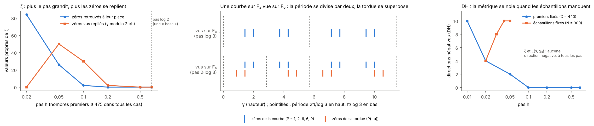

# V6.11 — La base comme pas de temps

**Date :** 10 octobre 2026  
**Statut :** expériences exécutées (§3 et §4) ; résultats classiques cités (§2), sans relecture des textes originaux dans cette session. Ce qui est mesuré et ce qui est supposé est séparé au §7.  
**Suite de :** document 32, §9, suite 2. C'est le coup choisi par le navigateur de recherche (document 34) après le document 33, avec un score de 3,0. Les calculs avaient été faits le 9 octobre au soir et sont rédigés ici.

## 1. La question

Dans le Modèle réduit, F = q^D^ (document 32). Deux questions en découlent.
- Le générateur D est-il intrinsèque, la base q n'étant qu'un pas d'échantillonnage du flot (log q) ? Et que perd-on en changeant de base ?
- Pour ζ, qui n'a pas de base, quel pas utiliser ? Le document 33 a montré qu'au pas log 2 tous les zéros se replient. La métrique se replie-t-elle aussi ?

## 2. Ce qui est classique

Sur F~q²~, une courbe a N'~n~ = N~2n~ points ; ses valeurs propres normalisées deviennent β^2^, et P~q²~(u^2^) = P(u)·P(−u). Les zéros de la courbe sur F~q²~ sont donc ceux de la courbe sur F~q~ et ceux de sa tordue quadratique, de polynôme P(−u). Le spectre de D est le même, vu avec une période deux fois plus courte. Pour les vraies courbes, |β| = 1 ⟺ |β^2^| = 1 : RH ne dépend pas de la base. C'est la tour d'extensions, deuxième ingrédient de la preuve de Weil (mémo P2.2, v3.7) : une borne valable à tous les étages force RH.

## 3. Mesuré : le Modèle réduit vu sur F~q²~

Pour les 525 courbes du document 29 et les 220 faux jumeaux, on reconstruit l'opérateur à partir des seuls comptages sur F~q²~ (traces p~2n~), par la construction du document 32.

| | Vraies courbes (525) | Faux jumeaux (220) |
|---|---|---|
| Dimension reconstruite = zéros distincts de β^2^ | 525 | 220 |
| Écart aux vraies valeurs propres β^2^ | ≤ 1,7·10^−8^ (racines doubles) | ≤ 1,7·10^−13^ |
| Opérateur unitaire (métrique positive) | **525** | **0** (écart à l'unitarité ≥ 0,38) |
| Directions négatives = zéros hors cercle distincts / 2 | 525 | **220** |
| Dimension qui baisse en passant à F~q²~ | 51 | 10 |
| Zéros sur F~q²~ = zéros de la courbe ∪ zéros de la tordue | 525 | — |

- **D est intrinsèque.** Pour les 525 courbes, les zéros vus sur F~q²~ sont exactement ceux de la courbe et de sa tordue : c'est le même spectre, replié avec une demi-période.
- **La métrique survit au changement de base.** Aucun faux jumeau ne devient une courbe en montant d'un étage, et ses directions négatives restent une par paire de zéros hors cercle.
- **La dimension baisse quand β et −β fusionnent** (β^2^ commun). C'est le cas de 51 courbes, dont les 31 courbes égales à leur tordue (P(u) = P(−u)).

**Ce que la base q² efface : la descente.** On compte les polynômes de Weil entiers sur F~q~ dont l'image sur F~q²~ est la même, c'est-à-dire les objets possibles en bas, compatibles avec les comptages d'en haut :

| Descentes possibles | 1 | 2 | 3 | 4 | 6 | 8 | 12 |
|---|---:|---:|---:|---:|---:|---:|---:|
| Nombre de courbes | 30 | **440** | 1 | 48 | 2 | 3 | 1 |

- La courbe et sa tordue en font toujours partie (525 sur 525).
- Le nombre de descentes est exactement le nombre de façons de changer le signe de chaque facteur irréductible du polynôme (525 sur 525). La base q² efface donc **un signe par facteur irréductible**.
- Le record (12 descentes) est une courbe de genre 7 sur F~3~ dont le polynôme a 4 facteurs irréductibles.
- **La réfutation annoncée par le navigateur n'a pas eu lieu.** Le navigateur avait écrit, avant le calcul, ce qui réfuterait la thèse : deux courbes non tordues ayant les mêmes comptages sur F~q²~. Dans le corpus, aucune courbe ne partage l'image sur F~q²~ d'une autre courbe que sa tordue (0 sur 525). Nuance : 55 courbes ont d'autres descentes possibles, mais ce sont des polynômes de Weil absents du corpus, qui ne sont pas forcément des courbes.

## 4. Mesuré : ζ, L et DH, la métrique selon le pas

Avec le générateur des premiers (document 33 ; a = 0,04 ; aucun zéro utilisé), on fait varier le pas h de deux façons.

**À nombres premiers fixés (X ≈ 440).** Ici, N = 6/h : quand le pas grandit, on a moins d'échantillons.

| Pas h | 0,01 | 0,02 | 0,05 | 0,1 | 0,2 | 0,5 | log 2 |
|---|---:|---:|---:|---:|---:|---:|---:|
| Échantillons N | 600 | 300 | 120 | 60 | 30 | 12 | 9 |
| Directions négatives, ζ | 0 | 0 | 0 | 0 | 0 | 0 | 0 |
| Directions négatives, L(s, χ~5~) | 0 | 0 | 0 | 0 | 0 | 0 | 0 |
| Directions négatives, DH | **10** | 4 | 2 | **0** | 0 | 0 | 0 |

**À nombre d'échantillons fixé (N = 300).** Ici, un pas plus grand va chercher des nombres premiers plus loin.

| Pas h | 0,02 | 0,03 | 0,04 | 0,05 |
|---|---:|---:|---:|---:|
| Nombres premiers jusqu'à | 440 | 8 780 | 176 313 | 3 541 287 |
| Directions négatives, DH | 4 | 8 | 10 | 10 |

- **À pas grossier, l'imposteur passe.** Dès h = 0,1 à nombres premiers fixés, la métrique de DH est aussi positive que celle de ζ (plus petite valeur propre 7·10^−3^ contre 2·10^−4^).
- **Ce n'est pas le pas qui noie la métrique, c'est le manque d'échantillons.** À N fixé, un pas plus grand garde les directions négatives, et en fait apparaître davantage.
- **La cause :** à pas fixe, ζ et DH ont une infinité de zéros repliés dans un espace de dimension N. Leurs contributions positives remplissent toutes les directions et noient l'indéfini des quadruplets hors droite. Le Modèle réduit n'a pas ce problème : 2g zéros par période, et toujours assez de dimensions.

*À gauche : à nombres premiers fixés, plus le pas grandit, plus les zéros de ζ se replient ; au pas log 2, ils le sont tous. Au milieu : une courbe sur F~3~ vue sur F~9~ ; la période se divise par deux et les zéros de la tordue se superposent. À droite : les directions négatives de la métrique de DH ; elles disparaissent quand les échantillons manquent (en bleu), et restent quand on garde N fixé (en orange).*

## 5. Ce que cela dit

1. **La base est un pas de temps.** D est intrinsèque ; changer de base revient à échantillonner le même flot avec un pas plus long. Cela replie les hauteurs et efface un signe par facteur irréductible, mais ne touche pas à la position des zéros par rapport au cercle : RH est une propriété du générateur, pas de la base.
2. **Pour ζ, le bon pas est le plus fin.** À nombres premiers donnés, plus le pas est fin, plus on a d'échantillons, moins il y a de repliement, et mieux la métrique voit les zéros hors droite. Le pas log 2, une « base », est le pire choix : DH y paraît aussi positive que ζ. L'image classique du « corps à un élément » (ζ comme une courbe sur F~1~, de pas log 1 = 0 ; Manin, Connes–Consani, cités de mémoire) trouve ici une traduction mesurable : la seule base qui convienne à ζ est le pas nul, c'est-à-dire le flot.
3. **La tour change de sens.** Dans le Modèle réduit, la tour F~q~ ⊂ F~q²~ ⊂ … va vers des pas de plus en plus longs, et l'information la plus fine est au rez-de-chaussée. Pour ζ, il n'y a pas de rez-de-chaussée : on monte en affinant le pas et en allongeant la fenêtre (plus de nombres premiers). Cela précise la réponse partielle de V6.8 (« la hauteur joue le rôle de l'étage ») : l'étage de ζ est le couple (pas, fenêtre).

## 6. Lecture selon l'hypothèse

L'hypothèse de l'auteur : RH n'existe que parce qu'elle est nécessaire à quelque chose de plus grand qui la rend nécessaire.

Dans le Modèle réduit, le « plus grand » contient toute la tour : RH est vraie à chaque étage (|β^n^| = 1 pour tout n), et c'est en exigeant une borne à tous les étages que Weil la rend nécessaire. Le changement de base mesuré ici en est l'image : la métrique passe intacte d'un étage à l'autre, pour toutes les courbes, et aucun faux jumeau ne s'y glisse.

Pour ζ, l'analogue de « tous les étages » est « tous les pas et toutes les fenêtres ». La positivité de la métrique pour toutes les fenêtres est exactement le critère de Weil. Ce document ajoute une nuance : une seule fenêtre à pas grossier ne suffit pas, puisque l'imposteur y passe. Seule la famille entière, pas → 0 et fenêtre → ∞, peut porter la nécessité. C'est la place que le document 32 réservait à l'objet d'un étage au-dessus : ce qui imposerait la positivité à toute la famille à la fois.

## 7. Démontré, mesuré, supposé

**Classique (cité).** P~q²~(u^2^) = P(u)·P(−u) ; la tordue quadratique ; l'argument de la tour dans la preuve de Weil ; le critère de positivité de Weil [Wei52].

**Mesuré.** §3 : D intrinsèque, sur 525 courbes ; métrique conservée sur F~q²~ (525 courbes et 220 faux jumeaux) ; la descente efface un signe par facteur irréductible (525 sur 525). §4 : pour ζ et L, aucune direction négative à aucun pas ; pour DH, des directions négatives qui disparaissent à nombres premiers fixés quand le pas grandit, et restent à N fixé.

**Supposé.** Que la famille de toutes les fenêtres soit le bon analogue de la tour, et que l'objet manquant soit ce qui impose la positivité à toute la famille.

**Question divergente : la loi de seuil.** Combien d'échantillons faut-il pour que la métrique voie un quadruplet hors droite de poids donné ? Si cette loi est mesurable sur DH, elle dit à quel coût on peut surveiller la métrique de ζ vers le haut : c'est le coup suivant du navigateur (la métrique des premiers, plus haut).

## 8. Limites

- Courbes de genre ≤ 12 sur F~3~, F~5~, F~7~ ; les « descentes » sont des polynômes de Weil entiers, pas forcément des jacobiennes.
- Pour ζ, L et DH : une seule fonction test (a = 0,04) ; directions négatives comptées au-dessus de 10^−11^ fois la plus grande valeur propre.
- La comparaison à N fixé va jusqu'à des nombres premiers ≤ 3,5 millions ; au-delà, le coût de calcul croît vite.
- Résultats classiques et image du corps à un élément cités de mémoire.

## 9. Noms proposés pour le registre

| Nom | Image | Énoncé exact | Où l'image casse | Question divergente |
|---|---|---|---|---|
| **Le Pas de base** | La base d'un corps fini est la cadence d'une caméra qui filme un même mouvement. | F~q²~ voit le même D avec une demi-période : zéros = courbe ∪ tordue (525 sur 525) ; RH conservée. | Pour ζ, il n'y a pas de cadence naturelle. | La seule cadence qui convienne à ζ est-elle la cadence nulle ? |
| **La Descente** | Redescendre d'un étage, c'est deviner un signe par pièce. | Les objets sur F~q~ compatibles avec les comptages sur F~q²~ sont les choix de signe des facteurs irréductibles (525 sur 525 ; 2 dans 440 cas, jusqu'à 12). | Polynômes de Weil, pas forcément des courbes. | Quel serait, pour ζ, l'analogue d'un facteur irréductible : un facteur d'Euler ? |
| **La Métrique noyée** | Une voix seule couverte par une foule. | À nombres premiers fixés, DH perd ses directions négatives quand le pas grandit (10 → 0 entre h = 0,01 et 0,1) ; à N fixé, elle les garde. | Une seule fonction test ; seuil de bruit fixé. | Combien d'échantillons faut-il pour entendre un quadruplet de poids donné ? |

## Fichiers

- Code : `src/base_change.py` (traces sur F~q²~, reconstruction, descentes, facteurs irréductibles) ; `src/prime_generator.py` (document 33).
- Script : `scripts/run_base_change.py` (environ 80 secondes ; `--figure` pour la figure seule).
- Données : `base_change.csv`, `base_metric_step.csv`, figure `base_step.png`.
- Tests : `tests/test_v611_base_change.py` (3 tests).

<!-- references:debut -->

## Références

Format : [clé] auteurs, *titre*, publication, lien. Fiches complètes et état de vérification : document 42 (registre des sources).

- [Wei52] A. Weil. *Sur les « formules explicites » de la théorie des nombres premiers*. Comm. Sém. Math. Univ. Lund, vol. suppl. dédié à M. Riesz (1952), 252–265. <https://en.wikipedia.org/wiki/Weil%27s_criterion> — partiellement vérifié

<!-- references:fin -->
