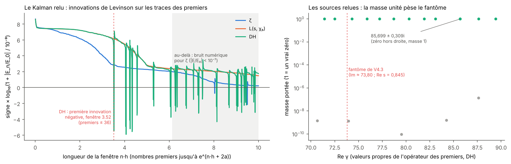

# V6.12 — Relecture : les trois idées rejetées relues, et les priorités refaites

**Date :** 10 octobre 2026  
**Statut :** relecture du corpus, expériences exécutées (§3 à §5), priorités recalculées par le navigateur (§7). Ce qui est mesuré et ce qui est supposé est séparé au §9.  
**Demande de l'auteur :** « D'abord refaire les priorités au regard de la relecture. Voir aussi si les 3 idées rejetées ne peuvent pas être relues symboliquement au regard du dictionnaire des idées et voir ce que ça donne comme autres idées. » La relecture est celle du corpus entier, faite pour construire le portail (V6.11.1).

## 1. Les trois idées rejetées

La carte des idées garde trois « diagnostics rétrogradés par l'audit » de la V4.3. Chacun a été rejeté pour une raison précise :

| Idée | Ce qu'elle voulait faire | Pourquoi elle a été rejetée (V4.3) |
|---|---|---|
| **Kalman, GPS analytique** | Suivre l'information accumulée échelle par échelle, comme un filtre de Kalman [Kal60] suit une position. | Information par unité de log X : 0,092 ; 0,114 ; 0,102 ; 0,070. Aucune loi ne se dégage. |
| **Localisation de sources** | Retrouver les zéros comme des sources cachées dans le signal des nombres premiers. | Partie réelle biaisée (de −0,002 à −0,09) ; le vrai zéro hors droite de DH est sous-estimé de 25 % ; un **mode fantôme** (Im ≈ 73,80, Re s = 0,845) est désigné comme le plus hors droite alors qu'aucun zéro n'est là. Pas de borne d'observabilité. |
| **Schrödinger, H~eff~** | Lire chaque zéro comme un niveau d'énergie d'un opérateur, et certifier une métrique M > 0. | Tests circulaires (les zéros étaient injectés) ; en dimension finie, M > 0 équivaut à un spectre réel (reparamétrisation) ; le signal de G est d'ordre 2, d'où des blocs de Jordan qu'aucune métrique positive ne rend autoadjoints. |

Depuis V6.9, le dictionnaire des opérateurs (le registre des métaphores) contient des outils qui n'existaient pas lors de ce rejet : **Le Chaînon**, **Le Générateur des premiers**, **La Masse unité**, **Le Repliement**, **La Métrique noyée**. Relire une idée symboliquement, c'est ici lui appliquer ces opérateurs et regarder quelle objection tombe et laquelle reste.

| Idée rejetée | Opérateurs qui la relisent | Ce qui tombe | Ce qui reste |
|---|---|---|---|
| Kalman, GPS | Le Générateur des premiers, La Métrique noyée | « Aucune loi » : le filtre tournait sur le mauvais signal, Q(X), qui est un carré. Sur les traces des premiers, il devient la récurrence de Levinson et donne une alarme nette (§3). | La loi du seuil de détection reste à établir. |
| Localisation de sources | La Masse unité, Le Recensement | Le fantôme et le biais : une vraie valeur propre porte la masse ĝ(γ), le fantôme ne pèse rien (§4). | Fenêtre finie : la borne d'observabilité n'est pas uniforme. |
| Schrödinger, H~eff~ | Le Chaînon, La Métrique manquante | La circularité : l'opérateur se construit sans zéros. Les blocs de Jordan : ils venaient du signal d'ordre 2. Le Théorème A se lit au rayon spectral (§5). | M > 0 équivaut toujours à RH. Le verrou est le même, mais il est maintenant situé : la métrique. |

## 2. Le cadre commun

Tout se passe sur les traces t~n~ = Σ~γ~ ĝ(γ) e^iγnh^, calculées par la formule explicite avec les seuls nombres premiers (document 33). Elles forment la métrique de Toeplitz G~jk~ = t~j−k~. Fenêtre principale : a = 0,04 et h = 0,01.

## 3. Le Kalman relu : les innovations de Levinson

**L'idée.** Pour un signal stationnaire de covariance t~n~, le filtre de Kalman est la récurrence de Levinson–Szegő [Sze39]. À chaque pas n, elle calcule une **innovation** E~n~ (l'erreur de prédiction) et un coefficient de réflexion k~n~. Elle repose sur trois faits classiques :

- E~n~ = det G~n+1~ / det G~n~ ;
- la métrique est positive jusqu'à la taille N ⟺ toutes les innovations sont positives ⟺ tous les |k~n~| < 1 (Szegő, Geronimus ; cités de mémoire) ;
- une innovation négative est une position impossible : le premier pas où la métrique cesse d'être positive.

**Mesuré** (`reread_levinson.csv`, jusqu'à n = 1 000, premiers ≤ 23 862) :

| Objet | Horizon numérique (\|E~n~/E~0~\| < 10^−7^) | \|k~n~\| max avant l'horizon | Première innovation négative |
|---|---|---|---|
| ζ | n = 613 (fenêtre 6,13) | 0,755 | **aucune** |
| L(s, χ~5~) | n = 823 (fenêtre 8,23) | 0,791 | **aucune** |
| DH | n = 529 | 10,9 | **n = 352 : fenêtre 3,52, nombres premiers ≤ 36** (E/E~0~ = −3·10^−4^) |

Au-delà de l'horizon, les innovations sont plus petites que les erreurs d'arrondi de la double précision, et leur signe n'est plus fiable. Pour ζ, une innovation de −1,4·10^−7^ apparaît à n = 950, au-delà de son horizon (613) ; à cette taille, la métrique n'a d'ailleurs aucune valeur propre négative (plus petite : −10^−15^ relativement, l'arrondi).

**Le seuil de détection.** On cherche à quelle longueur de fenêtre l'alarme de DH se déclenche, selon la fonction test (son poids sur le quadruplet de 85,7) et le pas :

| a | Poids relatif du quadruplet 85,7 | Pas fin (h = a/4) | Pas double (h = a/2) |
|---:|---:|---|---|
| 0,30 | 4·10^−10^ | 4,65 (premiers ≤ 190) | pas d'alarme |
| 0,20 | 10^−7^ | 6,70 (≤ 1 211) | pas d'alarme |
| 0,12 | 2·10^−5^ | **3,48 (≤ 41)** | 4,62 (≤ 129) |
| 0,08 | 0,012 | **3,48 (≤ 38)** | 4,84 (≤ 148) |
| 0,05 | 0,21 | **3,51 (≤ 37)** | 3,58 (≤ 39) |
| 0,04 | 0,38 | **3,52 (≤ 36)** | 3,58 (≤ 38) |
| 0,03 | 0,58 | **3,53 (≤ 36)** | 3,60 (≤ 38) |

- **Avec un pas fin et un poids suffisant, l'alarme se déclenche toujours vers une fenêtre de 3,5**, c'est-à-dire avec les nombres premiers jusqu'à 36 ou 41.
- **Un pas plus grossier la retarde ou l'éteint.** C'est La Métrique noyée du document 35, vue ici pas à pas.
- **L'alarme vient du quadruplet de 85,7 :** avec les seuls zéros sur la droite et ce quadruplet, elle sonne à la même longueur.
- **Chaque quadruplet, pris seul, sonne entre 2,7 et 3,5** (85,7 : 3,48 ; 114,2 : 2,71 ; 166,5 : 3,30 ; 176,7 : 2,78 ; 240,4 : 2,76). Ce n'est pas simplement 2π divisé par l'écart aux zéros voisins (3,2 à 4,7) : la loi reste à trouver.

> **Correctif V6.14 (document 38).** Le signe d'une innovation de Levinson n'est pas fiable dès que la métrique est mal conditionnée, même si |E~n~/E~0~| reste grand. L'« horizon » |E~n~/E~0~| < 10^−7^ n'est donc pas une borne de fiabilité. Relus avec les valeurs propres (λ~min~ < −10^−10^·λ~max~), les seuils par quadruplet seul sont 3,50 ; 3,91 ; 4,35 ; 4,17 ; 4,21 : ceux de 114,2 à 240,4 donnés ci-dessus étaient du bruit. La détection principale de DH (3,52, premiers ≤ 36 ; 3,53 aux valeurs propres) et l'absence d'alarme pour ζ et L tiennent. Dans le balayage (a, h), les lignes a = 0,3 et a = 0,2 deviennent 5,55 et 5,05. La loi trouvée : un quadruplet s'entend au temps de Heisenberg de sa hauteur, log(q·γ~0~/2π).

**Lecture.** Le GPS de la v1 n'était pas une mauvaise idée, il tournait sur le mauvais signal. Sur Q(X), carré de la formule explicite, l'information s'accumule sans loi visible. Sur les traces des premiers, le même filtre dit à chaque pas si la position reste possible : il reste dans le disque (|k~n~| < 1) pour ζ et L, et il sonne pour DH dès les nombres premiers ≤ 36. Le test de rejet de v3.2 avait besoin de X = 3·10^5^ pour voir DH à travers la croissance de Q.

## 4. Les sources relues : la masse unité pèse le fantôme

Avec les seuls nombres premiers ≤ 437, on regarde les valeurs propres de l'opérateur de DH entre 70 et 90 (`reread_sources.csv`) :

| Valeur propre | Masse portée | Plus proche vrai zéro | Verdict |
|---|---|---|---|
| 73,955 + 0,008i (près du fantôme de V4.3) | **1,3·10^−9^** | 74,325 (sur la droite), à 0,37 | ne pèse rien : rejetée |
| 74,324982 | 1,000000 | 74,324982, à 3·10^−10^ | vrai zéro |
| 85,699348 ± 0,308517i | 1,000000 | le zéro hors droite, à 6·10^−10^ | vrai zéro **hors droite**, partie réelle exacte |

L'ancien pipeline désignait comme « le plus hors droite » un mode qui n'existait pas, et sous-estimait de 25 % le vrai. La masse unité tranche les deux : le fantôme a une masse de 10^−9^, le vrai zéro une masse de 1 et sa partie réelle à 10^−9^ près. Ce qui reste : la masse est un critère par fenêtre, pas une borne uniforme quand la hauteur grandit.

## 5. Le Schrödinger relu : l'opérateur existe, le Théorème A se lit à son rayon spectral

- **Circularité : levée.** L'opérateur de translation e^hD^ est construit depuis les seuls nombres premiers (document 33). Son générateur D est un H~eff~ arithmétique au sens de la V4.3, sans zéro injecté.
- **Blocs de Jordan : expliqués.** Le signal G du corpus (Lemme 5) a des pôles doubles aux zéros, et un signal d'ordre 2 donne des blocs de Jordan. Le générateur utilise le signal d'ordre 1, −F′/F, dont chaque zéro simple porte une masse 1 (La Masse unité). L'ancien obstacle venait de l'ordre du signal, pas de l'idée.
- **M > 0 ⟺ RH : inchangé.** C'est le maillon manquant du chaînon (document 32). Relu, le Schrödinger ne contourne pas le verrou, il le désigne.
- **Le Théorème A au rayon spectral.** Le Théorème A dit que l'exposant de croissance de Q vaut Θ − ½, où Θ est la plus grande partie réelle des zéros. Dans une fenêtre, cet exposant se lit au rayon spectral du générateur, max |Im γ| sur les valeurs propres bien déterminées (masse 1 à 10^−6^ près) :

| Objet | Rayon spectral lu avec les premiers ≤ 437 | Valeur vraie dans la fenêtre résolue | Pente de log Q / log X (test de v3.2, X = 3·10^5^) |
|---|---|---|---|
| ζ | < 2·10^−7^ | 0 | 0,326 |
| L(s, χ~5~) | < 5·10^−7^ | 0 | 0,338 |
| DH | **0,308517** | 0,308517 (σ = 0,808517 ; pente prédite 2σ − 1 = 0,617) | 0,563 |

La croissance de Q mélange l'exposant avec des termes en (log X)^3^, ce qui donne 0,33 pour ζ alors que l'exposant vaut 0. Le générateur lit l'exposant directement. Le quadruplet de 240,4 (0,3695) est vu par la métrique mais pas encore résolu comme valeur propre : le rayon spectral lu est une borne inférieure de Θ − ½ dans la fenêtre.

*À gauche, les innovations de Levinson (signe × logarithme) selon la longueur de la fenêtre. ζ et L restent positives. DH devient négative dès 3,52, et ses changements de signe suivants marquent l'entrée des autres quadruplets. La zone grise est au-delà de l'horizon numérique de ζ. À droite, la masse des valeurs propres de DH : les vrais zéros pèsent 1, et le fantôme de V4.3 ne pèse rien.*

## 6. Ce que cela donne comme autres idées

1. **La loi de seuil des innovations.** De quoi dépend la longueur de détection (2,7 à 3,5 selon le quadruplet) : de l'écart à la droite, du poids, des voisins ? Une loi mesurée sur DH dirait à quel coût surveiller ζ vers le haut. Coût faible.
2. **L'île vue par les premiers.** Dans les espaces de l'Archipel d'Euler (document 30), suivre les innovations le long d'un chemin qui part d'un point d'Euler. Le bord de l'île serait le premier paramètre où une innovation devient négative, mesuré sans calculer un seul zéro.
3. **Le degré 2 par les premiers.** Le générateur n'a besoin que des coefficients de Hecke [Hec37] et du facteur gamma : pour les deux formes propres de poids 24, plus besoin de calculer les zéros. Le coût du degré 2 baisse nettement.
4. **Le Théorème A en fenêtre, comme énoncé.** Relier exactement l'exposant de Q (asymptotique) et le rayon spectral du générateur (fenêtre) : un énoncé qui raccorde le noyau démontré (A et B) au chaînon.
5. **Préparer la relecture.** La relecture rappelle que le noyau (Théorèmes A et B) est « démontré, non relu » depuis la v2. La préparer, avec un dossier à jour et des questions précises, ne coûte presque rien et ne dépend d'aucun autre coup.
6. **Allonger l'horizon.** Des innovations calculées en haute précision repousseraient l'horizon numérique de ζ (6,1 aujourd'hui). C'est la condition pour suivre la métrique plus haut.

## 7. Les priorités refaites

Le navigateur a reçu les nouveaux coups (prévisions écrites avant tout calcul), le coût du degré 2 a été revu de 4 à 2,5, et les trois relectures sont enregistrées comme faites. Son classement :

| Rang | Coup | Score | Maillon |
|---:|---|---:|---|
| 1 | La loi de seuil des innovations | 2,33 | métrique |
| 2 | La métrique des premiers, plus haut | 1,75 | métrique |
| 3 | L'île vue par les premiers | 1,5 | métrique |
| 4 | Préparer la relecture | 1,07 | — |
| 5 | Les paires de Lehmer [Leh56] | 1,0 | métrique |
| 6 | Le degré 2 par les premiers | 0,96 | traces |
| 7 | La loi du rayon | 0,33 | traces |

Les trois premiers portent sur le maillon manquant et se suivent naturellement : la loi de seuil dit combien d'échantillons il faut ; la métrique plus haut l'applique à ζ ; l'île la transporte dans l'Archipel. La préparation de la relecture est quatrième au score, mais elle est indépendante et peu coûteuse : elle peut avancer en parallèle.

## 8. Lecture selon l'hypothèse

L'hypothèse de l'auteur : RH n'existe que parce qu'elle est nécessaire à quelque chose de plus grand qui la rend nécessaire.

Les trois idées rejetées cherchaient RH dans le signal des zéros, à travers Q. C'étaient des instruments pour « voir ». Relues avec le chaînon, elles deviennent des instruments de la métrique :

- le GPS dit, pas à pas, où la positivité tient (ζ, L) et où elle casse (DH) ;
- les sources sont pesées ;
- l'opérateur de Schrödinger existe.

Les trois convergent vers le même maillon manquant, et cela précise la place du « plus grand ». Ce serait ce qui rend chaque innovation positive, à chaque pas et dans chaque fenêtre, c'est-à-dire ce qui garde le filtre dans le disque pour toujours. Dans le Modèle réduit, c'est la surface C×C qui le fait.

## 9. Démontré, mesuré, supposé

**Classique (cité).** La récurrence de Levinson–Szegő et l'équivalence « Toeplitz définie positive ⟺ |k~n~| < 1 » ; le lien Kalman–Levinson pour un signal stationnaire ; le critère de Weil [Wei52].

**Mesuré.** §3 : innovations positives pour ζ et L jusqu'à l'horizon numérique ; première innovation négative de DH à la fenêtre 3,52 (premiers ≤ 36), attribuée au quadruplet de 85,7 ; seuils par quadruplet de 3,5 à 4,35 (corrigés en V6.14 : la V6.12 donnait 2,7 à 3,5, du bruit). §4 : fantôme de V4.3 de masse 1,3·10^−9^, vrais zéros de masse 1. §5 : rayon spectral 0,308517 pour DH, inférieur à 10^−6^ pour ζ et L.

**Supposé.** Que la longueur de détection suive une loi simple (§6, point 1). Que l'énoncé « Théorème A en fenêtre » soit démontrable proprement (§6, point 4).

**Question divergente.** Pour ζ, l'innovation E~n~ décroît sans jamais s'annuler (une infinité de zéros remplit toujours de nouvelles directions), alors que pour une courbe elle tombe à zéro au rang 2g. La vitesse de décroissance des innovations de ζ mesure-t-elle quelque chose de l'objet, une « dimension » au sens du document 08 ?

## 10. Limites

- Double précision : horizon numérique à n = 613 pour ζ ; au-delà, le signe des innovations n'est pas fiable.
- Une seule famille de fonctions test (cos^4^) ; le seuil peut dépendre de sa forme.
- Le fantôme de V4.3 est comparé par sa position (Im ≈ 73,8) : l'ancien pipeline n'est pas réexécuté ici.
- Les pentes de Q viennent du test de v3.2 (X = 3·10^5^).
- Résultats classiques cités de mémoire.

## 11. Noms proposés pour le registre

| Nom | Image | Énoncé exact | Où l'image casse | Question divergente |
|---|---|---|---|---|
| **L'Innovation** | Le GPS qui dit, à chaque pas, si la position est encore possible. | Récurrence de Levinson [Lev47] sur les traces des premiers : ζ et L restent dans le disque (\|k~n~\| ≤ 0,79) ; DH sonne à la fenêtre 3,52 (premiers ≤ 36). | Horizon numérique (double précision). | La longueur de détection suit-elle une loi simple ? |
| **Le Fantôme pesé** | On reconnaît un fantôme à ce qu'il ne pèse rien. | Le mode fantôme de V4.3 (Im ≈ 73,8) porte une masse de 1,3·10^−9^ ; les vrais zéros, 1. | Critère par fenêtre, pas borne uniforme. | La masse unité devient-elle une borne d'observabilité quand la fenêtre grandit ? |
| **Le Rayon spectral** | La plus grande dérive se lit au bord du spectre. | Θ − ½ dans une fenêtre = max \|Im γ\| du générateur : 0,308517 pour DH, < 10^−6^ pour ζ et L ; la pente de Q mélange cet exposant avec (log X)^3^. | Borne inférieure : un quadruplet non résolu ne compte pas. | Le Théorème A et le générateur sont-ils la même mesure, vue à deux échelles ? |

## Fichiers

- Code : `src/prime_generator.py` (fonction `levinson`, ajoutée en V6.12).
- Script : `scripts/run_rejected_reread.py` (environ 90 secondes ; `--figure` pour la figure seule).
- Données : `reread_levinson.csv`, `reread_levinson_summary.csv`, `reread_threshold.csv`, `reread_quadruplets.csv`, `reread_sources.csv`, `reread_theoremA.csv`, figure `reread.png`.
- Tests : `tests/test_v612_reread.py` (2 tests).
- Navigateur : nouveaux coups dans `2_Methode/Navigateur/carte_navigation.json`.

<!-- references:debut -->

## Références

Format : [clé] auteurs, *titre*, publication, lien. Fiches complètes et état de vérification : document 42 (registre des sources).

- [Hec37] E. Hecke. *Über Modulfunktionen und die Dirichletschen Reihen mit Eulerscher Produktentwicklung I, II*. Math. Ann. 114 (1937), 1–28 et 316–351 (non vérifié). — non vérifié
- [Kal60] R. E. Kalman. *A new approach to linear filtering and prediction problems*. J. Basic Eng. 82 (1960), 35–45. <https://www.cs.unc.edu/~welch/kalman/kalmanPaper.html> — partiellement vérifié
- [Leh56] D. H. Lehmer. *On the roots of the Riemann zeta-function*. Acta Math. 95 (1956), 291–298. <https://en.wikipedia.org/wiki/Lehmer_pair> — partiellement vérifié
- [Lev47] N. Levinson. *The Wiener RMS (root mean square) error criterion in filter design and prediction*. J. Math. Phys. 25 (1947), 261–278 ; amélioré par J. Durbin, Rev. Inst. Int. Stat. 28 (1960), 233–243. <https://en.wikipedia.org/wiki/Levinson_recursion> — partiellement vérifié
- [Sze39] G. Szegő. *Orthogonal Polynomials*. AMS Colloquium Publications 23 (1939). <https://en.wikipedia.org/wiki/Orthogonal_polynomials_on_the_unit_circle> — partiellement vérifié
- [Wei52] A. Weil. *Sur les « formules explicites » de la théorie des nombres premiers*. Comm. Sém. Math. Univ. Lund, vol. suppl. dédié à M. Riesz (1952), 252–265. <https://en.wikipedia.org/wiki/Weil%27s_criterion> — partiellement vérifié

<!-- references:fin -->
