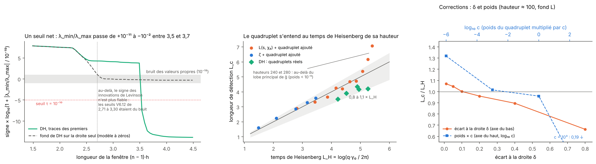

# V6.14 — La loi de seuil : un quadruplet hors droite s'entend au temps de Heisenberg de sa hauteur

**Date :** 10 octobre 2026  
**Statut :** expériences exécutées et reproduites ; un lemme exact (§3) ; une loi mesurée, avec une prévision écrite avant les tests (§4) ; une correction de la V6.12 (§2). Ce qui est démontré, mesuré et supposé est séparé au §9.  
**Demande de l'auteur :** « Suis cette trajectoire avec les 3 relectures d'abord en parallèle puis les autres. » Après la pré-relecture (document 37), c'est le premier coup de recherche proposé par le navigateur : « La loi de seuil des innovations » (score 2,33).

## 1. La question, telle qu'elle avait été pré-enregistrée

En V6.12 (document 36), la récurrence de Levinson [Lev47] sur les traces des nombres premiers a détecté le quadruplet hors droite de DH à la fenêtre 3,52, avec les premiers ≤ 36. Elle donnait aussi, quadruplet par quadruplet, des seuils de 2,7 à 3,5. Le navigateur a enregistré, avant tout calcul :

- **Question :** de quoi dépend la longueur de fenêtre où la métrique de DH cesse d'être positive ?
- **Thèse :** une loi simple en l'écart à la droite, le poids et l'écart aux voisins.
- **Témoin :** des quadruplets synthétiques placés à la main, et L(s, χ₅) sans alarme.
- **Réfutation :** aucune loi.

**Réponse courte.** Il y a une loi, mais ce n'est pas celle de la thèse. La longueur de détection dépend surtout de la **hauteur** du quadruplet, à travers la densité des zéros. L'écart à la droite, le poids et les voisins ne sont que des corrections.

## 2. D'abord une correction de la V6.12

**Le signe d'une innovation n'est pas fiable dès que la métrique est mal conditionnée, même si l'innovation reste grande.** La V6.12 tenait une innovation pour fiable tant que |E~n~/E~0~| > 10^−7^. Ce critère ne protège de rien.

Exemple (`seuil_correction_fond.csv`). Le fond de DH réduit à ses zéros sur la droite a une métrique positive par construction : chaque zéro y entre avec un poids ĝ(γ) ≥ 0. Pourtant, à la taille 296, Levinson rend une innovation de −2·10^−3^, mille fois au-dessus de l'ancien seuil. Les valeurs propres disent pourquoi : dès la taille 271, λ~min~/λ~max~ vaut 10^−14^, et la matrice est numériquement singulière.

| Taille de G | E~n~/E~0~ (Levinson) | λ~min~/λ~max~ (valeurs propres) |
|---|---|---|
| 251 | 6,1·10^−3^ | 2,2·10^−11^ |
| 271 | 3,2·10^−3^ | 1,2·10^−14^ |
| 296 | **−2,0·10^−3^** | 4,3·10^−17^ (bruit) |
| 301 | 1,9·10^−3^ | −1,5·10^−16^ (bruit) |

**Nouveau critère.** La fenêtre de détection est la plus petite taille n telle que λ~min~(G~n~) < −10^−10^·λ~max~(G~n~). Le bruit des valeurs propres en double précision est de l'ordre de 10^−15^. Comme G~n~ est une sous-matrice principale de G~n+1~, λ~min~ ne croît pas avec n (entrelacement de Cauchy), et la recherche se fait par dichotomie. La longueur de fenêtre est (n − 1)·h.

**Ce qui tient et ce qui tombe.**

| Résultat de la V6.12 | Valeurs propres (V6.14) | Verdict |
|---|---|---|
| DH par les premiers : fenêtre 3,52, premiers ≤ 36 | 3,53, premiers ≤ 36 | **tient** |
| ζ et L(s, χ₅) : aucune alarme | aucune valeur propre < −10^−10^ jusqu'à la taille 901 | **tient** |
| Quadruplet de 85,7 seul : 3,48 | 3,50 | tient |
| Quadruplets de 114,2 ; 166,5 ; 176,7 ; 240,4 seuls : 2,71 ; 3,30 ; 2,78 ; 2,76 | 3,91 ; 4,35 ; 4,17 ; 4,21 | **tombe** : c'était du bruit |
| Balayage (a, h), lignes a = 0,3 et a = 0,2 : 4,65 et 6,7 | 5,55 et 5,05 | corrigé ; les dix autres lignes tiennent |
| « Horizons numériques » 613 (ζ), 823 (L), 529 (DH) | — | ce ne sont pas des bornes de fiabilité |

`run_rejected_reread.py` utilise désormais ce critère. Ses fichiers `reread_quadruplets.csv` et `reread_threshold.csv` sont régénérés, et le document 36 porte un correctif.

**Précision étendue.** Avec 80 chiffres (mpmath), le premier changement de signe exact est stable, et le critère en double précision ne le retarde que de 0,1 à 0,16. Avec 30 chiffres, Levinson se trompe encore (3,63 au lieu de 4,08).

| Configuration (modèle à zéros, fond L) | 30 chiffres | 80 chiffres | double, valeurs propres |
|---|---|---|---|
| Quadruplet à 99,80, δ = 0,2 | 3,63 (faux) | **4,08** | 4,19 |
| Quadruplet à 20,74, δ = 0,2 | 2,73 | **2,73** | 2,89 |

## 3. Pourquoi le seuil est net : un lemme d'inertie

Une paire de zéros hors droite γ~0~ ∓ iδ entre dans la métrique sous la forme d'un terme de rang 2 :

  G = B + w·x·y\* + w̄·y·x\*,  avec x~j~ = e^i(γ0−iδ)jh^, y~j~ = e^i(γ0+iδ)jh^, w = ĝ(γ~0~ − iδ).

Ici B est la métrique du reste (le fond). Écrivons U = [x, y], C = [[0, w], [w̄, 0]] et K = U\*B^−1^U, la matrice 2 × 2 du noyau reproduisant du fond aux deux points de la paire.

**Lemme (prouvé ici, élémentaire).** Si B est définie positive, le nombre de valeurs propres négatives de G est égal au nombre de valeurs propres positives de C^−1^ + K, moins 1. Donc G cesse d'être positive si et seulement si

  |K~xy~ + 1/w̄|² < K~xx~·K~yy~.

Pour un quadruplet (deux paires), on retranche 2 au lieu de 1.

*Preuve.* On applique l'additivité de l'inertie (Haynsworth [Hay68]) à la matrice par blocs [[B, U], [U\*, −C^−1^]], par ses deux compléments de Schur : In(B) + In(−C^−1^ − K) = In(−C^−1^) + In(G). Or In(B) = (n, 0) et In(−C^−1^) = (1, 1). ∎

**Vérifié** (`seuil_inertie.csv`) : sur un fond complet de L(s, χ₅) et un quadruplet de poids 1 000, le nombre de valeurs propres négatives donné par le lemme coïncide avec le calcul direct à chaque taille de 76 à 89 (0, puis 1 à la taille 82, puis 2 à la taille 84).

**Lecture.** La paire devient visible quand le fond distingue ses deux points mieux que l'inverse de son poids. Un poids multiplié par c ne déplace donc le seuil que par l'intermédiaire de log c, si le noyau K croît vite. C'est ce qu'on observe au §5 : le seuil saute de 10^−11^ à 10^−2^ en quelques centièmes de fenêtre (figure, panneau de gauche).

## 4. La loi : le temps de Heisenberg

**Le chemin.** Sur le fond de L(s, χ₅), la première idée était un comptage : le seuil vaudrait le nombre de zéros plus bas que le quadruplet, plus une constante (≈ 290 ± 20 de la hauteur 20 à 280). L'expérience de retrait l'a réfutée. Retirer du fond les 21 ou les 43 zéros les plus bas ne change pas le seuil (4,19 contre 4,20). En retirer 80 ne l'avance que de 0,18.

La seconde idée tient. **Le seuil suit le temps de Heisenberg à la hauteur du quadruplet**, c'est-à-dire 2π fois la densité moyenne des zéros :

  L~H~(γ~0~) = log(q·γ~0~ / 2π)  (q = conducteur ; 1 pour ζ, 5 pour L(s, χ₅) et DH).

C'est aussi le logarithme du conducteur analytique C(γ~0~) = q·γ~0~/2π. En nombres premiers, **un quadruplet à la hauteur γ~0~ s'entend avec les premiers jusqu'à environ q·γ~0~/2π.**

**Prévision écrite avant les tests** (`data/seuil_prevision.md`, horodatée 2026-10-10 à 00 h 29 UTC, copiée telle quelle). La loi a été trouvée sur le fond de L(s, χ₅). Les quatre prévisions suivantes ont été écrites avant d'être calculées :

| Prévision | Résultat | Verdict |
|---|---|---|
| P1 : pour ζ (q = 1), L~c~ ≈ log(γ~0~/2π), à ±15 % | rapport 1,03 à 1,08 sur cinq hauteurs | **tenue** |
| P2 : L~c~ ne dépend pas du pas h (0,005 ; 0,01 ; 0,02), à ±5 % | 4,15 ; 4,20 ; 4,32 | **tenue** |
| P3 : L~c~ dépend peu de la largeur a (0,03 ; 0,04 ; 0,06) | 4,25 ; 4,20 ; 4,12 | **tenue** |
| P4 : un quadruplet qui remplace un zéro du fond est détecté vers 0,8–0,85 L~H~, comme ceux de DH | 0,82 à 0,99, presque comme un quadruplet ajouté | **réfutée** |

**Mesuré** (traces des premiers pour le fond, quadruplet synthétique δ = 0,2 placé au milieu de deux zéros, `seuil_synthetiques.csv`) :

| Fond | Hauteur | Poids relatif | L~c~ | L~H~ | L~c~/L~H~ |
|---|---|---|---|---|---|
| ζ | 27,7 | 0,91 | 1,60 | 1,48 | 1,08 |
| ζ | 51,4 | 0,71 | 2,25 | 2,10 | 1,07 |
| ζ | 100,1 | 0,26 | 2,86 | 2,77 | 1,03 |
| ζ | 148,7 | 0,04 | 3,28 | 3,16 | 1,04 |
| ζ | 199,6 | 0,001 | 3,59 | 3,46 | 1,04 |
| L(s, χ₅) | 20,7 | 0,95 | 2,89 | 2,80 | 1,03 |
| L(s, χ₅) | 38,8 | 0,82 | 3,32 | 3,43 | 0,97 |
| L(s, χ₅) | 59,5 | 0,63 | 3,65 | 3,86 | 0,95 |
| L(s, χ₅) | 79,8 | 0,43 | 4,25 | 4,15 | 1,02 |
| L(s, χ₅) | 99,8 | 0,26 | 4,20 | 4,38 | 0,96 |
| L(s, χ₅) | 129,5 | 0,10 | 4,69 | 4,64 | 1,01 |
| L(s, χ₅) | 160,3 | 0,02 | 4,71 | 4,85 | 0,97 |
| L(s, χ₅) | 200,4 | 0,001 | 5,37 | 5,07 | 1,06 |
| L(s, χ₅) | 239,9 | 3·10^−6^ | 6,17 | 5,25 | 1,18 |
| L(s, χ₅) | 279,6 | 10^−5^ | 7,07 | 5,41 | 1,31 |

De la hauteur 20 à la hauteur 200, sur deux fonds de conducteurs différents, **L~c~/L~H~ reste entre 0,95 et 1,08.** **Contrôle indépendant** : un vérificateur, avec son propre code (quadrature de φ̂, modèle à zéros, aucun module du corpus), trouve 1,03 à 1,06 pour ζ et 0,94 à 1,06 pour L(s, χ₅) aux hauteurs 50, 100 et 200. Aux hauteurs 240 et 280, le quadruplet est au-delà du lobe principal de ĝ (premier zéro à 3π/a ≈ 236) : son poids tombe sous 10^−5^ et il est entendu plus tard, comme le prévoit la correction de poids du §5.

## 5. Ce qui ne compte presque pas

À la hauteur ≈ 100, sur le fond de L(s, χ₅) :

- **L'écart à la droite δ.** De δ = 0,01 à δ = 0,8, L~c~/L~H~ passe de 1,07 à 0,66 : 1,07 (0,01) ; 1,05 (0,05) ; 1,00 (0,1) ; 0,96 (0,2) ; 0,90 (0,4) ; 0,66 (0,8). La limite δ → 0 est finie. Un quadruplet aussi proche de la droite qu'on veut s'entend vers 1,07 L~H~ en arithmétique exacte, mais son signal est d'ordre δ², donc la précision nécessaire croît.
- **Le poids.** En multipliant le poids du quadruplet par c : 1,32 (c = 10^−6^) ; 1,02 (10^−3^) ; 0,96 (1). C'est un effet logarithmique, d'environ 6 % par décade, conforme au lemme. Il faut un poids des centaines de fois plus grand que celui de n'importe quel zéro du fond pour s'affranchir de la loi (rapport 0,19 pour c = 10³).
- **La position entre deux zéros voisins :** de 0,95 à 1,02 sur sept positions, sans tendance.
- **Les zéros plus bas :** en retirer 21 ou 43 ne change rien ; en retirer 80 avance le seuil de 4 %.
- **Le pas h :** aucun effet, à condition que h < π/γ~0~ (au-delà, la hauteur se replie : c'est le cas a = 0,12, h = 0,06 du balayage, où la fréquence de Nyquist, 52, est sous la hauteur 85,7, et la détection recule de 3,48 à 4,62). C'est vraisemblablement le mécanisme de la Métrique noyée de la V6.11 : au pas h = 0,1, la fréquence de Nyquist (31) est sous toutes les hauteurs des quadruplets de DH, les zéros repliés s'empilent et allongent le temps de Heisenberg effectif. À vérifier.
- **La largeur a de la fonction test :** effet de 3 %.

## 6. Les quadruplets réels de DH sont entendus un peu plus tôt

Chaque quadruplet de DH, isolé (les autres sont retirés du fond complet calculé par les premiers, `seuil_reels.csv`) :

| Hauteur | δ | L~c~ | L~H~ | L~c~/L~H~ | Analogue synthétique (même hauteur, même δ, zéro voisin remplacé) |
|---|---|---|---|---|---|
| 85,70 | 0,309 | 3,51 | 4,22 | 0,83 | 0,90 |
| 114,16 | 0,151 | 3,91 | 4,51 | 0,87 | 0,97 |
| 166,48 | 0,074 | 4,35 | 4,89 | 0,89 | 0,99 |
| 176,70 | 0,224 | 4,17 | 4,95 | 0,84 | 0,94 |
| 240,40 | 0,370 | 4,21 | 5,25 | 0,80 | 0,82 |

Les quadruplets réels sont entendus à 0,80–0,89 L~H~, de 2 à 10 % plus tôt que leurs analogues synthétiques. Remplacer un zéro voisin ne l'explique pas (P4 réfutée). **Question ouverte** : DH n'a pas de produit d'Euler, et la statistique fine de ses zéros (les écarts entre voisins, la répulsion) n'est peut-être pas celle de L(s, χ₅). Le facteur 0,8–0,9 en serait la trace.

## 7. Ce que la loi veut dire

- **Un zéro hors droite n'est pas entendu avant que la fenêtre ait résolu l'écart moyen des zéros à sa hauteur.** Avant le temps de Heisenberg, la fenêtre ne voit qu'une densité lissée, positive, qui absorbe la paire. Après lui, la fenêtre voit les zéros un par un : entre eux, la métrique du fond n'a presque plus de poids, et la paire négative s'y loge. C'est la lecture du lemme du §3 par le noyau reproduisant. L'explication fine (la croissance de K à L~H~) reste à démontrer.
- **En nombres premiers : il faut les premiers jusqu'au conducteur analytique de la hauteur.** Pour le quadruplet de DH à 85,7, C = 5·85,7/2π ≈ 68 ; la détection a lieu avec les premiers ≤ 36, soit C^0,83^·e^0,08^.
- **Pour surveiller plus haut** (coup « La métrique des premiers, plus haut »), la loi donne le plan. Pour voir des quadruplets à la hauteur T, il faut une fenêtre d'environ log(qT/2π), un pas h < π/T, et une largeur a < 3π/T pour que ĝ(T) ne soit pas dans les lobes secondaires. Pour T = 600 et q = 5 : fenêtre ≈ 6,2, h < 0,005, a < 0,016, soit environ 1 300 échantillons.

## 8. Lecture selon l'hypothèse

L'hypothèse de travail est que RH n'existe que parce qu'elle est nécessaire à quelque chose de plus grand qui la rend nécessaire.

**Mesuré.** Les premiers ne trahissent une sortie de la droite à la hauteur T qu'à partir de l'échelle q·T/2π. Le test de positivité est donc local en hauteur, et son coût croît avec elle : chaque hauteur a son échelle de premiers, et aucune famille finie de premiers ne surveille toutes les hauteurs.

**Supposé.** Si la positivité de ζ est la restriction d'une positivité sur un objet plus grand, cet objet doit agir à toutes les échelles C(T) à la fois. C'est le rôle de la tour dans le Modèle réduit, où chaque étage F~q^n~ est une échelle. La loi de Heisenberg dit quel étage de la tour correspond à quelle hauteur : l'étage n ↔ log C(T). C'est une correspondance de lecture, pas un résultat.

## 9. Démontré, mesuré, supposé

| | Énoncé | Statut |
|---|---|---|
| Démontré | Lemme d'inertie (§3) : G cesse d'être positive ⟺ C^−1^ + U\*B^−1^U est définie positive. | Preuve d'une ligne (Haynsworth), vérifiée numériquement. |
| Démontré | λ~min~(G~n~) ne croît pas avec n. | Entrelacement de Cauchy. |
| Mesuré | Correction de la V6.12 : quatre seuils par quadruplet étaient du bruit ; la détection principale de DH (3,53) tient. | Valeurs propres, précision étendue à 80 chiffres. |
| Mesuré | L~c~ ≈ L~H~ = log(q·γ~0~/2π) : rapport 0,95–1,08 pour ζ et L (hauteurs 20 à 200) ; 0,80–0,89 pour DH réel. | Trois prévisions sur quatre tenues ; P4 réfutée ; recalculé par un vérificateur indépendant. |
| Mesuré | δ, poids, position, pas, largeur : corrections de quelques pourcents (sauf δ ≥ 0,4 et poids < 10^−5^). | Balayages. |
| Supposé | Le seuil au temps de Heisenberg vient de la croissance du noyau reproduisant d'une mesure discrète quand la fenêtre résout ses atomes. | Heuristique, non démontré. |
| Supposé | Le facteur 0,8–0,9 de DH vient de la statistique de ses zéros. | Question ouverte. |

## 10. Limites

- Un seul type de fonction test (cos⁴) ; un seul pas principal (h = 0,01).
- Le deuxième chiffre du rapport dépend du seuil τ : entre 10^−13^ et 10^−8^, il bouge de 0,04 au plus (contrôle indépendant). La bande 0,9–1,1 tient.
- Pour L(s, χ₅), caractère complexe, l'équation fonctionnelle n'apparie que γ~0~ ± iδ ; la paire −γ~0~ ± iδ du quadruplet synthétique est ajoutée par symétrie, elle n'est pas imposée.
- Quadruplets synthétiques à δ = 0,2 pour la loi de hauteur ; la dépendance en δ n'est mesurée qu'à la hauteur 100.
- Les zéros servent à construire les quadruplets synthétiques et à les retirer : la loi porte sur l'instrument, pas sur une fonction inconnue.
- Hauteurs ≤ 280 ; au-delà de 236, les poids sont dans les lobes secondaires de ĝ.
- Résultats classiques (entrelacement, Haynsworth) cités de mémoire.

## 11. Noms proposés pour le registre

| Nom | Image | Énoncé exact | Où l'image casse | Question divergente |
|---|---|---|---|---|
| **Le Temps de Heisenberg** | Une note n'est entendue que lorsque l'oreille sépare les notes voisines. | Un quadruplet à la hauteur γ~0~ est détecté à la fenêtre L~c~ ≈ log(q·γ~0~/2π) : rapport 0,95–1,08 pour ζ et L, 0,80–0,89 pour DH ; premiers jusqu'à ≈ q·γ~0~/2π. | Poids < 10^−5^ (lobes secondaires) ; repliement si h > π/γ~0~ ; le facteur de DH n'est pas expliqué. | Le facteur dépend-il de la statistique des zéros (répulsion ou non) ? |
| **La Balance d'inertie** | Deux poids opposés sur un plateau qui est le fond. | G = B + paire cesse d'être positive ⟺ C^−1^ + U\*B^−1^U > 0 (noyau reproduisant du fond aux deux points de la paire). | B doit être définie positive. | Peut-on calculer la croissance du noyau au temps de Heisenberg ? |
| **Le Signe fragile** | L'aiguille d'une boussole cassée continue de pointer avec assurance. | Fond positif par construction, innovation de Levinson de −2·10^−3^ à la taille 296 (λ~min~/λ~max~ = 4·10^−17^) ; à 30 chiffres, une erreur de 0,45 sur la fenêtre. | — | Quelle précision faut-il pour une fenêtre donnée ? |

## 12. Suite proposée

- **Le temps de Heisenberg en degré 2, avec Δ de Ramanujan [Ram16].** Fond L(Δ, s) calculé par les coefficients τ(n), quadruplets synthétiques. Prévision : la densité des zéros double (degré 2), donc L~c~ ≈ log C(T) ≈ 2·log(T/2π) à la hauteur T (à une correction de poids près). Ce serait un premier calcul en degré 2.
- **Le devineur de lois.** Faire passer chaque table du corpus dans une détection de relations entières (PSLQ) et un ajustement par analyse dimensionnelle, et pré-enregistrer chaque loi proposée avant de la tester. C'est ce qui a été fait ici à la main.

## Fichiers

- Code : `src/prime_generator.py` (fonctions `lmin_ratio`, `first_negative_size`, `heisenberg_length`, ajoutées en V6.14).
- Script : `scripts/run_detection_threshold.py` (environ 100 secondes ; `--figure` pour la figure seule). `scripts/run_rejected_reread.py` est corrigé (critère des valeurs propres).
- Données : `seuil_prevision.md` (la prévision, écrite avant les tests), `seuil_correction_fond.csv`, `seuil_reels.csv`, `seuil_synthetiques.csv`, `seuil_inertie.csv`, `seuil_precision.csv`, figure `seuil.png` ; `reread_quadruplets.csv` et `reread_threshold.csv` régénérés.
- Tests : `tests/test_v614_seuil.py` (3 tests) ; `tests/test_v612_reread.py` mis à jour.

<!-- references:debut -->

## Références

Format : [clé] auteurs, *titre*, publication, lien. Fiches complètes et état de vérification : document 42 (registre des sources).

- [Hay68] E. V. Haynsworth. *Determination of the inertia of a partitioned Hermitian matrix*. Linear Algebra Appl. 1 (1968), 73–81. <https://en.wikipedia.org/wiki/Haynsworth_inertia_additivity_formula> — partiellement vérifié
- [Lev47] N. Levinson. *The Wiener RMS (root mean square) error criterion in filter design and prediction*. J. Math. Phys. 25 (1947), 261–278 ; amélioré par J. Durbin, Rev. Inst. Int. Stat. 28 (1960), 233–243. <https://en.wikipedia.org/wiki/Levinson_recursion> — partiellement vérifié
- [Ram16] S. Ramanujan. *On certain arithmetical functions*. Trans. Cambridge Philos. Soc. 22 (1916), 159–184. <https://encyclopediaofmath.org/wiki/Ramanujan_function> — partiellement vérifié

<!-- references:fin -->
