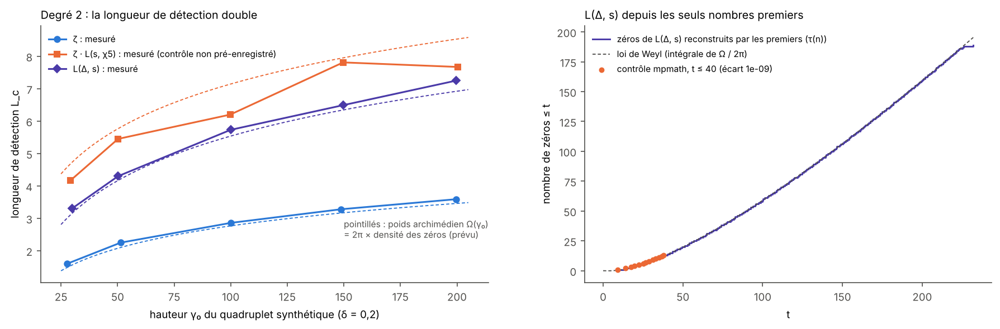
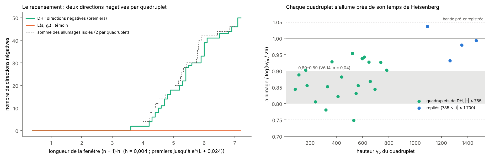

# V6.15 — Le degré 2 et le recensement : la loi de seuil avec Δ de Ramanujan [Ram16], et les quadruplets de DH comptés par les premiers

**Date :** 10 octobre 2026  
**Statut :** deux coups du navigateur, joués l'un après l'autre. Prévisions écrites avant tout calcul (`data/prevision_v615.md`, 06 h 26 UTC). Expériences exécutées et reproduites ; contrôles indépendants des zéros ; ce qui est démontré, mesuré et supposé est séparé au §6.  
**Demande de l'auteur :** « Faire les deux points suivants. » Ce sont les deux premiers coups proposés par le navigateur après la V6.14 : « Le temps de Heisenberg en degré 2 (Δ de Ramanujan) » (score 2,10) et « La métrique des premiers, plus haut » (score 1,75).

## 1. Les prévisions et leur sort

| | Prévision (écrite avant le calcul) | Résultat | Verdict |
|---|---|---|---|
| P1 | L(Δ, s), quadruplet synthétique (δ = 0,2) aux hauteurs 30 à 200 : L~c~/Ω(γ~0~) entre 0,9 et 1,15 | 1,02 à 1,05 | **tenue** |
| P2 | À la même hauteur, L~c~(Δ)/L~c~(ζ) ≈ 2, à ±15 % | 1,91 à 2,07 | **tenue** |
| P3 | DH, fenêtre 7,2 : exactement 30 directions négatives (deux par quadruplet de \|t\| ≤ 600) | 50 ; les 15 quadruplets de \|t\| ≤ 600 en portent exactement 30 ; les 20 autres viennent de zéros hors droite plus hauts, tous identifiés (§3) | **fausse dans sa lettre** |
| P4 | Chaque quadruplet de \|t\| ≤ 600 s'allume entre 0,75 et 1,05 × log(5γ~0~/2π) | 14 sur 15 ; le quinzième (531,3 ; δ = 0,35) à 0,749 | **tenue à une exception près** |
| P5 | Témoin L(s, χ₅) : aucune direction négative jusqu'à 7,2 | aucune | **tenue** |
| P6 | Le générateur retrouve les 15 quadruplets à 10^−3^ près | 14 sur 15 (à 8·10^−5^ près) ; pas celui de 595,0 | **tenue à une exception près** |

## 2. Premier coup : le temps de Heisenberg en degré 2, avec Δ de Ramanujan

### 2.1 L(Δ, s) depuis les seuls nombres premiers

Δ(z) = q·∏(1 − q^n^)^24^ = Σ τ(n) q^n^ est la forme modulaire de poids 12 et de niveau 1. Sa fonction L normalisée, L(Δ, s) = Σ τ(n) n^−11/2^ n^−s^, a un produit d'Euler de degré 2 et une équation fonctionnelle s ↦ 1 − s. C'est le premier objet de degré 2 du corpus.

- **Les coefficients τ(n), exacts jusqu'à 25 000.** On calcule ∏(1 − q^n^)³ par l'identité de Jacobi, on l'élève à la puissance 8 modulo six nombres premiers, puis on reconstruit par les restes chinois. Contrôles : τ(1) à τ(11) et τ(23) = 18 643 272 ; la relation de Hecke [Hec37] τ(p²) = τ(p)² − p^11^ ; la multiplicativité ; et la borne de Deligne |τ(p)| ≤ 2p^11/2^ pour tous les p ≤ 25 000 (maximum 1,974).
- **Les traces, sans aucun zéro.** La formule explicite donne t~n~ par les premiers (coefficients de −L′/L) et un terme archimédien de poids Ω(r) = 2 Re ψ(6 + ir) − 2 log 2π. **Ω(r) est 2π fois la densité moyenne des zéros à la hauteur r.**
- **Contrôle indépendant des zéros.** Treize zéros de t ≤ 40 sont calculés sans les premiers, par la série des fonctions gamma incomplètes de Λ(6 + it) en précision étendue (mpmath). Le premier est 9,2223794. L'opérateur reconstruit des seules traces des premiers retrouve ces treize zéros **à 1,2·10^−9^ près**, avec des masses 1. Il en retrouve 189 jusqu'à 232, et leur nombre suit la formule de comptage de Riemann–von Mangoldt [Man05] (parfois appelée « loi de Weyl » dans le corpus) (20 contre 19,7 à 50 ; 59 contre 59,0 à 100 ; 106 contre 106,5 à 150 ; 159 contre 159,4 à 200). **Correctif V6.17 :** le Contour tourné (document 41) compte 196 zéros jusqu'à 232,08 ; le générateur en a manqué 7 entre 224 et 232, au bord de sa fenêtre, et sa précision se dégrade au-dessus de t = 150 (10^−7^ jusqu'à 150, 2,7·10^−4^ à 232). Les comptages jusqu'à 200 sont confirmés exactement.
- **Formule explicite.** Avec une fonction test large (a = 0,5), les traces des premiers et celles des treize zéros coïncident à 2·10^−7^ près. L'écart restant vient des zéros au-delà de 40.
- **Positivité.** La métrique de L(Δ, s) n'a aucune direction négative jusqu'à la taille 1 001.

Je me suis d'abord trompé sur quatre de ces zéros (jusqu'à 4·10^−3^), à cause d'une recherche de racine trop grossière. Le générateur avait raison, et une dichotomie l'a confirmé.

### 2.2 La loi en degré 2

La loi de la V6.14 se réécrit sans conducteur ni degré : **la longueur de détection est le poids archimédien à la hauteur du quadruplet**,

  L~c~ ≈ Ω(γ~0~) = 2π × densité des zéros = log Q + 2 Re Σ~j~ (γ~j~′/γ~j~)(½ + iγ~0~).

En degré 1, Ω(γ~0~) ≈ log(qγ~0~/2π). Pour L(Δ, s), Ω(γ~0~) ≈ 2 log(γ~0~/2π), deux fois plus.

| Hauteur visée | L(Δ, s) : L~c~ | Ω~Δ~ | rapport | ζ : L~c~ | Ω~ζ~ | rapport | L~c~(Δ)/L~c~(ζ) |
|---|---|---|---|---|---|---|---|
| 30 | 3,31 | 3,16 | 1,05 | 1,60 | 1,48 | 1,08 | 2,07 |
| 50 | 4,30 | 4,17 | 1,03 | 2,25 | 2,10 | 1,07 | 1,91 |
| 100 | 5,73 | 5,54 | 1,03 | 2,86 | 2,77 | 1,03 | 2,00 |
| 150 | 6,49 | 6,34 | 1,02 | 3,28 | 3,16 | 1,04 | 1,98 |
| 200 | 7,25 | 6,92 | 1,05 | 3,59 | 3,46 | 1,04 | 2,02 |

**En degré 2, la longueur d'écoute double.** Elle double parce que la densité des zéros double : ce n'est pas le degré en tant que tel qui compte, c'est la densité.

**Contrôle supplémentaire, non pré-enregistré : le produit ζ·L(s, χ₅).** C'est un objet de degré 2 non primitif : ses zéros sont la réunion de deux familles indépendantes, et son poids est la somme Ω~ζ~ + Ω~L~. Le rapport L~c~/Ω y vaut 0,87 à 0,98. C'est plus tôt que pour Δ ou pour ζ (1,02 à 1,08), et proche des quadruplets réels de DH (0,80 à 0,89). Deux familles de zéros superposées ne se repoussent pas entre elles. Cela va dans le sens de l'hypothèse du coup « Le facteur de DH » : l'avance viendrait d'une répulsion plus faible entre zéros voisins. C'est un indice, pas une preuve.

## 3. Second coup : la métrique des premiers, plus haut

### 3.1 Le plan

La loi de seuil (document 38, §7) donnait le plan pour voir un quadruplet à la hauteur T : fenêtre ≈ log(5T/2π), pas h < π/T, largeur a < 3π/T. Pour T = 600, on a pris :

- a = 0,012, ce qui place le premier zéro de ĝ à 3π/a ≈ 785 ;
- h = 0,004, ce qui donne une fréquence de Nyquist π/h ≈ 785 ;
- une fenêtre jusqu'à 7,2, soit les nombres premiers ≤ 1 370 et des matrices de taille 1 801.

### 3.2 Le recensement

Le critère est celui de la V6.14 : une direction est négative si λ < −10^−10^·λ~max~.

| Métrique des premiers, fenêtre 7,2 | Directions négatives |
|---|---|
| DH | **50** |
| L(s, χ₅), témoin | **0** |
| ζ, contrôle non pré-enregistré | **0** |
| DH, sans les quadruplets de \|t\| ≤ 600 | 20 |
| DH, sans les quadruplets de \|t\| ≤ 785 | 8 |
| DH, sans les quadruplets de \|t\| ≤ 1 100 | 6 |
| DH, sans les quadruplets de \|t\| ≤ 1 700 | **0** |

**Chaque direction négative est attribuée à un zéro hors droite connu.** Pour cela, les zéros de DH ont été calculés de 600 à 1 700 sans les premiers. On a utilisé la méthode de la V6.3d : minima de |F|, méthode de Newton, puis contrôle de complétude par le principe de l'argument, sur 55 bandes de 20, toutes en accord. On trouve 18 quadruplets hors droite entre 600 et 1 100, et 32 entre 1 100 et 1 700.

Les 50 directions négatives se répartissent en 25 quadruplets, deux directions chacun :

- **15 quadruplets de |t| ≤ 600.** Ce sont tous ceux de la liste, sans exception.
- **6 quadruplets entre 600 et 785**, dans le lobe principal de ĝ : 611,8 ; 647,0 ; 657,1 ; 692,9 ; 737,8 ; 783,7.
- **4 quadruplets repliés**, de hauteurs 1 092,5 ; 1 264,2 ; 1 354,8 ; 1 464,4. Au pas h, une fréquence γ au-delà de π/h revient dans la fenêtre en γ − 2π/h, ici en −478, −307, −216 et −106. Dans les lobes secondaires de ĝ, ces quadruplets n'ont qu'un poids de 5·10^−8^ à 5·10^−7^, et ils sont pourtant comptés.

La prévision P3 (« exactement 30 ») oubliait que la fenêtre voit aussi les zéros plus hauts que la cible. La réfutation annoncée (une direction négative pour L, ou un quadruplet de |t| ≤ 600 sans direction négative) n'a pas eu lieu.

### 3.3 L'escalier et l'allumage de chaque quadruplet

Le nombre de directions négatives croît par marches de 2 avec la fenêtre (figure ci-dessous) : 2 à 3,6, 30 à 5,5, 50 à 7,1. Isolé (les autres quadruplets retirés du fond), chaque quadruplet s'allume près de son temps de Heisenberg (`hauteur_allumage.csv`) :

| Hauteur | δ | Allumage | log(5γ~0~/2π) | Rapport |
|---|---|---|---|---|
| 85,7 | 0,31 | 3,56 | 4,22 | 0,84 |
| 114,2 | 0,15 | 4,00 | 4,51 | 0,89 |
| 166,5 | 0,07 | 4,41 | 4,89 | 0,90 |
| 176,7 | 0,22 | 4,23 | 4,95 | 0,85 |
| 240,4 | 0,37 | 4,23 | 5,25 | 0,81 |
| 320,9 | 0,32 | 4,33 | 5,54 | 0,78 |
| 331,1 | 0,27 | 4,75 | 5,57 | 0,85 |
| 366,6 | 0,13 | 5,27 | 5,68 | 0,93 |
| 411,8 | 0,32 | 4,76 | 5,79 | 0,82 |
| 440,5 | 0,21 | 5,16 | 5,86 | 0,88 |
| 520,9 | 0,016 | 5,75 | 6,03 | 0,95 |
| 531,3 | 0,35 | 4,53 | 6,05 | **0,75** |
| 548,9 | 0,23 | 5,05 | 6,08 | 0,83 |
| 566,5 | 0,29 | 5,23 | 6,11 | 0,86 |
| 595,0 | 0,08 | 5,78 | 6,16 | 0,94 |
| 611,8 à 783,7 (6 quadruplets) | 0,11 à 0,35 | 5,33 à 5,90 | 6,19 à 6,44 | 0,84 à 0,94 |
| 1 092,5 à 1 464,4 (repliés) | 0,33 à 0,36 | 6,44 à 7,01 | 6,77 à 7,06 | 0,93 à 1,04 |

Avec une autre largeur (a = 0,012 contre 0,04) et un autre pas (0,004 contre 0,01), les quadruplets de DH s'allument à 0,75–0,95 de leur temps de Heisenberg, en moyenne 0,87, comme en V6.14 (0,80 à 0,89). Les plus éloignés de la droite s'allument le plus tôt : la corrélation entre δ et le rapport vaut −0,77 sur les 21 quadruplets de |t| ≤ 785.

### 3.4 Le compte voit plus loin que le générateur

L'opérateur reconstruit retrouve les 14 premiers quadruplets à 8·10^−5^ près, avec des masses 1. Il ne retrouve ni celui de 595,0 ni aucun des quadruplets au-dessus. Le simple compte des directions négatives de la métrique les voit tous, repliés compris : **compter est plus robuste que localiser.**

## 4. Ce que cela veut dire

- **La loi de seuil est une loi de densité.** En degré 1 comme en degré 2, la fenêtre doit atteindre 2π fois la densité des zéros à la hauteur du quadruplet. Cette densité est exactement le poids archimédien Ω de la formule explicite. Le terme archimédien, qu'on traite d'ordinaire comme une correction, fixe donc la longueur d'écoute.
- **La métrique des premiers est un recensement.** Avec les premiers ≤ 1 370, elle compte 25 quadruplets hors droite de DH jusqu'à la hauteur 1 464, deux directions négatives chacun, sans en manquer ni en inventer. Le témoin, L(s, χ₅), reste à zéro. C'est la réponse, à cette échelle, à la question divergente de la Métrique en avance : on peut compter les zéros hors droite d'une fonction par une seule fenêtre de premiers.
- **Pour ζ**, la même fenêtre ne montre aucune direction négative (contrôle non pré-enregistré). C'est cohérent avec les vérifications connues de RH, très au-delà de ces hauteurs ; ce n'est pas une vérification nouvelle.

## 5. Lecture selon l'hypothèse

L'hypothèse de travail est que RH n'existe que parce qu'elle est nécessaire à quelque chose de plus grand qui la rend nécessaire.

**Δ en est l'illustration la plus nette, au niveau local.** La conjecture de Ramanujan (|τ(p)| ≤ 2p^11/2^) a été démontrée par Deligne, comme conséquence de l'hypothèse de Riemann pour des variétés sur les corps finis (les variétés de Kuga–Sato [Del71]). Une propriété des coefficients de Δ y est nécessaire parce qu'elle est la trace d'un objet plus grand, la cohomologie d'une variété : c'est exactement le schéma de l'hypothèse, réalisé en un point. Mesuré ici : la borne tient pour tous les p ≤ 25 000 (maximum 1,974). En revanche, l'hypothèse de Riemann pour L(Δ, s) elle-même, sur ses zéros, n'est pas démontrée. Sa métrique est positive dans notre fenêtre.

**Le recensement dit où la positivité casse.** Pour DH, elle casse exactement aux zéros hors droite, et nulle part ailleurs. Une positivité imposée par un objet plus grand devrait donc rendre ce recensement nul à toutes les échelles à la fois. C'est ce que l'on attend de ζ, et ce que la tour fait dans le Modèle réduit. *Supposé* : l'objet plus grand de ζ serait celui qui annule le recensement à toutes les hauteurs à la fois, comme la variété de Kuga–Sato impose la borne de Ramanujan à tous les premiers à la fois.

## 6. Démontré, mesuré, supposé

| | Énoncé | Statut |
|---|---|---|
| Démontré (cité) | Borne de Ramanujan–Deligne pour τ(p). | Deligne (1974) [Del74], cité de mémoire ; vérifiée ici pour p ≤ 25 000. |
| Mesuré | L(Δ, s) reconstruit depuis les τ(n) : zéros à 1,2·10^−9^ des zéros calculés sans les premiers ; formule de comptage de Riemann–von Mangoldt. | Contrôles indépendants. |
| Mesuré | Loi de seuil en degré 2 : L~c~/Ω = 1,02–1,05 ; L~c~(Δ)/L~c~(ζ) = 1,91–2,07. | Prévision P1–P2 tenue. |
| Mesuré | Recensement : DH a 50 directions négatives à la fenêtre 7,2, toutes attribuées (25 quadruplets, dont 4 repliés) ; L : 0. | P3 fausse dans sa lettre, P5 tenue. |
| Mesuré | Allumage de chaque quadruplet de DH : 0,75–0,95 du temps de Heisenberg (14 sur 15 dans la bande pré-enregistrée pour \|t\| ≤ 600). | P4 tenue à une exception près. |
| Indice | Produit ζ·L : allumage à 0,87–0,98 ; l'absence de répulsion entre familles avancerait l'écoute. | Non pré-enregistré. |
| Supposé | L'objet plus grand de ζ annulerait le recensement à toutes les hauteurs à la fois. | Lecture. |

## 7. Limites

- Une seule famille de fonctions test (cos⁴).
- Les zéros de DH au-delà de 600 viennent de la méthode numérique de la V6.3d (avec contrôle de complétude), pas d'une seconde méthode.
- Les zéros de L(Δ, s) ne sont contrôlés indépendamment que jusqu'à t = 40 ; au-delà, le contrôle est la formule de comptage de Riemann–von Mangoldt.
- Le recensement s'arrête où le poids de ĝ tombe sous le seuil de bruit ; des quadruplets plus hauts que 1 700 peuvent exister sans être vus.
- Deux contrôles (ζ·L, et ζ dans le recensement) n'ont pas été pré-enregistrés.
- Résultat de Deligne cité de mémoire.

## 8. Noms proposés pour le registre

| Nom | Image | Énoncé exact | Où l'image casse | Question divergente |
|---|---|---|---|---|
| **Le Poids archimédien** | La longueur d'une corde fixe la note qu'elle peut entendre. | La longueur de détection d'un quadruplet est Ω(γ~0~) = 2π × densité des zéros : 1,02–1,08 pour ζ, L(s, χ₅) et L(Δ, s) ; elle double en degré 2. | Facteur 0,8–0,9 pour DH et 0,87–0,98 pour ζ·L. | Le facteur mesure-t-il la répulsion entre zéros ? |
| **Le Quadruplet replié** | Un passager qui revient par l'autre porte. | Au pas h, un quadruplet au-delà de π/h entre dans la fenêtre en γ − 2π/h ; 4 quadruplets de DH (1 092 à 1 464) sont comptés ainsi, avec un poids de 5·10^−8^ à 5·10^−7^. | Le poids tombe vite dans les lobes secondaires. | Un pas plus grossier peut-il servir de loupe sur les hauteurs ? |
| **La Somme sans répulsion** | Deux chorales qui chantent sans s'écouter. | ζ·L(s, χ₅) : allumage à 0,87–0,98 de Ω, contre 1,02–1,08 pour une seule fonction. | Un seul produit testé, non pré-enregistré. | DH est-il, localement, une somme sans répulsion ? |

## 9. Suite

Le navigateur reclasse les coups. En tête vient « L'Archipel en degré 2 » (score 1,70). Son coût est revu de 2,5 à 2, parce que L(Δ, s) est en place et que les deux formes propres de poids 24 se calculent de la même façon. Suivent « L'île vue par les premiers » (1,50) et « Le facteur de DH » (1,33), que le contrôle ζ·L rend plus précis.

## Fichiers

- Code : `src/delta_ramanujan.py` (τ(n) exacts, traces de L(Δ, s), terme archimédien général, Λ(6 + it) par mpmath).
- Scripts : `scripts/run_delta_heisenberg.py` (environ 2 minutes) ; `scripts/run_metric_height.py` (environ 5 minutes) ; `scripts/compute_dh_zeros_high.py` (zéros de DH de 600 à 1 700, environ 8 minutes).
- Données : `prevision_v615.md` ; `delta_*.csv`, `delta_heisenberg.png` ; `hauteur_*.csv`, `hauteur.png` ; `dh_zeros_600_1100.csv`, `dh_zeros_1100_1700.csv` et leurs audits.
- Tests : `tests/test_v615_degre2_recensement.py` (4 tests).

<!-- references:debut -->

## Références

Format : [clé] auteurs, *titre*, publication, lien. Fiches complètes et état de vérification : document 42 (registre des sources).

- [Del71] P. Deligne. *Formes modulaires et représentations ℓ-adiques*. Séminaire Bourbaki 1968/69, exposé 355, Lecture Notes in Math. 179, Springer (1971), 139–172. <https://www.numdam.org/item/SB_1968-1969__11__139_0/> — vérifié en ligne
- [Del74] P. Deligne. *La conjecture de Weil. I*. Publ. Math. IHÉS 43 (1974), 273–307 ; DOI 10.1007/BF02684373. <https://www.numdam.org/item/PMIHES_1974__43__273_0/> — vérifié en ligne
- [Hec37] E. Hecke. *Über Modulfunktionen und die Dirichletschen Reihen mit Eulerscher Produktentwicklung I, II*. Math. Ann. 114 (1937), 1–28 et 316–351 (non vérifié). — non vérifié
- [Man05] H. von Mangoldt. *Zur Verteilung der Nullstellen der Riemannschen Funktion ξ(t)*. Math. Ann. 60 (1905), 1–19. — partiellement vérifié. **Correctif V6.18 :** « Loi de Weyl » est un abus de langage : la loi de Weyl concerne les valeurs propres du laplacien. Pour ζ, écrire « formule de Riemann–von Mangoldt » ; pour L(Δ, s), « formule de comptage des zéros (analogue de Riemann–von Mangoldt, N(T) ∼ (T/π) log T en degré 2) ». L'analogie avec Weyl peut être signalée, pas employée comme nom.
- [Ram16] S. Ramanujan. *On certain arithmetical functions*. Trans. Cambridge Philos. Soc. 22 (1916), 159–184. <https://encyclopediaofmath.org/wiki/Ramanujan_function> — partiellement vérifié

<!-- references:fin -->
