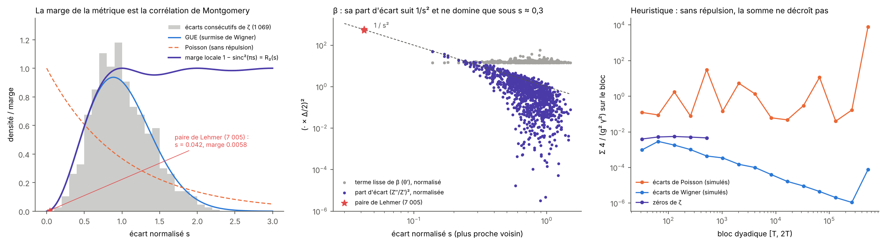

# V6.16 — La Rencontre à trois, et les croisements dans l'indicateur

**Date :** 10 octobre 2026  
**Statut :** une identité exacte et élémentaire (§2) ; des mesures sur les zéros de ζ, avec des prévisions écrites avant le calcul (`data/prevision_v616.md`, 10 h 54 UTC) dont trois sur cinq sont fausses dans leur lettre (§3) ; une nouvelle dimension de l'indicateur, comptée rétroactivement (§8). Ce qui est démontré, mesuré et supposé est séparé au §10.  
**Demande de l'auteur :** « Ce qui m'étonne, c'est qu'il n'y a pas de croisement entre les 3 aussi difficiles que RH. » Puis : « Oui, et en même temps il faut que les croisements soient pris en compte dans l'indicateur. » Deux textes reçus en cours de route (« Nécessité démontrée du Modèle réduit », « Classement des instruments 3D ») ont apporté trois règles, reprises au §8.

## 1. Pourquoi ce coup

Trois problèmes voisins de RH, aussi difficiles qu'elle, étaient apparus séparément dans le corpus :

- **la simplicité des zéros**, avec le corollaire B′ (V6.13) ;
- **la répulsion entre zéros**, c'est-à-dire la corrélation de paires de Montgomery, avec le facteur de la loi de seuil (V6.14–V6.15) ;
- **le degré 2**, avec Δ de Ramanujan [Ram16] (V6.15).

Ils n'avaient jamais été croisés. Le navigateur en était la cause : il note les coups par dimension de l'indicateur, et aucune dimension ne récompensait un pont entre deux conjectures. Le coup qui faisait ce croisement, « Les paires de Lehmer », était avant-dernier.

Les trois problèmes se rencontrent dans un seul événement, **la rencontre de deux zéros** :

- RH ne casse que par là : les sorties de la droite passent par un zéro double (V6.5, V6.7, V6.8) ;
- la simplicité dit que la rencontre n'a jamais lieu ;
- la répulsion dit qu'elle est rare, et de combien.

## 2. L'identité : la marge de la métrique est la corrélation de Montgomery

Prenons deux zéros sur la droite, γ et γ + g, à la hauteur γ. Ils entrent dans la métrique de Toeplitz (G~jk~ = t~j−k~) par les deux vecteurs x~j~ = e^iγjh^ et y~j~ = e^i(γ+g)jh^, j = 0, …, n − 1. La **marge locale** de la paire est le déterminant normalisé de leur Gram, 1 − |⟨x, y⟩/n|². Elle vaut 1 quand les deux directions sont orthogonales et 0 quand elles se confondent.

**Proposition (démontrée ici, élémentaire).** On a |⟨x, y⟩|/n = |sin(ngh/2)| / (n·|sin(gh/2)|). À la fenêtre de Heisenberg L = nh = log(γ/2π) (V6.14), et quand h → 0, la marge locale vaut

  m(s) = 1 − (sin πs / πs)²,  avec s = g·log(γ/2π)/2π l'écart normalisé.

C'est exactement la densité de corrélation de paires R~2~(s) de Montgomery.

*Preuve.* La somme géométrique donne |Σ~j<n~ e^igjh^| = |sin(ngh/2)/sin(gh/2)|. Quand h → 0 avec nh = L fixé, cette somme divisée par n tend vers |sin(gL/2)|/(gL/2). À L = log(γ/2π), gL/2 = πs, parce que l'écart moyen vaut 2π/log(γ/2π). ∎

**Conséquences.**

- La marge est nulle exactement à la rencontre (s = 0) : c'est le passage obligé d'une sortie de la droite.
- Une paire hors droite γ~0~ ∓ iδ entre dans la métrique avec la forme [[0, w], [w̄, 0]], de déterminant −|w|² < 0. Sa marge est **négative** : les deux directions négatives par quadruplet de la V6.10.
- La loi des marges est donc la loi des écarts entre zéros. Elle est faite de petites marges si les zéros ne se repoussent pas (Poisson), et de marges rarement petites s'ils se repoussent (GUE).

**RH, simplicité et répulsion sont trois lectures d'une même quantité, la marge locale de la métrique à la fenêtre de Heisenberg.** RH dit qu'elle ne devient jamais négative, la simplicité qu'elle ne s'annule jamais, la répulsion qu'elle est rarement petite.

## 3. Les prévisions et leur sort

| | Prévision (écrite avant le calcul) | Résultat | Verdict |
|---|---|---|---|
| P1 | Proportion de zéros de marge < 0,1 : à ±30 % de la valeur GUE (surmise de Wigner [Wig57]), et au moins 3 fois sous Poisson | 0,37 % (4 zéros, soit 2 paires), contre 1,19 % pour le GUE et 30 % pour Poisson | **qualitativement tenue** (80 fois sous Poisson) ; **quantitativement fausse** (3 fois sous le GUE) |
| P2 | Pente de log β~k~ contre log s~k~ entre −2,4 et −1,6 (10 % les plus serrés) | −0,03 pour β~k~ ; −1,61 pour sa part d'écart | **fausse** pour β~k~ |
| P3 | Les 10 % les plus serrés portent 25 à 40 % de Σβ~k~ | 6,7 % de β ; 35 % de sa part d'écart | **fausse** pour β |
| P4 | Σβ~k~ = 0,540 ± 0,005 (relecture B) | 0,5405 | **tenue** |
| P5 | Paire de Lehmer : marge < 0,01, et chacun de ses zéros pèse dans β plus de 100 fois la médiane | marge 0,0058 ; 39 et 43 fois la médiane pour β, 908 et 1 023 fois pour sa part d'écart | **à moitié** |

**Ce qui s'est trompé.** J'ai écrit P2, P3 et P5 pour β entier, alors que le calcul rapide qui les avait inspirées portait sur sa seule part d'écart. Or β est lisse à 95 % (§5). Les relectures sur la part d'écart, qui tiennent toutes, sont faites après coup : ce ne sont pas des confirmations.

## 4. La répulsion des marges

Sur les 1 070 zéros de ζ jusqu'à t = 1 500 (`rencontre_zeros.csv`), une marge sous 0,1 correspond à un écart normalisé s < 0,178.

| | Zéros de marge < 0,1 | Paires consécutives de marge < 0,1 |
|---|---|---|
| ζ (mesuré) | **0,37 %** (4) | **0,19 %** (2) |
| GUE (surmise de Wigner) | 1,19 % (≈ 13) | 0,60 % |
| Poisson (sans répulsion) | 30 % (≈ 320) | 16 % |

Les zéros de ζ se repoussent nettement : il y a 80 fois moins de petites marges que sans répulsion. Il y en a même 3 fois moins que dans la surmise de Wigner. Trois approximations peuvent expliquer cet écart, et il reste à le comprendre :

- la surmise de Wigner n'est qu'une approximation de la loi GUE ;
- la loi du plus proche voisin est calculée en supposant les deux écarts indépendants ;
- les zéros bas de ζ s'écartent de la limite GUE (corrections de hauteur finie, connues dans la littérature et citées de mémoire).

## 5. β est lisse ; sa part d'écart compte les paires

Le coefficient β du développement de Q (relecture B, §8) vaut 2Σ|u~γ~|², avec u~γ~ = (b~ρ~ − 2/ρ)/ρ et b~ρ~ = −2θ′(γ) − 2γ~E~ − i·Z″/Z′(γ). Il se coupe en deux :

- **un terme lisse**, issu de θ′(γ) ≈ ½ log(γ/2π), qui porte 95 % de β ;
- **une part d'écart**, 2Σ(Z″/Z′)²/|ρ|², qui porte 5 % de β (0,0283 sur 0,5405).

Pour les paires serrées, Z″/Z′ ≈ −2/(écart au voisin) : la corrélation vaut 0,98 sur les 10 % de zéros les plus serrés. Une fois les deux termes normalisés par l'écart moyen, **la part d'écart suit 1/s², et elle ne dépasse le terme lisse que pour s ≲ 0,3** (figure, panneau du milieu). Sur ces zéros, la part d'écart est portée à 35 % par les 10 % les plus serrés, et sa pente vaut −1,6.

**La paire de Lehmer [Leh56]** (7 005,0629 et 7 005,1006, s = 0,042) est le cas extrême. Sa marge vaut 0,0058. Sa part d'écart pèse environ **mille fois** la médiane des zéros voisins (908 et 1 023 fois), et elle fait 97,5 % de sa contribution à β, contre 4 % pour un zéro ordinaire.

**Heuristique (non démontrée).** Sans répulsion, la somme Σ4/(g²γ²) ne décroît pas par blocs dyadiques. Avec la répulsion de Wigner, elle décroît (figure, panneau de droite ; suites simulées). La finitude de la part d'écart de β serait donc un énoncé de répulsion.

## 6. Exploratoire : la marge vue par les nombres premiers

Pour les 12 paires les plus serrées sous la hauteur 550, on comprime la métrique des premiers (a = 0,012 ; h = 0,004 ; fenêtre de Heisenberg) sur les deux directions de la paire. Le déterminant normalisé obtenu suit l'écart : la corrélation de rang (Spearman) vaut 0,8. Il est environ deux fois plus grand que dans le modèle à deux atomes, parce que les zéros voisins pèsent aussi. Les premiers voient donc les marges, mais pas encore la formule nue. Ce point n'était pas pré-enregistré.

## 7. Ce que cela change

- La rencontre de deux zéros est le carrefour des trois problèmes. La quantité qui le mesure, la marge locale à la fenêtre de Heisenberg, est à la fois un objet de la métrique (RH), un détecteur de collision (simplicité) et la fonction de Montgomery (répulsion).
- Q porte les trois, ordre par ordre : son exposant lit RH (Théorème A) ; sa constante lit la simplicité (B′) ; la part d'écart de son coefficient β lit les paires serrées.

## 8. Les croisements dans l'indicateur

**Une septième dimension : « Croiser ».** Elle pose la question : les problèmes voisins de RH se lisent-ils dans les mêmes objets qu'elle ? Son niveau à une étape est le plus haut niveau d'un croisement produit par le corpus jusqu'à cette étape. Les croisements de la littérature sont montrés sur la carte, mais pas comptés.

**Comptage rétroactif.** Les croisements existaient avant la dimension. Ils sont comptés en V6.16, chacun avec sa raison :

| Étape | Croisement | Niveau |
|---|---|---|
| V6.5 | Les sorties de la droite passent par une rencontre (zéro double) | 4 |
| V6.7 | Le passage interdit, compris dans le Modèle réduit où RH est démontrée | 5 |
| V6.13 | La constante de Q lit la simplicité (B′) | 6 |
| V6.15 | L'écoute sans répulsion ; Ramanujan–Deligne [Del74] | 3 et 4 |
| V6.16 | La Rencontre à trois (identité) ; le compteur de paires | 6 et 4 |

Le niveau de « Croiser » passe ainsi de 0 à 4 en V6.5, à 5 en V6.7, puis à 6 en V6.13, où il reste. Le niveau 7 demanderait une relecture humaine.

**La carte des croisements.** C'est une matrice des cinq conjectures : RH, simplicité, répulsion, de Bruijn–Newman [DeB50] [New76], degré 2. Chaque case montre les croisements qui la remplissent. Une case vide est une **zone d'ombre**. Chaque croisement a aussi une colonne « pendant dans le Modèle réduit », et un croisement sans pendant est également une zone d'ombre.

**Trois règles reprises des deux textes reçus.** Ces textes transposent le corpus dans un vocabulaire d'ingénierie (maquette physique, coûts de prototypage), qui ne lui correspond pas. Le « 3D » du second est le numéro de version du document 24 (« V6.3d »), lu comme trois dimensions. Trois idées en ont été gardées :

1. **La navigation par axes croisés** devient la carte des croisements et ses zones d'ombre.
2. **« Tout résultat critique adossé à un essai sur modèle réduit »** devient la règle du pendant : chaque croisement sur ζ doit avoir son pendant là où RH est démontrée.
3. **La veille rétrospective** devient une règle du navigateur : une piste écartée est signalée « à relire » quand au moins trois opérateurs sont entrés au registre depuis sa dernière lecture. Les trois idées relues en V6.12 sont de nouveau signalées, puisque 9 opérateurs sont entrés depuis.

**Dans le navigateur.** La règle du croisement donne +0,5 par conjecture reliée au-delà de la première. Le poids de « Croiser » vaut 2. Deux coups visent les zones d'ombre : « La Rencontre en degré 2 » et « La Rencontre dans le Modèle réduit ». Un troisième, « La constante de Q dans le Modèle réduit », vise un pendant manquant.

## 9. Lecture selon l'hypothèse

L'hypothèse de travail est que RH n'existe que parce qu'elle est nécessaire à quelque chose de plus grand qui la rend nécessaire.

**Mesuré.** La marge locale de la métrique est la fonction de Montgomery, et les zéros de ζ en évitent les petites valeurs bien plus que le hasard. Une positivité qui « interdit le passage » (V6.7) devrait laisser exactement cette trace : la rencontre, seule porte de sortie, est évitée.

**Supposé.** L'objet plus grand, s'il existe, imposerait d'un seul geste la positivité (RH), l'absence de rencontre (simplicité) et sa rareté (répulsion). Sur les corps finis, c'est ce que font ensemble Weil, Deligne et Katz–Sarnak [KS99], avec une nuance instructive : une courbe supersingulière peut avoir des zéros confondus sans violer RH. La simplicité y est donc plus forte que RH ; le corpus devrait le mesurer (coup « La Rencontre dans le Modèle réduit »).

## 10. Démontré, mesuré, supposé

| | Énoncé | Statut |
|---|---|---|
| Démontré | Marge locale à la fenêtre de Heisenberg = 1 − sinc²(πs) = R~2~(s) ; marge négative pour une paire hors droite. | Identité élémentaire, vérifiée numériquement (test). |
| Mesuré | Répulsion : 0,37 % de marges < 0,1, contre 1,19 % (GUE) et 30 % (Poisson). | P1 qualitative tenue, quantitative fausse. |
| Mesuré | β lisse à 95 % ; part d'écart ∝ 1/s² (pente −1,6) ; paire de Lehmer : marge 0,006, part d'écart ≈ 1 000 fois la médiane. | P2, P3 fausses pour β entier ; justes pour sa part d'écart, après coup. |
| Exploratoire | La métrique des premiers voit les marges (Spearman 0,8), pas encore la formule nue. | Non pré-enregistré. |
| Supposé | Finitude de la part d'écart de β ⟺ répulsion. | Heuristique (simulations). |
| Supposé | Un objet plus grand imposerait d'un geste RH, simplicité et répulsion. | Lecture. |

## 11. Limites

- Le modèle à deux atomes ignore les zéros voisins ; la métrique réelle les compte (§6).
- La surmise de Wigner et la loi du plus proche voisin sont des approximations.
- 1 070 zéros jusqu'à 1 500, plus 223 autour de 7 005 : des hauteurs basses.
- Le comptage rétroactif de « Croiser » est un choix de lecture, écrit et justifié, pas une mesure.
- Montgomery (1973) [Mon73], Rodgers–Tao [RT20] (2020), Katz–Sarnak : cités de mémoire.

## 12. Noms proposés pour le registre

| Nom | Image | Énoncé exact | Où l'image casse | Question divergente |
|---|---|---|---|---|
| **La Rencontre à trois** | Trois chemins qui se croisent au même carrefour : le choc de deux zéros. | Marge locale à la fenêtre de Heisenberg = 1 − sinc²(πs) = densité de Montgomery ; 4 marges sous 0,1 sur 1 070 zéros de ζ (13 pour le GUE, 320 pour Poisson). | Modèle à deux atomes. | Le pendant sur les corps finis suit-il la symétrie de la famille ? |
| **Le Compteur de paires** | Un compteur qui ne bouge qu'aux chocs. | β est lisse à 95 % ; sa part d'écart suit 1/s² et compte les paires serrées ; Lehmer : environ mille fois la médiane. | Finitude seulement heuristique. | La part d'écart de β est-elle finie sans hypothèse sur les paires proches ? |
| **La Zone d'ombre** | Une case blanche sur la carte. | Case de la carte des croisements sans croisement du corpus, ou croisement sans pendant dans le Modèle réduit. | Une case vide n'est pas encore une question. | Quelle zone d'ombre cache un croisement déjà connu ? |

## 13. Suite

Avec la règle du croisement, le navigateur reclasse les coups (voir le navigateur). Les zones d'ombre de la carte lui donnent désormais des cibles explicites.

## Fichiers

- Script : `scripts/run_rencontre_a_trois.py` (environ 6 minutes ; `--figure` pour la figure seule).
- Données : `prevision_v616.md` ; `rencontre_zeros.csv`, `rencontre_lehmer.csv`, `rencontre_blocs.csv`, `rencontre_premiers.csv`, `rencontre_resume.csv` ; figure `rencontre.png`.
- Indicateur : dimension « Croiser », `conjectures` et `croisements` dans `2_Methode/Indicateur/indicateur_avancement.json` ; carte des croisements dans le document 31.
- Navigateur : règles du croisement, de la veille rétrospective et du pendant ; champ `croise` des coups ; liste `pistes_ecartees`.
- Tests : `tests/test_v616_rencontre_croisements.py` (3 tests).

<!-- references:debut -->

## Références

Format : [clé] auteurs, *titre*, publication, lien. Fiches complètes et état de vérification : document 42 (registre des sources).

- [DeB50] N. G. de Bruijn. *The roots of trigonometric integrals*. Duke Math. J. 17 (1950), 197–226. <https://en.wikipedia.org/wiki/De_Bruijn%E2%80%93Newman_constant> — partiellement vérifié
- [Del74] P. Deligne. *La conjecture de Weil. I*. Publ. Math. IHÉS 43 (1974), 273–307 ; DOI 10.1007/BF02684373. <https://www.numdam.org/item/PMIHES_1974__43__273_0/> — vérifié en ligne
- [KS99] N. M. Katz, P. Sarnak. *Zeroes of zeta functions and symmetry*. Bull. Amer. Math. Soc. 36 (1999), 1–26 ; voir aussi le livre Random Matrices, Frobenius Eigenvalues, and Monodromy, AMS Colloq. Publ. 45 (1999). <https://www.ams.org/bull/1999-36-01/S0273-0979-99-00766-1/> — vérifié en ligne
- [Leh56] D. H. Lehmer. *On the roots of the Riemann zeta-function*. Acta Math. 95 (1956), 291–298. <https://en.wikipedia.org/wiki/Lehmer_pair> — partiellement vérifié
- [Mon73] H. L. Montgomery. *The pair correlation of zeros of the zeta function*. Analytic Number Theory, Proc. Sympos. Pure Math. 24, AMS (1973), 181–193. <https://public.websites.umich.edu/~hlm/paircor1.pdf> — vérifié en ligne
- [New76] C. M. Newman. *Fourier transforms with only real zeros*. Proc. Amer. Math. Soc. 61 (1976), 245–251. <https://en.wikipedia.org/wiki/De_Bruijn%E2%80%93Newman_constant> — partiellement vérifié
- [Ram16] S. Ramanujan. *On certain arithmetical functions*. Trans. Cambridge Philos. Soc. 22 (1916), 159–184. <https://encyclopediaofmath.org/wiki/Ramanujan_function> — partiellement vérifié
- [RT20] B. Rodgers, T. Tao. *The De Bruijn–Newman constant is non-negative*. Forum Math. Pi 8 (2020), e6 ; arXiv:1801.05914. <https://arxiv.org/abs/1801.05914> — vérifié en ligne
- [Wig57] E. P. Wigner. *Results and theory of resonance absorption*. Conference on Neutron Physics by Time-of-Flight, Gatlinburg (1956), Oak Ridge National Laboratory Report ORNL-2309 (1957), p. 67. <https://en.wikipedia.org/wiki/Wigner_surmise> — partiellement vérifié

<!-- references:fin -->
