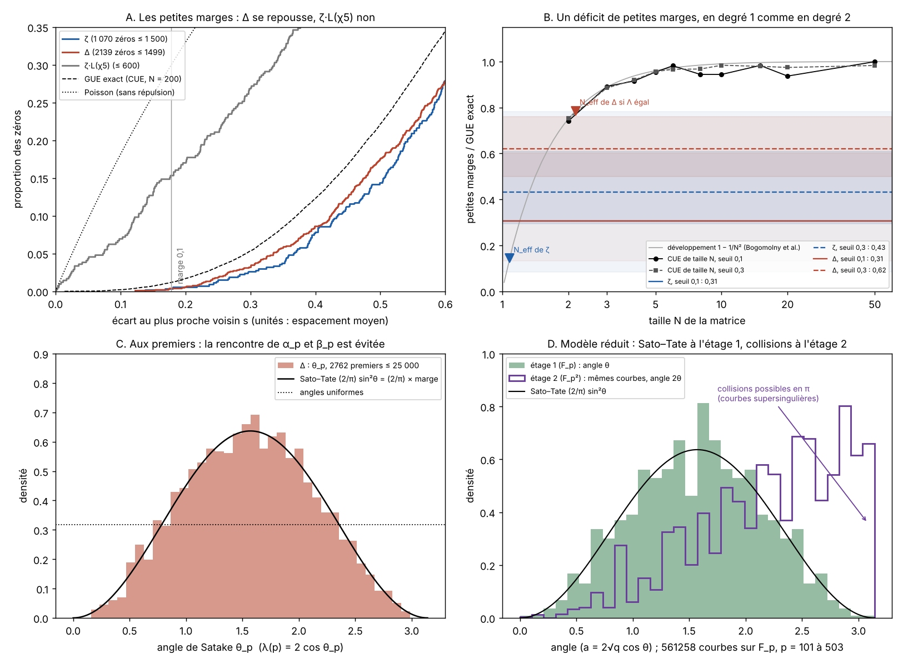

# V6.17 — La Rencontre en degré 2, et son pendant dans le Modèle réduit

**Date :** 10 octobre 2026  
**Statut :** trois identités exactes (§3) ; un instrument nouveau, validé (§2) ; des mesures en degré 2, aux premiers et dans le Modèle réduit, avec des prévisions écrites avant le calcul (`data/prevision_v617.md`, 11 h 55 UTC) dont une est fausse et une autre à moitié (§4). Ce qui est démontré, mesuré et supposé est séparé au §12.  
**Demande de l'auteur :** « Suite » : les deux coups en tête du navigateur après la V6.16, « La Rencontre en degré 2 » (3,00) et « La Rencontre dans le Modèle réduit » (2,00).

## 1. Pourquoi ce coup

La V6.16 a montré que RH, la simplicité des zéros et leur répulsion se lisent sur une même quantité : la marge locale de la métrique, à la fenêtre de Heisenberg. Sa carte des croisements laissait deux cases vides du côté du degré 2 (simplicité × degré 2, répulsion × degré 2). Sa règle du pendant demandait aussi que chaque croisement établi sur ζ ait son équivalent dans le Modèle réduit, là où RH est démontrée.

Le degré 2 apporte une chose que le degré 1 n'a pas. En chaque nombre premier p, Δ porte **deux** racines, α~p~ et β~p~, qui peuvent elles-mêmes se rencontrer. La rencontre a donc lieu deux fois en degré 2 : entre les zéros, et entre les racines en chaque premier.

## 2. Un instrument nouveau : le Contour tourné

**Le problème.** Sur la droite critique, Λ(6 + it) est de l'ordre de e^−πt/2^. Calculée à partir de l'axe réel, elle naît d'une annulation entre des termes de taille 1, et il faut des centaines de chiffres. La V6.15 s'arrêtait à t ≤ 40 en haute précision, et à t ≤ 232 avec le générateur des premiers.

**L'identité (démontrée ici).** On pose F(w) = Σ τ(n) e^−2πnw^, de sorte que Λ(s) = ∫~0~^∞^ F(y) y^s−1^ dy. On tourne la demi-droite d'intégration d'un angle φ < π/2 ; c'est permis car F décroît dans tout le secteur. On coupe ensuite à |w| = 1, et on replie la partie intérieure par la modularité F(1/w) = w^12^ F(w). Comme τ est réel, il reste une formule exacte et réelle :

  Λ(6 + it) = 2 e^−φt^ · Re( e^6iφ^ · A(6 + it) ),  avec A(s) = ∫~0~^∞^ F(e^x+iφ^) e^sx^ dx.

Avec φ = π/2 − 6/t, le facteur e^−φt^ absorbe l'annulation, et la double précision suffit. L'idée équivalente, un facteur δ^−s^ avec |δ| = 1, est connue des calculs de fonctions L (Rubinstein, §3.3 [Rub04], cité de mémoire) ; la formule ci-dessus est écrite et vérifiée ici pour Δ.

**Validation.**

- Contre le calcul en haute précision (mpmath, série des fonctions gamma incomplètes), l'écart relatif vaut 4·10^−15^ à t = 20, 4·10^−14^ à t = 100, 3·10^−14^ à t = 200, 6·10^−13^ à t = 612,3 et 4·10^−13^ à t = 1 001,7 (ce dernier calcul en haute précision a demandé 713 chiffres et 20 minutes ; le Contour tourné, une fraction de seconde).
- Les 13 zéros de la V6.15 sous t = 40 sont retrouvés à 5·10^−11^ près.
- **2 139 zéros jusqu'à t = 1 500, en deux minutes.**
- **Complétude, par la méthode de Turing [Tur53].** N(T) − θ(T)/π reste entre −0,54 et +0,65, de moyenne 0,000 (moyennes par fenêtres de 50 zéros entre −0,02 et +0,03). Une paire manquée décalerait durablement cette différence de −2. On compte 540 zéros à 500, 1 298 à 1 000 et 2 139 à 1 500.

**Correctif de la V6.15.** Le générateur des premiers de la V6.15 concorde avec le Contour tourné à moins de 10^−7^ jusqu'à t = 150, puis se dégrade (2,7·10^−4^ à 232). Il a manqué 7 zéros entre 224 et 232, au bord de sa fenêtre : il y a **196** zéros jusqu'à 232,08, et non 189. Les comptages de Weyl du document 39, jusqu'à 200, sont confirmés exactement (20, 59, 106, 159).

## 3. Trois identités : la marge est la loi de Haar

On place N atomes de masse 1 aux angles θ~1~, …, θ~N~ et on les regarde à travers une fenêtre de N échantillons : x~l~(j) = e^ijθ~l~^, j = 0, …, N − 1. La métrique est G = VV*, où V est la matrice de Vandermonde des e^iθ~l~^.

**3.1. Une paire (démontré, élémentaire).** La marge d'une paire, 1 − |⟨x~1~, x~2~⟩/N|², vaut 1 − D~N~(Δ)², où D~N~(Δ) = sin(NΔ/2)/(N sin(Δ/2)) et Δ = θ~1~ − θ~2~. Avec s = NΔ/2π, c'est 1 − (sin πs / (N sin(πs/N)))². C'est exactement la **corrélation de paires des matrices unitaires aléatoires de taille N** (CUE, Dyson [Dys62]). Quand N → ∞, on retrouve 1 − sinc²(πs), l'identité du document 40.

**3.2. Tous les atomes (démontré).** det G = |det V|² = Π~l<m~ |e^iθ~l~^ − e^iθ~m~^|². C'est, à une constante près, la **densité de Weyl [Wey39]** des angles propres d'une matrice unitaire de taille N tirée au hasard (mesure de Haar). La marge totale de la métrique, à la fenêtre N, *est* la loi de Haar.

**3.3. Une paire conjuguée (démontré).** Pour les deux racines d'un premier de Δ, ou d'une courbe de genre 1, les angles sont θ et −θ et λ = 2 cos θ (λ = λ(p) pour Δ, λ = a/√q pour une courbe). La métrique 2 × 2 est [[2, λ], [λ, 2]], et sa marge normalisée vaut

  det/4 = 1 − λ²/4 = sin²θ.

- Pour une courbe, c'est 1 − ρ~1~², la marge de Castelnuovo du document 28.
- Elle est positive si et seulement si |λ| ≤ 2 : c'est la borne de Hasse [Has36] pour les courbes, et celle de Ramanujan [Ram16]–Deligne pour Δ.
- La loi de Sato–Tate a pour densité (2/π) sin²θ, soit **(2/π) × la marge**.

**Vérification.** Sur les 425 courbes de genre 1 à 8 du Modèle réduit (V6.6), det G et la densité de Weyl coïncident à 2,5·10^−13^ près. Les marges de paires coïncident avec 1 − D~N~² à 4·10^−16^ près.

**Conséquence.** Aux premiers de Δ, les trois problèmes sont **trois théorèmes** :

- **positivité** (RH locale) : la marge est ≥ 0, c'est le théorème de Deligne (1974) [Del74] ;
- **simplicité** : la marge n'est jamais nulle, ce qui est automatique, car τ(p)² = 4p^11^ est impossible (p^11^ n'est pas un carré) ;
- **répulsion** : la marge suit la loi de Sato–Tate, démontrée pour Δ par Barnet-Lamb, Geraghty, Harris et Taylor (2011, cité de mémoire) [BGHT11].

## 4. Les prévisions et leur sort

| | Prévision (écrite avant le calcul) | Résultat | Verdict |
|---|---|---|---|
| P1 | Zéros de Δ de marge < 0,1 : au moins 10 fois sous Poisson | 0,37 % (8 zéros sur 2 139), contre 30 % pour Poisson | **tenue** (80 fois sous Poisson) |
| P2 | Rapport à la référence GUE exacte plus grand que pour ζ, et dans [0,5 ; 1,2] au seuil 0,1, dans [0,6 ; 1,1] au seuil 0,3 | Seuil 0,1 : 0,31 pour Δ (0,38 jusqu'à 1 000), autant que ζ (0,31). Seuil 0,3 : 0,62 (0,58 jusqu'à 1 000), contre 0,43 pour ζ | **fausse** au seuil 0,1 ; au seuil 0,3, **tenue** jusqu'à 1 500, **manquée de peu** jusqu'à 1 000 (la cible annoncée) |
| P3 | ζ·L(χ5) : 14 à 20 % de marges < 0,1 ; au moins 90 % de paires mixtes ; aucune collision (distance > 10^−6^) | 15,3 % (théorie 17,2 %) ; 100 % mixtes ; distance minimale 8,9·10^−4^ | **tenue** |
| P4 | Premiers de Δ : marges < 0,1 à ±30 % de Sato–Tate (1,385 %) et 10 fois sous l'uniforme ; marge minimale > 0 ; Kolmogorov–Smirnov p > 0,01 | 1,23 % (rapport 0,89) ; 17 fois sous l'uniforme ; marge minimale 0,026 ; p = 0,86 | **tenue** |
| P5 | Courbes sur F~p~ : marges < 0,1 à ±30 % de Sato–Tate ; aucune marge nulle ; à l'étage 2, collisions = courbes supersingulières, forme de Castelnuovo dégénérée ; leur proportion décroît avec p | 1,48 % (rapport 1,07) ; marge minimale 0,0024 ; 18 338 collisions = 18 338 supersingulières, ρ~2~ = 1 ; proportions 6,9 %, 2,8 %, 2,0 %, 2,5 %, 4,2 % | **tenue**, sauf la dernière clause : **fausse** (pas monotone) |

**Ce qui s'est trompé.**

- **P2.** J'ai supposé que la densité des zéros fixait seule leur écart à la limite GUE. Δ a une densité double à hauteur égale, mais il garde le même déficit de petites marges que ζ au seuil 0,1 (§5).
- **P5, dernière clause.** La proportion de courbes supersingulières suit des nombres de classes, qui fluctuent d'un p à l'autre ; elle ne décroît qu'en tendance.

## 5. Les zéros de Δ se repoussent, avec le même déficit que ζ

| | Marge < 0,1 (s < 0,178) | Marge < 0,3 (s < 0,323) |
|---|---|---|
| ζ, 1 070 zéros jusqu'à 1 500 (V6.16) | 0,37 % (4) | 2,99 % (32) |
| Δ, 1 298 zéros jusqu'à 1 000 | 0,46 % (6) | 4,01 % (52) |
| Δ, 2 139 zéros jusqu'à 1 500 | 0,37 % (8) | 4,30 % (92) |
| GUE exact (CUE de taille 200, simulé) | 1,23 % | 6,94 % |
| Poisson (sans répulsion) | 30,0 % | 47,6 % |
| ζ·L(χ5), 835 zéros jusqu'à 600 | 15,3 % | — |

- Les zéros de Δ se repoussent nettement : 8 marges sous 0,1, là où le GUE en attend 26 et Poisson 641.
- La paire la plus serrée de Δ jusqu'à 1 500 est en 823,1347 et 823,2140 (s = 0,123, marge 0,049). Il n'y a pas de paire de type Lehmer à ces hauteurs.
- **La surmise de Wigner [Wig57] n'était pas en cause en V6.16.** La valeur exacte (1,23 %) est presque celle de la surmise (1,19 %).
- **La taille finie des matrices ne suffit pas.** Le CUE de taille N donne moins de petites marges quand N est petit, mais jamais moins de 0,74 fois la limite pour N ≥ 2 (figure, panneau B). Or ζ et Δ sont à 0,31.

**Une explication connue, pour ζ.** Bogomolny, Bohigas, Leboeuf et Monastra (2006) [BBLM06] ont montré que, à la hauteur E, les écarts des zéros de ζ dévient de la limite GUE comme ceux de matrices unitaires de taille N~eff~ = log(E/2π)/√(12Λ), avec Λ = 1,57314. Le terme correctif de la corrélation de paires est −sin²(πs)/(3N~eff~²), et il réduit la fréquence des petits écarts du facteur 1 − 1/N~eff~².

- Pour ζ jusqu'à 1 500, N~eff~ ≈ 1,08 en moyenne. Le développement prévoit alors un rapport d'environ 0,14 ; on mesure 0,31 et 0,43, ce qui correspond à N ≈ 1,2–1,3. Le sens et l'ordre de grandeur sont les bons. Mais à N~eff~ ≈ 1, le développement est hors de son domaine : c'est une explication probable, pas démontrée.
- Pour Δ avec la même constante Λ, N~eff~ ≈ 2,16 et le rapport prévu serait 0,79. On mesure 0,31 à 0,62, soit N ≈ 1,2–1,6. Pour que l'explication tienne, il faudrait **Λ~Δ~ entre 2,8 et 5,1**, au lieu de 1,57. Λ contient une somme sur les premiers ; pour Δ, elle ferait intervenir les λ(p)². Le calcul de Λ~Δ~ est le prochain coup proposé (§15), et cet intervalle en est la prévision.

## 6. ζ·L(χ5) : deux familles étrangères

Le produit ζ·L(s, χ5) est la fonction zêta du corps Q(√5) : une fonction de degré 2 qui n'est pas primitive. Ses 835 zéros jusqu'à 600 sont ceux de ζ (341) et ceux de L(χ5) (494).

- **15,3 %** de ses zéros ont une marge sous 0,1. La formule de superposition prévoyait 17,2 % ; Poisson donne 30 % et le GUE 1,2 %.
- **Toutes** ces petites marges sont des paires mixtes, un zéro de ζ et un zéro de L(χ5). Prise seule, aucune des deux familles n'a de marge sous 0,1 jusqu'à 600.
- La paire mixte la plus serrée est en 533,7796 (ζ) et 533,7805 (L(χ5)). Leur distance vaut 8,9·10^−4^, soit s = 0,0015, et leur marge 7·10^−6^. C'est 28 fois plus serré que la paire de Lehmer [Leh56] de ζ (s = 0,042).

La répulsion appartient à une fonction primitive ; un produit de deux fonctions n'en hérite pas entre ses facteurs. Pour ζ·L(χ5), la simplicité (aucun zéro commun à ζ et L(χ5)) n'est donc protégée par **aucune** répulsion ; elle relève d'une autre conjecture, l'indépendance linéaire des ordonnées des zéros (citée de mémoire).

## 7. Aux premiers : la rencontre de α~p~ et β~p~

Sur les 2 762 premiers p ≤ 25 000 (figure, panneau C) :

- la marge sin²θ~p~ est toujours positive. Sa plus petite valeur est 0,026, en p = 18 047, et |λ(p)| ≤ 1,974 : c'est la borne de Deligne, vérifiée ;
- il n'y a jamais de collision, comme l'impose l'arithmétique (§3.3) ;
- la loi des angles est celle de Sato–Tate : test de Kolmogorov–Smirnov p = 0,86 ; moments de λ(p) d'ordre 2, 4 et 6 égaux à 0,991, 1,967 et 4,878, contre 1, 2 et 5 ;
- 1,23 % des premiers ont une marge sous 0,1, contre 1,385 % pour Sato–Tate et 20,5 % pour des angles uniformes.

## 8. Le pendant dans le Modèle réduit

**8.1. Étage 1 : la loi de la marge.** On prend toutes les courbes y² = x³ + ax + b sur F~p~, pour p = 101, 211, 307, 401 et 503, soit 561 258 courbes. Leur marge est sin²θ = 1 − ρ~1~².

- 1,48 % des courbes ont une marge sous 0,1, pour 1,385 % sous Sato–Tate.
- Les moments de a/√p d'ordre 2, 4 et 6 valent 1, 2 et 5 à 10^−3^ près pour chaque p (à 4·10^−5^ près pour p = 503) : c'est la loi de Sato–Tate « verticale », démontrée par Birch (1968, cité de mémoire) [Bir68].
- La plus petite marge vaut 0,0024. Il n'y a aucune collision sur F~p~, car a² = 4p est impossible.

**8.2. Étage 2 : le changement de base fabrique des collisions.** Sur F~p²~, les racines deviennent α² et β², et P~F~p²~~(u²) = P(u)·P(−u). Les zéros de la courbe au deuxième étage de la tour sont donc **la réunion de deux familles** :

- ceux de P(u) ;
- ceux de P(−u), sa tordue par le caractère quadratique de F~p²~/F~p~.

C'est le pendant exact de ζ~K~ = ζ·L(χ~K/Q~).

- Les collisions arrivent **exactement** aux courbes supersingulières (a = 0) : 18 338 courbes sur 561 258.
- Là, la forme de Castelnuovo de l'étage 2 est dégénérée (ρ~2~ = 1) et la marge est nulle, **mais RH reste vraie**.
- 21,4 % des courbes ont une marge sous 0,1 à l'étage 2, contre 1,4 % à l'étage 1. La superposition n'a pas de répulsion au point de collision : la densité y vaut 2/π (figure, panneau D).

**8.3. Les courbes et les faux jumeaux du Modèle réduit.**

- Parmi les 425 courbes de la V6.6, une a deux angles confondus (q = 5, genre 3). Sa marge est nulle et RH est vraie.
- Les 220 faux jumeaux de la V6.7 (comptages positifs, RH fausse) ont tous une marge négative. La réfutation prévue par le coup, « des faux jumeaux sans marge négative », ne se produit donc pas.

## 9. Ce que cela change

| | Modèle réduit (courbes) | Premiers de Δ | Zéros de ζ et de Δ | Superposition (ζ·L(χ5) ; étage 2) |
|---|---|---|---|---|
| **RH** (marge ≥ 0) | théorème (Weil ; Castelnuovo) | théorème (Deligne) ; marge minimale 0,026 | ouverte ; aucune marge négative jusqu'à 1 500 | ζ·L : ouverte ; étage 2 : théorème |
| **Simplicité** (marge ≠ 0) | parfois fausse (angles confondus) | automatique (arithmétique) | ouverte ; plus petite marge 0,049 (Δ), 0,0058 (Lehmer, ζ) | non protégée : marge 7·10^−6^ (ζ·L) ; fausse aux supersingulières (étage 2) |
| **Répulsion** (loi de la marge) | Sato–Tate vertical (Birch) ; moments 1, 2, 5 | Sato–Tate (2011) ; KS p = 0,86 | conjecturée (Montgomery [Mon73]) ; mesurée, avec un déficit à basse hauteur | absente entre les deux familles (100 % de paires mixtes) |

**La Loi de la marge.** Dans tous les cas où une loi est démontrée, la fréquence d'une configuration est proportionnelle à la marge qu'elle laisse à la métrique :

- Weyl, pour les matrices unitaires (§3.2) ;
- Sato–Tate, pour une paire conjuguée (§3.3) ;
- Dyson, pour le CUE de taille N (§3.1).

Pour les zéros de ζ, la conjecture de Montgomery dit la même chose à la limite (R~2~ = marge). Les mesures la confirment, avec un déficit à basse hauteur.

## 10. Les croisements dans l'indicateur

Trois croisements nouveaux, produits par le corpus en V6.17 :

| Croisement | Conjectures | Niveau | Pendant dans le Modèle réduit |
|---|---|---|---|
| La Rencontre en degré 2 | RH, répulsion, degré 2 | 4 (mesure robuste) | Identité 3.1 ; Sato–Tate sur 561 258 courbes |
| La Rencontre locale | RH, simplicité, répulsion, degré 2 | 6 (énoncé démontré, théorèmes cités) | Courbes de genre 1 : marge de Castelnuovo, Sato–Tate vertical |
| Les Familles étrangères | simplicité, répulsion, degré 2 | 4 (mesure robuste) | Changement de base F~p~ → F~p²~ : collisions supersingulières |

- Les zones d'ombre « simplicité × degré 2 » et « répulsion × degré 2 » sont remplies.
- Il reste « de Bruijn–Newman [DeB50] [New76] × degré 2 », « RH × de Bruijn–Newman » (que la littérature remplit seule), et les croisements sans pendant : la constante de Q, le compteur de paires.
- « L'écoute sans répulsion » (V6.15) reçoit son pendant : le changement de base.
- Le niveau de « Croiser » reste 6 ; le 7 demande une relecture humaine.
- Le **degré 2** passe de 3 à **4** (mesure robuste) : une mesure reproduite, avec témoins (ζ·L(χ5), CUE, Poisson) et audits (Turing, mpmath, salle blanche).

## 11. Lecture selon l'hypothèse

L'hypothèse de travail est que RH n'existe que parce qu'elle est nécessaire à quelque chose de plus grand qui la rend nécessaire.

**Mesuré.**

- Dans le Modèle réduit, l'objet plus grand a deux visages. La surface C × C donne la positivité (Castelnuovo) ; le groupe de monodromie de la famille donne la statistique (Katz–Sarnak [KS99], cité). Les deux signatures, « marge ≥ 0 » et « fréquence ∝ marge », apparaissent ensemble.
- Aux premiers de Δ, les deux sont des théorèmes, et ils viennent d'un même objet : la représentation galoisienne attachée à Δ.
- Pour les zéros de ζ et de Δ, la positivité est ouverte, mais la statistique est mesurée, et c'est la loi de la marge.
- Pour une superposition, ζ·L(χ5) ou l'étage 2, la positivité survit, mais la statistique entre les deux familles disparaît.

**Supposé.** Si un objet plus grand rend RH nécessaire pour ζ, il devrait aussi imposer la loi de la marge entre ses zéros, comme le groupe de monodromie le fait sur les corps finis. La répulsion mesurée serait alors une trace de cet objet. L'absence de répulsion mutuelle dans ζ·L(χ5) dirait que l'objet de ζ·L(χ5) est une paire d'objets, et non un seul.

## 12. Démontré, mesuré, supposé

| | Énoncé | Statut |
|---|---|---|
| Démontré | Contour tourné : Λ(6+it) = 2e^−φt^ Re(e^6iφ^ A(6+it)). | Identité exacte (Cauchy, modularité) ; vérifiée contre mpmath (5 hauteurs, jusqu'à 1 001,7). |
| Démontré | Marge d'une paire à la fenêtre N = R~2~ du CUE(N) ; marge totale = densité de Weyl ; paire conjuguée : marge = sin²θ = 1 − ρ~1~² = (π/2) × densité de Sato–Tate. | Élémentaire ; vérifié sur 425 courbes. |
| Démontré (cité) | Aux premiers de Δ : positivité (Deligne), non-collision (arithmétique), Sato–Tate (2011). | Théorèmes cités de mémoire, sauf l'arithmétique (ici). |
| Mesuré | Répulsion des zéros de Δ (8 marges < 0,1 sur 2 139 ; 26 attendues pour le GUE, 641 pour Poisson). | P1 tenue. |
| Mesuré | Déficit de petites marges, en degré 1 comme en degré 2 (rapport 0,31 au seuil 0,1). | P2 fausse au seuil 0,1. |
| Mesuré | ζ·L(χ5) : 15,3 % de petites marges, toutes mixtes ; paire mixte à 8,9·10^−4^. | P3 tenue. |
| Mesuré | Sato–Tate aux premiers (KS p = 0,86) et sur 561 258 courbes (moments 1, 2, 5) ; collisions de l'étage 2 = supersingulières. | P4 tenue ; P5 tenue sauf la monotonie. |
| Supposé | Le déficit vient de la hauteur finie (Bogomolny et al.), avec Λ~Δ~ ∈ [2,8 ; 5,1]. | Prévision du prochain coup. |
| Supposé | Un objet plus grand imposerait à la fois la positivité et la loi de la marge. | Lecture. |

## 13. Limites

- Les hauteurs sont basses (ζ et Δ jusqu'à 1 500, ζ·L(χ5) jusqu'à 600), et les petites marges sont peu nombreuses (4 et 8). Les intervalles de confiance (Garwood [Gar36], 95 %) sont larges : de 0,08 à 0,78 pour ζ au seuil 0,1.
- Le développement de Bogomolny et al. est utilisé hors de son domaine (N~eff~ ≈ 1–2).
- Sur F~p~, a est entier : le test de Kolmogorov–Smirnov rejette Sato–Tate pour chaque p (p-valeurs de 10^−11^ à 10^−96^), parce que la loi est discrète. Les comparaisons pertinentes sont les moments et la proportion agrégée.
- Le Contour tourné n'est pas un calcul certifié (arithmétique d'intervalles). Sa validation repose sur mpmath à cinq hauteurs (de 20 à 1 001,7) et sur la complétude de Turing.
- Deligne (1974), Birch (1968), Barnet-Lamb–Geraghty–Harris–Taylor (2011), Katz–Sarnak (1999), Dyson (1962) et Rubinstein sont cités de mémoire. La formule de N~eff~ et la valeur de Λ de Bogomolny et al. (2006) ont été vérifiées dans leur résumé.

## 14. Noms proposés pour le registre

| Nom | Image | Énoncé exact | Où l'image casse | Question divergente |
|---|---|---|---|---|
| **Le Contour tourné** | Regarder une falaise de biais pour en voir le relief. | Λ(6+it) = 2e^−φt^ Re(e^6iφ^ A) : l'annulation exponentielle disparaît, la double précision suffit ; 2 139 zéros de Δ en deux minutes. | Il faut une forme modulaire (modularité) pour replier le contour. | Le même geste vaut-il pour les fonctions de l'Archipel (pas de produit d'Euler, même équation fonctionnelle) ? |
| **La Loi de la marge** | Une foule qui laisse de la place à chacun en proportion de l'espace disponible. | La fréquence d'une configuration est proportionnelle à la marge de la métrique : Weyl, Sato–Tate, Dyson (démontré) ; zéros de ζ et de Δ (mesuré, avec un déficit à basse hauteur). | Pour les familles symplectiques (genre ≥ 2), la densité de Haar n'est plus le déterminant de la métrique de taille 2g. | Quelle métrique a pour marge la densité de USp(2g) ? |
| **Les Familles étrangères** | Deux foules qui se traversent sans se voir. | Une fonction non primitive superpose des familles sans répulsion mutuelle (ζ·L(χ5) : 15 % de petites marges, toutes mixtes) ; pendant exact : le changement de base, où les collisions existent (supersingulières). | Sur Q, aucune collision n'est connue ; sur F~p²~, elles existent. | Qu'est-ce qui empêche ζ et L(χ5) d'avoir un zéro commun, si rien ne les repousse ? |

## 15. Suite

- **La taille effective de Δ** (coup nouveau). Calculer la constante Λ~Δ~ de la formule de Bogomolny–Keating pour Δ, où intervient la fonction de Rankin–Selberg [Ran39] de Δ. Prévision : Λ~Δ~ entre 2,8 et 5,1. Si elle tombe hors de cet intervalle, le déficit de Δ n'est pas l'effet de hauteur finie.
- **La Loi de la marge en genre 2** (coup nouveau). Dans la famille des courbes de genre 2, la loi est celle de USp(4), et non le déterminant de la métrique de taille 4. Il s'agit de trouver quelle métrique a pour marge cette loi, et de la mesurer sur les courbes.
- La zone d'ombre « de Bruijn–Newman × degré 2 » reste ouverte. La paire la plus serrée de Δ (823,13) fixerait une première borne.

## Fichiers

- Instrument : `src/delta_contour.py` ; zéros : `scripts/compute_delta_zeros_contour.py` → `delta_zeros_contour.csv`, `delta_zeros_contour_audit.csv` (environ 2 minutes).
- Mesures : `scripts/run_rencontre_degre2.py` (environ 75 secondes ; `--figure` pour la figure seule) → `degre2_cue.csv`, `degre2_delta_zeros.csv`, `degre2_zetaK.csv`, `degre2_satake.csv`, `degre2_courbes_par_p.csv`, `degre2_courbes_ap.csv`, `degre2_modele_reduit_weyl.csv`, `degre2_resume.csv` ; figure `degre2.png`.
- Contrôle en haute précision : `scripts/check_delta_contour_mpmath.py` (mpmath ; environ 20 minutes à t = 1 001,7).
- Prévisions : `data/prevision_v617.md`.

<!-- references:debut -->

## Références

Format : [clé] auteurs, *titre*, publication, lien. Fiches complètes et état de vérification : document 42 (registre des sources).

- [BBLM06] E. Bogomolny, O. Bohigas, P. Leboeuf, A. G. Monastra. *On the spacing distribution of the Riemann zeros: corrections to the asymptotic result*. J. Phys. A 39 (2006), 10743–10754 ; arXiv:math/0602270. <https://arxiv.org/abs/math/0602270> — vérifié en ligne
- [BGHT11] T. Barnet-Lamb, D. Geraghty, M. Harris, R. Taylor. *A family of Calabi–Yau varieties and potential automorphy II*. Publ. RIMS 47 (2011), 29–98 ; DOI 10.2977/PRIMS/31. <https://ems.press/journals/prims/articles/4468> — vérifié en ligne
- [Bir68] B. J. Birch. *How the number of points of an elliptic curve over a fixed prime field varies*. J. London Math. Soc. 43 (1968), 57–60. <https://academic.oup.com/jlms/issue/s1-43/1> — vérifié en ligne
- [DeB50] N. G. de Bruijn. *The roots of trigonometric integrals*. Duke Math. J. 17 (1950), 197–226. <https://en.wikipedia.org/wiki/De_Bruijn%E2%80%93Newman_constant> — partiellement vérifié
- [Del74] P. Deligne. *La conjecture de Weil. I*. Publ. Math. IHÉS 43 (1974), 273–307 ; DOI 10.1007/BF02684373. <https://www.numdam.org/item/PMIHES_1974__43__273_0/> — vérifié en ligne
- [Dys62] F. J. Dyson. *Statistical theory of the energy levels of complex systems. I–III*. J. Math. Phys. 3 (1962), 140–156, 157–165, 166–175. <https://doi.org/10.1063/1.1703773> — partiellement vérifié
- [Gar36] F. Garwood. *Fiducial limits for the Poisson distribution*. Biometrika 28 (1936), 437–442. <https://doi.org/10.1093/biomet/28.3-4.437> — vérifié en ligne
- [Has36] H. Hasse. *Zur Theorie der abstrakten elliptischen Funktionenkörper I, II, III*. J. reine angew. Math. 175 (1936) ; DOI 10.1515/crll.1936.175.193. <https://doi.org/10.1515/crll.1936.175.193> — partiellement vérifié
- [KS99] N. M. Katz, P. Sarnak. *Zeroes of zeta functions and symmetry*. Bull. Amer. Math. Soc. 36 (1999), 1–26 ; voir aussi le livre Random Matrices, Frobenius Eigenvalues, and Monodromy, AMS Colloq. Publ. 45 (1999). <https://www.ams.org/bull/1999-36-01/S0273-0979-99-00766-1/> — vérifié en ligne
- [Leh56] D. H. Lehmer. *On the roots of the Riemann zeta-function*. Acta Math. 95 (1956), 291–298. <https://en.wikipedia.org/wiki/Lehmer_pair> — partiellement vérifié
- [Mon73] H. L. Montgomery. *The pair correlation of zeros of the zeta function*. Analytic Number Theory, Proc. Sympos. Pure Math. 24, AMS (1973), 181–193. <https://public.websites.umich.edu/~hlm/paircor1.pdf> — vérifié en ligne
- [New76] C. M. Newman. *Fourier transforms with only real zeros*. Proc. Amer. Math. Soc. 61 (1976), 245–251. <https://en.wikipedia.org/wiki/De_Bruijn%E2%80%93Newman_constant> — partiellement vérifié
- [Ram16] S. Ramanujan. *On certain arithmetical functions*. Trans. Cambridge Philos. Soc. 22 (1916), 159–184. <https://encyclopediaofmath.org/wiki/Ramanujan_function> — partiellement vérifié
- [Ran39] R. A. Rankin. *Contributions to the theory of Ramanujan's function τ(n) and similar arithmetical functions. I, II*. Proc. Cambridge Philos. Soc. 35 (1939), 351–356 et 357–372. — partiellement vérifié
- [Rub04] M. Rubinstein. *Computational methods and experiments in analytic number theory*. arXiv:math/0412181 (2004) ; chapitre d'ouvrage collectif (LMS Lecture Notes, 2005 : non vérifié). <https://arxiv.org/abs/math/0412181> — vérifié en ligne. **Correctif V6.18 :** Rubinstein (§3.3) introduit un facteur δ^{−s}, |δ| = 1, dans l'équation fonctionnelle approchée lissée pour maîtriser cette annulation ; c'est l'équivalent de la rotation du contour, qu'il ne formule pas ainsi.
- [Tur53] A. M. Turing. *Some calculations of the Riemann zeta-function*. Proc. London Math. Soc. (3) 3 (1953), 99–117. <https://en.wikipedia.org/wiki/Turing%27s_method> — partiellement vérifié. **Correctif V6.18 :** Le corpus applique une forme simple (contrôle empirique de S(t)) de la méthode de Turing ; la méthode certifiée utilise une borne explicite sur ∫S(t)dt et les points de Gram.
- [Wey39] H. Weyl. *The Classical Groups: Their Invariants and Representations*. Princeton University Press (1939). <https://press.princeton.edu/books/paperback/9780691057569/the-classical-groups> — partiellement vérifié
- [Wig57] E. P. Wigner. *Results and theory of resonance absorption*. Conference on Neutron Physics by Time-of-Flight, Gatlinburg (1956), Oak Ridge National Laboratory Report ORNL-2309 (1957), p. 67. <https://en.wikipedia.org/wiki/Wigner_surmise> — partiellement vérifié

<!-- references:fin -->
