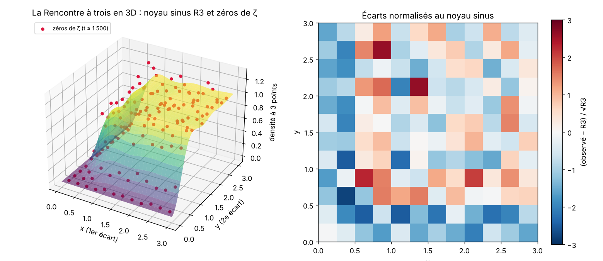

# V6.19 — Plan de recherche : la Rencontre à n et la matrice des théories (adapté en V6.20 à V6.29)

**Date :** 10 octobre 2026  
**Statut :** plan de recherche. Il contient une identité démontrée (§3.1), un premier calcul fait avec des prévisions écrites avant (§3.2), sept axes avec leurs prévisions (§4) et une matrice d'équivalence et de force des théories, à compléter (document 44). **Adapté en V6.20** : les pistes d'OpenAI sont rattachées aux axes (§4 bis), deux axes s'ajoutent (H, le Tamis à deux ; I, le Palier et la simplicité), l'ordre est refait (§5) après le recalcul du palier 4/3 (document 45), et les résultats retrouvés dans la littérature sont recensés (document 45, §4).  
**Demande de l'auteur :** « Ces nouvelles lectures montrent des figures parfois similaires, mais en 3D. Faire un plan de recherche qui utilise aussi ces points découverts. Ouvrez et gardez notre méthode : analyse symbolique, puis opérateur, puis fonctions et identifications. Une représentation qui reprend et situe la matrice d'équivalence et de force des théories, à compléter. »

## 1. Ce que montrent les nouvelles lectures

Les lectures de la V6.18.1 viennent des réponses d'OpenAI, de l'article court et de la Leçon 2026. Plusieurs d'entre elles dessinent des figures que le corpus connaît déjà en deux dimensions. Elles les montrent avec un axe de plus.

| Figure du corpus (2D) | La même figure avec un axe de plus (3D) | Où on la lit |
|---|---|---|
| Marge d'une paire de zéros, 1 − sinc²(πs), en fonction de l'écart s (doc. 40) | Densité à trois points R3(x, y) sur le plan des deux écarts : une surface | Rudnick–Sarnak [RS96] ; Bogomolny et al. [BBLM06] |
| Loi de la marge : la marge d'une paire est la corrélation de paires du CUE(N) (doc. 41) | La même loi pour n atomes : la marge d'un n-uplet est sa corrélation à n points | §3.1 ci-dessous |
| Zéros de ζ sur une droite | Zéros de H_t dans le plan (x, t) du flot de la chaleur : des trajectoires qui se rencontrent | de Bruijn [DeB50], Newman [New76], Rodgers–Tao [RT20], Polymath [Pol19] |
| Corrélation de paires sous RH (Montgomery) | Facteur de forme F(α) en fonction de α et de la hauteur T, sans RH | Montgomery [Mon73] ; Baluyot–Goldston–Suriajaya–Turnage-Butterbaugh [BGST24] |
| Énergie Q(X) en fonction de log X (Théorème A) | Coefficients de Bohr de Ψ : amplitude en fonction de γ et de la longueur L | Besicovitch [Bes32] ; piste OA04 d'OpenAI |
| Proportions de zéros simples et critiques (doc. 13) | Proportions en intervalles courts, en fonction de la hauteur et de la longueur | Alpöge–Furman [AF26] ; Lamzouri [Lam26] ; B. Wang [Wan26a], [Wan26b] ; Pearce-Crump [PC26] |

La première ligne a été calculée tout de suite, parce qu'elle prolonge exactement la V6.17 (§3). Les autres deviennent des axes du plan (§4).

## 2. La méthode, gardée et ouverte

Chaque axe passe par les quatre temps de la méthode du corpus. Chaque temps a sa garde, tirée du registre des métaphores (doc. 20) : une métaphore n'est conservée que si elle pointe vers un objet exact, un observable, un témoin contraire et une règle d'arrêt.

| Temps | Ce qu'on fait | Garde |
|---|---|---|
| **1. Symbolique** | On nomme l'image (une métaphore du registre, ou un nom nouveau proposé). | L'image doit dire où elle casse. |
| **2. Opérateur** | On écrit l'objet mathématique exact que l'image désigne : une métrique, une forme, un flot, une projection. | L'objet est défini sans les zéros quand c'est possible. |
| **3. Fonctions** | On choisit les quantités calculables : une marge, une densité, une trajectoire, un coefficient. | La prévision est écrite avant le calcul, avec la règle d'arrêt. |
| **4. Identification** | On reconnaît la quantité dans une théorie connue : une loi de matrices aléatoires, un critère, un théorème du Modèle réduit. On la place dans la matrice (doc. 44). | Un témoin contraire (Davenport–Heilbronn, Poisson, familles étrangères) doit échouer là où ζ réussit. |

La méthode est **ouverte** : la matrice des théories (doc. 44) est le lieu où l'identification s'écrit. Une case remplie doit citer une source du registre ou un document du corpus. Une case vide est une question.

## 3. Premier résultat : la Rencontre à n

### 3.1. L'identité (démontrée, élémentaire)

On place n atomes aux angles θ~1~, …, θ~n~ et on les regarde à travers une fenêtre de N échantillons : x~l~(j) = e^ijθ~l~^, j = 0, …, N − 1. La métrique est G = VV*. Son coefficient vaut

  G~lm~ = e^i(N−1)(θ~l~−θ~m~)/2^ · sin(NΔ/2) / sin(Δ/2),  avec Δ = θ~l~ − θ~m~.

La phase s'écrit u~l~ ū~m~ : G/N = U K U*, avec U diagonale unitaire et K~lm~ = D~N~(θ~l~ − θ~m~), D~N~(Δ) = sin(NΔ/2)/(N sin(Δ/2)). Donc

  **det(G/N) = det[D~N~(θ~l~ − θ~m~)] = (2π/N)^n^ · R~n~(θ~1~, …, θ~n~),**

où R~n~ est la corrélation à n points des valeurs propres d'une matrice unitaire de taille N tirée selon la mesure de Haar (CUE(N)). La marge normalisée d'un n-uplet est sa corrélation à n points. Pour n = 2, c'est l'identité 3.1 de la V6.17 ; pour n = N, c'est la densité de Weyl [Wey39] (identité 3.2). À la fenêtre de Heisenberg (N → ∞, écarts normalisés s fixés), on obtient det[sinc(π(s~l~ − s~m~))], le noyau sinus, dont la conformité avec les zéros est démontrée pour des fonctions-tests à support restreint [RS96] (cité de mémoire).

Pour trois atomes, aux écarts x et y : R3(x, y) = 1 − a² − b² − c² + 2abc, avec a = sinc(πx), b = sinc(πy), c = sinc(π(x + y)).

### 3.2. Les mesures (prévisions écrites à 18 h 18 UTC, avant le calcul : `data/prevision_v619.md`)

Script : `scripts/run_rencontre_a_n.py` (2 secondes). Zéros de ζ jusqu'à t = 1 500 (1 070 zéros), dépliés par la formule de Riemann–von Mangoldt. Triplets ordonnés, écarts (x, y) dans [0, 3]², cases de 0,25.

| | Prévision | Résultat | Verdict |
|---|---|---|---|
| P1 | identité vérifiée à 10^−12^ près, n = 2 à 5 | écart maximal 1,4·10^−15^ sur 1 000 n-uplets | **juste** |
| P2 | densité à trois points des zéros de ζ : χ² réduit ≤ 2 pour R3, ≥ 5 pour Poisson | 1,34 pour R3 (120 cases) ; 17,3 pour Poisson | **juste** |
| P3 | trou triple : masse de la zone x, y < 0,5 au plus 1/3 de celle du produit des paires R2(x)R2(y) | observé 0 ; produit des paires 13,6 ; R3 4,4 ; Poisson 266 | **juste** |
| P4 | ζ·L(χ5) (t ≤ 600) : pas de trou triple (masse au moins 3 fois celle de ζ seule) | 10 triplets contre 0 pour ζ seule : le critère chiffré est rempli. Mais Poisson en attendait 207 : le trou existe encore, moins profond | **à moitié** |

**Ce que P4 a appris : la loi des Familles étrangères.** Si ζ et L(χ5) sont deux familles indépendantes qui suivent chacune le noyau sinus à leur propre échelle, la densité à trois points du mélange est une somme : f³R3 pour trois points d'une même famille, f²(1 − f)R2 pour deux points d'une famille et un de l'autre, etc. Ici, f = 0,408 est la part de ζ dans la densité. Cette loi de superposition donne un χ² réduit de **0,87** sur 141 cases, contre 2,52 pour le noyau sinus seul. Le nom « Familles étrangères » (V6.17) devient un énoncé mesuré : à trois points, deux familles se superposent sans se voir.

**Un écart à suivre.** La zone x, y < 0,5 contient 0 triplet de zéros de ζ, alors que R3 en attend 4,4 (probabilité de Poisson d'environ 1 %). La première ligne et la première colonne de la carte des écarts (figure, à droite) sont toutes en bleu : à basse hauteur, la répulsion à trois est plus forte que le noyau sinus. C'est le sens de l'effet de hauteur finie de Bogomolny et al. [BBLM06], que la V6.16 avait trouvé pour les paires. C'est l'axe A.

## 4. Les axes du plan

Chaque axe garde la même forme : les quatre temps, la prévision, le témoin, la règle d'arrêt. Les coûts sont en séances de travail.

### Axe J. La surface virtuelle (V6.21 ; prioritaire, à la demande de l'auteur)

1. **Symbolique.** La Surface virtuelle : une surface dont on connaît les intersections sans connaître les points ; la Scène manquante.
2. **Opérateur.** La forme d'intersection sur {fibres, graphes de Frobenius} : dans le Modèle réduit, celle de C × C ; pour ζ, la même par le dictionnaire (fibres ↔ pôle, intersections ↔ puissances de premiers, genre ↔ terme archimédien), calculée depuis les seuls premiers.
3. **Fonctions.** Le nombre de directions positives (indice de Hodge = 1 pour une vraie surface) ; le rang orthogonal aux fibres (« genre virtuel »).
4. **Identification.** Positivité de Castelnuovo (Weil, courbes) ; positivité de Weil (ζ) ; programme de Connes.

**Fait (doc. 46).** 425 courbes sur 425 : une direction positive. Les 220 faux jumeaux : surplus exact. ζ : une seule direction positive depuis les premiers ≤ 439. DH : 2 puis 10 en trop.
**Fait (doc. 47, V6.22).** J2 : Clifford n'attrape aucun jumeau ; Stepanov–Bombieri (fonction auxiliaire, par Riemann–Roch et le Frobenius) et le tordu quadratique attrapent les 220, à l'étage médian 4 (Castelnuovo : 3). Le lemme manquant pour ζ est formulé : une fonction auxiliaire qui borne ψ(x) − x d'un côté, ce qui demande un « Frobenius absolu » sur Spec Z.
**Fait (doc. 48, V6.23).** J5 : la fonction de Stepanov n'existe qu'avec le Frobenius ; l'identité (mêmes valeurs aux points) et une permutation échouent ; ce qui compte est l'inséparabilité (dérivée nulle de x^p).
**Suite.** J3, la fonction auxiliaire pour les premiers, avec l'action d'échelle à la place du Frobenius (lecture de Connes–Consani, puis calcul). J4, le genre virtuel.
**Témoin.** Les faux jumeaux du Modèle réduit ; DH pour ζ.
**Arrêt (J2).** Aucune inégalité plus précoce que Castelnuovo ne sépare les courbes des jumeaux.
**Coût :** J2 1,5 ; J3 2 ; J4 1.

### Axe A. La Rencontre à n en hauteur

1. **Symbolique.** La Rencontre à n ; le Temps de Heisenberg.
2. **Opérateur.** La métrique G d'un n-uplet à la fenêtre N~eff~(T), la taille effective de Bogomolny et al. [BBLM06].
3. **Fonctions.** R3 du CUE(N~eff~) exact, grâce à l'identité 3.1 (det[D~N~]), comparé aux triplets de ζ par tranches de hauteur. Puis les triplets des 2 139 zéros de L(Δ, s), et ceux des angles de Frobenius dans le Modèle réduit.
4. **Identification.** Loi de Haar à taille finie ; pendant dans le Modèle réduit : Katz–Sarnak [KS99].

**Prévision.** Le déficit à x, y < 0,5 disparaît avec R3 du CUE(N~eff~). Le χ² réduit passe sous 1,2.
**Témoin.** Une suite de Poisson dépliée de même densité.
**Arrêt.** Si le CUE(N~eff~) n'améliore pas le χ² de 20 %, l'effet n'est pas celui de la hauteur finie.
**Coût :** 1.

### Axe B. Montgomery sans RH et le Compteur de paires

1. **Symbolique.** La Loi de la marge ; le Compteur de paires.
2. **Opérateur.** Le facteur de forme F(α, T), transformée de Fourier de la marge des paires.
3. **Fonctions.** F(α) mesuré sur nos zéros, pour α < 1 et α > 1. Puis la part d'écart de β (doc. 40) exprimée comme une intégrale de F.
4. **Identification.** Montgomery [Mon73] sous RH ; la version sans RH de Baluyot et al. [BGST24].

**Prévision.** La part de β portée par les paires serrées (35 % pour 10 % des zéros, V6.16) se déduit de F(α) à 10 % près.
**Témoin.** DH, où F n'a pas la forme GUE.
**Arrêt.** Écart de plus de 25 %.
**Coût :** 1,5.

### Axe C. Le flot de la chaleur en 3D : les collisions sont-elles la Rencontre ?

1. **Symbolique.** Le Thermostat critique ; la Rencontre à trois.
2. **Opérateur.** Le flot ∂~t~H = −∂²~x~H. En remontant le temps (t < 0), les zéros de H~t~ se rapprochent puis se rencontrent.
3. **Fonctions.** Les trajectoires des zéros dans le plan (x, t), pour ζ et pour Ξ~DH~. Pour chaque paire : le temps de collision t~c~ et la marge initiale m = 1 − sinc²(πs).
4. **Identification.** Λ = 0 ⇔ RH [DeB50], [New76], [RT20] ; calculs de Polymath [Pol19].

**Prévision.** |t~c~| croît comme une puissance de la marge initiale, d'exposant entre 0,5 et 1,5. La paire de Lehmer près de 7 005 entre en collision la première dans sa fenêtre.
**Témoin.** DH : ses quadruplets hors de la droite rejoignent la droite à t > 0. C'est le coup « Le Thermostat du Sosie », déjà ouvert.
**Arrêt.** Aucune corrélation de rang entre |t~c~| et m (Spearman < 0,3).
**Coût :** 2. **Origine :** piste OA05 d'OpenAI (« température zéro »).

### Axe D. La queue de Nyman–Beurling et les sommes de Maier–Rassias

1. **Symbolique.** Le Filtre antipôle ; l'Effaceur orthogonal.
2. **Opérateur.** La queue T~N~ et la somme de carrés V~N~ = (1/12) Σ J~2~(q)(Σ~q|d~ w~d~/d)² (doc. 12).
3. **Fonctions.** Une borne de T~N~ par V~N~, mesurée jusqu'à N = 10⁵. Depuis la V6.20 (doc. 45) : T~N~ ≈ 2,9 κ/log²N en médiane, en lente croissance (de 2,7 à 3,1), avec des pics là où A~N~ s'annule. C'est le terme qui décide si le palier tend vers 4/3.
4. **Identification.** Les sommes de Möbius et Vasyunin de Maier–Rassias [MR18] ; la constante de Bettin–Conrey–Farmer [BCF13].

**Prévision.** T~N~ ≤ 3V~N~ pour tout N ≥ 100 ; et T~N~ log²N/κ reste sous 4 en médiane jusqu'à 10⁷.
**Témoin.** Des coefficients de Steinhaus (signes aléatoires) à la place de μ.
**Arrêt.** La borne échoue avant N = 10⁴.
**Coût :** 1,5. C'est le coup « La queue par l'écho », déjà ouvert. **Origine :** piste OC04 d'OpenAI.

### Axe E. Le Carillon de Bohr (nom proposé)

1. **Symbolique.** Un carillon dont chaque cloche est un zéro : Ψ sonne sans s'amplifier ni s'éteindre.
2. **Opérateur.** Les translations unitaires de l'espace de Besicovitch B² [Bes32].
3. **Fonctions.** Les coefficients de Bohr A~γ~(L) = (1/L)∫ Ψ(u)e^−iγu^ du, en fonction de γ et de L : une surface.
4. **Identification.** Le Théorème B : sous RH, Σ|A~γ~|² = S (doc. 37).

**Prévision.** Les 100 premiers A~γ~ convergent à 5 % près pour L = 40.
**Témoin.** DH, où Ψ croît.
**Arrêt.** Pas de convergence à L = 60.
**Coût :** 1. C'est le coup « Les coefficients de Bohr de Ψ ». **Origine :** pistes OA02 et OA04 d'OpenAI (K(L) et l'espace B²).

### Axe F. Les proportions de 2026 et le recensement

1. **Symbolique.** Le Census spectral.
2. **Opérateur.** La compression finie de la forme de Weil [Wei52] utilisée par Alpöge–Furman [AF26].
3. **Fonctions.** Les proportions de zéros simples et critiques en intervalles courts [Wan26a] ; la méthode de Selberg optimisée [PC26].
4. **Identification.** Ces proportions sont-elles des proportions de marges non nulles ?

**C'est une lecture**, non un calcul. Les résumés seulement ont été lus. **Coût :** 1.

### Axe G. Compléter la matrice

On remplit d'abord les cases « ? ». Ensuite :

- on source la ligne de Mertens ;
- on relie Hilbert–Pólya à Weil ;
- on relie l'énergie transverse à Nyman–Beurling (OpenAI les traitait ensemble) ;
- on vérifie la page MathOverflow [MO21].

Règle : une case ne se remplit qu'avec une source du registre ou un document du corpus.

### Axe H. Le Tamis à deux (V6.20 ; la seule piste d'OpenAI jamais explorée)

1. **Symbolique.** Le Tamis à deux : un crible qui ne laisse passer que les nombres à au plus deux facteurs premiers.
2. **Opérateur.** La somme de carrés V~N~ = (1/12) Σ J~2~(q)(Σ~q|d~ w~d~/d)², décomposée par canaux q.
3. **Fonctions.** La parcimonie de c (c(n) = 0 dès trois facteurs premiers distincts) et les canaux actifs de V~N~. On les calcule pour ζ, L(χ5), DH et des coefficients de Steinhaus.
4. **Identification.** Le produit d'Euler (Fermeture multiplicative, PRIME-LOCK) ; le « monstre » d'OpenAI, Re⟨Af,f⟩ ≤ 0 : la dissipation viendrait-elle du produit d'Euler ?

**Prévision.** Pour ζ et L(χ5), plus de 90 % de V~N~ est porté par les canaux q à au plus deux facteurs premiers. Ce n'est pas le cas pour DH.
**Témoin.** Steinhaus : s'il a la même parcimonie, la propriété ne dit rien de plus que PRIME-LOCK.
**Arrêt.** Même répartition des canaux chez Steinhaus et chez ζ.
**Coût :** 1. **Origine :** piste OA08 d'OpenAI ; coup « Le Tamis à deux contre le Sosie ».

### Axe I. Le Palier et la simplicité (V6.20)

1. **Symbolique.** Le Palier ; le Diapason (Théorème B).
2. **Opérateur.** La famille qui annule le pôle, w = μ + βa, et sa décomposition e~N~² log N/(4κ/3) = b~N~² r~Q~ + ¾τ~N~ (doc. 45).
3. **Fonctions.** Le développement au second ordre en 1/log N, à comparer à la médiane mesurée (0,985 × 4/3). La même médiane pour d'autres familles qui annulent le pôle (μ log³n, plusieurs bouchons). Un modèle de formule explicite avec un zéro double, pour voir le palier monter.
4. **Identification.** Corollaire B′ : la limite vaut (S/4κ) · 4/3 ; elle vaut 4/3 si et seulement si les zéros sont simples.

**Prévision.** Le second ordre explique l'écart 0,985 − (1 − 0,51/L) à 0,01 près. Dans le modèle à zéro double, la médiane dépasse 4/3 dès que S/4κ − 1 > 0,05.
**Témoin.** Les familles sans annulation du pôle ({μ, μ log n}) : un autre palier.
**Arrêt.** Deux familles qui annulent le pôle avec des médianes distinctes au-delà de 2 %.
**Coût :** 1,5. **Origine :** pistes OB05 et OC03 d'OpenAI (coups « Le Palier 4/3 » et « Plusieurs bouchons »).

## 4 bis. Ce que deviennent les pistes d'OpenAI

Sur les 27 pistes d'OpenAI, 18 sont closes. Leur place est dans la matrice (doc. 44), marquée d'un coin bleu.

| Piste d'OpenAI | État | Axe du plan | Place dans la matrice |
|---|---|---|---|
| OA01 exposant transverse λ⊥ | close (c'est le Théorème A) | — | ligne THA |
| OA02, OA04 densité K(L), espace B² | en partie | E | ligne STAR ; case DH × STAR (témoin) |
| OA05 de Bruijn–Newman, « température zéro » | en partie | C | ligne DBN ; case DBN × simplicité |
| OA06 dimension ½ (Lapidus–Herichi) | close, retrouvée dans la littérature | — | ligne LHD |
| OA07 Hilbert–Pólya dissipatif | close (retombe sur Weil) | — | lignes HP et WEIL |
| OA08 dissipation par le produit d'Euler | **jamais explorée** | **H** | ligne TAMIS |
| OB01 énergie transverse E⊥ | close, équivalence connue | — | ligne EPERP |
| OB02 Q comme énergie de Nyman–Beurling | close (identité exacte) | — | case NB ↗ THA |
| OB05 palier 4/3 ; OC03 plusieurs bouchons | en partie ; recalculé en V6.20 | **I** | case NB × simplicité |
| OC04 queue T~N~, somme de carrés V~N~ | en partie | D | case TAMIS × NB |

## 5. Ordre proposé

Ordre refait en V6.21 : l'axe J passe en tête, à la demande de l'auteur. Mis à jour en V6.22 après J2.

| Ordre | Axe | Coût | Ce qu'il débloque |
|---|---|---|---|
| 1 | J. Surface virtuelle, route de Weil : J3a, J3b et J6 faits (docs 49, 51, 52 ; signature robuste sur 180 réglages) ; puis J4, et l'explication du décompte des directions en trop de DH | 1 + 1 | la positivité sur le carré, ce qui manque aux entiers |
| 1 bis | A. Fait (docs 53, 54) : trou à trois mesuré (ζ 0 pour 15,6) ; ni la taille finie du CUE (N ≥ 3) ni le dépliage ne l'expliquent ; rigidité de forme, visible dans le rapport d'écarts ; suite : la formule à trois points de Bogomolny–Keating (petits premiers) | 2 | la loi de la rigidité à basse hauteur |
| 2 | B. Taille effective de Δ, avec le rapport d'écarts (doc. 54) | 1 | la ligne « corrélation de paires » |
| 3 | H. Tamis à deux (jamais exploré) | 1 | la ligne TAMIS ; le « monstre » d'OpenAI |
| 4 | D. Queue de Nyman–Beurling | 1,5 | la limite du palier (τ~N~ → 0 ?) |
| 5 | I. Palier et simplicité | 1,5 | la case NB × simplicité |
| 6 | C. Collisions du flot | 2 | la case dBN × simplicité |
| 7 | B. Montgomery sans RH | 1,5 | la ligne « corrélation de paires » |
| 8 | E. Carillon de Bohr | 1 | la ligne (★) |
| en continu | F fait (doc. 54 : les deux tiers sont un recensement de marges ; DH ✗ proportion). G : première séance faite (11 cases sourcées), deuxième ouverte (les cinq cases « ? ») | 1 | la matrice |

Les axes A, B et C, la lecture F et la matrice G ont été ajoutés au navigateur comme coups ouverts en V6.19. Les axes D, E et H y étaient déjà, venus des pistes d'OpenAI. L'axe I reprend les coups « Le Palier 4/3 » et « Plusieurs bouchons ».

## 6. Démontré, mesuré, supposé

| | Énoncé |
|---|---|
| **Démontré** | La marge normalisée d'un n-uplet est sa corrélation à n points du CUE(N) (§3.1). |
| **Mesuré** | Densité à trois points des zéros de ζ conforme au noyau sinus (χ² 1,34) et non à Poisson (17,3). Trou triple plus profond que le produit des paires. Loi de superposition pour ζ·L(χ5) (χ² 0,87). Déficit à basse hauteur (0 triplet pour 4,4 attendus). |
| **Supposé** | Le déficit vient des petits premiers (axe A ; la taille finie du CUE est écartée au doc. 54). Les collisions du flot sont la Rencontre (axe C). Axe F, établi depuis (doc. 54) : la borne des deux tiers recense les marges des paires. |

Rien de ceci ne prouve RH. La Rencontre à n décrit comment les zéros se placent les uns par rapport aux autres, pas où ils sont.

## 7. Lecture selon l'hypothèse de travail

L'hypothèse de l'auteur est que RH n'existe que parce qu'elle est nécessaire à quelque chose de plus grand qui la rend nécessaire. La Rencontre à n ajoute une pièce à cette lecture. La marge, définie comme une métrique, ne connaît que la géométrie de la fenêtre. Pourtant elle redonne, à tous les ordres, la loi de Haar du groupe unitaire. Ce « plus grand » serait alors le groupe et sa mesure : la seule loi qui laisse à chaque configuration une place proportionnelle à sa marge. La matrice des théories sert à situer cette lecture : elle montre quelles théories impliquent RH, lesquelles en découlent et lesquelles en sont indépendantes.

<!-- references:debut -->

## Références

Format : [clé] auteurs, *titre*, publication, lien. Fiches complètes et état de vérification : document 42 (registre des sources).

- [AF26] L. Alpöge, R. Furman. *More than two thirds of the zeros of the Riemann zeta function are simple and on the critical line*. arXiv:2608.13637 (août 2026). <https://arxiv.org/abs/2608.13637> — vérifié en ligne
- [BBLM06] E. Bogomolny, O. Bohigas, P. Leboeuf, A. G. Monastra. *On the spacing distribution of the Riemann zeros: corrections to the asymptotic result*. J. Phys. A 39 (2006), 10743–10754 ; arXiv:math/0602270. <https://arxiv.org/abs/math/0602270> — vérifié en ligne
- [BCF13] S. Bettin, J. B. Conrey, D. W. Farmer. *An optimal choice of Dirichlet polynomials for the Nyman–Beurling criterion*. Proc. Steklov Inst. Math. 280 (2013) ; arXiv:1211.5191. <https://arxiv.org/abs/1211.5191> — vérifié en ligne
- [Bes32] A. S. Besicovitch. *Almost Periodic Functions*. Cambridge University Press (1932). — non vérifié
- [BGST24] S. A. C. Baluyot, D. A. Goldston, A. I. Suriajaya, C. L. Turnage-Butterbaugh. *An unconditional Montgomery theorem for pair correlation of zeros of the Riemann zeta-function*. Acta Arith. 214 (2024), 357–376 ; DOI 10.4064/aa230612-20-3. <https://impan.pl/en/publishing-house/journals-and-series/acta-arithmetica/online/115529/an-unconditional-montgomery-theorem-for-pair-correlation-of-zeros-of-the-riemann-zeta-function> — vérifié en ligne
- [DeB50] N. G. de Bruijn. *The roots of trigonometric integrals*. Duke Math. J. 17 (1950), 197–226. <https://en.wikipedia.org/wiki/De_Bruijn%E2%80%93Newman_constant> — partiellement vérifié
- [KS99] N. M. Katz, P. Sarnak. *Zeroes of zeta functions and symmetry*. Bull. Amer. Math. Soc. 36 (1999), 1–26 ; voir aussi le livre Random Matrices, Frobenius Eigenvalues, and Monodromy, AMS Colloq. Publ. 45 (1999). <https://www.ams.org/bull/1999-36-01/S0273-0979-99-00766-1/> — vérifié en ligne
- [Lam26] Y. Lamzouri. *A new proof that more than 2/3 of the zeros of the Riemann zeta function are simple and on the critical line*. arXiv:2609.02882 (sept. 2026). <https://arxiv.org/abs/2609.02882> — vérifié en ligne
- [MO21] MathOverflow (question 400779). *A question on an equivalence of RH*. mathoverflow.net, question 400779 (année estimée d'après le numéro, non vérifiée) (2021). <https://mathoverflow.net/questions/400779> — non vérifié
- [Mon73] H. L. Montgomery. *The pair correlation of zeros of the zeta function*. Analytic Number Theory, Proc. Sympos. Pure Math. 24, AMS (1973), 181–193. <https://public.websites.umich.edu/~hlm/paircor1.pdf> — vérifié en ligne
- [MR18] H. Maier, M. Th. Rassias. *Explicit estimates of sums related to the Nyman–Beurling criterion for the Riemann Hypothesis*. arXiv:1806.05070 (2018). <https://arxiv.org/abs/1806.05070> — vérifié en ligne
- [New76] C. M. Newman. *Fourier transforms with only real zeros*. Proc. Amer. Math. Soc. 61 (1976), 245–251. <https://en.wikipedia.org/wiki/De_Bruijn%E2%80%93Newman_constant> — partiellement vérifié
- [PC26] A. Pearce-Crump. *Optimising Selberg's method for critical zeros*. arXiv:2609.15329 (septembre 2026). <https://arxiv.org/abs/2609.15329> — vérifié en ligne
- [Pol19] D. H. J. Polymath. *Effective approximation of heat flow evolution of the Riemann ξ function, and a new upper bound for the de Bruijn–Newman constant*. Res. Math. Sci. 6 (2019), 31 ; arXiv:1904.12438. <https://arxiv.org/abs/1904.12438> — vérifié en ligne
- [RS96] Z. Rudnick, P. Sarnak. *Zeros of principal L-functions and random matrix theory*. Duke Math. J. 81 (1996), 269–322 (référence citée de mémoire). <https://arxiv.org/abs/2002.00595> — partiellement vérifié
- [RT20] B. Rodgers, T. Tao. *The De Bruijn–Newman constant is non-negative*. Forum Math. Pi 8 (2020), e6 ; arXiv:1801.05914. <https://arxiv.org/abs/1801.05914> — vérifié en ligne
- [Wan26a] B. Wang. *Simple critical zeros and distinct zeros of the Riemann zeta-function in short intervals*. arXiv:2609.07918 (septembre 2026). <https://arxiv.org/abs/2609.07918> — vérifié en ligne
- [Wan26b] B. Wang. *Proportions of the non-trivial zeros of the Riemann zeta function*. arXiv:2609.24167 (septembre 2026). <https://arxiv.org/abs/2609.24167> — vérifié en ligne
- [Wei52] A. Weil. *Sur les « formules explicites » de la théorie des nombres premiers*. Comm. Sém. Math. Univ. Lund, vol. suppl. dédié à M. Riesz (1952), 252–265. <https://en.wikipedia.org/wiki/Weil%27s_criterion> — partiellement vérifié
- [Wey39] H. Weyl. *The Classical Groups: Their Invariants and Representations*. Princeton University Press (1939). <https://press.princeton.edu/books/paperback/9780691057569/the-classical-groups> — partiellement vérifié

<!-- references:fin -->
