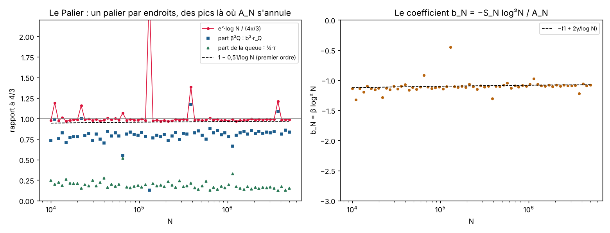

# V6.20 — Le Palier 4/3 recalculé, et ce que le programme a retrouvé

**Date :** 10 octobre 2026  
**Statut :** calcul refait, jusqu'à N = 5·10⁶, avec des prévisions écrites avant (`data/prevision_v620_palier.md`, 18 h 49 UTC). Deux d'entre elles sont justes, deux le sont à moitié. Le document contient aussi un recensement des résultats retrouvés ici puis reconnus dans la littérature, avec la référence dans le corpus et la source.  
**Demande de l'auteur :** « Au fait, quelque part on a 4/3. Il faudrait refaire ce calcul et voir si ce n'est pas légèrement différent. » Et : « dire ce que nous avons redécouvert indirectement, avec la référence dans notre corpus ».

## 1. D'où vient le 4/3

La famille qui « annule le pôle » vient d'une réponse d'OpenAI, vérifiée en V5.6 (doc. 12). Les poids sont w = μ + βa, avec a(n) = μ(n)(log²n − 2γ log n) et β = −S~N~/A~N~, où S~N~ = Σ μ(n)/n et A~N~ = Σ a(n)/n. On a alors exactement :

  e~N~² = β²Q(N) + T~N~.

Ici, Q est l'énergie des Théorèmes A et B, et T~N~ la queue. Le corpus notait un **palier** e~N~² log N/κ ≈ 1,28–1,31, de N = 998 à 10⁵. Il annonçait aussi que, sous RH, « la famille tend vers ≈ (4/3)κ/log N » (KNOWN_GAPS, clôture V5.6 ; registre, « Le Palier »).

On écrit le rapport à 4/3 en trois facteurs :

  e~N~² log N / (4κ/3) = b~N~² · r~Q~ + ¾ τ~N~,

- b~N~ = β log²N ;
- r~Q~ = Q(N)/((4κ/3) log³N) ;
- τ~N~ = T~N~ log N/κ.

Sous RH, avec des zéros simples, b~N~ → −1 en moyenne et r~Q~ → 1 (Théorème B). Il faut aussi que τ~N~ → 0. La limite est alors 4/3. Si des zéros étaient multiples, r~Q~ tendrait vers S/(4κ) > 1 (corollaire B′), et la limite serait plus grande.

## 2. Les prévisions et leur sort

| | Prévision | Résultat | Verdict |
|---|---|---|---|
| P1 | les valeurs de la V5.6 retrouvées à 10^−6^ près | Q(N) à 10^−14^ près ; e~N~² à 1,1·10^−4^ près. L'écart vient de la troncature de la queue, que la V5.6 coupait plus tôt. | **à moitié** |
| P2 | T~N~ log²N/κ dans 2,7 ± 0,3 jusqu'à 10⁶ | la médiane va de 2,73 à 3,09 et croît lentement ; aux pics, jusqu'à 23,9 (N = 5·10⁵) | **à moitié** |
| P3 | r~Q~ suit 1 − 4,99/L + 10,3/L² à 3 % près | écart ≤ 2,6 % jusqu'à 5·10⁶ (0,7188 contre 0,7198 à 5·10⁶) | **juste** |
| P4 | ce n'est pas une constante ; toutes les valeurs sous 4/3 jusqu'à 10⁶ ; limite 4/3 ± 0,05 | ce n'est pas une constante : **juste**. Mais 16 % des N tirés dépassent 4/3, avec des pics à 2,55 et 3,27 fois 4/3 : **faux**. La médiane, 1,313, est dans 4/3 ± 0,05 : **juste**. | **à moitié** |

Le calcul (`scripts/run_palier_quatre_tiers.py`, une minute et demie) recalcule μ, Λ et c par des cribles indépendants de ceux de la V5.6. Contrôle de la queue : à N = 10⁶, doubler la longueur de sommation change T~N~ de 0,5 %, soit 0,1 % du total.

## 3. Ce que montre le recalcul

**Oui, c'est légèrement différent.** Sur 64 valeurs de N réparties de 10⁴ à 5·10⁶, la **médiane** de e~N~² log N/κ vaut **1,313**, soit **0,985 × 4/3** (déciles 0,974 et 1,010). Par tranches de log N, la médiane reste entre 0,979 et 0,989 : elle ne monte pas visiblement vers 4/3 sur cette plage.

**Le 4/3 apparent est une compensation.** À N = 5·10⁶, les trois facteurs valent :

| Facteur | Valeur à 5·10⁶ | Limite sous RH |
|---|---|---|
| b~N~² | 1,158 (b~N~ = −1,076) | 1 |
| r~Q~ | 0,719 | 1 |
| ¾ τ~N~ | 0,152 | 0 |
| **total / (4/3)** | **0,985** | **1** |

Aucun des trois n'est près de sa limite, mais leurs écarts se compensent. Au premier ordre en 1/L, avec L = log N :

- b~N~² ≈ 1 + 4γ/L ;
- r~Q~ ≈ 1 − 4,99/L (doc. 37) ;
- ¾ τ ≈ 2,17/L (queue mesurée).

Le rapport vaut donc 1 − 0,51/L + O(1/L²). Les médianes mesurées sont au-dessus de cette droite (0,985 au lieu de 0,96 à L = 13). Les termes du second ordre ne sont donc pas négligeables à ces hauteurs.

**Ce n'est pas un palier partout : il y a des pics.** b~N~ = −S~N~ log²N/A~N~ est un rapport de deux sommes qui tendent toutes deux vers 0 en oscillant. Sa médiane suit bien −(1 + 2γ/L) (−1,086 sur cinq millions de valeurs de N). Mais là où A~N~ passe près de 0 sans que S~N~ le fasse, b~N~ s'écarte. On a |b~N~| = 93 218 à N = 33 493 (où A~N~ ≈ 0), et 0,9 % des N ont b~N~ hors de [−2 ; −0,5].

Aux pics, la famille ne converge pas : e~N~² log N/κ atteint 2,55 × 4/3 à N = 129 975 et 3,27 × 4/3 à N = 5·10⁵. La V5.6 avait mesuré à sept valeurs de N et les avait manqués.

**Correctifs au corpus.**

- « Palier 1,28–1,31 de 998 à 10⁵ » : vrai aux N mesurés. En médiane, le palier vaut 0,985 × 4/3 jusqu'à 5·10⁶, avec des pics dès 1,3·10⁵.
- « La famille tend vers (4/3)κ/log N sous RH » : vrai seulement en valeur typique. C'est conditionnel (RH, zéros simples, τ~N~ → 0) et lent (correction en 1/log N). Le long des N où A~N~ s'annule, c'est faux.
- La queue T~N~ ≈ 2,9 κ/log²N est observée, pas démontrée ; T~N~ log²N/κ croît lentement (de 2,7 à 3,1). C'est l'objet du coup « La queue par l'Écho ».

**Ce que le palier pourrait lire.** Si la queue est démontrée négligeable (axe D) et si b~N~ → −1 en moyenne, alors sous RH la médiane du palier tend vers (S/4κ) · 4/3. Elle vaut 4/3 si et seulement si tous les zéros sont simples (corollaire B′). Une famille de Nyman–Beurling lirait ainsi la simplicité des zéros. C'est une case de la matrice (NB × simplicité), marquée « éventuellement nouveau, à confirmer ». Les données jusqu'à 5·10⁶ ne permettent pas de distinguer une limite 0,988 × 4/3 d'une limite 4/3 atteinte avec des corrections en 1/log²N.

## 4. Ce que le programme a retrouvé

Les résultats ci-dessous ont été obtenus ici, ou proposés par OpenAI et vérifiés ici, puis reconnus dans la littérature. Ils ne sont pas nouveaux. Ils montrent que le corpus est arrivé par ses propres chemins à des endroits connus, ce qui valide ces chemins.

| Ce qui a été retrouvé | Dans le corpus | Où c'était déjà |
|---|---|---|
| « RH (et même l'absence de zéro dans Re s > 1) force le produit d'Euler » dans les espaces V~q~ | doc. 30 (V6.8), reconnu au doc. 37 | Saias–Weingartner, Th. 2 [SW09] ; degré 2 : Booker–Thorne, Th. 1.1 [BT14] |
| La méthode des Théorèmes A et B (caractérisation de Θ, moyenne quadratique) | doc. 37 | Cramér [Cra22] ; Montgomery–Vaughan, ch. 13 [MV07] ; Brent–Platt–Trudgian [BPT22]. Le Théorème B lui-même n'a pas été trouvé tel quel |
| La constante κ = 2 + γ − log 4π dans Nyman–Beurling | docs 09, 10 (v3.5) | borne de Burnol [Bur02] ; Bettin–Conrey–Farmer [BCF13] |
| La covariance des dents de scie pgcd(a, b)²/(12ab) (lemme L8) | doc. 09 ; BIBLIO_POSITIONNEMENT (v3.8) | Franel [Fra24], démontrée par Landau [Lan24] |
| Le lien entre la dimension ½ et RH (dimension énergétique de Q) | doc. 08 (v5.2) ; piste OA06 d'OpenAI | Lapidus–Maier [LM95] ; Herichi–Lapidus [HL12] ; Lapidus–van Frankenhuijsen [LvF06] |
| Le creux des différences de zéros près des log p | doc. 24 | Pérez-Marco [PM11] ; Ford–Zaharescu [FZ15]. Propre au corpus : la comparaison avec DH |
| La marge d'une paire est la corrélation de paires | docs 40, 41 | Montgomery [Mon73] ; Dyson, CUE(N) [Dys62] |
| La marge totale est la densité de Weyl ; la marge d'une paire conjuguée suit Sato–Tate | doc. 41 | Weyl [Wey39] ; Barnet-Lamb–Geraghty–Harris–Taylor [BGHT11] |
| La marge d'un n-uplet est la corrélation à n points ; les familles étrangères se superposent | doc. 43 | structure déterminantale (Dyson [Dys62]) ; Rudnick–Sarnak [RS96], cité de mémoire |
| Le Contour tourné pour L(Δ, s) en double précision | doc. 41 | facteur δ^−s^ de Rubinstein, §3.3 [Rub04] |
| Le déficit de petits écarts à basse hauteur | docs 40, 41, 43 | taille effective de Bogomolny–Bohigas–Leboeuf–Monastra [BBLM06] |
| L'énergie transverse E⊥ = Σ1/\|ρ\|² − κ (OpenAI) | doc. 09 | équivalence connue ; source donnée par OpenAI, non vérifiée [MO21] |
| Le Hilbert–Pólya « dissipatif » (OpenAI) | docs 09, 36 | se ramène à la positivité de Weil [Wei52], [Con03] |
| Les poids polynomiaux en log n dans Nyman–Beurling (OpenAI) | doc. 09 | Bettin–Conrey–Farmer [BCF13] ; Burnol [Bur02] |

**Ce qui reste peut-être propre au corpus, à confirmer :**

- le Théorème B et son corollaire B′ (doc. 37) ;
- le critère (★) ;
- la comparaison avec DH (docs 24, 36, 38, 39) ;
- la loi de superposition mesurée à trois points (doc. 43) ;
- la lecture de la simplicité par le palier (§3).

La matrice (doc. 44) colore désormais chaque théorie et chaque relation selon sa provenance : connue de la littérature, recalculée ici, retrouvée puis reconnue, ou éventuellement nouvelle. Un coin bleu y marque ce qui vient d'OpenAI.

## 5. Démontré, mesuré, supposé

| | Énoncé |
|---|---|
| **Démontré** | L'identité e~N~² = β²Q(N) + T~N~ (V5.6). La décomposition en trois facteurs b², r~Q~, τ (§1). |
| **Mesuré** | Médiane 0,985 × 4/3 de 10⁴ à 5·10⁶, sans montée visible. Des pics là où A~N~ s'annule (jusqu'à 3,27 × 4/3). T~N~ ≈ 2,9 κ/log²N, en lente croissance. r~Q~ conforme au développement du doc. 37 à 2,6 % près. |
| **Supposé** | Limite 4/3 sous RH avec des zéros simples (exige τ~N~ → 0). Lecture de la simplicité par la médiane du palier. |

## 6. Lecture selon l'hypothèse de travail

Le palier montre en petit ce que l'hypothèse de l'auteur dit en grand : la valeur « juste », 4/3, n'est portée par aucun des trois facteurs pris seul. Elle naît de leur accord, et cet accord se défait par endroits. Ce qui le rend nécessaire serait la structure qui relie S~N~, A~N~ et Q, c'est-à-dire les zéros eux-mêmes. Ce n'est pas un des trois facteurs.

<!-- references:debut -->

## Références

Format : [clé] auteurs, *titre*, publication, lien. Fiches complètes et état de vérification : document 42 (registre des sources).

- [BBLM06] E. Bogomolny, O. Bohigas, P. Leboeuf, A. G. Monastra. *On the spacing distribution of the Riemann zeros: corrections to the asymptotic result*. J. Phys. A 39 (2006), 10743–10754 ; arXiv:math/0602270. <https://arxiv.org/abs/math/0602270> — vérifié en ligne
- [BCF13] S. Bettin, J. B. Conrey, D. W. Farmer. *An optimal choice of Dirichlet polynomials for the Nyman–Beurling criterion*. Proc. Steklov Inst. Math. 280 (2013) ; arXiv:1211.5191. <https://arxiv.org/abs/1211.5191> — vérifié en ligne
- [BGHT11] T. Barnet-Lamb, D. Geraghty, M. Harris, R. Taylor. *A family of Calabi–Yau varieties and potential automorphy II*. Publ. RIMS 47 (2011), 29–98 ; DOI 10.2977/PRIMS/31. <https://ems.press/journals/prims/articles/4468> — vérifié en ligne
- [BPT22] R. P. Brent, D. J. Platt, T. S. Trudgian. *The mean square of the error term in the prime number theorem*. J. Number Theory 238 (2022), 740–762 ; arXiv:2008.06140. <https://arxiv.org/abs/2008.06140> — vérifié en ligne
- [BT14] A. R. Booker, F. Thorne. *Zeros of L-functions outside the critical strip*. Algebra Number Theory 8 (2014), no. 9, 2027–2042 ; DOI 10.2140/ant.2014.8.2027 ; arXiv:1306.6362 ; correction ANT 8:9. <https://arxiv.org/abs/1306.6362> — vérifié en ligne
- [Bur02] J.-F. Burnol. *A lower bound in an approximation problem involving the zeros of the Riemann zeta function*. Adv. Math. 170 (2002), 56–70 ; arXiv:math/0103058. <https://arxiv.org/abs/math/0103058> — vérifié en ligne
- [Con03] J. B. Conrey. *The Riemann Hypothesis*. Notices Amer. Math. Soc. 50, n° 3 (mars 2003). <https://www.ams.org/notices/200303/fea-conrey-web.pdf> — partiellement vérifié
- [Cra22] H. Cramér. *Ein Mittelwertsatz in der Primzahltheorie*. Math. Z. 12 (1922), 147–153. — partiellement vérifié
- [Dys62] F. J. Dyson. *Statistical theory of the energy levels of complex systems. I–III*. J. Math. Phys. 3 (1962), 140–156, 157–165, 166–175. <https://doi.org/10.1063/1.1703773> — partiellement vérifié
- [Fra24] J. Franel. *Les suites de Farey et le problème des nombres premiers*. Nachr. Ges. Wiss. Göttingen, Math.-Phys. Kl. (1924), 198–201. — partiellement vérifié
- [FZ15] K. Ford, A. Zaharescu. *Unnormalized differences between zeros of L-functions*. Compositio Math. (DOI 10.1112/S0010437X14007659) ; arXiv:1305.2520 (2015). <https://arxiv.org/abs/1305.2520> — partiellement vérifié
- [HL12] H. Herichi, M. L. Lapidus. *Fractal complex dimensions, Riemann hypothesis and invertibility of the spectral operator*. Contemp. Math. 600 ; arXiv:1210.0882 (2012). <https://arxiv.org/abs/1210.0882> — vérifié en ligne
- [Lan24] E. Landau. *Bemerkungen zu der vorstehenden Abhandlung von Herrn Franel*. Nachr. Ges. Wiss. Göttingen, Math.-Phys. Kl. (1924), 202–206. — partiellement vérifié
- [LM95] M. L. Lapidus, H. Maier. *The Riemann hypothesis and inverse spectral problems for fractal strings*. J. London Math. Soc. (2) 52 (1995), 15–34. <https://doi.org/10.1112/jlms/52.1.15> — partiellement vérifié. **Correctif V6.18 :** Pages : 15–34 (et non 15–35).
- [LvF06] M. L. Lapidus, M. van Frankenhuijsen. *Fractal Geometry, Complex Dimensions and Zeta Functions: Geometry and Spectra of Fractal Strings*. Springer Monographs in Math., Springer, 2006 (2e éd. 2013). — partiellement vérifié
- [MO21] MathOverflow (question 400779). *A question on an equivalence of RH*. mathoverflow.net, question 400779 (année estimée d'après le numéro, non vérifiée) (2021). <https://mathoverflow.net/questions/400779> — non vérifié
- [Mon73] H. L. Montgomery. *The pair correlation of zeros of the zeta function*. Analytic Number Theory, Proc. Sympos. Pure Math. 24, AMS (1973), 181–193. <https://public.websites.umich.edu/~hlm/paircor1.pdf> — vérifié en ligne
- [MV07] H. L. Montgomery, R. C. Vaughan. *Multiplicative Number Theory I. Classical Theory*. Cambridge Stud. Adv. Math. 97, Cambridge University Press, 2007. <https://personal.science.psu.edu/rcv4/personal/Publications/MNTI/19.0_pp_463_485_Oscillations_of_error_terms.pdf> — partiellement vérifié
- [PM11] R. Pérez-Marco. *Statistics on Riemann zeros*. arXiv:1112.0346 (2011). <https://arxiv.org/abs/1112.0346> — vérifié en ligne
- [RS96] Z. Rudnick, P. Sarnak. *Zeros of principal L-functions and random matrix theory*. Duke Math. J. 81 (1996), 269–322 (référence citée de mémoire). <https://arxiv.org/abs/2002.00595> — partiellement vérifié
- [Rub04] M. Rubinstein. *Computational methods and experiments in analytic number theory*. arXiv:math/0412181 (2004) ; chapitre d'ouvrage collectif (LMS Lecture Notes, 2005 : non vérifié). <https://arxiv.org/abs/math/0412181> — vérifié en ligne. **Correctif V6.18 :** Rubinstein (§3.3) introduit un facteur δ^{−s}, |δ| = 1, dans l'équation fonctionnelle approchée lissée pour maîtriser cette annulation ; c'est l'équivalent de la rotation du contour, qu'il ne formule pas ainsi.
- [SW09] É. Saias, A. Weingartner. *Zeros of Dirichlet series with periodic coefficients*. Acta Arith. 140 (2009), no. 4, 335–344 ; DOI 10.4064/aa140-4-4 ; arXiv:0807.0783. <https://arxiv.org/abs/0807.0783> — vérifié en ligne
- [Wei52] A. Weil. *Sur les « formules explicites » de la théorie des nombres premiers*. Comm. Sém. Math. Univ. Lund, vol. suppl. dédié à M. Riesz (1952), 252–265. <https://en.wikipedia.org/wiki/Weil%27s_criterion> — partiellement vérifié
- [Wey39] H. Weyl. *The Classical Groups: Their Invariants and Representations*. Princeton University Press (1939). <https://press.princeton.edu/books/paperback/9780691057569/the-classical-groups> — partiellement vérifié

<!-- references:fin -->
