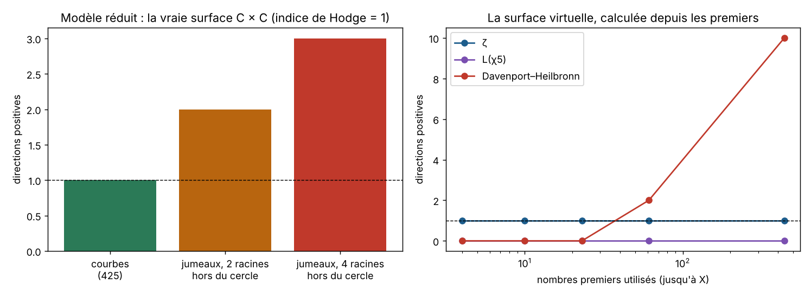

# V6.21 — Axe J : la surface virtuelle

**Date :** 10 octobre 2026  
**Statut :** premier pas de l'axe J, mis en tête du plan à la demande de l'auteur. Il contient un dictionnaire, démontré dans le Modèle réduit, et trois mesures, avec des prévisions écrites avant le calcul (`data/prevision_v621_surface.md`, 19 h 10 UTC). Trois prévisions sont justes. La quatrième est juste pour DH, mais elle était mal formulée pour L(χ5).  
**Demande de l'auteur :** « Et si on résolvait par une géométrie impossible ou virtuelle ? Pas complexe. Virtuelle. » Puis : « Axe J prioritaire. »

## 1. L'idée

Dans le **Modèle réduit** (doc. 28), RH est un théorème. Weil l'obtient sur une **surface**, la courbe multipliée par elle-même (C × C), grâce à une positivité : l'indice de Hodge, qui est la marge de Castelnuovo du corpus. Pour ζ, cette surface n'existe pas. Il faudrait voir les entiers comme une courbe sur un « corps à un élément », que personne n'a construit. C'est la « Scène manquante » du registre.

L'axe J ne construit pas la surface. Il construit seulement **ce qu'elle produirait** : sa forme d'intersection, c'est-à-dire la manière dont ses courbes se coupent. Il la calcule à partir des seuls nombres premiers, puis il regarde si elle a la signature d'une vraie surface. Une surface est « virtuelle » au sens où l'on connaît ses intersections sans connaître ses points.

## 2. Le dictionnaire (démontré dans le Modèle réduit)

Sur C × C, on prend trois sortes de courbes :

- les fibres f~1~ = point × C et f~2~ = C × point ;
- les graphes de Frobenius Γ~n~ = {(x, F^n^x)}.

Elles se coupent ainsi, avec N~d~ = q^d^ + 1 − S~d~, le nombre de points sur F~q^d~ :

| Intersection | Courbe sur F~q~ | ζ (surface virtuelle) |
|---|---|---|
| f~1~·f~2~ = 1 ; Γ~n~·f~1~ = 1 ; Γ~n~·f~2~ = q^n^ | les fibres | le **pôle** de ζ en s = 0 et s = 1 |
| Γ~m~·Γ~n~ = q^min(m,n)^ N~\|m−n\|~ | les points de F^\|m−n\|^ | les **puissances de nombres premiers**, Λ(m)/√m |
| Γ~n~·Γ~n~ = q^n^(2 − 2g) | le **genre** | le **terme archimédien** (log π, digamma) : un genre infini, régularisé |
| au plus une direction positive (indice de Hodge) | théorème : RH (Weil) | **positivité de Weil ⇔ RH** |

On normalise D~n~ = q^−n/2^ Γ~n~ et l'on se place orthogonalement aux fibres. On trouve alors exactement

  D~m~·D~n~ = −q^−\|m−n\|/2^ S~\|m−n\|~ = −Σ~i~ e^i(m−n)θ~i~^ (si \|α~i~\| = √q),

soit l'**opposé de la métrique des zéros** du corpus : la forme de Toeplitz du doc. 29, la métrique G = VV* des docs 33 et 41. Le nombre de directions positives de la surface vaut donc 1, pour les fibres, plus le nombre de valeurs propres négatives de la métrique.

**La marge du corpus est, au signe près, la forme d'intersection d'une surface.** Le corpus mesurait depuis la V6.7 une géométrie sans la nommer.

## 3. Les mesures

Script : `scripts/run_surface_virtuelle.py` (40 secondes).

| | Prévision | Résultat | Verdict |
|---|---|---|---|
| P1 | les 425 courbes du Modèle réduit : une seule direction positive | **425 sur 425** | **juste** |
| P2 | les 220 faux jumeaux : au moins deux directions positives, surplus = (racines hors du cercle)/2 | **220 sur 220**, surplus exact (101 jumeaux à 2 racines hors du cercle : 2 positives ; 119 à 4 racines : 3 positives) | **juste** |
| P3 | ζ et L(χ5) : une seule direction positive ; DH : 2 en trop par quadruplet hors de la droite | ζ : **une seule**, à toutes les fenêtres (100 à 600 pas, premiers ≤ 439). L(χ5) : **aucune**. DH : 0, 0, 0, puis **2** (premiers ≤ 61), puis **10** (premiers ≤ 439), comme les directions négatives de la métrique des premiers (doc. 33). | **juste pour ζ et DH ; mal formulée pour L(χ5)** : sans pôle, il n'y a pas de fibres, et le dictionnaire prévoit 0, ce qu'on trouve |
| P4 | rang orthogonal aux fibres = 2g dans le Modèle réduit ; pour ζ, rang = nombre de zéros résolus (« genre virtuel ») | Modèle réduit : 2g pour 424 courbes sur 425 (la dernière a des zéros confondus) et 220 jumeaux sur 220. ζ : le rang remplit la fenêtre (594 sur 600). Avec cette fonction-test, il ne mesure pas un genre. | **juste dans le Modèle réduit ; non concluant pour ζ** |

**Un bug, trouvé et corrigé pendant le calcul.** Le premier passage donnait 3 directions positives pour ζ. La contribution des fibres était écrite comme une somme extérieure au lieu d'un produit extérieur. Une fois l'erreur corrigée, la décomposition « fibres ⊕ orthogonal » est vérifiée, et ζ a exactement une direction positive.

## 4. Ce que cela veut dire, et ce que ce n'est pas

**Ce n'est pas une preuve, et le dictionnaire n'est pas nouveau.** Lire la positivité de Weil comme l'ombre de la positivité de Castelnuovo sur C × C est le point de vue de Weil lui-même [Wei52]. Bombieri l'expose [Bom00a], et c'est le programme de Connes [Con99], [CCM25], avec la géométrie sur le « corps à un élément » (Deninger, Manin, Soulé, cités de mémoire). C'est une **redécouverte** de plus, à ajouter à celles du document 45.

**Ce qui est propre au corpus :**

1. La forme d'intersection virtuelle est **calculée** depuis les nombres premiers, et elle a la signature d'une surface pour ζ, à toutes les fenêtres essayées.
2. Le **témoin** DH a une surface virtuelle **impossible**. Il a 2, puis 10 directions positives en trop, une paire par quadruplet de zéros hors de la droite.
3. Dans le Modèle réduit, le surplus des faux jumeaux est **exactement** la moitié du nombre de racines hors du cercle (220 cas sur 220).

**Ce qui manque.** Sur une vraie surface, l'indice de Hodge n'est pas un axiome : il découle du **théorème de Riemann–Roch** et de l'existence d'une classe ample. Les faux jumeaux du Modèle réduit ont tout ce qu'on peut lire dans les comptages :

- l'équation fonctionnelle ;
- des comptages positifs, c'est-à-dire des courbes « effectives » ;
- des intersections entières.

Pourtant, leur surface virtuelle viole l'indice de Hodge. **L'effectivité ne suffit pas.** Il manque à leur « surface » quelque chose comme Riemann–Roch. Pour ζ, la question devient : quelle propriété des nombres premiers jouerait le rôle de Riemann–Roch ?

## 5. Suite de l'axe J

- **J2. Le Riemann–Roch virtuel.** Dans le Modèle réduit, chercher l'inégalité de type Riemann–Roch, écrite avec les seuls comptages, que les 425 courbes vérifient et que les 220 jumeaux violent. Il faut la trouver avant l'étage où Castelnuovo les démasque. Témoin : les jumeaux. Prévision : une telle inégalité existe à la fenêtre g + 1, alors que Castelnuovo demande 2g + 1. Coût : 1,5.
- **J3. La même inégalité pour ζ.** Si J2 réussit, la traduire par le dictionnaire (pôle, premiers, terme archimédien), puis la tester sur ζ, L(χ5) et DH. Coût : 2.
- **J4. Le genre virtuel.** Choisir une fonction-test dont la fenêtre résout les zéros un par un (fenêtre de Heisenberg), et vérifier que le rang orthogonal aux fibres suit N(T). Ce serait le « genre » de la surface à la résolution T. Coût : 1.

## 6. Démontré, mesuré, supposé

| | Énoncé |
|---|---|
| **Démontré** | Le dictionnaire du §2 sur C × C, et l'identité « forme d'intersection orthogonale aux fibres = −métrique des zéros ». |
| **Mesuré** | Indice de Hodge : 425 courbes sur 425. Violation exacte pour les 220 faux jumeaux. ζ : une seule direction positive depuis les premiers ≤ 439. DH : 2 puis 10 en trop. |
| **Supposé** | Qu'un analogue de Riemann–Roch, écrit avec les nombres premiers, existe pour ζ (axes J2 et J3). |

## 7. Lecture selon l'hypothèse de travail

L'hypothèse de l'auteur dit que RH est nécessaire à quelque chose de plus grand. Dans le Modèle réduit, ce plus grand est **la surface** : RH y est la condition pour que les intersections soient celles d'une surface qui existe. L'axe J montre que, pour ζ, les intersections calculées depuis les nombres premiers sont **compatibles avec une surface** à toutes les fenêtres essayées. Pour le sosie DH, elles sont **incompatibles** avec toute surface. RH serait alors la condition d'existence d'une surface virtuelle pour les entiers, et ce qui la rendrait nécessaire serait la surface elle-même, si elle existe.

<!-- references:debut -->

## Références

Format : [clé] auteurs, *titre*, publication, lien. Fiches complètes et état de vérification : document 42 (registre des sources).

- [Bom00a] E. Bombieri. *Remarks on Weil's quadratic functional in the theory of prime numbers, I*. Rend. Mat. Acc. Lincei (9) 11 (2000), 183–233. — vérifié en ligne
- [CCM25] A. Connes, C. Consani, H. Moscovici. *Zeta spectral triples*. arXiv:2511.22755 (27 nov. 2025). <https://arxiv.org/abs/2511.22755> — vérifié en ligne. **Correctif V6.18 :** Le titre est « Zeta spectral triples » ; le résumé parle d'une réalisation spectrale des zéros, pas explicitement de formes de Weil tronquées.
- [Con99] A. Connes. *Trace formula in noncommutative geometry and the zeros of the Riemann zeta function*. Selecta Math. (N.S.) 5 (1999), 29–106 ; arXiv:math/9811068. <https://arxiv.org/abs/math/9811068> — vérifié en ligne
- [Wei52] A. Weil. *Sur les « formules explicites » de la théorie des nombres premiers*. Comm. Sém. Math. Univ. Lund, vol. suppl. dédié à M. Riesz (1952), 252–265. <https://en.wikipedia.org/wiki/Weil%27s_criterion> — partiellement vérifié

<!-- references:fin -->
