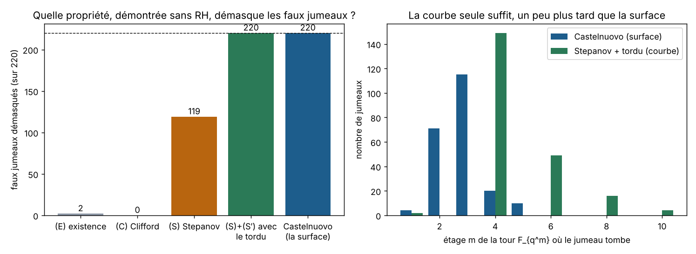

# V6.22 — Axe J2 : le Riemann–Roch virtuel

**Date :** 11 octobre 2026  
**Statut :** test fait dans le Modèle réduit, avec des prévisions écrites avant (`data/prevision_v622_riemann_roch.md`). Deux sont justes et deux fausses. Une cinquième a été écrite après le premier calcul, avant le second : elle est juste. Le document en tire une formulation précise du lemme manquant pour ζ.  
**Demande de l'auteur :** « Étape suivante. » Et la consigne : « viser une propriété d'existence, de dimension ou de dualité, justifiée indépendamment de RH », en comparant avec la stratégie de Riemann–Roch de Connes–Consani. « La prochaine avancée majeure serait de démontrer pourquoi l'arithmétique oblige cette géométrie à avoir la bonne signature. »

## 1. La question

Le document 46 a montré deux choses. La marge du corpus est, au signe près, la forme d'intersection d'une surface. Les 220 faux jumeaux du Modèle réduit ont tout ce qu'on lit dans les comptages : l'équation fonctionnelle, qui est la **dualité**, et des comptages positifs, qui sont l'effectivité. Pourtant leur surface est impossible.

L'axe J2 cherche ce qui leur manque, sous la forme d'une propriété d'**existence** ou de **dimension**, démontrée pour toute courbe **sans utiliser RH**.

## 2. Les contraintes testées

Toute courbe lisse de genre g sur F~q~ vérifie les contraintes suivantes, sur chaque extension F~q^m~. Toutes sont démontrées sans RH.

| | Nature | Énoncé | D'où il vient |
|---|---|---|---|
| (E) | existence | le groupe des classes de degré 0 n'est pas vide : h~m~ = Π(1 − α~i~^m^) ≥ 1 | la classe nulle existe |
| (C) | dimension | Clifford : le nombre A~n~ de diviseurs effectifs de degré n ≤ 2g − 2 est au plus h~m~ (Q^⌊n/2⌋+1^ − 1)/(Q − 1), où Q = q^m^ | Riemann–Roch sur la courbe |
| (S) | existence par dimension | Stepanov–Bombieri : si Q est un carré et Q > (g + 1)⁴, alors N~m~ ≤ Q + (2g + 1)√Q + 1 | une fonction auxiliaire existe parce que l'espace de Riemann–Roch est assez grand [Ste69], [Bom73] |
| (E′), (S′) | existence d'un revêtement | le tordu quadratique (l'involution hyperelliptique) existe sur chaque F~q^m~ ; son groupe n'est pas vide, et il vérifie lui aussi (S) : Q + 1 + S~m~ ≤ Q + (2g + 1)√Q + 1 | revêtement galoisien de la droite |

La **dualité classe par classe** (ℓ(D) − ℓ(K − D) = n − g + 1) n'est pas testée ici. Elle implique l'équation fonctionnelle de la fonction zêta après agrégation sur les classes. Les jumeaux vérifient cette conséquence agrégée ; on ne leur a construit ni espaces de sections ni dualité sur chaque classe. L'équation fonctionnelle seule ne restitue pas ce contenu plus fort. Correction de portée apportée en V6.34.

## 3. Les résultats

Le script `scripts/run_riemann_roch_virtuel.py` calcule tout en entiers exacts, sur la tour m = 1 à 80, en 3 secondes.

| | Prévision | Résultat | Verdict |
|---|---|---|---|
| P1 | aucune courbe ne viole (E), (C), (S) | 0 violation sur 425 courbes, ni pour le tordu | **juste** |
| P2 | chaque jumeau viole au moins une des trois contraintes avant m = 80 | **121 sur 220** seulement | **fausse** |
| P3 | (S) seule démasque plus tard que Castelnuovo | rapport médian des étages : 3 ; jamais avant Castelnuovo | **juste** |
| P4 | (E) et (C) démasquent au moins un quart des jumeaux | (E) : 2 ; (C) : **0** | **fausse** |
| P5 (écrite après le 1^er^ calcul, avant le 2^e^) | avec le tordu, les 220 jumeaux sont attrapés avant m = 80, aucune courbe | **220 sur 220**, tous avant m = 10 ; aucune courbe | **juste** |

**Ce qu'on apprend.**

1. **La dimension seule ne suffit pas.** Clifford, la conséquence la plus directe de Riemann–Roch sur les comptages, n'attrape aucun jumeau. L'existence de la classe nulle en attrape deux, des jumeaux de genre 1 qui n'ont aucun point.
2. **Ce qui décide, c'est une fonction auxiliaire.** Stepanov construit, grâce à Riemann–Roch, une fonction qui s'annule à un ordre élevé en tous les points rationnels. Elle existe parce que l'espace des fonctions est assez grand, et parce que **le Frobenius x ↦ x^q^ est une application de la courbe dans elle-même**. Cette fonction interdit d'avoir trop de points. P2 est fausse parce que cette borne est **unilatérale** : un jumeau dont la plus grande racine est réelle positive a trop *peu* de points, jamais trop.
3. **La borne de l'autre côté vient d'un revêtement.** Le tordu quadratique existe pour toute vraie courbe hyperelliptique, et il compte Q + 1 + S~m~ points. Lui appliquer Stepanov borne N~m~ par le bas. Avec lui, les 220 jumeaux tombent tous, à l'étage médian 4, contre 3 pour Castelnuovo. Dans 12 cas, c'est au même étage. Ce n'est jamais plus tôt, ce qui est attendu : Castelnuovo est la borne exacte.
4. **C'est la preuve de Bombieri (1973)** [Bom73] : Riemann–Roch sur la courbe, plus le Frobenius, plus le tordu, plus la tour des extensions, plus le théorème de Pringsheim, donnent RH, **sans passer par la surface**. Le corpus la retrouve ici, et la voit à l'œuvre, jumeau par jumeau. C'est une redécouverte de plus.

## 4. Le lemme manquant pour ζ, formulé précisément

On traduit chaque ingrédient de Bombieri pour ζ. Le **théorème de Landau** sur les séries de Dirichlet à coefficients positifs (cité de mémoire, voir Titchmarsh [Tit86]) joue le rôle de Pringsheim.

| Ingrédient (courbes) | Pour ζ | État |
|---|---|---|
| comptages positifs (effectivité) | Λ(n) ≥ 0 : ψ compte quelque chose, les puissances de premiers pondérées | **vrai**. DH ne l'a pas : il n'a pas de « points » sur lesquels une fonction auxiliaire pourrait s'annuler. |
| pas de racine dominante réelle positive (rôle du tordu) | ζ n'a pas de zéro réel dans ]0 ; 1[ | **vrai, démontré sans RH** : ζ(σ) < 0 sur ]0 ; 1[ |
| Pringsheim | Landau : sans zéro réel, une borne **unilatérale** ψ(x) − x ≤ C x^1/2^ log²x pour tout x entraîne RH (l'intégrale de Dirichlet du reste, de signe constant, n'a pas de singularité réelle avant ½) | **classique** |
| Riemann–Roch sur la courbe | Riemann–Roch pour Spec Z : van der Geer–Schoof [VGS00], Connes–Consani [CC22], [CC24] ; Clifford arithmétique : Groenewegen [Gro01] | **existe** |
| le Frobenius x ↦ x^q^, une application de la courbe | un « Frobenius absolu » sur Z | **manque**. Connes–Consani proposent l'action d'échelle (cité de mémoire). |
| la tour F~q^m~ avec Q grand | une famille où « Q » grandit | **manque**. Spec Z n'a pas d'extensions des constantes. |

**Le lemme manquant, dit simplement.** Il faudrait montrer que les nombres premiers ne peuvent pas être *trop nombreux*, avec une erreur de l'ordre de √x, par un argument d'existence. On construirait une « fonction auxiliaire » sur Spec Z qui s'annule fortement aux nombres premiers. Elle existerait parce que l'espace de Riemann–Roch est assez grand. Le reste, c'est-à-dire l'effectivité, l'absence de zéro réel et le théorème de Landau, est déjà démontré. Il manque le Frobenius qui rend la fonction auxiliaire possible, et la tour qui rend l'erreur petite.

Cela précise la remarque de l'auteur. « Pourquoi l'arithmétique oblige la géométrie à avoir la bonne signature » se ramène à une question : **quel Frobenius agit sur Spec Z ?** C'est la question de Connes et Consani. Le corpus y arrive par un chemin indépendant, celui des faux jumeaux.

## 5. Démontré, mesuré, supposé

| | Énoncé |
|---|---|
| **Démontré (connu)** | Les contraintes (E), (C), (S), (S′) pour toute courbe ; la preuve de Bombieri ; le théorème de Landau ; l'absence de zéro réel de ζ dans ]0 ; 1[ ; Riemann–Roch pour Spec Z (Connes–Consani). |
| **Mesuré** | Clifford : 0 jumeau sur 220 ; existence : 2 ; Stepanov seul : 121 ; Stepanov et tordu : 220 sur 220, étage médian 4 (Castelnuovo : 3). Aucune courbe en défaut. |
| **Supposé** | Qu'un « Frobenius absolu » sur Spec Z permette de construire la fonction auxiliaire de Stepanov pour les nombres premiers. |

## 6. Suite de l'axe J

- **J3 (redéfini). La fonction auxiliaire pour les premiers.** Il faut écrire, sur un modèle fini, ce que serait la construction de Stepanov si l'on remplace le Frobenius par l'action d'échelle x ↦ λx, puis mesurer la borne obtenue sur ψ(x). C'est d'abord une lecture de [CC22] et [CC24], puis un calcul. Témoin : DH. Coût : 2.
- **J4. Le genre virtuel** (inchangé).
- **J5. Le Frobenius dans le Modèle réduit.** Il s'agit de mesurer ce que perd la preuve de Stepanov si l'on remplace le Frobenius par une application qui n'est pas un morphisme, par exemple une permutation aléatoire des points de même degré. Si la borne casse, on saura que c'est bien le caractère géométrique du Frobenius qui porte RH. Coût : 1.

## 7. Lecture selon l'hypothèse de travail

Dans le Modèle réduit, ce qui rend RH nécessaire n'est pas un nombre. C'est la présence d'une **application**, le Frobenius, qui fait partie de la géométrie de la courbe. Cette application rend la fonction auxiliaire possible, et la fonction interdit trop de points. Pour les entiers, le « plus grand » de l'hypothèse de l'auteur aurait donc un nom précis : un Frobenius absolu, qui ferait des nombres premiers les points fixes d'une dynamique. RH serait la trace de son existence.

<!-- references:debut -->

## Références

Format : [clé] auteurs, *titre*, publication, lien. Fiches complètes et état de vérification : document 42 (registre des sources).

- [Bom73] E. Bombieri. *Counting points on curves over finite fields (d'après S. A. Stepanov)*. Séminaire Bourbaki 1972/73, exp. 430, Lecture Notes in Math. 383, Springer, 1974, 234–241 (1973). <https://www.numdam.org/item/SB_1972-1973__15__234_0/> — vérifié en ligne
- [CC22] A. Connes, C. Consani. *Riemann–Roch for Spec Z (compactifié d'Arakelov)*. arXiv:2205.01391 (v1 mai 2022, v2 mars 2023). <https://arxiv.org/abs/2205.01391> — vérifié en ligne
- [CC24] A. Connes, C. Consani. *Riemann–Roch for the ring Z*. C. R. Math. Acad. Sci. Paris 362 (2024), 229–235 ; DOI 10.5802/crmath.543. <https://comptes-rendus.academie-sciences.fr/mathematique/articles/10.5802/crmath.543/> — vérifié en ligne
- [Gro01] R. P. Groenewegen. *An arithmetic analogue of Clifford's theorem*. J. Théor. Nombres Bordeaux 13, n° 1 (2001), 143–156. <https://www.numdam.org/item/JTNB_2001__13_1_143_0/> — vérifié en ligne
- [Ste69] S. A. Stepanov. *On the number of points of a hyperelliptic curve over a finite prime field*. Izv. Akad. Nauk SSSR Ser. Mat. 33 (1969), no. 5, 1171–1181 ; trad. Math. USSR-Izv. 3 (1969), 1103–1114. <https://mathnet.ru/eng/im2197> — vérifié en ligne
- [Tit86] E. C. Titchmarsh. *The Theory of the Riemann Zeta-Function*. 2e éd., révisée par D. R. Heath-Brown, Oxford, Clarendon Press, 1986. — partiellement vérifié
- [VGS00] G. van der Geer, R. Schoof. *Effectivity of Arakelov divisors and the theta divisor of a number field*. arXiv:math/9802121 (1998–1999) ; Selecta Math. (N.S.) 6 (2000), 377–398 (référence de revue citée de mémoire). <https://arxiv.org/abs/math/9802121> — partiellement vérifié

<!-- references:fin -->
