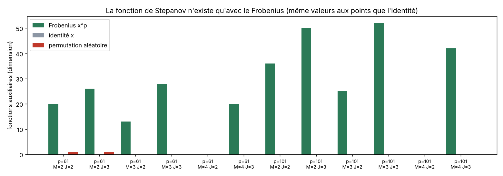

# V6.23 — Axe J5 : le Frobenius qui n'est pas un morphisme

**Date :** 11 octobre 2026  
**Statut :** expérience faite (construction de Stepanov réalisée en algèbre linéaire exacte sur F~p~), avec des prévisions écrites avant (`data/prevision_v623_frobenius.md`, 22 h 12 UTC) : trois justes, dont une à une exception près, et une fausse. La note du §5 répond à l'idée de l'auteur sur le Théorème A.  
**Demande de l'auteur :** « Et si on revenait au Théorème A, en donnant des dimensions fictives pour identifier les dimensions nécessaires, comme si on avait une énergie avec dérivation en puissance… Si c'est débile, faites le programme identifié par la piste actuelle. »

## 1. La question

Le document 47 a montré que, dans le Modèle réduit, la propriété décisive est la **fonction auxiliaire** de Stepanov. Elle existe grâce à Riemann–Roch et au **Frobenius** x ↦ x^p^. Mais qu'est-ce qui, dans le Frobenius, compte vraiment ?

- Qu'il permute les points ?
- Qu'il soit une application de la courbe dans elle-même (un morphisme) ?
- Ou une propriété plus fine ?

Pour le savoir, on refait la construction de Stepanov pour de vrai, en remplaçant le Frobenius par d'autres applications.

## 2. L'expérience

On prend la courbe y² = x³ + x + 1 sur F~61~ et F~101~. On note S l'ensemble des x pour lesquels x³ + x + 1 est un carré non nul ; il compte 24 éléments pour p = 61 et 52 pour p = 101.

On cherche une fonction auxiliaire de la forme :

  A(x) = Σ~j<J~ Σ~a<K~ (r~ja~ + s~ja~ g(x)) x^a^ φ(x)^j^, avec g = f^(p−1)/2^ (g = 1 sur S),

qui s'annule à l'ordre M en chaque point de S. Cela fait 2JK inconnues et M·|S| conditions. On choisit 2JK plus petit que M·|S|. Il y a donc *moins d'inconnues que de conditions*. Une fonction auxiliaire n'existe que si les conditions ne sont pas indépendantes.

On compare trois choix de φ :

- **(F)** le Frobenius x^p^ ;
- **(I)** l'identité x, qui a les mêmes valeurs aux points puisque x^p^ = x sur F~p~ ;
- **(P)** une permutation aléatoire de F~p~, écrite comme polynôme. Elle permute aussi les points, mais ce n'est pas un morphisme de la courbe.

Script : `scripts/run_frobenius_non_geometrique.py` (14 secondes), rang exact modulo p.

## 3. Les résultats

| | Prévision | Résultat | Verdict |
|---|---|---|---|
| P1 | avec le Frobenius, rang des conditions ≪ M·\|S\| : des fonctions auxiliaires existent | dans 10 cas sur 12, de 13 à 52 fonctions auxiliaires. Exemple : p = 101, M = 2, J = 3, 84 inconnues pour 104 conditions, mais les conditions n'ont que le rang 34, d'où **50** fonctions auxiliaires | **juste** |
| P2 | avec la permutation, conditions génériques : aucune fonction | 0 dans 10 cas sur 12 ; 1 dans les deux cas où inconnues et conditions sont en nombre égal (48), une coïncidence de rang | **juste, à une exception près** |
| P3 | avec l'identité, comme la permutation | 0 dans les 12 cas | **juste** |
| P4 | la borne déduite \|S\| ≤ deg A/M est de la forme p/2 + O(√p) | aux tailles calculées (p ≤ 101), la borne déduite reste au-dessus de p : elle est triviale. Stepanov demande p grand devant le genre et des paramètres d'ordre √p. | **fausse sous cette forme** |

**Ce qu'on apprend.**

- **Ce n'est pas de permuter les points qui compte.** La permutation le fait, et elle échoue.
- **Ce n'est pas non plus d'être une application régulière.** L'identité en est une, elle prend les mêmes valeurs que le Frobenius en chaque point, et elle échoue.
- **Ce qui compte est infinitésimal : la dérivée de x^p^ est nulle** (p x^p−1^ = 0 en caractéristique p). Le Frobenius est *inséparable*. Les dérivées de A en un point ignorent donc le facteur φ(x)^j^, et les conditions d'annulation à l'ordre M s'effondrent : 104 conditions n'ont que le rang 34.

C'est le cœur de la preuve de Stepanov et Bombieri. Le corpus le voit maintenant à l'œuvre, en comptant les rangs.

## 4. Ce que cela dit du Frobenius absolu (axe J3)

Le « Frobenius absolu » qu'il faudrait pour ζ ne doit pas seulement faire des nombres premiers ses points fixes. Il lui faut aussi l'analogue de cette **inséparabilité** : une dérivée qui s'annule, pour que la fonction auxiliaire existe.

Connes et Consani travaillent en « caractéristique un » (semi-corps idempotents). Là, le Frobenius x ↦ x^λ^ est un automorphisme pour tout λ > 0 : c'est l'action d'échelle (cité de mémoire). L'axe J3 a désormais une question précise : **cette action d'échelle a-t-elle un analogue de « dérivée nulle » qui ferait chuter le rang des conditions d'annulation aux nombres premiers ?** Sur un modèle fini, cela se mesure comme ici, par des rangs.

## 5. Note : le Théorème A et les « dimensions fictives »

L'idée de l'auteur n'est pas « débile ». C'est une bonne idée, et le corpus l'a déjà mise en œuvre sous un autre nom. On donne à l'énergie une **dimension fictive** s, par Z~E~(s) = ∫ \|C(t)\|² t^−1−2s^ dt, et l'on cherche la dimension à partir de laquelle l'énergie devient finie. Cette dimension est exactement Θ (le Théorème A). C'est la « dimension énergétique » du document 08, retrouvée chez Lapidus et ses coauteurs [LM95], [HL12] (doc. 45, §4). RH dit que la dimension nécessaire est ½.

**Dériver « en puissance » ne déplace pas cette dimension** (démontré, élémentaire). Dériver à l'ordre fractionnaire α en échelle logarithmique multiplie la transformée de Mellin par s^α^. Cela ne crée ni ne déplace aucune singularité aux zéros ρ, puisque s^α^ est régulier et non nul près de chaque ρ. Seules changent les puissances du logarithme et les constantes, comme le 4/3 du Théorème B (doc. 45). La dimension nécessaire est donc **intrinsèque** : c'est la partie réelle du zéro le plus à droite, et aucune dimension fictive ne peut la changer. C'est pourquoi le corpus est passé à la piste actuelle : chercher *ce qui force* cette dimension, et non la mesurer autrement.

## 6. Démontré, mesuré, supposé

| | Énoncé |
|---|---|
| **Démontré** | Dérivée nulle de x^p^ en caractéristique p (classique) ; une dérivation fractionnaire ne déplace pas la dimension énergétique (§5). |
| **Mesuré** | Fonctions auxiliaires : de 13 à 52 avec le Frobenius dans 10 cas sur 12 ; 0 avec l'identité dans 12 cas ; 0 avec une permutation dans 10 cas (1 dans deux cas d'égalité). Le Frobenius divise par 3 le rang des conditions (34 au lieu de 104). |
| **Supposé** | Que le Frobenius absolu de ζ doive avoir un analogue d'inséparabilité (axe J3). |

## 7. Lecture selon l'hypothèse de travail

Ce qui rend RH nécessaire dans le Modèle réduit n'est pas une propriété des points. Le Frobenius, l'identité et une permutation agissent de la même façon sur les points, et une seule des trois permet la preuve. C'est une propriété **infinitésimale**, la dérivée nulle, que l'on ne voit pas en regardant les points mais seulement en regardant autour. Le « plus grand » de l'hypothèse de l'auteur serait donc une structure invisible point par point. C'est cohérent avec tout le corpus : les comptages, même parfaits, ne suffisent pas, comme le montrent les faux jumeaux.

<!-- references:debut -->

## Références

Format : [clé] auteurs, *titre*, publication, lien. Fiches complètes et état de vérification : document 42 (registre des sources).

- [HL12] H. Herichi, M. L. Lapidus. *Fractal complex dimensions, Riemann hypothesis and invertibility of the spectral operator*. Contemp. Math. 600 ; arXiv:1210.0882 (2012). <https://arxiv.org/abs/1210.0882> — vérifié en ligne
- [LM95] M. L. Lapidus, H. Maier. *The Riemann hypothesis and inverse spectral problems for fractal strings*. J. London Math. Soc. (2) 52 (1995), 15–34. <https://doi.org/10.1112/jlms/52.1.15> — partiellement vérifié. **Correctif V6.18 :** Pages : 15–34 (et non 15–35).

<!-- references:fin -->
