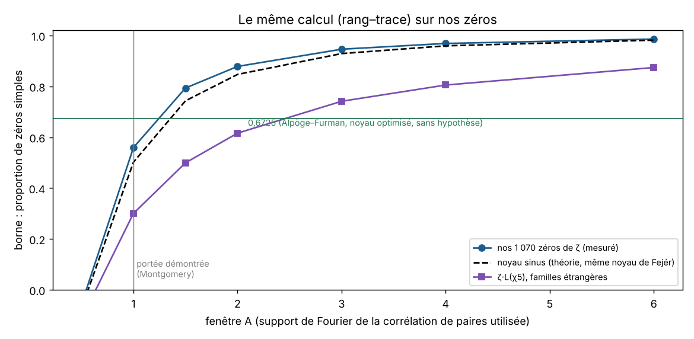

# V6.24 — Analyse de risques, J3 simplifié, et « le même calcul » que les deux tiers

**Date :** 11 octobre 2026  
**Statut :** analyse de décision, et deux calculs faits avec des prévisions écrites avant (`data/prevision_v624.md`, 22 h 23 UTC). J3 simplifié : la prévision A1 est fausse, et cela apprend quelque chose. Les deux tiers : deux prévisions justes, une à moitié.  
**Demande de l'auteur :** « Faisons cela comme une analyse de risques, pour décider. Mais j'aurais envie de creuser J3, peut-être la simplifier ? Comment OpenAI calcule ses 67 % ? Le tamis ? Si j'applique le même calcul, je suis à combien ? Mets aussi à jour les éléments de description. »

## 1. Analyse de risques

Chaque coup ouvert est jugé sur cinq points :

- la probabilité d'un résultat utile ;
- son coût ;
- ce qu'il fait gagner ;
- son risque principal ;
- ce qu'on apprend même en cas d'échec.

Les probabilités et les coûts sont ceux de la carte du navigateur, à discuter. Le coût est compté en séances.

| Coup | Proba. | Coût | Ce qu'il fait gagner | Risque principal | Si échec, on apprend… | Avis |
|---|---|---|---|---|---|---|
| **J3 complet** : fonction auxiliaire pour les premiers | 0,15 | 2 | le lemme manquant lui-même | aucun modèle fini fidèle ; on mesure un artefact | où l'analogie Frobenius ↔ échelle casse | **à découper** (§2) |
| **J3a** : additivité ou dérivée nulle ? (fait, §2) | 0,6 | 0,5 | ce que le Frobenius doit avoir | expérience trop grossière | — | fait |
| **J3b** : lecture ciblée de Connes–Consani (caractéristique un, dérivations) | 0,6 | 1 | savoir si leur Frobenius a la propriété du §2 | lecture partielle | la piste échelle est à abandonner, ou non | **recommandé** |
| A : la Rencontre à n en hauteur | 0,6 | 1 | consolide la répulsion ; explique l'écart du §3 | effet trop petit pour 1 070 zéros | taille de l'échantillon à prévoir | recommandé, en parallèle |
| J4 : le genre virtuel | 0,5 | 1 | lien rang ↔ N(T) | choix de la fonction-test | — | après J3b |
| H : le Tamis à deux | 0,3 | 1 | dernière piste d'OpenAI jamais explorée | ne voir que PRIME-LOCK | une piste close | quand on veut |
| D : la queue de Nyman–Beurling | 0,4 | 1,5 | limite du palier | démonstration hors de portée | — | plus tard |
| Relecture humaine de A et B | — | coup humain | « Démontrer » passe de 6 à 7 | aucun lecteur trouvé | — | **toujours le plus rentable** |

**Décision proposée.** On creuse J3 par étapes courtes et peu risquées : J3a est fait, J3b vient ensuite. On fait l'axe A en parallèle, parce qu'il est sûr. J3 complet ne se lance que si J3b trouve un analogue de la propriété du §2 dans la caractéristique un.

## 2. J3 simplifié (J3a) : additivité ou dérivée nulle ?

En caractéristique p, le Frobenius a deux propriétés à la fois :

- il est **additif** : (x + y)^p^ = x^p^ + y^p^ ;
- sa **dérivée est nulle**.

En « caractéristique un », celle de Connes–Consani, le Frobenius x ↦ x^λ^ reste additif, mais sa dérivée ne s'annule pas, puisque n·a = a. J3a refait la construction de Stepanov (doc. 48) avec quatre choix de φ :

| φ | additif ? | dérivée nulle ? | fonctions auxiliaires (p = 101, M = 2, 3, 4) |
|---|---|---|---|
| x^p^ | oui | oui | 50, 52, 42 |
| x^p^ + 1 | non | oui | 50, 52, 42 |
| x^2p^ | non | oui | 46, 47, 36 |
| x^p^ + x | oui | **non** (dérivée 1) | **50, 52, 42** |

La prévision A1 (« seuls les φ de dérivée nulle marchent ») est **fausse** : x^p^ + x marche aussi. La raison est instructive. Les fonctions x^a^·(x^p^ + x)^j^ engendrent le même espace que les x^a^·x^jp^, à un décalage de degré près, car x est déjà dans l'espace. Ce qui compte n'est donc ni l'additivité, ni la dérivée de φ elle-même. **C'est que l'espace des fonctions auxiliaires contienne x^p^** : une fonction de très haut degré qui coïncide en tous les points avec une fonction de bas degré (x^p^ = x sur F~p~), et que les dérivations ne voient pas.

**Conséquence pour J3.** Le « Frobenius absolu » doit fournir cela : une fonction qui, aux nombres premiers, coïncide avec une fonction simple, mais qui est invisible aux dérivations. Sur Z, une telle fonction existe *pour chaque premier séparément* : x^p^ ≡ x modulo p, et sa dérivée est nulle modulo p. Il n'en existe pas *pour tous les premiers à la fois*. J3b doit dire si l'action d'échelle de Connes–Consani en fournit une pour tous à la fois. La prévision A2 n'est pas testable par cette expérience ; elle reste ouverte.

## 3. Les 67 %, et « le même calcul » sur nos zéros

**D'où viennent les 67 %.** Ce n'est pas OpenAI, et ce n'est pas un tamis. Le chiffre 0,6725 est celui d'**Alpöge–Furman** (août 2026) [AF26], qui démontrent **sans hypothèse** qu'au moins 67,25 % des zéros de ζ sont simples et sur la droite critique. L'article indique que l'argument a été trouvé et rédigé par Claude, puis vérifié par les auteurs et formalisé en Lean 4 (doc. 13). Le « Tamis à deux » est une autre chose : une piste d'OpenAI sur la suite c(n), sans lien avec ce chiffre.

**Le calcul en trois lignes** (doc. 13) :

1. On met les zéros dans une matrice de Gram G, une compression finie de la forme de Weil. Ses vecteurs sont les e^iγt^ sur une fenêtre de longueur A (en unités naturelles).
2. **Inégalité rang–trace** : le nombre de zéros distincts est au moins (tr G)²/tr G². Le dénominateur tr G² est une somme sur les paires de zéros, c'est-à-dire la corrélation de paires.
3. La corrélation de paires n'est démontrée que pour une fenêtre A ≤ 1 (Montgomery, puis sans RH par Baluyot et al. [BGST24]). Avec un noyau optimisé (Montgomery–Taylor), on obtient ≥ 0,8362 de zéros distincts, puis ≥ 2 × 0,8362 − 1 ≈ 0,6725 de zéros simples.

**Le même calcul sur nos 1 070 zéros** (script `scripts/run_v624.py`, noyau de Fejér, plus simple que celui d'Alpöge–Furman) :

| Fenêtre A | Distincts (nos zéros) | Simples (nos zéros) | Simples (théorie, même noyau) | ζ·L(χ5) : simples |
|---|---|---|---|---|
| 0,5 | 0,47 | — (borne vide) | — | — |
| **1 (portée démontrée)** | **0,78** | **0,56** | 0,50 | 0,30 |
| 1,5 | 0,90 | 0,79 | 0,74 | 0,50 |
| 2 | 0,94 | 0,88 | 0,85 | 0,62 |
| 4 | 0,98 | 0,97 | 0,96 | 0,81 |
| 6 | 0,99 | 0,99 | 0,98 | 0,87 |

**Réponse : à la fenêtre démontrée, vous êtes à 56 %** avec ce noyau. Le noyau sinus seul prévoit 50 %. Le noyau optimisé d'Alpöge–Furman donne 67,25 %. Nos zéros font un peu mieux que la théorie, car à basse hauteur la répulsion est plus forte, comme le déficit de Bogomolny et al. déjà vu aux docs 40, 41 et 43. Si la corrélation de paires était connue jusqu'à A = 2, la même méthode donnerait environ 88 % ; jusqu'à A = 4, environ 97 %. C'est le chiffrage de ce que le doc. 13 disait : « dépasser 0,6725 demanderait la corrélation de paires au-delà de la portée connue ».

**Attention** : nos nombres sont des **mesures** sur des zéros connus. Ce ne sont pas des théorèmes, et le 0,6725 est un théorème.

| | Prévision | Résultat | Verdict |
|---|---|---|---|
| B1 | à A = 1 : distincts 0,75 ± 0,02, simples 0,50 ± 0,04 | 0,78 et 0,56 : un peu au-dessus de la fourchette, dans le sens de la répulsion à basse hauteur | **à moitié** |
| B2 | distincts ≥ 0,95 à A = 4 | 0,98 | **juste** |
| B3 | le mélange ζ·L(χ5) fait moins bien | 0,30 contre 0,56 à A = 1 | **juste** |

Le résultat B3 a un sens. La méthode des deux tiers **ne marche que pour une famille qui se repousse elle-même**. Deux familles étrangères superposées, comme ζ·L(χ5) (doc. 43), font chuter la borne. C'est la Loi de la marge vue par la méthode d'Alpöge–Furman.

## 4. Démontré, mesuré, supposé

| | Énoncé |
|---|---|
| **Démontré (connu)** | Rang–trace ; Montgomery jusqu'à A = 1 ; 0,6725 (Alpöge–Furman, sans hypothèse). |
| **Mesuré** | Sur nos zéros, au même noyau : 56 % à A = 1, 88 % à A = 2, 97 % à A = 4 ; mélange : 30 % à A = 1. J3a : l'additivité seule ne décide rien ; ce qui compte est la présence de x^p^ dans l'espace. |
| **Supposé** | Que l'action d'échelle fournisse, pour tous les premiers à la fois, une fonction invisible aux dérivations (J3b). |

## 5. Lecture selon l'hypothèse de travail

Les deux tiers et la surface virtuelle disent la même chose de deux façons. La positivité de la forme de Weil, comptée par rang–trace, donne des proportions. La même positivité, lue comme indice de Hodge, donnerait RH. Entre les deux, il y a ce qui manque : soit la corrélation de paires au-delà de A = 1, soit le Frobenius qui ferait exister la surface. Pour l'hypothèse de l'auteur, la chose « plus grande » apparaît comme ce qui rendrait la corrélation de paires connue partout, et non seulement dans la fenêtre que l'on sait démontrer.

<!-- references:debut -->

## Références

Format : [clé] auteurs, *titre*, publication, lien. Fiches complètes et état de vérification : document 42 (registre des sources).

- [AF26] L. Alpöge, R. Furman. *More than two thirds of the zeros of the Riemann zeta function are simple and on the critical line*. arXiv:2608.13637 (août 2026). <https://arxiv.org/abs/2608.13637> — vérifié en ligne
- [BGST24] S. A. C. Baluyot, D. A. Goldston, A. I. Suriajaya, C. L. Turnage-Butterbaugh. *An unconditional Montgomery theorem for pair correlation of zeros of the Riemann zeta-function*. Acta Arith. 214 (2024), 357–376 ; DOI 10.4064/aa230612-20-3. <https://impan.pl/en/publishing-house/journals-and-series/acta-arithmetica/online/115529/an-unconditional-montgomery-theorem-for-pair-correlation-of-zeros-of-the-riemann-zeta-function> — vérifié en ligne

<!-- references:fin -->
