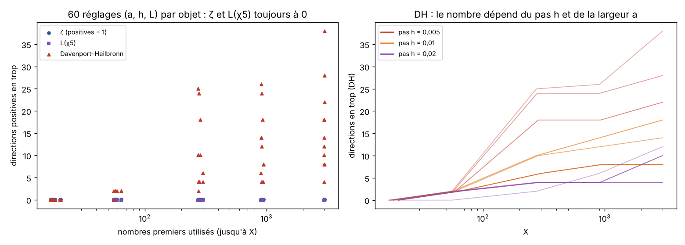

# V6.27 — J6 : le carré, en continu

**Date :** 11 octobre 2026  
**Statut :** calcul fait sur 180 réglages, avec des prévisions écrites avant (`data/prevision_v627_carre.md`, 22 h 57 UTC). Deux sont justes, une presque juste, une fausse. La signature de la surface virtuelle est robuste ; le nombre de directions en trop de DH ne l'est pas.  
**Demande de l'auteur :** « Suite » (l'axe J, prioritaire).

## 1. La question

Le document 46 a construit la forme d'intersection « virtuelle » de ζ à partir des seuls nombres premiers. Le pôle y joue le rôle des fibres, les puissances de premiers celui des intersections, et le terme archimédien celui du genre. Cette forme n'avait qu'une direction positive, comme sur une vraie surface (indice de Hodge). Mais ce résultat ne valait que pour **un seul réglage** : largeur de la fonction-test a = 0,04, pas h = 0,01.

Connes et Consani réalisent les correspondances de Frobenius pour **tout λ > 0** (doc. 51). J6 vérifie donc que la signature tient pour toute la famille continue : 4 largeurs a (0,02 à 0,16), 3 pas h (0,005 à 0,02), 5 fenêtres par réglage, jusqu'à X = 3 000. Cela fait 60 réglages par objet. Chaque réglage est contrôlé : les traces calculées depuis les premiers et depuis les zéros connus doivent concorder à 10^−6^ près. **Les 180 réglages sont fiables.**

## 2. Les résultats

| | Prévision | Résultat | Verdict |
|---|---|---|---|
| P1 | ζ : exactement une direction positive dans tous les réglages fiables ; L(χ5) : aucune | ζ : **60 sur 60** ; L(χ5) : **60 sur 60** | **juste** |
| P2 | DH : des directions en trop dès X ≥ 61 | **39 sur 39** réglages avec X ≥ 61 | **juste** |
| P3 | à X fixé, le nombre de directions en trop de DH ne dépend pas du pas h | à X ≈ 3 000 et a = 0,02 : 38, 18 et 12 pour h = 0,005 ; 0,01 et 0,02. Il dépend aussi de la largeur a. | **fausse** |
| P4 | ce nombre est pair (deux par quadruplet) | 59 sur 60 ; une exception (25, avec a = 0,02, h = 0,005, X ≈ 275) | **juste à une exception près** |

**Ce qui est robuste : la signature.** Dans les 180 réglages, la surface virtuelle de ζ a exactement la signature d'une vraie surface, et celle de L(χ5) aussi (aucune direction positive, puisqu'il n'y a pas de pôle). Celle de DH viole l'indice de Hodge dès que X ≥ 61. C'est le résultat du document 46, désormais établi pour toute la famille de réglages essayée, et non pour un seul.

**Ce qui ne l'est pas : le décompte des directions en trop de DH.** J'avais prévu « deux par quadruplet de zéros hors de la droite, quel que soit le réglage ». C'est faux. À X fixé, le nombre change avec le pas et la largeur. Une explication simple (les quadruplets dont le poids dépasse un seuil) a été testée : elle ne concorde que dans 5 à 10 % des cas. Le nombre de directions en trop dépend de la façon dont la fenêtre « entend » chaque quadruplet. C'est la loi de seuil du doc. 38, qui fait intervenir la hauteur, le pas et la largeur à la fois. Le décompte exact reste à expliquer.

**Ce que cela veut dire.** L'indice de Hodge virtuel de ζ est une propriété **stable** de la forme calculée depuis les premiers, comme on l'attend d'une vraie géométrie. Le défaut de DH est, lui, une propriété **qualitative** stable : il y a toujours des directions en trop. En revanche, son nombre n'est pas un invariant. Seule la présence ou l'absence de directions en trop distingue ζ et DH. Leur nombre ne mesure pas, à lui seul, combien de zéros sont hors de la droite.

**Correctif V6.30 (doc. 55).** « Dès X ≥ 61 » est exact pour les 39 réglages où X ≥ 61, mais ce n'est pas un seuil : 8 des 9 réglages où X vaut 55,7 à 59,1 montrent déjà 2 directions en trop. Aucun réglage n'a été fait entre X ≈ 20 et X ≈ 56. Décompte complet : 0 sur 12 réglages pour X ≤ 20,3 ; 47 sur 48 pour X ≥ 55,7.

## 3. Une remarque sur l'axe A

En préparant l'axe A (la Rencontre à n en hauteur), j'ai vérifié la taille effective de Bogomolny et al. que le corpus utilise : pour ζ jusqu'à 1 500, N~eff~ ≈ 1,08 (doc. 41). Une matrice unitaire de taille 1 n'a pas de triplets. L'axe A tel qu'il était écrit (« R3 du CUE(N~eff~) ») doit donc être reformulé. Il faudra utiliser la formule det[D~N~] prolongée aux N réels, ce que permet l'identité du doc. 43, et non une vraie matrice de taille N~eff~. Le plan est corrigé dans ce sens.

## 4. Démontré, mesuré, supposé

| | Énoncé |
|---|---|
| **Démontré** | Le dictionnaire du doc. 46 (inchangé). |
| **Mesuré** | Une seule direction positive pour ζ dans 60 réglages sur 60 ; aucune pour L(χ5) (60 sur 60) ; directions en trop pour DH dans 39 réglages sur 39 dès X ≥ 61. Le nombre de directions en trop dépend du pas et de la largeur. |
| **Supposé** | Que l'indice de Hodge virtuel de ζ tienne pour tout X. C'est RH, sous la forme de Weil. |

## 5. Lecture selon l'hypothèse de travail

La géométrie qui rendrait RH nécessaire se comporte, dans tout ce qu'on peut mesurer, comme si elle existait : sa signature ne dépend pas de la façon dont on la regarde. Celle du sosie, au contraire, est fausse sous tous les réglages. Seule l'ampleur de son défaut varie avec le regard. Une géométrie réelle se reconnaît justement à cela : ses invariants ne dépendent pas de l'instrument.
