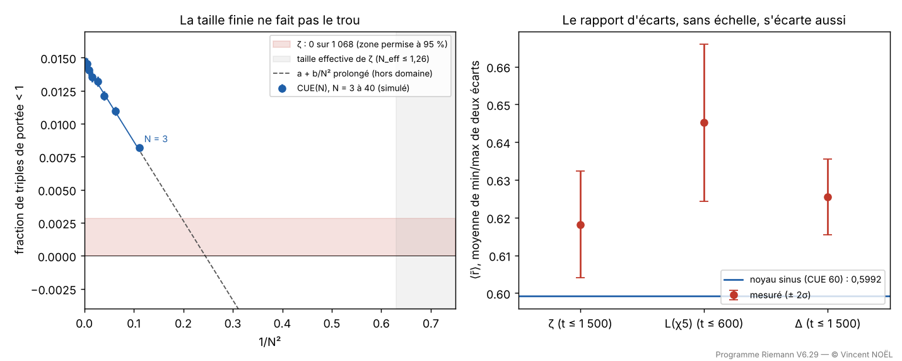

# V6.29 — Le trou à trois, lu ; les proportions de 2026 ; la matrice complétée

**Date :** 11 octobre 2026  
**Statut :** trois coups du navigateur, faits dans l'ordre de leurs scores.

1. Compléter la matrice des théories (3,10) : 11 cases sourcées.
2. Lire les proportions de 2026 (2,90) : relecture faite.
3. Lire Bogomolny et al. pour de vrai (2,75) : calcul fait.

Le calcul du trou à trois a des prévisions écrites avant (`data/prevision_v629_bblm.md`, 23 h 50 UTC) : une est juste, deux sont fausses. La prévision du navigateur, écrite en V6.28, est tenue dans le domaine où la correction a un sens.  
**Demande de l'auteur :** « Suites ».

## 1. Le trou à trois, avec Bogomolny et al. pris dans leur domaine

**Le rappel.** Au document 53, aucun triple de zéros consécutifs de ζ ne tenait dans moins d'un écart moyen (t ≤ 1 500 : 0 pour 15,6 attendus). Le modèle utilisé, la formule de taille effective prolongée à N ≈ 1, s'était révélé invalide. Ici, la correction de Bogomolny, Bohigas, Leboeuf et Monastra [BBLM06] est prise dans son vrai domaine : les matrices unitaires aléatoires de taille N, avec N entier et au moins 3. C'est la plus petite taille qui a des triples.

**Ce que dit la littérature (résumés lus).**

- [BBLM06] : à hauteur E, les écarts des zéros de ζ ressemblent, au premier ordre, à ceux du CUE de taille N~eff~ = log(E/2π)/√(12Λ), avec Λ = 1,57314. Le développement vaut pour N~eff~ grand.
- Nishigaki [Nis25] : dans le **rapport de deux écarts consécutifs**, la correction en N⁻² du CUE s'annule. L'écart de ζ au noyau sinus y décroît comme une puissance négative de log(T/2π), la puissance −3 d'après le résumé.
- Atas, Bogomolny, Giraud et Roux [ABGR13] : ce rapport n'a pas besoin de dépliage, car il ne dépend pas de la densité locale.

Ce rapport, r̃ = min(s~i~, s~i+1~)/max(s~i~, s~i+1~), est donc l'instrument propre. Il ne voit ni l'échelle, ni le dépliage, ni la correction de taille finie au premier ordre.

**Les résultats.**

| | Prévision | Résultat | Verdict |
|---|---|---|---|
| Navigateur (V6.28) | la correction prévoit un déficit de triples serrés du bon sens, mais plus faible que mesuré | dans son domaine (N ≥ 3), oui : la fraction suit a + b/N² de N = 40 à N = 3 (a = 0,01467, b = −0,0601) et vaut 0,0082 au CUE(3), soit 8,8 triples attendus pour ζ ; 0 est observé (probabilité de Poisson 1,6·10^−4^) | **tenue** |
| B1 | le CUE(3) a encore une fraction entre 0,004 et 0,010 | 0,0082 ± 0,0001 (la loi en 1/N² prévoyait 0,0080) | **juste** |
| B2 | le rapport moyen ⟨r̃⟩ de ζ, L(χ5), Δ est compatible avec le noyau sinus (0,5992) à 2σ | ζ 0,618 (+2,7σ) ; L(χ5) 0,645 (+4,4σ) ; Δ 0,625 (+5,2σ) | **fausse** |
| B3 | pour ζ, la portée s'écarte du noyau sinus (p < 0,01) mais pas le rapport (p > 0,05) | portée p = 0,02 ; rapport p = 0,0008 | **fausse** |

**Ce que cela veut dire.**

- **La taille finie ne fait pas le trou.** Une matrice unitaire de taille 3 a encore 0,8 % de triples serrés. Pour ne rien voir sur 1 068 triples, il faudrait une fraction sous 0,0028. La droite a + b/N² ne descend à ce niveau qu'en dessous de N = 2,2, là où il n'existe plus de triples. Le prolongement à N~eff~ ≈ 1 qui donnait « 0 » n'est qu'une extrapolation hors domaine.
- **Le dépliage n'y est pour rien.** Le rapport moyen calculé sans dépliage est le même à 10^−4^ près (ζ 0,6181 au lieu de 0,6182).
- **C'est un effet de forme, pas d'échelle.** Le rapport d'écarts, qui ne voit pas l'échelle, s'écarte lui aussi du noyau sinus, dans le même sens. Les deux écarts voisins sont plus égaux que dans le hasard unitaire : ζ a 21 rapports sous 0,2, pour 47 attendus. C'est une rigidité de forme.
- **La loi de hauteur reste à voir (exploratoire, non prévu).** Pour ζ, le rapport moyen ne baisse pas visiblement entre les tranches 0–500, 500–1 000 et 1 000–1 500 : 0,619, 0,614 et 0,622, à ± 0,012 près. Une loi en (log(T/2π))⁻³ diviserait l'écart par 4 de la première à la dernière tranche. Les barres d'erreur ne permettent pas de trancher. De plus, L(χ5) s'écarte le plus alors que sa hauteur effective est plus grande que celle de ζ. Une loi de hauteur commune aux trois fonctions ne suffit donc pas : les coefficients aux petits premiers comptent.

**La suite (coup ouvert).** La formule à trois points de Bogomolny et Keating [BK13] ajoute à la limite des matrices aléatoires les termes oscillants des petits premiers. C'est l'outil qui peut prévoir ce trou à ces hauteurs. Coût 2 : lire le texte, puis calculer. Prévision du coup : au plus 4 triples serrés pour ζ, et un rapport moyen au-dessus de 0,61.

## 2. Les proportions de 2026, relues comme un recensement de marges

**Prévision du navigateur (V6.19).** « La compression de Weil d'Alpöge–Furman se réécrit comme un recensement de marges. »

**Le calcul.** Prenons la version du corpus (doc. 49) : une matrice de Gram G des zéros, normalisée (G~ii~ = 1). La borne rang–trace donne :

  nombre de zéros distincts ≥ (tr G)²/tr G² = n / (1 + (1/n) Σ~i≠j~ (1 − m~ij~)),

où m~ij~ = 1 − |G~ij~|² est la **marge de la paire** (i, j), c'est-à-dire le déterminant de sa matrice de Gram 2 × 2 (docs 41 et 43). C'est une identité d'algèbre : tr G² = n + Σ~i≠j~ |G~ij~|².

- Si toutes les marges valent 1 (des zéros parfaitement séparés), la borne vaut n : tous les zéros sont distincts.
- Chaque paire de marge faible fait baisser la borne.

La borne des deux tiers est donc bien un **recensement des marges des paires**. La prévision est **tenue** pour Alpöge–Furman [AF26], sous cette forme normalisée. Leur forme exacte, avec mollificateurs, n'a été lue qu'en résumé. Lamzouri [Lam26], B. Wang [Wan26a] et Pearce-Crump [PC26] n'ont été relus qu'en résumé, et pas dans ce sens.

**Le témoin.** Davenport–Heilbronn borne la portée de toute proportion. Bombieri et Hejhal [BH95] montrent qu'une combinaison de fonctions L comme DH a presque tous ses zéros sur la droite, sous RH pour chaque fonction L et une hypothèse d'espacement. DH a pourtant des zéros hors de la droite. **Aucune proportion, même de 100 %, ne donne RH.** Il faut une propriété qui distingue ζ de DH, comme la signature de la surface virtuelle (docs 46 et 52).

## 3. La matrice des théories, complétée

**Prévision du navigateur (V6.19).** « Au moins dix cases se remplissent avec une source du registre. » Réfutation : moins de cinq. **Tenue** : 11 cases sourcées et une ligne nouvelle.

| Case | Relation | Source | Remarque |
|---|---|---|---|
| Ordre de Mertens × RH | ⇔ | [Tit86], Th. 14.25(C) | cité de mémoire ; Littlewood (1912) non vérifié |
| Lindelöf pour les premiers × RH | ⇔ (ligne nouvelle) | [GGL20] | borne uniforme des sommes Σ Λ(n) n^−it^ |
| Li × Weil | ⇔ | [BL99] | les coefficients de Li sont des valeurs de la forme de Weil |
| Hilbert–Pólya × Modèle réduit | ≈ | [KS99], [Del74] | sur une courbe, l'opérateur existe : le Frobenius sur H¹ |
| Modèle réduit × corrélations à n points | ≈ | [KS99] | monodromie |
| Modèle réduit × corrélation de paires | ≈ | [KS99] | cas n = 2 |
| Weil × simplicité | ↗ | [AF26] | rang–trace, recalculé (doc. 49) et relu (§2) |
| DH × proportion | ✗ | [BH95] | aucune proportion ne donne RH |
| Riemann–Roch pour Spec Z × Modèle réduit | ≈ | [CC22], [CC24] | pendant du Riemann–Roch des courbes |
| Mertens × Nyman–Beurling | ↗ | [Bae03], [BCF13] | approximants construits sur μ(n) |
| Corrélations à n points | note | doc. 54 | rigidité à basse hauteur, sans échelle |

Un coup « deuxième séance » est ouvert pour les cinq cases « ? » qui restent.

## 4. Démontré, mesuré, supposé

| | Énoncé |
|---|---|
| **Démontré** | La borne rang–trace, sous forme normalisée, est n / (1 + (1/n) Σ (1 − m~ij~)) : une fonction des marges des paires (identité d'algèbre). |
| **Mesuré** | La fraction de triples serrés du CUE(N) suit a + b/N² jusqu'à N = 3 (0,0082). ζ, L(χ5) et Δ ont un rapport d'écarts moyen supérieur au noyau sinus (+2,7σ, +4,4σ et +5,2σ). Le dépliage ne change pas ce rapport. |
| **Lu (résumés)** | [BBLM06], [Nis25], [BK13], [ABGR13], [AF26]. |
| **Cité de mémoire** | Titchmarsh, Th. 14.25(C) (Mertens) ; la valeur ⟨r̃⟩ ≈ 0,5996 du GUE dans [ABGR13] (recalculée ici : 0,5992). |
| **Supposé** | Que la rigidité à basse hauteur vienne des petits premiers (formule de Bogomolny–Keating), et qu'elle s'efface quand la hauteur croît. |

## 5. Lecture selon l'hypothèse de travail

Le trou à trois n'est pas un défaut de l'instrument, et il n'est pas non plus un reste de « petite taille ». C'est une forme : les zéros les plus bas se rangent avec des écarts voisins plus égaux que ne le veut le hasard unitaire. La piste qui reste désigne les petits premiers. Si elle tient, la structure qui « rend RH nécessaire » laisse sa marque la plus nette là où l'arithmétique est la plus visible, aux premiers 2, 3, 5 et 7, avant que la loi universelle ne l'efface. Les proportions racontent la même histoire par l'autre bout : elles comptent les marges, mais elles ne voient pas la différence entre ζ et DH. Ce qui distingue ζ n'est pas une statistique de ses zéros. C'est une structure qui tient pour tous à la fois.

<!-- references:debut -->

## Références

Format : [clé] auteurs, *titre*, publication, lien. Fiches complètes et état de vérification : document 42 (registre des sources).

- [ABGR13] Y. Y. Atas, E. Bogomolny, O. Giraud, G. Roux. *Distribution of the ratio of consecutive level spacings in random matrix ensembles*. Phys. Rev. Lett. 110 (2013), 084101 ; arXiv:1212.5611. <https://arxiv.org/abs/1212.5611> — partiellement vérifié
- [AF26] L. Alpöge, R. Furman. *More than two thirds of the zeros of the Riemann zeta function are simple and on the critical line*. arXiv:2608.13637 (août 2026). <https://arxiv.org/abs/2608.13637> — vérifié en ligne
- [Bae03] L. Báez-Duarte. *A strengthening of the Nyman–Beurling criterion for the Riemann hypothesis*. Atti Accad. Naz. Lincei Rend. Lincei Mat. Appl. (9) 14 (2003), 5–11 ; arXiv:math/0202141. <https://arxiv.org/abs/math/0202141> — vérifié en ligne
- [BBLM06] E. Bogomolny, O. Bohigas, P. Leboeuf, A. G. Monastra. *On the spacing distribution of the Riemann zeros: corrections to the asymptotic result*. J. Phys. A 39 (2006), 10743–10754 ; arXiv:math/0602270. <https://arxiv.org/abs/math/0602270> — vérifié en ligne
- [BCF13] S. Bettin, J. B. Conrey, D. W. Farmer. *An optimal choice of Dirichlet polynomials for the Nyman–Beurling criterion*. Proc. Steklov Inst. Math. 280 (2013) ; arXiv:1211.5191. <https://arxiv.org/abs/1211.5191> — vérifié en ligne
- [BH95] E. Bombieri, D. A. Hejhal. *On the distribution of zeros of linear combinations of Euler products*. Duke Math. J. 80 (1995), 821–862. <https://arxiv.org/abs/0704.3448> — partiellement vérifié. **Correctif V6.18 :** Bombieri–Hejhal montrent (sous RH pour chaque fonction et une hypothèse d'espacement) que 100 % des zéros, en densité, sont sur la droite ; la fermeture de la plage de survie n'en découle pas directement : elle reste une attente du corpus.
- [BK13] E. Bogomolny, J. P. Keating. *A method for calculating spectral statistics based on random-matrix universality with an application to the three-point correlations of the Riemann zeros*. J. Phys. A: Math. Theor. 46 (2013), 305203 ; arXiv:1307.6012. <https://arxiv.org/abs/1307.6012> — vérifié en ligne
- [BL99] E. Bombieri, J. C. Lagarias. *Complements to Li's criterion for the Riemann hypothesis*. J. Number Theory 77 (1999), no. 2, 274–287 ; DOI 10.1006/jnth.1999.2392. <https://doi.org/10.1006/jnth.1999.2392> — partiellement vérifié
- [CC22] A. Connes, C. Consani. *Riemann–Roch for Spec Z (compactifié d'Arakelov)*. arXiv:2205.01391 (v1 mai 2022, v2 mars 2023). <https://arxiv.org/abs/2205.01391> — vérifié en ligne
- [CC24] A. Connes, C. Consani. *Riemann–Roch for the ring Z*. C. R. Math. Acad. Sci. Paris 362 (2024), 229–235 ; DOI 10.5802/crmath.543. <https://comptes-rendus.academie-sciences.fr/mathematique/articles/10.5802/crmath.543/> — vérifié en ligne
- [Del74] P. Deligne. *La conjecture de Weil. I*. Publ. Math. IHÉS 43 (1974), 273–307 ; DOI 10.1007/BF02684373. <https://www.numdam.org/item/PMIHES_1974__43__273_0/> — vérifié en ligne
- [GGL20] S. M. Gonek, S. W. Graham, Y. Lee. *The Lindelöf hypothesis for primes is equivalent to the Riemann hypothesis*. Proc. Amer. Math. Soc. 148 (2020), 2863–2875. <https://doi.org/10.1090/proc/14974> — vérifié en ligne
- [KS99] N. M. Katz, P. Sarnak. *Zeroes of zeta functions and symmetry*. Bull. Amer. Math. Soc. 36 (1999), 1–26 ; voir aussi le livre Random Matrices, Frobenius Eigenvalues, and Monodromy, AMS Colloq. Publ. 45 (1999). <https://www.ams.org/bull/1999-36-01/S0273-0979-99-00766-1/> — vérifié en ligne
- [Lam26] Y. Lamzouri. *A new proof that more than 2/3 of the zeros of the Riemann zeta function are simple and on the critical line*. arXiv:2609.02882 (sept. 2026). <https://arxiv.org/abs/2609.02882> — vérifié en ligne
- [Nis25] S. M. Nishigaki. *Distributions of consecutive level spacings of circular unitary ensemble and their ratio: finite-size corrections and Riemann ζ zeros*. arXiv:2507.10193 (juillet 2025). <https://arxiv.org/abs/2507.10193> — vérifié en ligne
- [PC26] A. Pearce-Crump. *Optimising Selberg's method for critical zeros*. arXiv:2609.15329 (septembre 2026). <https://arxiv.org/abs/2609.15329> — vérifié en ligne
- [Tit86] E. C. Titchmarsh. *The Theory of the Riemann Zeta-Function*. 2e éd., révisée par D. R. Heath-Brown, Oxford, Clarendon Press, 1986. — partiellement vérifié
- [Wan26a] B. Wang. *Simple critical zeros and distinct zeros of the Riemann zeta-function in short intervals*. arXiv:2609.07918 (septembre 2026). <https://arxiv.org/abs/2609.07918> — vérifié en ligne

<!-- references:fin -->
