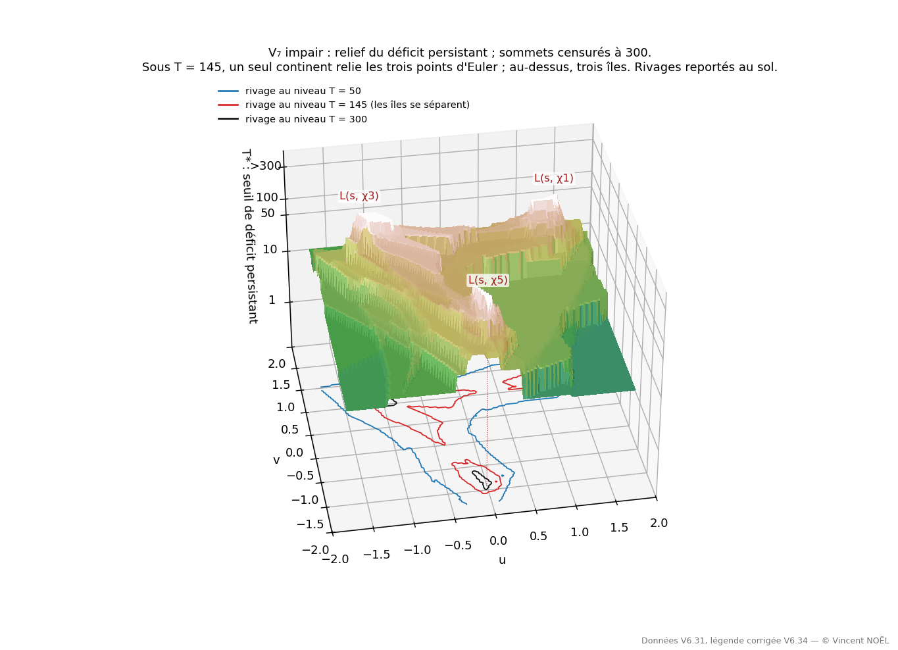

# V6.31 — Le relief de l'archipel : une seule vue 3D

**Date :** 11 octobre 2026  
**Statut :** calcul refait sur la carte du document 30, avec des prévisions écrites avant (`data/prevision_v631_relief.md`, 0 h 30 UTC). Avec le critère prévu, les prévisions sont fausses : ce critère mesure surtout un bruit de comptage. Avec un critère corrigé, choisi après avoir vu ce bruit, la figure est nette.  
**Demande de l'auteur :** « À un endroit on voyait trois îlots, et quand on changeait de niveau c'était plutôt une grande île. On ne devrait pas représenter cela avec une seule représentation en 3D oblique pour bien voir les zones ? »

## 1. L'idée

Le document 30 montrait la carte de V₇ impair à deux hauteurs, côte à côte :

- jusqu'à |t| = 50, un continent qui relie les trois points d'Euler ;
- jusqu'à |t| = 300, trois îles.

Ces deux cartes motivent un relief. En chaque point, T* est ici un **seuil de déficit persistant du comptage sur la droite**, par rapport au point d'Euler de référence et jusqu'au plafond 300. Le relief est la surface z = T*. Une seule vue oblique en montre les niveaux. Identifier ce seuil à une première paire hors droite demande un comptage total des zéros de la fonction elle-même. La V6.34 effectue ce contrôle sur onze points et trouve des écarts (document 58).

## 2. Le calcul et les prévisions

Les points (141 × 141) et les fonctions de Hardy sont ceux du document 30. Pour chaque T de 1 à 300 (par pas de 1), on calcule le déficit : le nombre de zéros sur la droite du point d'Euler le plus proche, moins celui du point considéré. Ce déficit compare les comptages de deux fonctions ; sa conversion en nombre de paires hors droite exige le comptage total.

| | Prévision (critère prévu : premier T où le déficit atteint 2) | Résultat | Verdict |
|---|---|---|---|
| R1 | seuls les trois points d'Euler dépassent 300 | 78 points dépassent 300 | **fausse** |
| R2 | les îles se séparent entre T = 50 et 150 | elles se séparent dès T = 9 à 31 | **fausse** |
| R3 | parts au-dessus de 50, 150 et 300 proches de 32 %, 2,6 % et 1,0 % (à un facteur 1,5 près) | 10 %, 1,8 % et 0,4 % | **juste pour 150, fausse pour 50 et 300** |

**Pourquoi le critère prévu échoue.** Au bord |t| = T, un zéro du point considéré peut tomber juste au-dessus de T alors que celui du point d'Euler tombe juste en dessous. Le déficit monte alors à 1 ou 2, puis retombe au niveau suivant. **75 % des points de la carte ont un déficit qui retombe**. C'est le bruit de bord signalé par le document 30. Même un déficit persistant compare deux fonctions différentes et ne donne pas automatiquement leur différence de zéros hors droite.

**Critère corrigé (choisi après coup).** T* est la hauteur à partir de laquelle le déficit reste au moins égal à 2 jusqu'à 300.

| | Critère corrigé | Document 30 |
|---|---|---|
| part de la carte au-dessus de T = 50 | 36 % | 32 % |
| au-dessus de 150 | 9,7 % | 2,6 % |
| au-dessus de 300 | 1,0 % (203 points, en 3 îles) | 1,0 %, en 3 îles |
| séparation des îles | **un seul continent jusqu'à T = 144 ; trois îles dès T = 145** | entre 50 et 300 |

Avec ce critère, R2 serait juste. Avec le critère prévu, elle est fausse.

## 3. Ce que montre la figure

- Trois sommets, aux trois points d'Euler. Dans la famille étudiée, RH impose un point d'Euler (doc. 30, §3.4). La réciproque serait la GRH pour les fonctions L correspondantes et n'est pas démontrée. Aucun zéro hors droite n'est détecté pour ces témoins jusqu'à 300 en V6.34.
- Une crête qui les relie. Elle indique un faible déficit persistant à basse hauteur dans cette carte.
- Un col à T = 145. En dessous, une seule île ; au-dessus, trois. Les rivages aux niveaux 50, 145 et 300 sont reportés au sol.
- Des plaines basses, en vert : le déficit persistant y apparaît avant |t| = 10 ; les deux représentants contrôlés directement en V6.34 concordent.

## 4. Démontré, mesuré, supposé

| | Énoncé |
|---|---|
| **Démontré** | Dans V_q, RH n'est possible qu'aux points d'Euler (doc. 30, d'après Saias–Weingartner). |
| **Mesuré** | Le relief T* sur 141 × 141 points. Col à T = 145 avec le critère corrigé. 75 % de déficits transitoires. |
| **Hypothèse contrôlée en V6.34** | L'identification de T* à une première sortie est réfutée pour deux représentants du col : T*=145, premières détections directes à 80 et 113. Deux points restent censurés à 300 ; leur T* stocké à 10⁶ n'est pas une hauteur mesurée. Voir document 58. |

## 5. Lecture selon l'hypothèse de travail

Le relief représente la persistance d'une ressemblance aux fonctions L dans des fenêtres finies. La région se fend en îles quand la hauteur croît. Le comptage direct précise ce que mesure cette image et confirme que le seuil historique peut retarder la détection d'une sortie. L'existence d'un produit d'Euler reste une condition nécessaire dans cette famille ; le relief ne fournit pas sa suffisance ni une preuve de GRH.
