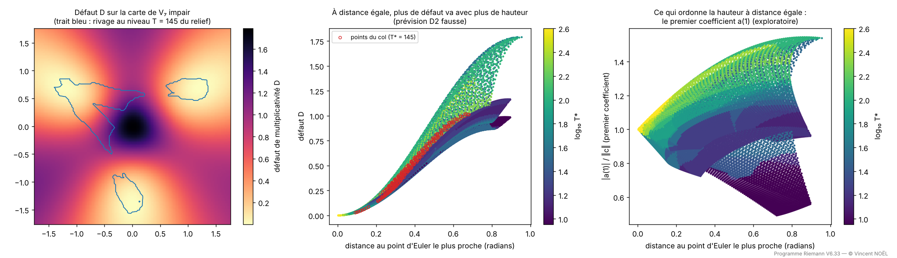

# V6.33 — La force qui abaisse le relief : le défaut de multiplicativité, puis le premier coefficient

**Date :** 11 octobre 2026  
**Statut :** calcul fait sur la carte du document 56, avec trois prévisions écrites avant (`data/prevision_v633_force.md`, 21 h 00 UTC). Les trois sont fausses. Une analyse faite après coup désigne une autre grandeur, le premier coefficient a(1). Elle n'a pas été prévue et devra être retestée.  
**Demande de l'auteur :** mesurer si la hauteur T* suit le défaut de multiplicativité (« si cela a le moindre intérêt »).

## 1. La question

Au document 56, chaque point de la carte de V₇ impair reçoit une hauteur T*, celle où la fonction perd sa première paire de zéros. L'hypothèse à tester était la suivante : **la force qui abaisse le relief, partout sauf aux trois sommets, est la perte du produit d'Euler.**

Pour la mesurer, on utilise le fait qu'en un point c de la carte, les coefficients de F_c ne dépendent que du reste de n modulo 7 :

  A(r) = Σ_χ c_χ·e^{−iφ_χ}·χ(r).

Le **défaut de multiplicativité** mesure, sans unité, de combien ces coefficients s'écartent d'un produit d'Euler :

  D(c) = Σ_{r,s} |A(1)·A(rs) − A(r)·A(s)|² / (Σ_r |A(r)|²)².

Il est exactement nul aux points d'Euler (à 4·10⁻³⁰ près en machine) et vaut au plus 1,79 sur la carte. On note d la distance au point d'Euler le plus proche.

## 2. Les prévisions et leur sort

| | Prévision | Résultat | Verdict |
|---|---|---|---|
| D1 | corrélation de rang entre T* et D inférieure à −0,6 | −0,31 (la distance seule donne −0,43) | **fausse** |
| D2 | à distance égale, D n'ajoute presque rien (corrélation partielle entre −0,2 et 0,2) | **+0,38** : à distance égale, plus de défaut va avec **plus** de hauteur | **fausse, et de signe contraire** |
| D3 | le col des îles (T* = 145, 283 points) passe là où le défaut est faible | 19 % seulement de ses points sont sous la médiane : il passe là où le défaut est **fort** | **fausse** |

L'hypothèse « le défaut de multiplicativité est la force » ne tient pas sous cette forme. À distance égale d'un sommet, ce ne sont pas les directions les plus « anti-Euler » qui perdent leurs zéros le plus tôt.

## 3. Ce que montre l'analyse faite après coup (non prévue)

La figure du milieu montre deux nappes. À une même distance, les points se rangent en deux familles : l'une a un fort défaut et reste haute, l'autre a un faible défaut et tombe tôt. La grandeur qui sépare ces nappes est le **premier coefficient** a(1) = A(1) : le poids du terme n = 1 de la série.

| Corrélation partielle de rang | Valeur |
|---|---|
| T* et \|a(1)\|/‖c‖, à distance égale | **+0,81** |
| D et \|a(1)\|/‖c‖, à distance égale | +0,62 |
| T* et D, à distance égale **et** à \|a(1)\| égal | **−0,24** |

On lit deux forces opposées :

- **Un ancrage : le premier coefficient.** Plus |a(1)| est grand, plus la combinaison garde ses zéros sur la droite. C'est cohérent avec un fait classique : quand le premier terme d'une série de Dirichlet domine la somme des autres, |a(1)| > Σ_{n≥2} |a(n)|·n^{−σ}, la série n'a aucun zéro dans le demi-plan Re s > σ. Le document 30 (§7) avait déjà relevé |a(1)| aux points milieux, là où des zéros apparaissent dans Re s > 1.
- **Une poussée : le défaut de multiplicativité.** Une fois l'ancrage pris en compte, le défaut abaisse bien le relief, avec le signe attendu (−0,24). Mais il pèse beaucoup moins que l'ancrage.

Les sommets réunissent les deux : défaut nul, et |a(1)| = ‖c‖. L'ancrage seul ne suffit pas, car il est plus grand ailleurs (jusqu'à 1,54‖c‖), en des points qui ne sont pas des sommets.

## 4. Démontré, mesuré, supposé

| | Énoncé |
|---|---|
| **Démontré** | D = 0 exactement aux points d'Euler. Domination du premier terme : |a(1)| > Σ_{n≥2} |a(n)| n^{−σ} implique l'absence de zéro dans Re s > σ (classique). |
| **Mesuré** | D1, D2 et D3 sont fausses. Après coup : la corrélation partielle entre T* et |a(1)| vaut +0,81, celle entre T* et D (à d et |a(1)| fixés) −0,24. |
| **Supposé** | Que l'ancrage par a(1) et la poussée du défaut décrivent le relief en général. À retester avec des prévisions écrites avant, sur un autre espace (V₁₁ ou V₁₃ impair, par tirage de points). |

## 5. Lecture selon l'hypothèse de travail

Le relief n'est pas abaissé par une seule force. Le premier coefficient tient les zéros sur la droite, comme une quille. L'absence de produit d'Euler les en écarte, mais seulement en second. Aux sommets, les deux s'accordent : la quille est entière et la structure multiplicative intacte. Ce que l'hypothèse de l'auteur appelle « ce qui rend RH nécessaire » apparaît ici en deux parts : une condition de poids (a(1)), que bien des fonctions remplissent, et une condition de forme (la multiplicativité), que seuls les sommets remplissent.
