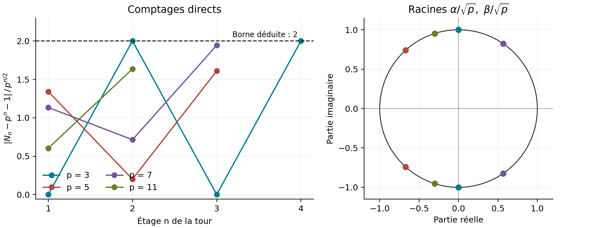

# V6.35 — De la tour finie à la borne spectrale

**Document 59 · 12 octobre 2026**  
**Auteur :** Vincent P. P. NOËL · Programme Riemann  
**Objet :** exécution des étapes 1 et 2 proposées après le document 58.

## 1. Le résultat obtenu

Le mécanisme des jets s'étend à **tous les corps finis de caractéristique impaire**, et pas seulement aux corps premiers. Pour une cubique \(f\), le comptage et sa torsion donnent, à chaque étage \(q=p^n\),

\[
|N_n-(p^n+1)|\le10p^{n/2}.
\]

La constante 10 est uniforme : elle ne dépend ni de \(p\), ni de \(n\), ni de la cubique. Pour une cubique **lisse**, la rationalité de sa fonction zêta fournit indépendamment deux nombres \(\alpha,\beta\), de produit \(p\), tels que

\[
N_n=p^n+1-\alpha^n-\beta^n.
\]

La borne sur toute la tour force alors

\[
\boxed{|\alpha|=|\beta|=\sqrt p},
\qquad
\boxed{|N_n-(p^n+1)|\le2p^{n/2}}.
\]

Ce dernier résultat est la borne de Hasse, reconstruite ici par une chaîne complète : **jets → rang → multiplicité → tour → spectre**. La constante intermédiaire 10 suffit pour obtenir la constante finale exacte 2.

| Élément | Statut en V6.35 |
|---|---|
| Jets de Hasse sur \(\mathbb F_{p^n}\), même aux ordres élevés | Démontré |
| Borne uniforme sur tous les étages | Démontrée |
| Rationalité indépendante de la borne de Hasse | Justifiée par Riemann–Roch, source vérifiée |
| Modules spectraux et droite \(1/2\) de la zêta elliptique | Déduits |
| Certificats exacts sur cinq instances d'extension | Calculés et contrôlés |
| Objet analogue pour la zêta de Riemann | Ouvert |

La méthode appartient à Stepanov [Ste69] et Bombieri [Bom73]. V6.35 en donne une réalisation explicite, avec hypothèses séparées et témoins vérifiables. Ce travail ne revendique pas un théorème historiquement nouveau. Les relectures sont internes ; une relecture par un spécialiste reste à organiser.

\newpage

## 2. Pourquoi les jets doivent être calculés directement

Un jet est la liste des premiers coefficients du développement d'un polynôme autour d'un point :

\[
A(x+h)=\sum_{k\ge0}D^{[k]}A(x)\,h^k.
\]

Les \(D^{[k]}\) sont les **dérivées de Hasse**. Annuler les \(M\) premières coordonnées au point \(a\) signifie exactement que \((x-a)^M\) divise \(A\). Cette définition fonctionne en toute caractéristique.

Les formules utiles sont

\[
D^{[k]}x^d=\binom dk x^{d-k},
\qquad
D^{[k]}(AB)=\sum_{\ell=0}^kD^{[\ell]}A\,D^{[k-\ell]}B.
\]

Les coefficients binomiaux sont réduits modulo \(p\). On n'inverse jamais \(k!\). En caractéristique 3, par exemple,

\[
D^{[3]}x^3=1,
\qquad
\frac{d^3}{dx^3}x^3=0.
\]

La dérivée ordinaire perd une information que le jet conserve. C'est essentiel pour le certificat sur \(\mathbb F_{27}\), qui impose les ordres 0, 1, 2 et 3.

Posons \(q=p^n\), \(e=(q-1)/2\), \(g=f^e\), et

\[
S=\{a\in\mathbb F_q:f(a)\ne0,\ g(a)=1\}.
\]

Les éléments de \(S\) sont les abscisses donnant deux points sur \(y^2=f(x)\). Pour \(M<q\), le Frobenius fournit deux propriétés simultanées :

\[
(x+h)^{jq}=(x^q+h^q)^j,
\qquad a^{jq}=a^j\quad(a\in\mathbb F_q).
\]

Ainsi les jets d'ordre \(1,\ldots,M-1\) des facteurs \(x^{jq}\) sont nuls, tandis que leurs valeurs deviennent des puissances de bas degré.

On choisit l'espace de **polynômes formels**

\[
W=\operatorname{span}
\{x^{jq+i},\ x^{jq+i}g:0\le j<J,\ 0\le i<K\}.
\]

Si \(1\le K\le(q-3)/2\), leurs degrés dominants sont distincts : leurs résidus modulo \(q\) sont dans deux intervalles disjoints. Donc \(\dim W=2JK\). Le degré maximal est

\[
D=(J-1)q+K-1+\frac{3(q-1)}2.
\]

On conserve \(W\) dans \(\mathbb F_q[x]\) : un quotient par \(x^q-x\) détruirait cette indépendance.

\newpage

## 3. La baisse de rang donne une borne sur chaque étage

Le développement binomial de \(g=f^e\) donne, pour tout \(k\), une identité polynomiale

\[
f^kD^{[k]}g=gP_k,\qquad\deg P_k\le2k.
\]

Pour vérifier la borne, on écrit \(\Delta=f(x+h)-f(x)\). Le coefficient de \(h^k\) dans \(\Delta^\ell\) a degré au plus \(3\ell-k\). Dans

\[
P_k=\sum_{\ell=0}^{\min(e,k)}
\binom e\ell f^{k-\ell}[h^k]\Delta^\ell,
\]

chaque terme a donc degré au plus \(3(k-\ell)+3\ell-k=2k\).

Sur \(S\), on a \(g(a)=1\) et \(f(a)\ne0\). Multiplier le bloc de jets d'ordre \(k\) par \(f(a)^k\) ne change pas son rang. La règle du produit et le Frobenius le font passer par les polynômes de degré au plus \(K+J-2+2k\). Ainsi

\[
\operatorname{rang}\mathcal J_M
\le\sum_{k<M}\min(|S|,K+J-1+2k)
\le R=M(K+J-1)+M(M-1).
\]

Si \(2JK>R\), le noyau contient un polynôme **non nul** \(A\). Il est divisible par tous les \((x-a)^M\), pour \(a\in S\). Les facteurs étant premiers entre eux,

\[
M|S|\le\deg A\le D,
\qquad |S|\le U=\lfloor D/M\rfloor.
\]

La famille \(J=r+1,\ K=3r^2-r+1,\ M=2r\), avec \(6r^2-2r+5\le q\), donne exactement \(2JK-R=2\), et

\[
U=\left\lfloor\frac q2+\frac{3(q-1)}{4r}+\frac{3r-1}{2}\right\rfloor.
\]

Si \(z\le3\) est le nombre de racines distinctes de \(f\), alors \(N_q=2|S|+z+1\). Une torsion \(\nu f\), avec \(\nu\) non carré, échange carrés et non-carrés : \(|S_{\nu f}|=q-z-|S|\). Les deux bornes donnent

\[
|N_q-q-1|\le2U-q+z.
\]

Pour \(q\ge29\), choisir \(r=\lfloor\sqrt{(q-5)/6}\rfloor\) majore cette erreur par \(9{,}674\sqrt q<10\sqrt q\). Pour \(q<29\), la somme des \(q\) caractères quadratiques donne directement une erreur au plus \(q<10\sqrt q\). **Tous les étages sont couverts**, y compris \(\mathbb F_3\). L'annexe détaille les inégalités de la constante.

\newpage

## 4. De la tour au spectre : une implication non circulaire

On suppose ici que \(f\in\mathbb F_p[x]\) est sans racines multiples. Le modèle projectif est une courbe elliptique \(E\). Posons \(h=N_1\), \(t=p+1-h\).

Riemann–Roch donne \(\dim L(D)=d\) pour un diviseur de degré \(d\ge1\). Il y a \(h\) classes de chaque degré, et \((p^d-1)/(p-1)\) diviseurs effectifs par classe. Leur série donne

\[
Z(E,T)=1+\sum_{d\ge1}h\frac{p^d-1}{p-1}T^d
=\frac{1-tT+pT^2}{(1-T)(1-pT)}.
\]

Cette justification, vérifiée dans Milne [Mil20], utilise les diviseurs et Riemann–Roch. Elle n'utilise ni la borne de Hasse, ni l'égalité des modules spectraux.

En factorisant le numérateur et en comparant les logarithmes formels avec le produit sur les points fermés, on obtient

\[
1-tT+pT^2=(1-\alpha T)(1-\beta T),
\quad \alpha\beta=p,
\quad N_n=p^n+1-\alpha^n-\beta^n.
\]

L'équation fonctionnelle \(Z(E,1/(pT))=Z(E,T)\) exprime une symétrie réciproque. Elle ne fixe pas seule les modules.

La section précédente donne, **pour tout \(n\ge1\)**,

\[
|\alpha^n+\beta^n|\le10p^{n/2}.
\]

Si \(A=|\alpha|>\sqrt p\), alors \(|\beta|=p/A<\sqrt p\). L'inégalité triangulaire inverse entraînerait

\[
10\ge\frac{|\alpha^n+\beta^n|}{p^{n/2}}
\ge
\left(\frac A{\sqrt p}\right)^n
-\left(\frac{\sqrt p}A\right)^n
\longrightarrow+\infty.
\]

C'est impossible. Aucun module ne dépasse \(\sqrt p\), et leur produit impose qu'ils lui soient tous deux égaux. On obtient la borne précise \(2p^{n/2}\).

Enfin, \(\zeta_E(s)=Z(E,p^{-s})\) s'annule lorsque \(p^s=\alpha\) ou \(\beta\). Ainsi \(p^{\Re s}=\sqrt p\), donc **\(\Re s=1/2\)**. Les pôles ont des parties réelles 0 et 1.

La conclusion concerne la **zêta de la courbe elliptique**. Le passage de cette chaîne à \(\zeta(s)\), la zêta des entiers, reste le problème du programme.

\newpage

## 5. Les certificats : ce qui a réellement été calculé

Les extensions sont construites comme \(\mathbb F_p[u]/(m(u))\), avec \(m\) irréductible. Les éléments sont encodés par leurs coefficients en base \(p\) ; les opérations utilisent le polynôme \(m\). Un calcul modulo l'entier \(p^n\) ne produirait pas le corps voulu.

La courbe testée est \(y^2=x^3+x+1\), lisse aux caractéristiques utilisées. La torsion sur \(\mathbb F_{125}\) utilise le non-carré 2.

| Corps / cubique | \(J,K,M\) | \(2JK\) | Conditions \(M\lvert S\rvert\) | Rang exact | Noyau |
|---|---:|---:|---:|---:|---:|
| \(\mathbb F_{27}\), \(f\) | 3, 11, 4 | 66 | 52 | 51 | 15 |
| \(\mathbb F_{25}\), \(f\) | 7, 9, 6 | 126 | 78 | 78 | 48 |
| \(\mathbb F_{49}\), \(f\) | 3, 11, 4 | 66 | 108 | 56 | 10 |
| \(\mathbb F_{125}\), \(f\) | 5, 45, 8 | 450 | 416 | 400 | 50 |
| \(\mathbb F_{125}\), \(2f\) | 5, 45, 8 | 450 | 560 | 400 | 50 |

| Corps / cubique | \(\lvert S\rvert\) | Degré du témoin | Degré maximal \(D\) | Multiplicité minimale |
|---|---:|---:|---:|---:|
| \(\mathbb F_{27}\), \(f\) | 13 | 93 | 103 | 4 |
| \(\mathbb F_{25}\), \(f\) | 13 | 136 | 194 | 6 |
| \(\mathbb F_{49}\), \(f\) | 27 | 173 | 180 | 4 |
| \(\mathbb F_{125}\), \(f\) | 52 | 701 | 730 | 8 |
| \(\mathbb F_{125}\), \(2f\) | 70 | 701 | 730 | 8 |

Sur \(\mathbb F_{27}\), le dernier ordre imposé est 3 : le calcul traverse la limite de l'ancienne méthode par factorielles. Sur \(\mathbb F_{125}\), les ordres 5, 6 et 7 traversent également cette limite.

La torsion sur \(\mathbb F_{125}\) montre pourquoi **compter les conditions ne suffit pas** : 560 conditions dépassent les 450 inconnues, mais le rang est 400. Le noyau de dimension 50 existe réellement. Le témoin vérifie \(8\times70=560\le701\le730\).

Chaque témoin est conservé intégralement : module du corps, points, vecteur du noyau et coefficients du polynôme. Il est reconstruit puis vérifié de deux façons : coefficients de Hasse directs et divisions successives par \(x-a\).

Le cas \(\mathbb F_{27}\) a aussi été recalculé avec une arithmétique et une élimination indépendantes lors de la relecture critique. Les cinq instances sont des certificats de calcul ; la preuve universelle n'utilise pas leurs résultats.

\newpage

## 6. Comptages sur les tours et lecture du résultat

Les douze nombres ci-dessous sont **comptés directement** dans les corps construits. La récurrence spectrale ne les génère pas : elle est appliquée ensuite comme contrôle séparé.

| \(p\) | \(n\) | \(q=p^n\) | \(N_n\) direct | \(N_n-q-1\) |
|---:|---:|---:|---:|---:|
| 3 | 1 | 3 | 4 | 0 |
| 3 | 2 | 9 | 16 | 6 |
| 3 | 3 | 27 | 28 | 0 |
| 3 | 4 | 81 | 64 | −18 |
| 5 | 1 | 5 | 9 | 3 |
| 5 | 2 | 25 | 27 | 1 |
| 5 | 3 | 125 | 108 | −18 |
| 7 | 1 | 7 | 5 | −3 |
| 7 | 2 | 49 | 55 | 5 |
| 7 | 3 | 343 | 380 | 36 |
| 11 | 1 | 11 | 14 | 2 |
| 11 | 2 | 121 | 140 | 18 |

Les traces \(s_n=\alpha^n+\beta^n\) satisfont \(s_0=2,\ s_1=t,\ s_n=ts_{n-1}-ps_{n-2}\). Cette récurrence coïncide avec chacun des douze comptages.

La figure illustre les résultats sur quelques étages. **Une liste finie d'étages ne prouve pas l'égalité des modules.** Celle-ci vient de la borne démontrée pour tous les \(n\), combinée au produit \(\alpha\beta=p\).

Le plan de validation a été fixé avant l'exécution consolidée. Les valeurs déjà connues y sont désignées comme contrôles de reproduction, sans leur attribuer une découverte nouvelle.

\newpage

## 7. Ce qui reste ouvert et le prochain travail utile

**Sur les corps finis, les étapes 1 et 2 sont closes dans le cadre annoncé.** La preuve couvre les cubiques, la caractéristique impaire et, pour la conséquence spectrale, les courbes lisses de genre un. Elle ne traite pas ici la caractéristique 2, les genres supérieurs ou l'optimisation générale des paramètres.

La lissité est indispensable à l'étape spectrale. Le modèle singulier \(y^2=x^2(x+a)\), avec \(a\) non carré dans \(\mathbb F_p\), vérifie

\[
N_n=p^n+1-(-1)^n,\qquad
Z_{\rm brut}(T)=\frac{1+T}{(1-T)(1-pT)}.
\]

Son erreur satisfait une borne en racine carrée, mais son zéro \(T=-1\) a module 1. Le numérateur elliptique de degré deux et le produit de ses racines inverses \(p\) sont des hypothèses substantielles. On distingue ce modèle brut de sa normalisation.

**Pour les entiers, la prochaine étape est une construction à tester.** Le document 51 avait montré que l'action d'échelle seule ne fournit pas l'annulation nécessaire. Réutiliser cette action en lui donnant un nom de Frobenius ne résout pas cette difficulté.

| Objet à construire pour \(\zeta\) | Exigence avant toute conclusion |
|---|---|
| Espace de fonctions auxiliaires | Indépendance prouvée avant de connaître les zéros |
| Opérateur ou relations de jets | Baisse de rang issue de l'arithmétique |
| Contrôle global des annulations | Borne jouant le rôle du degré polynomial |
| Paramètre analogue à la tour | Même constante de contrôle sur tous ses niveaux |

Le prochain coup enregistré est de **définir un candidat explicite, puis de le soumettre à un témoin contraire**, notamment Davenport–Heilbronn ou un faux jumeau. La baisse de rang doit découler de ses relations, et non d'un ajustement numérique. Si elle apparaît seulement après introduction des zéros, elle ne fournit pas le maillon indépendant recherché. Le navigateur conserve les autres pistes ouvertes de V6.34.

**Reproduction.** La preuve complète est dans le dossier 3_Preuves_et_calculs/preuves, fichier LEMME_TOUR_ET_SPECTRE_V635.md. Les données v635_tour.json/csv et v635_certificats.json sont dans le dossier data. Depuis 3_Preuves_et_calculs, lancer python src/v635_tour_et_spectre.py, puis python tests/run_all_tests.py. Les tables du programme sont limitées à \(q\le1024\) ; le théorème n'a pas cette limite.

**Source de rationalité.** Milne [Mil20], chapitre I, théorème 4.13 et formule (8), pp. 35–36 ; chapitre IV, proposition 9.9, théorème 9.10 et remarque 9.11(a), pp. 155–156.

<!-- references:debut -->

## Références

Format : [clé] auteurs, *titre*, publication, lien. Fiches complètes et état de vérification : document 42 (registre des sources).

- [Bom73] E. Bombieri. *Counting points on curves over finite fields (d'après S. A. Stepanov)*. Séminaire Bourbaki 1972/73, exp. 430, Lecture Notes in Math. 383, Springer, 1974, 234–241 (1973). <https://www.numdam.org/item/SB_1972-1973__15__234_0/> — vérifié en ligne
- [Mil20] J. S. Milne. *Elliptic Curves*. World Scientific, deuxième édition (2021). <https://www.jmilne.org/math/Books/EC2.pdf> — vérifié en ligne
- [Ste69] S. A. Stepanov. *On the number of points of a hyperelliptic curve over a finite prime field*. Izv. Akad. Nauk SSSR Ser. Mat. 33 (1969), no. 5, 1171–1181 ; trad. Math. USSR-Izv. 3 (1969), 1103–1114. <https://mathnet.ru/eng/im2197> — vérifié en ligne

<!-- references:fin -->
