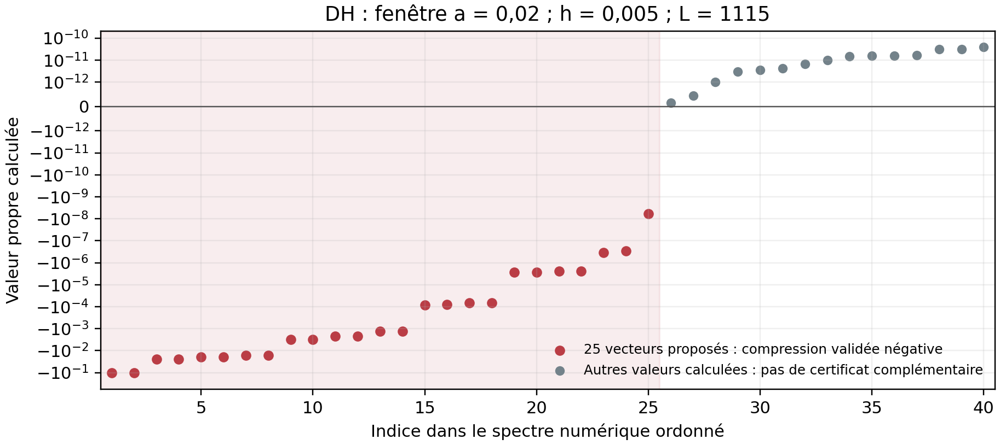

# V6.36 — Trois articles et un certificat de négativité

**Document 60 · 12 octobre 2026**  
**Auteur :** Vincent P. P. NOËL · Programme Riemann  
**Statut :** bilan éditorial, exécution du protocole et preuve computationnelle dans une fenêtre fixée. Relectures internes ; aucune soumission externe effectuée.

## 1. La décision éditoriale

Le résultat de V6.35 devient un **troisième article en LaTeX**, sous la forme d'une note expositive et reproductible. La méthode est classique ; l'intérêt du texte est de présenter la chaîne complète, ses hypothèses et cinq certificats exacts, dont des jets d'ordre supérieur à la caractéristique.

| Article | Type de document | Apport et limite |
|---|---|---|
| 1 — Moyenne quadratique à pôles doubles | Prépublication analytique, format amsart | Théorèmes A, B et critère conjoint RH–simplicité. Nouveauté et références détaillées à faire relire. |
| 2 — Formes de Weil côté arithmétique | Note numérique et certificat dans une fenêtre | Dictionnaire matriciel, contrôle DH, désormais une borne inférieure validée sur l'inertie d'un cas fixé. |
| 3 — Jets de Hasse et borne spectrale elliptique | Note expositive avec données reproductibles | Méthode de Stepanov, rationalité indépendante et déduction de Hasse. Aucun théorème historiquement nouveau revendiqué. |

Le format commun est celui d'un article mathématique : résumé, énoncés, preuves, hypothèses, données et références. Les trois sources sont compilables avec pdfLaTeX. Elles sont accompagnées de leurs PDF ; le corpus conserve les programmes et données de reproduction.

**Mon avis.** Le troisième texte se prête à une publication pédagogique ou méthodologique. Il ne faut pas le présenter comme une découverte de la borne de Hasse. L'article 1 reste le candidat analytique principal, sous réserve de relecture spécialisée. L'article 2 gagne un résultat concret, limité à une fenêtre.

\newpage

## 2. Les corrections des anciens textes

La relecture constructive et la relecture critique ont recoupé les passages suivants.

| Texte | Correction | Raison |
|---|---|---|
| Article 1, exposant fini | Ajout de \(\log(S/3)/\log X\) | \(3\log\log X/\log X\) vaut environ 0,5174 à \(10^7\), et non 0,33. Sous RH et simplicité, l'approximation cubique complète donne 0,3445 ; la mesure vaut environ 0,325. |
| Article 1, Nyman–Beurling | Normalisation de \(\beta_N\) rendue conditionnelle | Une médiane numérique ne prouve pas \(\beta_N\log^2N\to-1\), surtout près des zéros de \(A_N\). |
| Article 1, pics | Affirmation de non-convergence retirée | Un échantillon fini avec pics ne démontre aucune conclusion asymptotique de ce type. |
| Article 1, preuve locale | Cas de zéro ou un pôle distingué | Le minimum des écarts entre deux zéros n'est pas défini lorsqu'il n'existe pas deux zéros. |
| Article 1, calibrations | Portée aux objets testés explicitée | Une comparaison finie DH/L ne généralise pas automatiquement les théorèmes prouvés pour \(\zeta\). |
| Article 2, résumé et tableau | Tolérance numérique indiquée immédiatement | Une inertie obtenue en virgule flottante n'est pas un décompte exact démontré. |
| Article 2, faux jumeaux | Effectivité limitée au degré 200 testé | Les calculs finis n'établissent pas une effectivité sur tous les degrés. |

Le coeur des démonstrations A et B n'a pas présenté de faille dans cette relecture interne. Cela ne remplace pas une expertise indépendante et ne valide pas les références numérotées encore non contrôlées dans leurs originaux.

Une erreur bibliographique de V6.35 est aussi corrigée : le PDF de l'auteur pour la deuxième édition de **Milne, Elliptic Curves**, donne **2021**, et non 2020. Le registre conserve la clé Mil20 pour ses liens, mais sa fiche, la preuve et les références du document 59 portent l'année correcte. Cette correction ne modifie pas la preuve.

\newpage

## 3. Le protocole a repris son premier coup

Le navigateur classait en tête « Certifier les signes par une erreur en norme ». Le cas fixé était **Davenport–Heilbronn, \(a=0,02\), \(h=0,005\), \(L=1115\)**, avec 25 directions négatives comptées numériquement dans V6.27.

Le plan a été écrit avant le nouveau calcul. Sa règle centrale était : une différence entre deux programmes ne borne pas leur erreur par rapport à la matrice exacte. Les postes d'erreur devaient être explicitement couverts.

La nouvelle construction n'utilise aucun zéro :

1. Coefficients DH reconstruits à partir des radicaux et logarithmes en intervalles.
2. Convolution \(g\) évaluée par une formule trigonométrique fermée, différente du quadrateur initial.
3. Terme archimédien calculé dans la variable physique à partir de la représentation intégrale de la digamma [NIS10].
4. Noeuds et poids de Gauss encadrés ; restes de quadrature majorés par Cauchy sur chaque branche analytique.
5. Traces entourées d'intervalles à 60 chiffres ; leur passage aux centres binary64 est couvert.
6. Sous-espace proposé numériquement, puis signe de sa compression contrôlé avec les erreurs des produits matriciels [HM19].

Si \(\delta_k\) est le rayon certifié de la trace \(k\), la structure de Toeplitz donne

\[
\|G-\widehat G\|_2\le\|G-\widehat G\|_F
\le\sqrt{L\delta_0^2+
2\sum_{k=1}^{L-1}(L-k)\delta_k^2}.
\]

| Poste | Valeur |
|---|---:|
| Rayon maximal d'une trace | \(2,622\times10^{-18}\) |
| Reste maximal de quadrature | \(6,855\times10^{-25}\) |
| Borne en norme sur l'erreur des traces | \(1,757\times10^{-16}\) |
| Écart Fourier / physique en norme de Frobenius, mesuré | \(4,281\times10^{-14}\) |
| Écart aux traces des zéros connus, maximal et mesuré | \(4,259\times10^{-8}\) |

Les deux dernières lignes sont des comparaisons. Elles ne servent pas à fabriquer la borne démontrée de la troisième ligne. La queue de zéros connue ne suffit d'ailleurs pas ici à une certification aux petites marges.

\newpage

## 4. Le résultat : au moins 25 directions négatives

Une matrice \(V\) de 25 vecteurs est proposée par le calcul numérique. Ses coordonnées sont ensuite traitées comme des dyadiques exactes. La preuve porte sur la compression **exacte** \(V^TGV\), et ne suppose pas que les vecteurs calculés soient des vecteurs propres exacts.

Les normes carrées des colonnes sont encadrées et vérifiées inférieures à 2. Les erreurs des deux produits matriciels sont majorées avec le modèle déterministe d'arrondi binary64. Le budget maximal par entrée de la compression est

\[
e_{\rm compression}<2,639\times10^{-13}.
\]

On ajoute ce budget aux sommes de Gershgorin. Leur borne supérieure est

\[
\max_i\left(
\widehat B_{ii}+\sum_{j\ne i}|\widehat B_{ij}|+\sum_j e_{ij}
\right)<-6,087\times10^{-9}<0.
\]

La compression est donc négative définie. Ses 25 colonnes sont nécessairement indépendantes, et

\[
\boxed{\nu_-(G_{1115}^{DH})\ge25.}
\]

Le certificat emploie l'arithmétique d'intervalles et le modèle standard IEEE binary64, sans débordement ni sous-flux significatif, comme le détaille l'annexe. Il ne suppose pas un modèle probabiliste des erreurs.

Le calcul flottant donne toujours 25 directions au seuil choisi. **La preuve donne une borne inférieure, pas le compte exact.** La positivité du sous-espace complémentaire n'est pas certifiée. Un nombre impair n'est pas interdit : le fond positif ou une compression peuvent masquer une des deux directions négatives d'un quadruplet pris isolément.

\newpage

## 5. Ce qui est clos et ce qui vient ensuite

| Question | Bilan |
|---|---|
| Les 25 directions négatives de la fenêtre fixée sont-elles un simple effet de tolérance ? | Un sous-espace de dimension 25 est maintenant validé négatif, sous le modèle d'arithmétique indiqué. |
| Le compte total est-il exactement 25 ? | Non établi : absence de certificat pour le complément. |
| Les 180 réglages de l'article 2 sont-ils certifiés ? | Non : le certificat porte sur ce cas fixé. |
| La forme de \(\zeta\) est-elle positive à tous les niveaux ? | Ouvert ; ce résultat DH ne le démontre pas. |
| Le troisième article apporte-t-il un théorème nouveau ? | Aucune nouveauté historique revendiquée ; note expositive et reproductible. |

Le coup de certification est enregistré comme exécuté, avec sa portée restreinte et son complément ouvert. Les niveaux de l'indicateur ne sont pas artificiellement relevés : on a renforcé un contrôle dans le cadre connu, sans construire le mécanisme qui imposerait RH pour les entiers.

Le prochain coup classé du navigateur est **l'ancrage V13 avec directions appariées** : fixer les comparaisons avant calcul pour séparer l'effet du premier coefficient et celui du défaut de multiplicativité. La construction d'un espace auxiliaire arithmétique indépendant demeure une route à construire ; la certification numérique ne la remplace pas.

### Reproduction

Depuis 3_Preuves_et_calculs :

    python scripts/run_v636_norme.py
    python tests/run_all_tests.py

Les traces, leurs extrémités binaires, le témoin de 25 colonnes et les résultats sont conservés dans data. Le détail des majorants et du modèle d'arrondi est dans preuves/PREUVE_NORME_V636.md. Le pré-enregistrement est data/prevision_v636_norme.md. Les trois articles sont dans 1_Presentation/articles, en sources LaTeX et en PDF.

Les fichiers sont préparés pour relecture et diffusion comme prépublications. Un destinataire ou un lieu de soumission scientifique n'a pas été choisi.

<!-- references:debut -->

## Références

Format : [clé] auteurs, *titre*, publication, lien. Fiches complètes et état de vérification : document 42 (registre des sources).

- [HM19] N. J. Higham, T. Mary. *A New Approach to Probabilistic Rounding Error Analysis*. SIAM Journal on Scientific Computing 41 (2019), A2815–A2835. <https://epubs.siam.org/doi/10.1137/18M1226312> — vérifié en ligne
- [NIS10] F. W. J. Olver, D. W. Lozier, R. F. Boisvert, C. W. Clark (éd.). *NIST Digital Library of Mathematical Functions, chapitre 5, équation 5.9.16*. NIST DLMF, édition en ligne (2010). <https://dlmf.nist.gov/5.9#E16> — vérifié en ligne

<!-- references:fin -->
