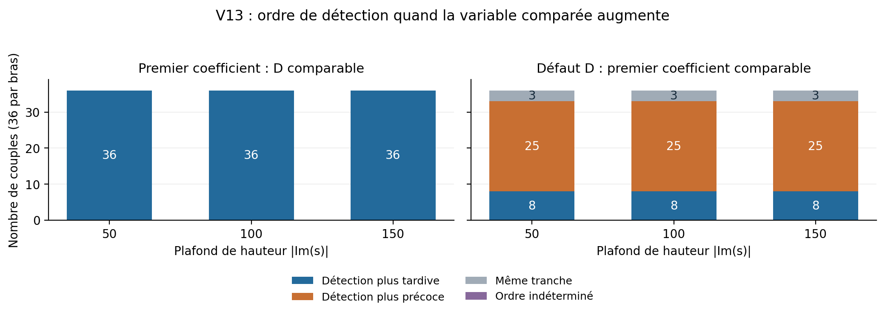
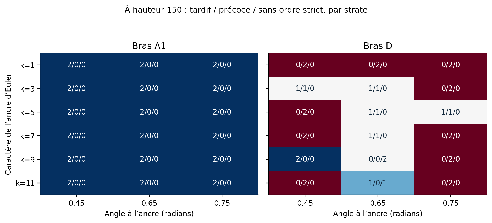

# V6.37 - Ancrage apparié V13

**Document 61.** Vincent P. P. NOËL. 12 octobre 2026.

## Le résultat et sa portée

La question du navigateur était précise : l'association avec le premier
coefficient persiste-t-elle quand on compare des points à la même distance
du même point d'Euler, et peut-on distinguer cette association du défaut
de multiplicativité ? L'expérience a été exécutée sur **72 couples fixés
avant le comptage**, soit 144 directions et six témoins d'Euler.

À hauteur 150, le bras A1 donne **36 couples avec une détection plus tardive**
quand le premier coefficient augmente, **0 avec une détection plus précoce**,
0 dans la même tranche et 0 d'ordre indéterminé. La prévision A1
**résiste au critère de signe fixé** dans ce dessin expérimental.

Le bras D donne 8 couples avec une détection plus tardive, 25 plus
précoce, 3 dans la même tranche et 0 indéterminés lorsque D augmente.
Cette tendance majoritairement précoce est hétérogène : elle ne valide pas
l'idée forte « D n'apporte aucun signal résiduel ». Les tableaux par ancre et
rayon restent nécessaires. Un taux agrégé ne constitue pas une causalité.

La grandeur comparée est la **première tranche de déficit numérique de comptage**.
Une racine complexe recoupée confirme une présence dans une tranche ; les
raffinements ne certifient pas l'absence de racines antérieures. Le transfert
à un mécanisme arithmétique imposant RH reste ouvert.



## 1. Définition des objets et du plan

V13 désigne ici l'espace impair modulo 13, de dimension six. Ses coordonnées
correspondent aux caractères primitifs d'indices 1, 3, 5, 7, 9 et 11. On conserve
l'équation fonctionnelle en formant, pour des coefficients réels,

\[
F_c(s)=\sum_i c_i e^{-i\phi_i}L(s,\chi_i),\qquad \|c\|_2=1,
\]

où les phases sont celles du module historique. Les axes \(e_i\) sont les points
d'Euler. En posant \(b_i=c_i e^{-i\phi_i}\), les deux covariables sont

\[
a_1=\left|\sum_i b_i\right|,\qquad
D=1+a_1^2-2\Re\!\left[\left(\sum_i b_i\right)
\left(\sum_i |b_i|^2\overline{b_i}\right)\right].
\]

D contient a1 dans sa définition : leur relation n'est pas une découverte
statistique. Le plan cherche une variation conditionnelle locale.

Chaque candidat s'écrit \(c=\cos(r)e_i+\sin(r)u\), avec \(u\perp e_i\) et
\(\|u\|=1\). Les angles fixés sont 0,45, 0,65 et 0,75 radian, tous inférieurs
à \(\pi/4\). L'ancre la plus proche est donc unique et la distance projective
\(\arccos(\max_j|c_j|)\) vaut exactement r. Ce r est un angle, pas son sinus.

| Bras | Variable qui varie | Variable rapprochée | Écart minimal | Tolérance de rapprochement |
|---|---|---|---:|---:|
| A1 | Premier coefficient a1 | D | 0,20 | 0,04 |
| D | Défaut D | a1 | 0,25 | 0,03 |

Pour chaque ancre et rayon, 512 candidats sont produits par une graine
déterministe (6371301, ancre, indice du rayon), sans utiliser de valeur de
fonction L ou de zéro. Deux couples de chaque bras sont choisis en maximisant
le contraste sous les tolérances annoncées. Aucun candidat n'est réutilisé.
Les **36 strates sont faisables** ; aucun seuil n'a été relâché après résultat.
Le ciblage de grands contrastes interdit d'interpréter ces 72 couples comme
un échantillon uniforme de tout V13.

## 2. Prévisions et comptage

La prévision conserve les six témoins d'Euler, les contours raffinés et les
non-détections. Pour A1, le critère de signe fixé était : davantage d'ordres
stricts tardifs que précoces quand a1 augmente. Pour D, la prévision était
l'absence de direction uniforme entre ancres et rayons. Aucun seuil n'a été
choisi après consultation des hauteurs ; aucun test statistique confirmatoire
sur une population n'est revendiqué.

Le plafond est 150, avec bilans prévus à 50 et 100. Le bord droit a été choisi
avant comptage par \(a_1>\sqrt6(\zeta(\sigma_R)-1)\) : \(\sigma_R=9\).
Cette domination exclut les zéros au bord droit et au-delà dans le modèle
exact. La symétrie fonctionnelle fournit le bord opposé. Les bords horizontaux
sont contrôlés numériquement.

Le total provient du contour de la fonction complétée ; le compte critique
provient des changements de signe de Hardy. La différence des deux est
reprise à plusieurs pas. Les marges de bord enregistrées sont **des minima
échantillonnés**, sans majorant de variation entre les nœuds.

| Pas vertical | Pas horizontal initial | Lignes horizontales non résolues | Résidu maximal à l'entier | Raffinements |
|---:|---:|---:|---:|---:|
| 0.02 | 0.050 | 0 | 1.20e-10 | 5997 |
| 0.01 | 0.025 | 0 | 1.19e-10 | 3044 |

La droite critique est aussi reprise au pas 0,005. Sur tous les niveaux et
toutes les directions : 0 totaux modifiés, 0 comptes
critiques modifiés au premier raffinement et 0 au troisième pas.
**150/150 directions sont admissibles** selon les contrôles de
stabilité, de parité, de monotonie et de marges de bord échantillonnées.
Les six témoins d'Euler : aucune détection hors droite sous le plafond. Cela décrit cette fenêtre numérique.

Deux racines très proches, un zéro double ou un zéro exactement sur un nœud
peuvent échapper aux changements de signe. De petits sauts de phase et un
résidu proche d'un entier ne certifient pas la variation continue d'argument.
C'est pourquoi le déficit est qualifié de numérique et des racines
représentatives sont recherchées avec un second évaluateur à 50 chiffres.

## 3. Résultats avec les non-détections conservées

Pour une première détection au niveau k, l'instrument donne la tranche
\((k-1,k]\). Deux tranches ordonnées donnent un signe ; une même tranche ne
signifie pas des ordonnées égales. Une détection et une non-détection peuvent
ordonner l'instrument ; deux non-détections ne donnent aucun ordre. Les cas
non résolus restent séparés. Aucune hauteur 151 n'est imputée aux censures.

| Plafond | Bras | Plus tardive | Plus précoce | Même tranche | Indéterminé |
|---:|---|---:|---:|---:|---:|
| 50 | A1 | 36 | 0 | 0 | 0 |
| 50 | D | 8 | 25 | 3 | 0 |
| 100 | A1 | 36 | 0 | 0 | 0 |
| 100 | D | 8 | 25 | 3 | 0 |
| 150 | A1 | 36 | 0 | 0 | 0 |
| 150 | D | 8 | 25 | 3 | 0 |

Les dénominateurs doivent rester visibles : **36 couples par bras**.
À 150, 5 directions non Euler n'ont pas de déficit détecté.
La proportion sur les seuls couples ordonnables ne décrit pas à elle seule
les autres couples. Le JSON conserve les bornes descriptives obtenues en
laissant inconnus les ordres des tranches égales ou indéterminées.

Dans le bras A1, les contrastes sélectionnés sont grands : a1 bas entre
0.0097 et 0.3536, a1 haut entre 1.1728 et 1.4858.
Le résultat 36/36 ne mesure donc pas la réponse à une petite variation d'a1.

Pour D, les 25 signes précoces sur 33 ordonnables représentent 75,76 %.
La tendance est majoritaire aux trois rayons et dans cinq des six ancres,
mais certaines strates ont des signes opposés. **La non-uniformité prévue
est constatée au sens faible ; une absence de tendance D n'est pas validée.**

Un diagnostic calculé après les résultats examine le petit écart d'a1 restant
dans les couples D. Dans **17 des 25 couples précoces**, le membre à
D plus grand possède aussi a1 plus grand. Une simple baisse résiduelle d'a1
n'explique donc pas à elle seule tous ces signes. Ce contrôle exploratoire
ne démontre pas que D cause la différence : les autres coefficients changent
et aucune borne de sensibilité aux tolérances n'a été démontrée.



Les ancres conjuguées échangent les indices \(k\leftrightarrow12-k\) et les
signes des ordonnées. Une copie conjuguée ne serait pas une réplication
indépendante. Les candidats des six strates sont différents, mais cette
symétrie interdit de compter six mécanismes arithmétiques sans justification.

## 4. Recoupement des racines et lecture critique

Le plan fixait le premier couple de chaque bras et ancre au rayon médian
0,65 : 24 jobs possibles. Chaque membre reste enregistré, même si la grille
ne détecte rien, si elle est ambiguë ou si la localisation échoue.

Les caractères et les phases sont reconstruits à 50 chiffres ; une table
périodique agrégée fournit une évaluation indépendante par mpmath. Le
recoupement vérifie la tranche, la séparation de la droite, le résidu et
le partenaire \(1-\overline{s}\). Le détail complet est conservé en JSON.

**Bilan des recoupements :** 24 recherches prévues, 24 racines recoupées à 50 chiffres avec leurs partenaires. Écart maximal entre évaluateurs : 2.23e-12. Aucun certificat d'erreur sur 50 décimales n'est revendiqué..

La lecture constructive propose que l'ancrage du premier coefficient
conserve une association après contrôle des covariables. La lecture critique
souligne le lien algébrique de D avec a1, les tolérances résiduelles, le ciblage
des contrastes et la fiabilité finie du compteur. La synthèse retient le
résultat des couples, sans le transformer en explication causale ni en théorème
global sur les zéros. Les preuves de jets de Hasse des versions précédentes
ne fournissent pas, à elles seules, le mécanisme manquant pour les entiers.

## 5. Suite décidée d'après le résultat

L'orthogonalité des caractères donne une explication plausible du contraste
de taille : pour les coefficients périodiques a(r) de F,

\[
\frac1{12}\sum_{r=1}^{12}|a(r)|^2=1.
\]

Après normalisation par le premier coefficient complexe, cette énergie
devient \(1/|a(1)|^2\). Un petit premier coefficient rend donc la queue
relativement grande. Cette identité ne suffit pas à expliquer la première
hauteur : elle contrôle une énergie de coefficients, pas l'emplacement
de toutes les annulations complexes.

La prochaine question prioritaire est de comparer D en fixant **exactement
le premier coefficient complexe a(1)**, l'ancre et le rayon, au lieu de
rapprocher seulement son module. Cela contrôle aussi la phase. On peut
imposer \(u_i=0\) et \(\sum_j u_j e^{-i\phi_j}=0\) dans le plan de candidats
\(c=\cos(r)e_i+\sin(r)u\). Ces trois contraintes linéaires réelles laissent
un noyau de dimension au moins trois ; les vecteurs unitaires de ce noyau
forment génériquement une sphère de dimension deux. Alors
\(a(1)=\cos(r)e^{-i\phi_i}\) est constant dans la strate, et D peut être
comparé selon sa variation effective, à vérifier sans consulter les zéros.

La précision, les règles de sélection et les critères devront être fixés
dans un nouveau protocole avant comptage. Cela testera la persistance du
signal D ; cela ne produira toujours pas une attribution causale, car les
autres composantes continuent de varier.

La domination du premier terme fournit déjà un contrôle de la partie réelle
où les zéros ne peuvent se trouver. Elle ne donne pas directement une borne
sur la première hauteur imaginaire. Relier ce contrôle aux collisions de
Hardy et à leurs dérivées reste une question analytique distincte. Une extension
de fenêtre doit conserver les couples et fixer ses paramètres avant calcul.

Une étude numérique supplémentaire ne remplace pas le lemme arithmétique
recherché : espace auxiliaire indépendant des zéros, baisse structurelle de
rang et contrôle de croissance. Aucun nouvel article affirmant un résultat
général n'est justifié par ces couples seuls. Les trois articles corrigés
de V6.36 restent dans le corpus ; ce document ajoute une expérience
reproductible et sa relecture.

## Reproduction et provenance

Depuis `3_Preuves_et_calculs`, le protocole et la sélection figés accompagnent
les données. `--run` vérifie leurs empreintes avant tout calcul.

```bash
python scripts/run_v637_apparie.py --run
python scripts/run_v637_apparie.py --postchecks
python scripts/run_v637_root_crosscheck.py
python scripts/build_v637_document.py
python tests/run_all_tests.py
```

Les caches volumineux sont facultatifs et reconstruits au besoin. Les fichiers
CSV donnent les résultats par direction ; le NPZ conserve tous les comptages
aux trois pas ; le JSON contient chaque comparaison et chaque strate. La
prévision d'origine est conservée avec ses octets et son empreinte. Le mémo
de relecture explicite les contrôles recommandés et ceux effectivement réalisés.

Empreinte SHA-256 du manifeste (octets sauvegardés) :

`685ddfe024480de8d0fc47364d998fa58de058082207efb32b61f4f05ee7fcbb`

## Annexe : tous les signes par strate à hauteur 150

| Bras | Indice de l'ancre | Angle | Tardif | Précoce | Sans ordre strict |
|---|---:|---:|---:|---:|---:|
| A1 | 1 | 0.45 | 2 | 0 | 0 |
| D | 1 | 0.45 | 0 | 2 | 0 |
| A1 | 1 | 0.65 | 2 | 0 | 0 |
| D | 1 | 0.65 | 0 | 2 | 0 |
| A1 | 1 | 0.75 | 2 | 0 | 0 |
| D | 1 | 0.75 | 0 | 2 | 0 |
| A1 | 3 | 0.45 | 2 | 0 | 0 |
| D | 3 | 0.45 | 1 | 1 | 0 |
| A1 | 3 | 0.65 | 2 | 0 | 0 |
| D | 3 | 0.65 | 1 | 1 | 0 |
| A1 | 3 | 0.75 | 2 | 0 | 0 |
| D | 3 | 0.75 | 0 | 2 | 0 |
| A1 | 5 | 0.45 | 2 | 0 | 0 |
| D | 5 | 0.45 | 0 | 2 | 0 |
| A1 | 5 | 0.65 | 2 | 0 | 0 |
| D | 5 | 0.65 | 1 | 1 | 0 |
| A1 | 5 | 0.75 | 2 | 0 | 0 |
| D | 5 | 0.75 | 1 | 1 | 0 |
| A1 | 7 | 0.45 | 2 | 0 | 0 |
| D | 7 | 0.45 | 0 | 2 | 0 |
| A1 | 7 | 0.65 | 2 | 0 | 0 |
| D | 7 | 0.65 | 1 | 1 | 0 |
| A1 | 7 | 0.75 | 2 | 0 | 0 |
| D | 7 | 0.75 | 0 | 2 | 0 |
| A1 | 9 | 0.45 | 2 | 0 | 0 |
| D | 9 | 0.45 | 2 | 0 | 0 |
| A1 | 9 | 0.65 | 2 | 0 | 0 |
| D | 9 | 0.65 | 0 | 0 | 2 |
| A1 | 9 | 0.75 | 2 | 0 | 0 |
| D | 9 | 0.75 | 0 | 2 | 0 |
| A1 | 11 | 0.45 | 2 | 0 | 0 |
| D | 11 | 0.45 | 0 | 2 | 0 |
| A1 | 11 | 0.65 | 2 | 0 | 0 |
| D | 11 | 0.65 | 1 | 0 | 1 |
| A1 | 11 | 0.75 | 2 | 0 | 0 |
| D | 11 | 0.75 | 0 | 2 | 0 |
