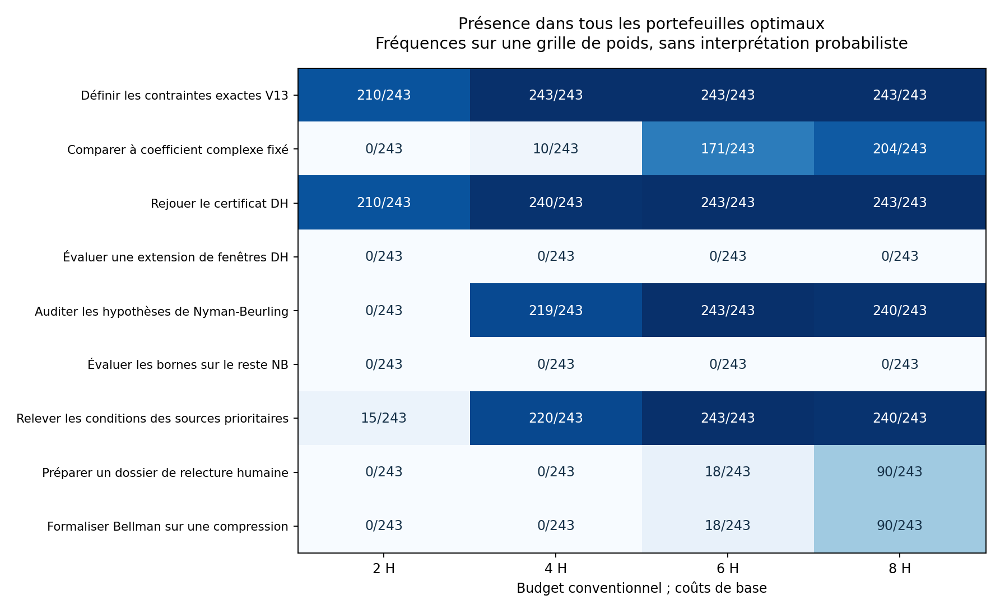

# V6.38 - Atlas des décisions et équations de Bellman

**Document 62. Vincent P. P. NOËL. 12 octobre 2026.**

Type : atlas de recherche, audit documentaire et modèle de planification reproductible. Ce document ne constitue ni un nouvel article prouvant RH, ni une expertise externe de toutes les preuves du corpus.

## 1. État final recherché

La reprise vise un corpus dans lequel une prochaine décision peut être justifiée : acquis, hypothèses, réfutations, questions ouvertes, dépendances et contrôles sont traçables. Son état final documentaire est un atlas relié aux sources et un modèle explicite comparant des suites de livrables. L’état final mathématique reste distinct : construire un mécanisme arithmétique qui impose la positivité pertinente pour ζ sur toute la classe requise, puis établir son implication vers RH.

Le registre couvre les 61 documents de présentation de la base V6.37, les étapes historiques de l’indicateur et des annexes de preuve/relecture sélectionnées. Un inventaire séparé recense tous les fichiers. Cette couverture documentaire ne signifie pas que chaque preuve, chaque ligne de code ou chaque citation externe a reçu une nouvelle validation indépendante. Les trois articles sont situés à travers leurs documents de présentation et les annexes lues.

Les anciennes synthèses 01, 06 et 07 restent des vues historiques. Les demandes de relecture 04 et 05 sont des brouillons : aucun envoi ni avis de spécialiste n’est attesté. Les documents historiques gardent leur portée d’origine ; leurs correctifs sont exposés séparément.

## 2. Ce que la reprise change

| Point | Lecture actuelle |
|:--|:--|
| Énergie Q | Quantité quadratique non négative ; pour ζ, le demi-exposant normalisé vaut Θ−1/2 dans le Théorème A. L’exposant de Q est 2Θ−1. Une fenêtre n’atteint pas automatiquement le supremum global. |
| Positivité de ζ | Observations dans des compressions et seuils testés ; aucune positivité globale obtenue par le corpus. |
| DH, document 60 | Certificat d’au moins 25 directions négatives dans une fenêtre fixée, sous le modèle d’erreur explicité ; compte exact ouvert. |
| V13, document 61 | 72 couples préfixés ; A1 :36/36 détections tardives ; D :25 précoces,8 tardives,3 mêmes tranches. Association descriptive, sans causalité ni certificat d’absence antérieure. |
| Relief T* | Déficit relatif persistant, pas hauteur absolue de la première sortie. |
| Générateur D | Reconstruction exponentielle ne garantit pas un logarithme unique : choix de branche nécessaire. |
| Maillons ouverts | Compte de catégories, sans distance chiffrée à RH ni nombre garanti d’étapes. |

Les prévisions avant calcul sont conservées. Une thèse ancienne et son bilan sont deux objets différents : le champ « fait » atteste l’exécution d’un travail, pas la vérité de sa thèse.

## 3. Thèse, antithèse et synthèse

**Thèse constructive.** Bellman relie une action à ce qu’elle ouvre ensuite. Reproduire un certificat, établir l’impossibilité d’un appariement ou invalider une prévision peut avoir une utilité de recherche. Le registre doit créditer les acquis nouveaux, et non un simple changement de présentation.

**Antithèse critique.** Le corpus contient surtout la trajectoire effectivement suivie. Les résultats des alternatives non choisies ne sont pas connus. Les récompenses, les coûts et le découpage des actions restent des conventions ; le passé relu après connaissance du résultat n’est pas un préenregistrement. L’état réel de la recherche n’est pas établi comme markovien.

**Synthèse.** Nous construisons une planification documentaire finie et conditionnelle, avec ses limites visibles. Son optimalité se démontre et se contrôle exactement dans le modèle ; elle ne démontre pas l’optimalité scientifique réelle de la stratégie.

## 4. États, unités et deux écritures de Bellman

L’état est (D,b) : ensemble des actions déjà achevées et budget restant. Une action n’est admissible que si ses prérequis sont achevés. Chaque action coûte un nombre entier strictement positif de H, unité conventionnelle de travail ; H n’est pas une heure mesurée. Chaque token représente un livrable documentaire vérifiable, y compris un rapport concluant à un obstacle. La catégorie « certification » évalue un dossier de contrôle ; elle ne promet pas un nouveau théorème.

\[ U(D)=\sum_{k\in\cup_{a\in D}K(a)}w_{j(k)},\qquad [U]=\mathsf U,\quad[b]=[c]=\mathsf H. \]

Les cinq critères sont discrimination, certification, reproduction, articulation et transmission. Les coefficients numériques des profils sont 1, 2 ou 3 ; un poids dimensionné est ce coefficient multiplié par l’unité U par token. Un même token partagé n’est compté qu’une fois. Cette homogénéité ne transforme pas l’utilité en énergie physique, et n’identifie pas U à Q.

\[V(D,b)=\max\{U(D),\max_{a\text{ admissible}}V(D\cup\{a\},b-c(a))\}.\]

La première possibilité est STOP. V comprend les acquis et V(D,0)=U(D). Pour la valeur des gains nouveaux W=V−U, on a W(D,0)=0 et la récompense immédiate est U(D union {a})−U(D). Cette différence empêche le double comptage. Les coûts positifs et les actions uniques rendent l’horizon fini : aucun facteur γ inférieur à 1 n’est nécessaire. La preuve complète figure dans l’annexe des lemmes.

Une efficacité documentaire peut être définie par ΔU/ΔH, avec unité U/H. Elle demeure un rapport conventionnel de planification ; aucune puissance physique ni propriété arithmétique nouvelle n’en résulte.

## 5. Neuf actions explicites, avec achèvement conditionnel

| Action | Coût H et prérequis | Livrable |
|:--|:--|:--|
| Définir les contraintes exactes V13 | 1 ; aucun | Noyau exact des contraintes et faisabilité ; conclusion négative admissible. |
| Comparer à coefficient complexe fixé | 2 ; Définir les contraintes exactes V13 | Rapport de comparaison conditionnelle si faisable, ou conclusion explicite d’impossibilité avec fermeture de la branche ; aucun couple ni effet promis. |
| Rejouer le certificat DH | 1 ; aucun | Reproduction et budget d’erreur du témoin existant ; résultat de contrôle documenté. |
| Évaluer une extension de fenêtres DH | 3 ; Rejouer le certificat DH | Dossier d’extension avec contrôle ou obstacle explicite ; négativité supplémentaire non promise. |
| Auditer les hypothèses de Nyman-Beurling | 1 ; aucun | Séparer les conditions sur beta et le reste T ; pas de convergence acquise. |
| Évaluer les bornes sur le reste NB | 3 ; Auditer les hypothèses de Nyman-Beurling | Tentative bornée, hypothèses et obstacles consignés ; borne suffisante non promise. |
| Relever les conditions des sources prioritaires | 1 ; aucun | Notice des hypothèses réellement contrôlées et des accès encore manquants. |
| Préparer un dossier de relecture humaine | 2 ; Relever les conditions des sources prioritaires | Dossier prêt, sans envoi ni relecture externe prétendue. |
| Formaliser Bellman sur une compression | 2 ; aucun | État, récursion variationnelle et limite de portée ; aucune conséquence RH présupposée. |

La sélection de ces neuf actions n’est pas justifiée par Bellman lui-même. Elle découle des questions ouvertes identifiées dans le corpus. Les tokens et les coûts favorisent ici des dossiers préparatoires bon marché : leur présence dans un optimum ne constitue pas une découverte autonome de leur supériorité scientifique. Si les contraintes V13 sont impossibles, la suite est un rapport de fermeture de branche, pas une expérience fictivement réalisée.

## 6. Calcul exécuté et sensibilité

La prévision informatique a été enregistrée avant l’exécution. La programmation dynamique est comparée à une énumération indépendante des sous-ensembles réalisables : les 972 configurations passent, soit 4 budgets et 243 profils de poids. La lecture critique a aussi recoupé les valeurs, tous les portefeuilles et tous les premiers choix avec sa propre reconstruction. Il n’y a ni probabilités de transition apprises, ni taux de réussite scientifique estimé.

| Budget | Portefeuille à poids égaux | Valeur U |
|:--|:--|:--|
| 2 H | DH rejeu + V13 contraintes | 6 |
| 4 H | DH rejeu + NB audit + Sources + V13 contraintes | 10 |
| 6 H | DH rejeu + NB audit + Sources + V13 comparaison + V13 contraintes | 12 |
| 8 H | Bellman spectral + DH rejeu + NB audit + Sources + V13 comparaison + V13 contraintes OU DH rejeu + Dossier humain + NB audit + Sources + V13 comparaison + V13 contraintes | 13 |

Un portefeuille n’impose pas un ordre unique. Dans ce modèle à utilité terminale, plusieurs actions préparatoires peuvent être des premiers choix optimaux du même portefeuille. Tous les ex aequo sont conservés.

À budget 4, les contraintes V13 appartiennent à tous les portefeuilles optimaux pour les 243 profils testés, sans imposer qu’elles soient réalisées en premier. À budget 6, contraintes V13, rejeu DH, audit NB et sources appartiennent à tous les portefeuilles optimaux sur cette grille. Ce constat vaut pour les coûts de base et les poids 1, 2, 3 ; il ne vaut pas pour tous les coûts ou tous les poids possibles.

Trois scénarios de coûts illustrent cette limite : comparaison V13 coût 1, extension DH coût 1, et contraintes V13 coût 2. À budget 2 et poids égaux, doubler le coût des contraintes V13 remplace le couple contraintes V13 + rejeu DH par rejeu DH + audit NB OU rejeu DH + sources. Les coûts doivent donc être confrontés à du travail effectivement mesuré avant usage prescriptif fort.

## 7. Un pont mathématique précis, encore local

Pour une matrice hermitienne G sur un espace muni d’un produit scalaire positif fixé, on peut organiser la minimisation de la trace sur un repère orthonormé par Bellman :

\[ B_k(W)=\min_{\substack{v\in W\\\|v\|=1}}[\langle v,Gv\rangle+B_{k-1}(W\cap v^\perp)],\quad B_0(W)=0.\]

Le résultat est la somme des k plus petites valeurs propres du comprimé. La preuve par décomposition dans une base propre est donnée dans l’annexe. C’est une réécriture variationnelle classique, distincte du modèle documentaire ; elle ne fournit pas à elle seule une nouvelle borne.

Une trace négative ne prouve pas k directions négatives : diag(−100,1) a une trace négative et une seule direction négative. Le certificat V6.36 contrôle une compression strictement négative de dimension 25, termes croisés et erreurs compris. Une contraction artificielle ou un optimum de trace ne remplace pas ce contrôle, ni une preuve de positivité générale pour ζ.

## 8. Priorité proposée et critères d’arrêt

La recommandation opérationnelle est de préciser les contraintes V13 exactes avant de relancer un comptage : même ancre, même rayon, même coefficient complexe et sa phase. Si le noyau admissible ne permet aucune variation de D, l’expérience doit être close dans cette strate. Si des couples existent, ils doivent être figés avant le calcul, avec contours, raffinements et traitement explicite des non-détections. Cette recommandation s’appuie sur la question ouverte de V6.37, pas sur un premier choix unique imposé par Bellman.

En parallèle, le rejeu du témoin DH, l’audit des conditions NB et des sources prioritaires sont des contrôles séparés. Une extension DH exige un nouveau budget d’erreur ; un calcul spectral favorable ne suffit pas. Une borne NB doit contrôler les termes effectivement requis ; la tendance numérique de beta ne suffit pas.

L’atlas est achevé quand les 61 documents sont reliés aux sources, les décisions passées séparées de leur interprétation, les scénarios reproductibles et les pages actives synchronisées. Le protocole mathématique reste ouvert après cet achèvement documentaire.

## 9. Annexes reproductibles et source historique

- Registre complet : ../3_Preuves_et_calculs/data/v638_decisions.json.
- Inventaire exhaustif : ../3_Preuves_et_calculs/data/v638_inventaire.json.
- Modèle et résultats : ../3_Preuves_et_calculs/data/v638_modele_bellman.json et v638_bellman_resultats.json.
- Deux lectures : ../3_Preuves_et_calculs/preuves/LECTURE_CONSTRUCTIVE_BELLMAN_V638.md et LECTURE_CRITIQUE_BELLMAN_V638.md.
- Preuves : ../3_Preuves_et_calculs/preuves/LEMMES_BELLMAN_V638.md.
- Reproduction : python 3_Preuves_et_calculs/scripts/run_v638_bellman.py ; python 2_Methode/Outils/build_v638_atlas.py ; python 3_Preuves_et_calculs/tests/run_all_tests.py.

Source historique [Bel53] : R. Bellman, Some Functional Equations in the Theory of Dynamic Programming, PNAS39 (1953),1077-1082, DOI10.1073/pnas.39.10.1077 ; https://pubmed.ncbi.nlm.nih.gov/16589377/. Notice primaire vérifiée ; texte intégral non audité. Les deux lemmes de cette reprise sont entièrement démontrés dans l’annexe.

## 10. Répertoire des 61 documents de la base V6.37

Les notices suivantes sont une synthèse courte. Les champs complets, alternatives documentées, sections sources, correctifs et limites se trouvent dans l’atlas interactif et le registre JSON.

### 01. Programme Riemann — Synthèse

**Question.** Quel socle présenter à un lecteur nouveau ?

**Bilan.** A reformule RH, B est conditionnel et B′ porte sur la simplicité sous RH ; mesures et hypothèses sont séparées.

**Statut et portée.** synthese historique ; Vue historique V6.24 ; aucune expertise externe attestée.

Source : [document 01](../1_Presentation/01_SYNTHESE_FR.md).

### 02. A mean-square energy attached to the von Mangoldt double convolution: an exact criterion for the rightmost zero, an asymptotic under RH, and negative calibration results

**Question.** Comment présenter les résultats analytiques en anglais ?

**Bilan.** A et B sont exposés ; les termes inférieurs requièrent H1–H3⋆ ; aucun gain de densité ou positivité nouvelle.

**Statut et portée.** brouillon editorial ; Brouillon ancien ; les articles LaTeX révisés sont les textes actuels. Plusieurs références restent à vérifier.

Source : [document 02](../1_Presentation/02_Article_court_EN.docx).

### 03. Referee dossier: Theorems A and B

**Question.** Quels passages un spécialiste doit-il vérifier ?

**Bilan.** Une demande de relecture précise est préparée, sans réponse externe dans le document.

**Statut et portée.** brouillon editorial ; Préparation du dossier et expertise reçue sont distinctes ; version V4.5 complétée ensuite.

Source : [document 03](../1_Presentation/03_Dossier_de_relecture_EN.docx).

### 04. Brief for specialists (v5.1) — one page

**Question.** Comment résumer le résultat et les questions utiles ?

**Bilan.** Quatre questions portent sur antériorité, petits écarts, preuves et extensions.

**Statut et portée.** brouillon editorial ; Aucun envoi ni verdict spécialisé attesté ; références 2026 alors vues en résumé.

Source : [document 04](../1_Presentation/04_Brief_specialistes_EN.docx).

### 05. Message au relecteur / Message to the reviewer

**Question.** Comment demander une vérification sans revendiquer RH ?

**Bilan.** Projet de demande de vérification ; aucun résultat ni expertise nouvelle.

**Statut et portée.** brouillon editorial ; Brouillon, jamais assimilé à un message envoyé ; le verdict d’un lecteur reste lui-même discutable scientifiquement.

Source : [document 05](../1_Presentation/05_Message_au_relecteur.docx).

### 06. D'où viennent les intuitions : le cheminement intellectuel du programme Riemann

**Question.** Quelle logique relie les transitions ?

**Bilan.** Récit d’intuitions, tests, erreurs et décisions jusqu’à V6.24 ; origines non précisées signalées.

**Statut et portée.** synthese historique ; Récit rétrospectif, explicitement pas une interview ; état historique V6.24.

Source : [document 06](../1_Presentation/06_CHEMINEMENT_INTELLECTUEL.md).

### 07. Guide de lecture intuitif

**Question.** Comment guider une lecture non spécialisée ?

**Bilan.** Un parcours du signal à la métrique et à la fonction auxiliaire est présenté ; aucun résultat nouveau.

**Statut et portée.** synthese historique ; Vue V6.24 ; explications de hauteur finie et certains rapprochements retestés ensuite.

Source : [document 07](../1_Presentation/07_GUIDE_DE_LECTURE_INTUITIF.md).

### 08. Dimension de l'énergie : nouvelle branche active (v5.2)

**Question.** Peut-on lire Θ comme dimension d’une mesure positive ?

**Bilan.** D_E=Θ, donc RH équivaut à D_E=1/2 ; demi-sommes de zéros dans le modèle fini.

**Statut et portée.** identite et reformulation ; La positivité de la mesure ne borne pas sa dimension ; les modèles finis restent diagnostics.

Source : [document 08](../1_Presentation/08_Dimension_energie_fractale.md).

### 09. Vos deux attaques : audit et version améliorée

**Question.** Apportent-elles une contrainte nouvelle ?

**Bilan.** Contractivité automatique et cible K borné de niveau RH ; gain fini de la famille μ,a sans limite prouvée.

**Statut et portée.** audit interne ; Plateaux N≤200 non asymptotiques ; la courbure utile en log n n’est pas propre à a.

Source : [document 09](../1_Presentation/09_Attaques_audit_et_amelioration.docx).

### 10. Attaque 2 jusqu'à N = 1000 : résultats

**Question.** Persiste-t-il jusqu’à 1000 ?

**Bilan.** Le plateau reste entre 1,22 et 1,36 fois κ/log N ; règle d’arrêt non déclenchée.

**Statut et portée.** mesure numerique ; N≤998 ; passage sous κ/log N compatible avec une borne asymptotique liminf.

Source : [document 10](../1_Presentation/10_Attaque2_resultats_N1000.docx).

### 11. Estimer sous RH : ce que dit l'heuristique, et ce qu'elle ne dit pas

**Question.** Le terme principal sous RH suffit-il à l’expliquer ?

**Bilan.** Le terme principal manque les petites tailles ; pente, courbure et coupure ont des effets préasymptotiques.

**Statut et portée.** mesure et heuristique ; Heuristique non démontrée ; les hypothèses précises de BCF restent nécessaires.

Source : [document 11](../1_Presentation/11_Estimation_sous_RH.docx).

### 12. Annulation du pôle : vérification, extension, et retour à Q

**Question.** La projection déplace-t-elle la difficulté de Q ?

**Bilan.** L’identité est exacte ; b_N et T_N restent observés, non prouvés asymptotiquement.

**Statut et portée.** identite et mesure ; Clôture historique trop forte ; les conclusions de limite sont corrigées ensuite.

Source : [document 12](../1_Presentation/12_Annulation_du_pole.docx).

### 13. La leçon de 2026 : où se trouvait le levier

**Question.** Quel levier ressort des travaux récents sur les proportions ?

**Bilan.** Rang–trace et inertie identifiés comme levier différent des sommes de carrés automatiques.

**Statut et portée.** lecture documentaire ; Articles 2026 non lus intégralement ; le jugement stratégique « plus de cible » n’est pas un théorème.

Source : [document 13](../1_Presentation/13_Lecon_2026.docx).

### 14. Programme Riemann — Version 6

**Question.** Comment chercher des mécanismes testables ?

**Bilan.** Quatre programmes exploratoires sont définis avec témoins et règles d’arrêt ; TOMO initialement prioritaire.

**Statut et portée.** plan recherche ; Un cadre ne prouve aucune hypothèse ; distinguer plan initial et mises à jour ultérieures.

Source : [document 14](../1_Presentation/14_Document_de_travail_V6_Atlas_mecanismes.md).

### 15. V6 — TOMO-DH : tomographie multiplicative inter-échelles

**Question.** Le bispectre révèle-t-il une fermeture multiplicative perdue ?

**Bilan.** TOMO2 ne voit que la puissance ; le pont brut TOMO3 n’est pas observé, puis est expliqué et fermé.

**Statut et portée.** plan et refutation ; TOMO2 n’est pas universel ; dans le canal t, la fermeture redonne Δ par tautologie.

Source : [document 15](../1_Presentation/15_TOMO_DH_formalisation.md).

### 16. V6 — DARK-ZETA : cartographie du secteur sombre arithmétique

**Question.** Comment tester une cause commune sans lui donner une ontologie ?

**Bilan.** Premier bispectre brut négatif ; le cadre multicanal est conservé.

**Statut et portée.** plan recherche ; Aucune entité sombre construite ; deux observables équivalents ne sont pas deux preuves indépendantes.

Source : [document 16](../1_Presentation/16_DARK_ZETA_secteur_sombre_arithmetique.md).

### 17. V6 — DARK-ZETA : premier détecteur construit et testé

**Question.** Le premier détecteur sépare-t-il multiplicativité et effet spectral ?

**Bilan.** TOMO2 est invariant aux phases ; TOMO3 reste proche de son nul et sa corrélation change avec l’échelle.

**Statut et portée.** mesure numerique ; La corrélation sur une trajectoire ne constitue pas une loi générale.

Source : [document 17](../1_Presentation/17_DARK_ZETA_premier_detecteur_resultats.md).

### 18. V6.2 — PRIME-LOCK : premier verrou local

**Question.** La log-dérivée rend-elle visible le verrou local ?

**Bilan.** ζ/L passent ; DH fuit massivement ; Steinhaus passe aussi : diagnostic d’Euler local seulement.

**Statut et portée.** mesure numerique ; Facteurs locaux de degré 1 seulement ; aucun lien de suffisance vers RH.

Source : [document 18](../1_Presentation/18_PRIME_LOCK_premier_verrou_local.md).

### 19. V6 — DUAL-LOCK : plan de verrouillage local / global

**Question.** Quel objet joint local et archimédien sans multiplier deux scores ?

**Bilan.** Le plan D0 est exécuté en V6.3 ; signes négatifs DH sans zéros injectés dans la construction.

**Statut et portée.** plan et experience ; La positivité complète est déjà équivalente à RH ; le plan initial et le résultat sont temporellement distincts.

Source : [document 19](../1_Presentation/19_DUAL_LOCK_plan_local_global.md).

### 20. V6 — Registre canonique des métaphores et mécanismes

**Question.** Comment conserver une métaphore avec une garde exacte ?

**Bilan.** Le registre documente les opérateurs et garde aussi les rejets/correctifs.

**Statut et portée.** outil methodologique ; Un nom ou une unité ne crée aucune propriété nouvelle.

Source : [document 20](../1_Presentation/20_Registre_metaphores_V6.md).

### 21. V6.3 — DUAL-LOCK et Résidu sombre : résultats du test local/global

**Question.** Le signe vient-il d’un résidu stable de cancellation ?

**Bilan.** Le signe principal survit ; amplitudes ordinaires et un second mode sont ensuite retirés ou corrigés.

**Statut et portée.** mesure corrigee ; Cancellation non universelle et non physique ; valeurs historiques remplacées dans l’audit suivant.

Source : [document 21](../1_Presentation/21_DUAL_LOCK_RESIDU_SOMBRE_resultats.md).

### 22. V6.3a — Audit de l'instrument DUAL-LOCK

**Question.** Le phénomène résiste-t-il à une métrique correcte ?

**Bilan.** Le signe principal tient ; le second mode à 176 est retiré ; magnitudes/facteurs ordinaires rétrogradés.

**Statut et portée.** audit interne ; Les recoupements ne sont pas des certificats en norme ; précision liée à κ(G).

Source : [document 22](../1_Presentation/22_AUDIT_V6_3A_INSTRUMENT_DUAL_LOCK.md).

### 23. V6.3b/c — Audit des conventions de la formule explicite (DUAL-LOCK)

**Question.** La compression est-elle bien celle de Weil ?

**Bilan.** Accord numérique ; directions DH expliquées par leurs zéros hors droite.

**Statut et portée.** audit interne ; Concordance ne borne pas l’erreur exacte ; le premier compte DH est corrigé ensuite.

Source : [document 23](../1_Presentation/23_AUDIT_V6_3B_FORMULE_EXPLICITE.md).

### 24. V6.3d/e/f — Ce que chaque instrument voit réellement

**Question.** Voient-ils une information indépendante de la configuration des zéros ?

**Bilan.** Quatre coins séparent Euler local et signe global ; TOMO3 brut clos ; deux zéros DH manquants retrouvés.

**Statut et portée.** audit et classification ; Témoins fabriqués, fenêtres finies ; largeur du creux heuristique ; pas de gain RH.

Source : [document 24](../1_Presentation/24_CLASSEMENT_DES_INSTRUMENTS_V6_3D.md).

### 25. ATLAS DES MÉTAPHORES

**Question.** Quel test concret les analogies physiques proposent-elles ?

**Bilan.** Seuil 1D proposé avant carte 2D et théorie ; entropie non canonique tenue en attente.

**Statut et portée.** plan recherche ; Une transition de matrice peut laisser les zéros fixes ; aucun mécanisme physique revendiqué.

Source : [document 25](../1_Presentation/25_Atlas_metaphores_physique_mathematique_V6.pdf).

### 26. V6.4 — Le seuil τ_c : exécution du test prioritaire de l'Atlas

**Question.** Ce seuil est-il intrinsèque aux fonctions ?

**Bilan.** Seuil reproductible mais dépendant de la compression ; aucun zéro ne bouge ; carte 2D translation exacte.

**Statut et portée.** refutation documentee ; Le résultat concerne les conditions de l’interpolation étudiée ; aucune transition physique.

Source : [document 26](../1_Presentation/26_SEUIL_TAU_C_TEST_DE_L_ATLAS.md).

### 27. V6.5 — Là où les zéros bougent : RH ne tient qu'au point d'Euler

**Question.** La famille modulo 7 à symétrie fixe protège-t-elle RH ?

**Bilan.** Plage finie de survie se resserre ; sorties par rencontres ; asymétrie observée.

**Statut et portée.** mesure numerique ; Une famille et T≤1000 ; l’asymétrie reste heuristique ; Euler ne prouve pas GRH.

Source : [document 27](../1_Presentation/27_FAMILLE_MODULO_7_POINT_D_EULER.md).

### 28. V6.6 — Le Modèle réduit : à quoi ressemble une nécessité démontrée

**Question.** À quoi ressemble une nécessité démontrée ?

**Bilan.** Positivité de courbes et violations des faux ; quatre traits de signature dégagés.

**Statut et portée.** modele et mesures ; Effectivité des faux vérifiée à degrés finis ; signature observée ne prouve pas une géométrie pour ζ.

Source : [document 28](../1_Presentation/28_MODELE_REDUIT_NECESSITE_DEMONTREE.md).

### 29. V6.7 — STABILITY-RADIUS : la marge de la forme et la marge de l'objet

**Question.** Quelle perturbation définit chaque marge ?

**Bilan.** Marge de forme nulle par rang ; marge d’objet positive ou nulle avec RH vraie.

**Statut et portée.** identites et mesures ; Normes et fenêtres changent les valeurs ; aucune positivité globale de ζ démontrée.

Source : [document 29](../1_Presentation/29_STABILITY_RADIUS_MARGE_DE_LA_FORME_ET_DE_L_OBJET.md).

### 30. V6.8 — L'Archipel d'Euler : parmi les fonctions qui ont l'équation fonctionnelle, RH n'existe qu'aux points d'Euler

**Question.** Une déformation de V_q peut-elle garder Euler ?

**Bilan.** Dans V_q, RH impose un point d’Euler ; rayons et sorties mesurés à hauteur finie.

**Statut et portée.** preuve et mesures ; Condition nécessaire ; réciproque GRH ouverte ; restriction à V_q et antériorité connue.

Source : [document 30](../1_Presentation/30_ARCHIPEL_D_EULER.md).

### 31. Indicateur d'avancement RH

**Question.** Comment documenter sa maturité sans confondre résolution ?

**Bilan.** Sept dimensions ; niveaux généraux stables depuis V6.18 ; expertise externe non atteinte.

**Statut et portée.** outil navigation ; L’échelle n’est pas une distance métrique à RH ; croisements partiellement attribués après coup.

Source : [document 31](../1_Presentation/31_INDICATEUR_D_AVANCEMENT.html).

### 32. V6.9 — Le chaînon : du Frobenius discret au flot continu

**Question.** Quel maillon passe du Frobenius au continu ?

**Bilan.** Opérateurs et symétries aussi pour les faux ; le Gram sépare dans les modèles observés.

**Statut et portée.** mesure et classiques ; F=q^D ne détermine D qu’après une branche ; reconstruction finie ne donne pas un opérateur limite positif.

Source : [document 32](../1_Presentation/32_LE_CHAINON_DU_DISCRET_AU_CONTINU.md).

### 33. V6.10 — Le générateur des premiers : l'opérateur de ζ reconstruit sans aucun zéro

**Question.** Peut-on reconstruire depuis les seuls coefficients ?

**Bilan.** Zéros connus retrouvés avec masses proches de 1 ; négativité DH et effets de pas/fenêtre mesurés.

**Statut et portée.** mesure numerique ; Tolérance de masse 1% et signes près des arrondis ; aucune positivité générale démontrée.

Source : [document 33](../1_Presentation/33_LE_GENERATEUR_DES_PREMIERS.md).

### 34. Navigateur de recherche RH

**Question.** Comment choisir un coup avec prérequis et témoins ?

**Bilan.** 63 coups en V6.37 ; le premier coefficient complexe fixé devient prioritaire.

**Statut et portée.** outil navigation ; Probabilités/coûts historiques subjectifs ; « fait » décrit la procédure ; maillons non distance à RH.

Source : [document 34](../1_Presentation/34_NAVIGATEUR_DE_RECHERCHE.html).

### 35. V6.11 — La base comme pas de temps

**Question.** Que conserve le changement de base ou de pas ?

**Bilan.** Métrique du modèle survit ; un pas grossier masque parfois la négativité DH.

**Statut et portée.** mesure et classiques ; F seul ne fixe pas D sans branche ; un flot canonique de ζ n’est pas construit.

Source : [document 35](../1_Presentation/35_LA_BASE_COMME_PAS_DE_TEMPS.md).

### 36. V6.12 — Relecture : les trois idées rejetées relues, et les priorités refaites

**Question.** Les outils nouveaux changent-ils leur verdict ?

**Bilan.** Détection principale DH ; masse d’un fantôme quasi nulle ; rayon reflète l’écart connu à la droite.

**Statut et portée.** mesure corrigee ; Demi-exposant normalisé de Q=Θ−1/2 ; exposant de Q=2Θ−1 ; quatre seuils sont corrigés ensuite.

Source : [document 36](../1_Presentation/36_LES_IDEES_REJETEES_RELUES.md).

### 37. V6.13 — Pré-relecture : les Théorèmes A et B et l'Archipel d'Euler

**Question.** Les dossiers résistent-ils à une pré-relecture et à l’antériorité ?

**Bilan.** Retouches appliquées ; pas de faille trouvée dans les contrôles ; Archipel connu ; B′ isolé.

**Statut et portée.** audit interne ; Agents IA sans expertise humaine ; nouveauté B/B′ non établie ; références exactes à vérifier.

Source : [document 37](../1_Presentation/37_PRE_RELECTURE_A_B_ARCHIPEL.md).

### 38. V6.14 — La loi de seuil : un quadruplet hors droite s'entend au temps de Heisenberg de sa hauteur

**Question.** Quelle fenêtre permet la détection hors droite ?

**Bilan.** Lemme exact ; loi mesurée proche du poids archimédien ; trois prévisions tenues et une réfutée.

**Statut et portée.** preuve et mesure ; Fonction test et quadruplets synthétiques limités ; pas de loi uniforme démontrée.

Source : [document 38](../1_Presentation/38_LA_LOI_DE_SEUIL_LE_TEMPS_DE_HEISENBERG.md).

### 39. V6.15 — Le degré 2 et le recensement : la loi de seuil avec Δ de Ramanujan [Ram16], et les quadruplets de DH comptés par les premiers

**Question.** La loi double-t-elle en degré 2 et le compte voit-il plus loin ?

**Bilan.** Seuil proche du double ; 50 directions mesurées au lieu des 30 prévues ; contributions hautes identifiées.

**Statut et portée.** mesure numerique ; Tolérance numérique ; pas un certificat exact ; l’instrument Δ est amélioré ensuite.

Source : [document 39](../1_Presentation/39_LE_DEGRE_2_ET_LE_RECENSEMENT.md).

### 40. V6.16 — La Rencontre à trois, et les croisements dans l'indicateur

**Question.** Peut-on les lire sur une même marge locale ?

**Bilan.** Identité 1−sinc²(πs) ; répulsion ; β lisse à 95%, seule sa part d’écart suit les paires serrées.

**Statut et portée.** identite et mesure ; Deux atomes ignorent les voisins ; plusieurs prévisions fausses ; lecture de la part d’écart après coup.

Source : [document 40](../1_Presentation/40_LA_RENCONTRE_A_TROIS.md).

### 41. V6.17 — La Rencontre en degré 2, et son pendant dans le Modèle réduit

**Question.** Les identités et distributions se transportent-elles ?

**Bilan.** Identités Vandermonde/Haar ; répulsion Δ ; familles mixtes ; collisions en extension compatibles avec RH.

**Statut et portée.** preuve et mesure ; Contrôle de Turing empirique dans le corpus ; petites marges rares ; tailles effectives basses hors domaine.

Source : [document 41](../1_Presentation/41_LA_RENCONTRE_EN_DEGRE_2.md).

### 42. Registre des sources

**Question.** Que vérifie chaque source et où sert-elle ?

**Bilan.** 163 fiches : 81 indiquées vérifiées en ligne, 67 partielles et 15 non vérifiées.

**Statut et portée.** outil documentaire ; Statuts hérités du corpus, pas revérification V6.38 des 163 sources ; résumé distinct de texte intégral.

Source : [document 42](../1_Presentation/42_REGISTRE_DES_SOURCES.md).

### 43. V6.19 — Plan de recherche : la Rencontre à n et la matrice des théories (adapté en V6.20 à V6.29)

**Question.** Quelle stratégie relie identité et question de recherche ?

**Bilan.** Identité élémentaire ; mesures ζ/ζL ; plan adapté après retours avec nouveaux axes.

**Statut et portée.** plan et resultats ; Plan vivant ; identité CUE ne démontre pas une loi globale des zéros.

Source : [document 43](../1_Presentation/43_PLAN_DE_RECHERCHE_LA_RENCONTRE_A_N.md).

### 44. Matrice des théories RH

**Question.** Quelles implications sont connues, retrouvées ou ouvertes ?

**Bilan.** Vue lue : 27 théories, 92 cases écrites, 284 déduites, 326 à compléter.

**Statut et portée.** outil documentaire ; Pas une expertise indépendante de chaque implication ; limites de classe/citations restent substantielles.

Source : [document 44](../1_Presentation/44_MATRICE_DES_THEORIES.html).

### 45. V6.20 — Le Palier 4/3 recalculé, et ce que le programme a retrouvé

**Question.** Le plateau est-il constant et les résultats retrouvés sont-ils nouveaux ?

**Bilan.** Médiane 1,313≈0,985×4/3 avec pics ; décomposition exacte ; 14 redécouvertes recensées.

**Statut et portée.** mesure et correction ; Médiane et pics finis ne prouvent ni limite ni non-convergence ; formulation encore corrigée en V6.36.

Source : [document 45](../1_Presentation/45_LE_PALIER_RECALCULE_ET_LES_REDECOUVERTES.md).

### 46. V6.21 — Axe J : la surface virtuelle

**Question.** Peut-il se lire comme intersection virtuelle ?

**Bilan.** Orthogonal aux fibres=−métrique ; 425 courbes et 220 faux contrastés ; signatures ζ/L/DH mesurées.

**Statut et portée.** identite et mesure ; Surface de ζ non construite ; signature finie ne l’impose pas ; dictionnaire connu.

Source : [document 46](../1_Presentation/46_LA_SURFACE_VIRTUELLE.md).

### 47. V6.22 — Axe J2 : le Riemann–Roch virtuel

**Question.** Quel énoncé indépendant de RH les exclut ?

**Bilan.** Clifford n’exclut aucun faux ; Stepanov 121/220 seul, 220/220 avec torsion.

**Statut et portée.** mesure et formulation ; Dualité agrégée ne reconstruit pas les espaces de sections ; transfert à ζ non établi.

Source : [document 47](../1_Presentation/47_LE_RIEMANN_ROCH_VIRTUEL.md).

### 48. V6.23 — Axe J5 : le Frobenius qui n'est pas un morphisme

**Question.** Quel rôle distingue Frobenius d’identité ou permutation ?

**Bilan.** Rang faible et noyaux pour Frobenius ; identité échoue ; permutation parfois coïncidences.

**Statut et portée.** mesure exacte ; Interprétation initiale trop forte ; tailles finies parfois bornes triviales ; mécanisme précisé ensuite.

Source : [document 48](../1_Presentation/48_LE_FROBENIUS_QUI_N_EST_PAS_UN_MORPHISME.md).

### 49. V6.24 — Analyse de risques, J3 simplifié, et « le même calcul » que les deux tiers

**Question.** Quel petit test décidera la suite ?

**Bilan.** x^p+x fonctionne ; propriété de l’espace décisive ; proportions numériques dépendent de la fenêtre.

**Statut et portée.** analyse et mesure ; Pas de nouvelle proportion inconditionnelle ; le calcul utilise les zéros connus.

Source : [document 49](../1_Presentation/49_ANALYSE_DE_RISQUES_J3_ET_LES_DEUX_TIERS.md).

### 50. V6.25 — Les unités fictives : audit du document reçu

**Question.** L’homogénéité ajoute-t-elle une contrainte ?

**Bilan.** Identités exactes par Abel ; lecture mécanique cohérente ; aucune contrainte nouvelle sur les zéros.

**Statut et portée.** audit interne ; Travail d’impulsion parfois négatif même avec énergie positive ; aucune physique de ζ établie.

Source : [document 50](../1_Presentation/50_LES_UNITES_FICTIVES_AUDIT.md).

### 51. V6.26 — J3b : le Frobenius de caractéristique un

**Question.** L’échelle de caractéristique 1 fournit-elle ce rôle ?

**Bilan.** Le modèle ne construit pas les jets requis ; points/valeurs distingués des endomorphismes du carré.

**Statut et portée.** lecture et limite ; Aucune impossibilité générale en caractéristique 1 ; sources ciblées et extraits, pas tout le programme.

Source : [document 51](../1_Presentation/51_J3B_LE_FROBENIUS_DE_CARACTERISTIQUE_UN.md).

### 52. V6.27 — J6 : le carré, en continu

**Question.** La signature résiste-t-elle aux paramètres ?

**Bilan.** Signes robustes sur grille fiable ; nombre DH dépend du réglage ; cas impair 25 observé.

**Statut et portée.** mesure numerique ; Grille non certifiée dans son ensemble ; accord des traces et signe au seuil sont distincts.

Source : [document 52](../1_Presentation/52_J6_LE_CARRE_EN_CONTINU.md).

### 53. V6.28 — Axe A : la Rencontre à n en hauteur

**Question.** Le prolongement réel est-il une densité ?

**Bilan.** Densités négatives, trois prévisions fausses ; trou à trois mesuré à basse hauteur.

**Statut et portée.** refutation documentee ; L’échec du prolongement ne réfute pas CUE à taille entière.

Source : [document 53](../1_Presentation/53_LA_RENCONTRE_EN_HAUTEUR.md).

### 54. V6.29 — Le trou à trois, lu ; les proportions de 2026 ; la matrice complétée

**Question.** Le CUE fini suffit-il dans son domaine ?

**Bilan.** CUE fini réduit le déficit sans expliquer son ampleur ; rigidité de forme observée ; identité rang–trace.

**Statut et portée.** lecture et mesure ; Sources partielles ; rigidité observée sans mécanisme démontré.

Source : [document 54](../1_Presentation/54_LE_TROU_A_TROIS_LU.md).

### 55. V6.30 — Les articles présentables

**Question.** Quels textes sont présentables à relecture ?

**Bilan.** Candidat analytique et note expérimentale ; seuil DH≥61 requalifié comme échantillonnage de grille.

**Statut et portée.** brouillon editorial ; Prépublication prête distincte d’acceptation ; références parfois encore de mémoire.

Source : [document 55](../1_Presentation/55_ARTICLES_PRESENTABLES.md).

### 56. V6.31 — Le relief de l'archipel : une seule vue 3D

**Question.** Un relief résume-t-il la persistance ?

**Bilan.** Critère initial échoue ; critère persistant choisi après coup ; col à 145 dans cette carte.

**Statut et portée.** exploration corrigee ; T* est déficit relatif persistant, pas première hauteur hors droite ; censures non imputées.

Source : [document 56](../1_Presentation/56_LE_RELIEF_DE_L_ARCHIPEL.md).

### 57. V6.33 — La force qui abaisse le relief : le défaut de multiplicativité, puis le premier coefficient

**Question.** Le défaut multiplicatif l’abaisse-t-il ?

**Bilan.** Trois prévisions fausses ; association avec a(1) trouvée après coup ; signal résiduel D à retester.

**Statut et portée.** exploration et refutation ; Corrélation non causale ; D contient a1 par algèbre ; le seuil T* est relatif.

Source : [document 57](../1_Presentation/57_LA_FORCE_DU_RELIEF.md).

### 58. V6.34 - Validation directe du relief et lemme des jets

**Question.** Que reste-t-il après validation directe et preuve ?

**Bilan.** L’identification universelle T*=première détection est réfutée ; association a1 reproduite ; prévision D résiduelle fausse ; borne O(√p) prouvée.

**Statut et portée.** preuve et mesures ; Comptages non certifiés ; aucune causalité ; jets sur corps premiers avec M

## Références

Format : [clé] auteurs, *titre*, publication, lien. Fiches complètes et état de vérification : document 42 (registre des sources).

- [Bel53] R. Bellman. *Some Functional Equations in the Theory of Dynamic Programming*. PNAS39(10),1077-1082 ; DOI10.1073/pnas.39.10.1077 (1953). <https://pubmed.ncbi.nlm.nih.gov/16589377/> — partiellement vérifié
- [Ram16] S. Ramanujan. *On certain arithmetical functions*. Trans. Cambridge Philos. Soc. 22 (1916), 159–184. <https://encyclopediaofmath.org/wiki/Ramanujan_function> — partiellement vérifié

<!-- references:fin -->
