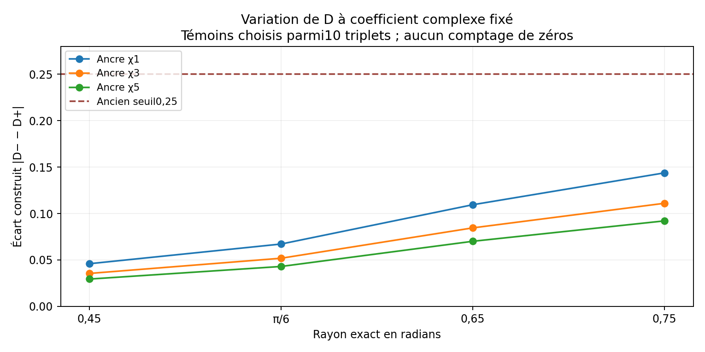

# V6.39 - Contraintes exactes V13 : comparaison faisable

**Document 63. Vincent P. P. NOËL. 12 octobre 2026.**

Type : note de preuve, témoins reproductibles et décision expérimentale. La source LaTeX accompagne le PDF.

## 1. La décision obtenue

**La comparaison est faisable.** Pour chacune des six ancres de V13 et pour tout angle 0<r<π/4, nous construisons deux fonctions ayant exactement le même coefficient complexe A=a(1), la même ancre et la même distance, mais des défauts de multiplicativité D différents.

Cela établit un point précis : dans cette famille construite, D n’est pas déterminé par le seul coefficient A, l’ancre et le rayon. C’est un résultat mathématique local qui rend une comparaison contrôlée possible. Il ne dit encore rien sur la hauteur des zéros ni sur une relation causale.

La valeur fixée est A=cos(r)z_i, avec z_i la phase du caractère de l’ancre. Nous ne démontrons pas la faisabilité pour tout A complexe arbitraire, notamment toutes les anciennes valeurs de V6.37. Le coefficient est constant à l’intérieur de chaque paire, pas entre les strates.

## 2. Le mécanisme, en quelques lignes

Les six caractères impairs modulo 13 forment trois paires conjuguées. Hors d’une ancre, deux paires restent disponibles. On combine leurs coordonnées pour obtenir une direction u qui vérifie exactement u_i=0, norme(u)=1 et somme_j u_j z_j=0.

\[c_\pm=\cos(r)e_i\pm\sin(r)u.\]

Ces deux directions opposées conservent donc A=cos(r)z_i. Leurs autres coefficients changent : une attribution causale à D seul n’est pas acquise. L’ancre est unique parce que cos(r)>sin(r).

\[ D(c_\pm)=D_0(r)\mp2\cos(r)\sin^3(r)P_i(u),\qquad D_0(r)=1+\cos^2r-2\cos^4r.\]

Le coefficient cubique P_i est démontré non nul. L’écart absolu vaut 4cos(r)sin³(r)|P_i|>0. La non-annulation est certifiée par des inégalités rationnelles sur des sommes finies de Gauss, sans consulter de zéro et sans dépendre des fonctions transcendantes flottantes de mpmath.

## 3. Un exemple lisible, entièrement défini

À rayon r=π/6, on a cos(r)=√3/2, sin(r)=1/2 et D0=5/8 exactement. Les phases et les directions par mineurs sont algébriques, donc les deux vecteurs de coefficients de cet exemple le sont aussi. Les décimales ci-dessous servent à lire le résultat ; la définition exacte est conservée dans les recettes et l’annexe.

| Ancre | D bas, encadrement | D haut, encadrement | Écart, encadrement |
|:--|:--|:--|:--|
| χ1 | [0.591416952844; 0.591416952845] | [0.658583047155; 0.658583047156] | [0.067166094310; 0.067166094311] |
| χ3 | [0.599063937370; 0.599063937371] | [0.650936062629; 0.650936062630] | [0.051872125258; 0.051872125259] |
| χ5 | [0.603492116627; 0.603492116628] | [0.646507883372; 0.646507883373] | [0.043015766745; 0.043015766746] |

Pour l’ancre χ1, les deux objets ont le même A=(√3/2)z1 mais D≈0,591417 et D≈0,658583. La différence≈0,067166 est contrôlée. Le témoin par mineurs utilise les caractères 5, 9, 11 hors de l’ancre ; sa normalisation et son signe sont définis analytiquement.

## 4. Contrastes et limites du futur dessin

Les rayons historiques sont repris sous leurs valeurs nominales exactes 9/20,13/20,3/4 ; il ne s’agit pas d’identifier ces réels aux anciens paramètres binary64. Le rayon π/6 fournit un contrôle algébrique supplémentaire.

- Témoins par paires conjuguées : écarts entre 0,008834 et 0,058427 sur les rayons nominaux historiques.
- Témoins sélectionnés parmi 10 triplets hors ancre : écarts entre 0,029444 et 0,143781.
- Les 48 paires de témoins calculées (deux familles, six ancres, quatre rayons) sont des constructions ; elles ne sont pas des observations indépendantes de zéros.
- Les six ancres se ramènent à trois classes conjuguées par rayon pour un observable symétrique en valeur absolue de la hauteur.
- Aucun des témoins construits n’atteint l’ancien seuil 0,25 ; aucun maximum global sur la sphère admissible n’est démontré.

À petit rayon, l’écart est d’ordre r³ tandis que le centre D0 est d’ordre r². Un seuil de contraste constant masque donc nécessairement cette construction près de l’ancre.

## 5. Ce qui a été vérifié

Les identités, le rang exact trois, la sphère admissible de dimension deux et la non-constance sont démontrés dans l’annexe. Les sommes de Gauss sont encadrées par deux méthodes : fractions exactes (Machin, Taylor et racine carrée entière), puis intervalles mpmath à 80/120 décimales pour les valeurs fines.

Une lecture indépendante a recoupé 618 enclosures par précision, vérifié l’emboîtement 120 dans 80 avec fractions exactes, puis recalculé 96 valeurs de D par la définition originelle sur 12×12 classes à 160 décimales. Cette seconde formule est indépendante de la réduction cubique. Les parties réelles des nombres racines et leurs parties imaginaires ont également été contrôlées par le certificat rationnel.

Les vecteurs binary64 exportés ne vérifient les égalités qu’à tolérance numérique. Les objets exacts sont ceux définis par les recettes Gauss, paires ou mineurs et normalisation ; les décimales exportées ne remplacent pas cette définition.

## 6. Prochaine étape concrète

La prochaine expérience doit comparer des couples à contraintes exactes, avec trois ancres représentatives et un seuil adapté aux écarts disponibles. Un reçu analytique prépare 12 couples par mineurs sur quatre rayons, sans aucun résultat de zéros. Le seuil de contraste proposé 0,025 est inférieur aux contrastes déjà établis ; il doit être conservé avant de lancer les nouveaux comptages.

Pour chaque couple, comparer la première tranche où le détecteur relève un déficit, avec contours raffinés, racines recoupées et non-détections conservées. Une détection numérique ne certifie pas l’absence de racines antérieures. Si une relation subsiste, elle restera une association conditionnelle avant toute explication causale ou théorème uniforme.

Aucun comptage de zéros n’a été effectué dans cette étape 1. L’étude des valeurs de A arbitraires, les contrastes maximaux et le mécanisme arithmétique imposant RH restent ouverts.

## 7. Fichiers et reproduction

- Recettes et résultats : ../3_Preuves_et_calculs/data/v639_contraintes.json.
- Certificat rationnel : ../3_Preuves_et_calculs/data/v639_certificat_rationnel.json.
- Précision 120 : ../3_Preuves_et_calculs/data/v639_contraintes_precision120.json.
- Relecture : ../3_Preuves_et_calculs/preuves/RELECTURE_CONTRAINTES_V13_V639.md.
- Reçu de la future comparaison : ../3_Preuves_et_calculs/data/v639_couples_fixes.json.
- Calcul reproductible : python 3_Preuves_et_calculs/scripts/run_v639_contraintes.py.
- Document reproductible : python 2_Methode/Outils/build_v639_document.py.

## Annexe - Démonstration complète

Date : 12 octobre 2026. Statut : démonstration interne d'un résultat dans un espace de dimension finie, avec vérification des nombres racines par intervalles rationnels exacts. Aucun zéro n'est consulté pour construire les témoins. Ce résultat prépare une comparaison ; il ne démontre ni une attribution causale ni RH.

### 1. Objets et question réellement résolue

On travaille dans l'espace impair modulo 13, avec les six caractères

\[
\chi_k(2^m)=\exp(2\pi i km/12),\qquad k\in\{1,3,5,7,9,11\}.
\]

L'indice de tableau \(i=0,\ldots,5\) correspond, dans cet ordre, à ces six valeurs de \(k\). L'involution \(i\mapsto i^*\) échange \((0,5),(1,4),(2,3)\). Posons

\[
\tau_k=\sum_{a=1}^{12}\chi_k(a)e^{2\pi ia/13},\qquad
\varepsilon_k=\frac{\tau_k}{i\sqrt{13}},\qquad
z_k=e^{-i\phi_k},\qquad \phi_k=\tfrac12\operatorname{Arg}(\varepsilon_k).
\]

La branche est celle du code historique : l'argument principal, puis division par deux. On la définit ici par les nombres racines exacts, et non par leur approximation binaire. Les intervalles ci-dessous excluent le point de coupure \(\varepsilon_k=-1\).

Pour un vecteur réel \(c\in\mathbb R^6\), normalisé par \(\|c\|_2=1\), le coefficient complexe du premier terme de Dirichlet est

\[
A(c)=a_c(1)=\sum_j c_j z_j.
\]

Le défaut utilisé dans le corpus est

\[
D(c)=1+|A(c)|^2
-2\Re\!\left[A(c)\sum_j c_j^3\overline{z_j}\right]. \tag{1}
\]

Tous ces coefficients et scores sont normalisés et sans dimension. Le rayon \(r\) est un angle en radians ; les calculs ne lui donnent aucune unité d'énergie physique.

La question est précise : **pour une même ancre \(i\), un même rayon \(0<r<\pi/4\) et un même premier coefficient complexe \(A=\cos(r)z_i\), peut-on obtenir deux valeurs distinctes de \(D\) ?** La réponse est oui, pour chacune des six ancres.

Cette construction porte sur les strates \(A=\cos(r)z_i\). Elle ne prouve pas que toute valeur arbitraire de \(A\) obtenue dans une expérience antérieure est compatible avec une strate non vide.

### 2. Nombres racines exacts et conjugués

Les identités utilisées ne supposent aucune conjecture sur les zéros. Comme \(\chi_k\) est non principal modulo le nombre premier 13,

\[
\begin{aligned}
|\tau_k|^2
&=\sum_{t\in\mathbb F_{13}^{\times}}\chi_k(t)
  \sum_{b\in\mathbb F_{13}^{\times}}e^{2\pi ib(t-1)/13}\\
&=12-\sum_{t\ne1}\chi_k(t)=13.
\end{aligned}
\]

La dernière égalité utilise \(\sum_t\chi_k(t)=0\). Donc \(|\varepsilon_k|=1\).

Tous les caractères considérés sont impairs : \(\chi_k(-1)=-1\). Un changement de variable donne

\[
\tau_{12-k}=-\overline{\tau_k},\qquad
\varepsilon_{12-k}=\overline{\varepsilon_k}.
\]

Comme les nombres racines évitent la coupure de l'argument,

\[
\phi_{i^*}=-\phi_i,\qquad z_{i^*}=\overline{z_i}. \tag{2}
\]

Il est également possible d'éviter tout calcul d'argument : si \(x_k=\Re\varepsilon_k\) et \(y_k=\Im\varepsilon_k\), alors

\[
\cos\phi_k=\sqrt{\frac{1+x_k}{2}}>0,\qquad
\sin\phi_k=\frac{y_k}{2\sqrt{(1+x_k)/2}},\qquad
z_k=\cos\phi_k-i\sin\phi_k. \tag{3}
\]

Ainsi les \(z_k\) sont des nombres algébriques exactement définis. Les phases décimales affichées par le programme historique ne sont pas les données exactes de la preuve.

Une première évaluation indépendante des sommes finies par intervalles à 70 décimales, puis un certificat utilisant exclusivement des fractions et des entiers (v639_rational.py), donnent les inclusions rationnelles volontairement larges suivantes. Les partenaires conjugués sont obtenus par (2).

| Caractère | \(\Re\varepsilon_k\) | \(\Im\varepsilon_k\) |
|---|---|---|
| \(k=1\) | \((522/1000,523/1000)\) | \((852/1000,854/1000)\) |
| \(k=3\) | \((289/1000,291/1000)\) | \((956/1000,958/1000)\) |
| \(k=5\) | \((-39/1000,-38/1000)\) | \((-1,-998/1000)\) |

Ces intervalles suffisent à constater : les trois parties réelles sont distinctes ; toutes les parties imaginaires sont non nulles ; aucun nombre racine n'est égal à \(-1\). Le calcul reproductible et ses intervalles plus fins sont archivés avec les données V6.39. La preuve de faisabilité n'utilise pas la position des zéros.

### 3. Lemme de dimension et de contrôle exact

Fixons une ancre \(i\) et définissons le sous-espace réel

\[
K_i=\left\{u\in\mathbb R^6:
u_i=0,\quad \sum_j u_jz_j=0\right\}. \tag{4}
\]

**Lemme 1.** Pour chacun des six indices \(i\), \(K_i\) est de dimension exactement trois. Pour tout vecteur unitaire \(u\in K_i\) et tout \(0<r<\pi/4\), les vecteurs

\[
c_\pm= t e_i\pm s u,\qquad t=\cos r,\quad s=\sin r, \tag{5}
\]

ont une norme égale à un, une même ancre d'Euler unique \(i\), un même rayon projectif \(r\), et un même coefficient complexe

\[
A(c_+)=A(c_-)=t z_i. \tag{6}
\]

**Démonstration.** Sur les cinq coordonnées différentes de \(i\), l'application \(u\mapsto\sum_j u_jz_j\), de \(\mathbb R^5\) vers \(\mathbb C\simeq\mathbb R^2\), est de rang deux. En effet, une paire conjuguée \((j,j^*)\) hors de l'ancre fournit le déterminant

\[
\det\begin{pmatrix}\Re z_j&\Re z_{j^*}\\
\Im z_j&\Im z_{j^*}\end{pmatrix}
=\Im(\overline{z_j}z_{j^*})
=\Im\varepsilon_j\ne0.
\]

Le noyau dans ces cinq coordonnées a donc dimension \(5-2=3\), ce qui prouve l'affirmation de dimension. Les vecteurs unitaires de \(K_i\) forment une sphère \(S^2\).

Dans (5), \(u_i=0\), donc \(\|c_\pm\|_2^2=t^2+s^2=1\) et la coordonnée d'ancre vaut \(t\). Pour \(j\ne i\),

\[
|(c_\pm)_j|=s|u_j|\le s<t.
\]

L'axe projectif \(\mathbb Re_i\) est donc l'unique axe d'Euler le plus proche. La distance angulaire à cet axe est

\[
\arccos\bigl(\max_j|(c_\pm)_j|\bigr)=\arccos t=r.
\]

Enfin, la contrainte complexe dans (4) donne (6). Cette égalité contrôle à la fois le module et la phase du premier coefficient. Elle est une identité exacte, et non un appariement à une tolérance près. \(\square\)

### 4. Identité exacte du défaut dans une strate

Définissons la forme cubique réelle

\[
P_i(u)=\Re\!\left[z_i\sum_j u_j^3\overline{z_j}\right]. \tag{7}
\]

**Lemme 2.** Pour les vecteurs du lemme 1,

\[
\begin{aligned}
D(c_+)&=D_0(r)-2ts^3P_i(u),\\
D(c_-)&=D_0(r)+2ts^3P_i(u),\\
D_0(r)&=1+t^2-2t^4=s^2(1+2t^2).
\end{aligned} \tag{8}
\]

En particulier,

\[
D(c_-)-D(c_+)=4ts^3P_i(u). \tag{9}
\]

**Démonstration.** Les supports de \(e_i\) et \(u\) sont disjoints. Par conséquent,

\[
\sum_j(c_\pm)_j^3\overline{z_j}
=t^3\overline{z_i}\pm s^3\sum_j u_j^3\overline{z_j}.
\]

Insérer cette identité et \(A(c_\pm)=tz_i\) dans (1) donne (8) et (9). \(\square\)

La constance de \(A\) n'impose donc la constance de \(D\) que si la restriction de \(P_i\) à cette sphère est nulle. Le lemme suivant exclut précisément cette obstruction pour V13.

### 5. Témoin algébrique par les deux autres paires conjuguées

Fixons une ancre \(i\). Parmi les trois paires conjuguées, choisissons les deux qui ne contiennent pas \(i\), notées \((j,j^*)\) et \((\ell,\ell^*)\). Prenons les représentants dans l'ordre historique : les caractères \(k=1,3,5\). Posons

\[
a=\sin\phi_j,\qquad b=\sin\phi_\ell,
\]

et définissons le vecteur réel \(v\) par

\[
v_j=b,\quad v_{j^*}=-b,\quad
v_\ell=-a,\quad v_{\ell^*}=a,
\qquad v_m=0\ \text{ailleurs}. \tag{10}
\]

Sa norme et sa normalisation sont

\[
n=\sqrt{2(a^2+b^2)}>0,\qquad u=v/n. \tag{11}
\]

**Lemme 3.** Le vecteur \(u\) appartient à \(K_i\), a une norme égale à un, est exactement défini par des nombres algébriques, et vérifie

\[
p_i:=P_i(u)=
\frac{2\sin\phi_i\,ab(b^2-a^2)}{[2(a^2+b^2)]^{3/2}}\ne0. \tag{12}
\]

**Démonstration.** Le support de \(v\) évite \(i\), donc \(v_i=0\). Avec (2),

\[
\sum_m v_mz_m
=b(z_j-z_{j^*})-a(z_\ell-z_{\ell^*})
=-2iab+2iab=0.
\]

La normalisation conserve ces contraintes. De même,

\[
\begin{aligned}
\sum_m v_m^3\overline{z_m}
&=b^3(\overline{z_j}-\overline{z_{j^*}})
-a^3(\overline{z_\ell}-\overline{z_{\ell^*}})\\
&=2i\,ab(b^2-a^2).
\end{aligned}
\]

Puisque \(\Re(iz_i)=\sin\phi_i\), on obtient (12).

Il reste à justifier la non-annulation. Les intervalles de la section 2 donnent \(\sin\phi_i\ne0\), \(a\ne0\) et \(b\ne0\). En outre,

\[
b^2-a^2=\frac{\Re\varepsilon_j-\Re\varepsilon_\ell}{2}\ne0,
\]

car les deux paires ont des parties réelles distinctes. Tous les facteurs du numérateur sont donc non nuls. Les formules (3), (10) et (11) établissent le caractère algébrique exact du témoin. \(\square\)

### 6. Théorème de faisabilité et intervalle de variation

**Théorème de faisabilité dans V13.** Pour chaque ancre de V13 impair et chaque rayon \(0<r<\pi/4\), il existe deux vecteurs réels normalisés \(c_+,c_-\) ayant exactement le même premier coefficient complexe, la même ancre unique et la même distance à cette ancre, mais des défauts \(D\) distincts. Les formules (5), (10) et (11) constituent une construction explicite. Leur contraste vaut

\[
|D(c_-)-D(c_+)|=4\cos(r)\sin^3(r)|p_i|>0. \tag{13}
\]

**Démonstration.** Appliquer les lemmes 1, 2 et 3. \(\square\)

On peut préciser la plage, sans confondre le témoin avec une optimisation. Posons

\[
p_i^{\max}=\max_{u\in K_i,\,\|u\|_2=1}|P_i(u)|.
\]

La sphère est compacte et connexe. La forme \(P_i\) est continue et impaire. Son image est donc exactement l'intervalle \([-p_i^{\max},p_i^{\max}]\), avec \(p_i^{\max}>0\). Par (8), l'image exacte de \(D\) dans cette strate est

\[
\boxed{\left[D_0(r)-2ts^3p_i^{\max},\;
D_0(r)+2ts^3p_i^{\max}\right].} \tag{14}
\]

Le témoin (12) établit l'inclusion effective

\[
\left[D_0(r)-2ts^3|p_i|,\;
D_0(r)+2ts^3|p_i|\right]
\subseteq D\bigl(S(K_i)\bigr). \tag{15}
\]

Il n'établit pas la valeur de \(p_i^{\max}\). Une borne universelle simple est

\[
|P_i(u)|\le\sum_j|u_j|^3\le\left(\sum_j u_j^2\right)^{3/2}=1.
\]

Ainsi \(p_i^{\max}\le1\), sans prétendre que cette borne soit atteinte dans le noyau contraint.

### 7. Témoin indépendant par trois colonnes

La construction précédente exploite la symétrie particulière de V13. Une seconde construction, utile pour recouper les calculs, prend trois indices distincts \(a,b,c\), tous différents de \(i\), et définit

\[
w_a=\Im(\overline{z_b}z_c),\quad
w_b=\Im(\overline{z_c}z_a),\quad
w_c=\Im(\overline{z_a}z_b),
\]

avec les autres coordonnées nulles. L'identité des mineurs d'une matrice réelle \(2\times3\) donne

\[
z_aw_a+z_bw_b+z_cw_c=0.
\]

Si \(\|w\|_2>0\), sa normalisation appartient donc exactement à \(K_i\). Pour démontrer un contraste, il faut encore montrer \(P_i(w/\|w\|_2)\ne0\) : le fait d'être dans le noyau ne suffit pas. Un intervalle de ce nombre excluant zéro fournit ce contrôle. Une recherche sur tous les triplets peut améliorer le contraste parmi ces seuls témoins ; elle n'optimise pas toute la sphère de (14).

Les relations exactes, plutôt que les petits résidus calculés en flottant, garantissent le maintien des contraintes. Les résidus flottants ne sont que des contrôles d'implémentation.

La symétrie impose également une limite au nombre de comparaisons distinctes. Soit \(S\) la permutation des coordonnées \(j\leftrightarrow j^*\). Pour le témoin (10), \(Su=-u\), et les ancres conjuguées utilisent la même direction \(u\). Par conséquent,

\[
S c_{i,+}=c_{i^*,-},\qquad S c_{i,-}=c_{i^*,+}.
\]

Si \(F_c(s)=\sum_j c_jz_jL(s,\chi_j)\), la conjugaison des caractères et (2) donnent

\[
F_{Sc}(s)=\overline{F_c(\overline s)}.
\]

Ainsi une comparaison fondée sur un observable symétrique en \(|\Im s|\) est identique pour les deux ancres conjuguées, après échange des membres. **Les six ancres ne constituent pas six répétitions indépendantes : elles donnent trois classes conjuguées par rayon pour ce témoin.** Un futur décompte devra conserver cette symétrie, même si les six couples sont archivés pour vérifier l'implémentation.

### 8. Échelle du contraste et limites pour l'expérience suivante

Au voisinage d'une ancre,

\[
D_0(r)=3r^2+O(r^4),\qquad
|D(c_-)-D(c_+)|=4|p_i|r^3+O(r^5).
\]

La variation à premier coefficient fixé apparaît donc au troisième ordre, alors que la valeur centrale est du second ordre. Cela ne rend pas la comparaison impossible, mais peut limiter sa précision statistique et numérique pour de petits rayons.

À titre de repères descriptifs, le témoin symétrique (10), avec les représentants \(k=1,3,5\), donne environ

| Ancre \(k\) | \(p_i\) du témoin symétrique |
|---|---|
| 1 | \(-0.02980463\) |
| 3 | \(-0.06303208\) |
| 5 | \(-0.03766727\) |
| 7 | \(+0.03766727\) |
| 9 | \(+0.06303208\) |
| 11 | \(+0.02980463\) |

Ces nombres décimaux sont des approximations de repérage ; les conclusions de non-annulation reposent sur les identités et les intervalles. Pour \(0<r<\pi/4\), \(4\cos(r)\sin^3(r)<1\). Les contrastes de ces témoins sont donc inférieurs à \(|p_i|\). **Le seuil de séparation \(0.25\) utilisé dans les anciens appariements ne doit pas être reconduit pour ces témoins.** Il ne s'agit pas d'une impossibilité d'obtenir un contraste plus grand dans toute la strate : (14) nécessiterait une optimisation supplémentaire.

La prochaine expérience devra fixer ses directions, ses rayons, sa règle de sélection et ses seuils avant tout comptage de zéros. Le lemme justifie l'existence des couples, mais n'annonce pas le signe de leurs différences de hauteur.

Pour obtenir un exemple dont tous les coefficients \(c_\pm\) sont algébriques, on peut prendre \(t=4/5\), \(s=3/5\), soit \(r=\arccos(4/5)<\pi/4\). Cela n'est pas nécessaire à la validité du théorème pour les autres rayons exactement définis.

### 9. Ce qui est démontré et ce qui reste ouvert

**Démontré dans cette note :**

- la dimension exacte trois du noyau contraint, pour chacune des six ancres ;
- la construction de couples avec \(A\) complexe, ancre et rayon exactement égaux ;
- la non-constance de \(D\) dans chacune de ces strates ;
- un témoin algébrique explicite et une formule exacte de son contraste ;
- la caractérisation de l'image de \(D\) comme intervalle, avec un sous-intervalle effectivement construit.

**Ouvert ou non entrepris :**

- le maximum global \(p_i^{\max}\) et la meilleure règle de sélection des couples ;
- la réponse du détecteur de zéros à une variation de \(D\) dans ces strates ;
- la stabilité de cette réponse sous extension des fenêtres et raffinement des calculs ;
- un mécanisme analytique reliant ce défaut à une hauteur de collision ou de sortie ;
- une quelconque attribution causale ou implication pour la positivité globale de \(\zeta\).

La décision de protocole est donc : **comparaison faisable**, sous les contraintes exactes décrites. La première étape n'est pas bloquée par une identité qui imposerait un défaut constant. L'étape suivante peut désormais être conçue avec des couples contrôlés ; elle reste une nouvelle expérience à préenregistrer.

### 11. Certificat indépendant en arithmétique rationnelle

Le fichier data/v639_certificat_rationnel.json conserve les bornes exactes (numérateurs et dénominateurs). Aucune fonction transcendante flottante ni aucun appel à mpmath n’est utilisé dans src/v639_rational.py.

Pour encadrer pi, on utilise l’identité de Machin, pi=16arctan(1/5)−4arctan(1/239). La série alternée d’arctangente est tronquée après 20 et 5 termes ; le prochain terme majore l’erreur avec le signe correct. L’identité se vérifie par tan(2arctan(1/5))=5/12, tan(4arctan(1/5))=120/119 et tan(4arctan(1/5)−arctan(1/239))=1, sur la branche positive inférieure à pi/2.

Chaque angle de la somme de Gauss est réduit modulo 2pi dans un intervalle contenu dans(−4,4). Pour son milieu rationnel m et sa demi-largeur delta, les polynômes de Taylor de sin au degré48 (coefficient pair nul) et de cos au degré49 (coefficient impair nul) donnent des erreurs inférieures à 4^49/49!+delta et4^50/50!+delta. Le terme delta est justifié par la borne 1 des dérivées. Les opérations sont exclusivement rationnelles.

Enfin, sqrt(13) est encadré par deux rationnels consécutifs de dénominateur 10^30 via une racine carrée entière, avec vérification des carrés. La normalisation des sommes de Gauss donne les encadrements de la section 2, dont la séparation stricte suffit au théorème de nonconstance. Les contrastes décimaux plus fins restent contrôlés séparément par mpmath.iv à 80/120 décimales et un recoupement indépendant à 160 décimales.
