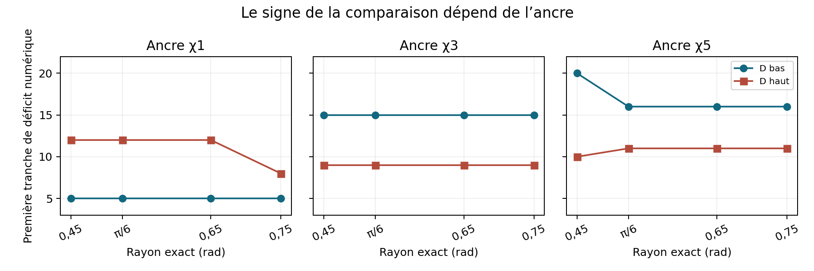

# V6.40 — Comparaison exacte V13 : le signe dépend de l’ancre

**Document 64 · Vincent P. P. NOËL · 12 octobre 2026**

Note de recherche, expérience prospective, relecture interne et source LaTeX.

## 1. Le résultat et la décision

**Les 12 couples préparés en V6.39 ont été comparés : 8 donnent une détection plus précoce pour le membre de D élevé, 4 une détection plus tardive.** Aucune égalité de tranche, aucune non-détection sous le plafond 150 et aucun cas non résolu ne sont retirés du bilan. Les 24 membres disposent chacun d’une racine hors droite recoupée à 80 et 110 chiffres de travail.

La prévision descriptive « une majorité des 12 strates » est atteinte : le seuil fixé avant calcul était 7 sur 12. Le résultat le plus instructif est sa structure. Les quatre rayons de χ₁ donnent le signe contraire ; ceux de χ₃ et χ₅ donnent le signe favorable. Le score D n’impose donc pas ici une orientation numérique uniforme, même après contrôle exact du premier coefficient complexe, de l’ancre et du rayon à l’intérieur de chaque couple.

Les douze couples ne sont pas douze réplications indépendantes. Les rayons d’une même ancre partagent une direction ; χ₃ et χ₅ emploient le même support de trois caractères. Le rapport 8/12 décrit ce plan déterministe. Il ne reçoit ni valeur p, ni interprétation causale, ni généralisation à toutes les directions de V13.



**Suite retenue : suivre des branches de racines dans les mêmes familles exactes et confronter leur mouvement à une formule locale démontrée.** Augmenter seulement le plafond ou accumuler des couples n’expliquerait pas ce changement de signe.

\newpage

## 2. Les douze résultats, sans sélection après calcul

Pour chaque ancre i et chaque rayon r, la recette définit exactement

\[c_\pm=\cos(r)e_i\pm\sin(r)u,\quad u_i=0,\quad\|u\|=1,\quad\sum_j u_jz_j=0.\]

\[a_+(1)=a_-(1)=\cos(r)z_i,\qquad D_+<D_-.\]

Le membre « + » a D bas, le membre « − » D haut. Les valeurs D ci-dessous sont arrondies pour lecture ; les égalités de contraintes viennent des recettes, démontrées dans le document 63. La phase et la valeur de A varient entre strates, mais sont identiques au sein d’une strate.

| Ancre | Rayon exact | D bas | D haut | Tranche, D bas | Tranche, D haut | Ordre, D haut |
|:--|:--|--:|--:|--:|--:|:--|
| χ1 | 9/20 | 0,473007 | 0,518984 | 5 | 12 | plus tard |
| χ1 | pi/6 | 0,591417 | 0,658583 | 5 | 12 | plus tard |
| χ1 | 13/20 | 0,775733 | 0,885213 | 5 | 12 | plus tard |
| χ1 | 3/4 | 0,890239 | 1,034020 | 5 | 8 | plus tard |
| χ3 | 9/20 | 0,478242 | 0,513749 | 15 | 9 | plus tôt |
| χ3 | pi/6 | 0,599064 | 0,650936 | 15 | 9 | plus tôt |
| χ3 | 13/20 | 0,788197 | 0,872748 | 15 | 9 | plus tôt |
| χ3 | 3/4 | 0,906609 | 1,017650 | 15 | 9 | plus tôt |
| χ5 | 9/20 | 0,481273 | 0,510718 | 20 | 10 | plus tôt |
| χ5 | pi/6 | 0,603492 | 0,646508 | 16 | 11 | plus tôt |
| χ5 | 13/20 | 0,795415 | 0,865530 | 16 | 11 | plus tôt |
| χ5 | 3/4 | 0,916088 | 1,008171 | 16 | 11 | plus tôt |

Les bilans aux plafonds 50, 100 et 150 ont le même ordre : toutes les premières détections du plan se situent au plus à la tranche 20. Des détections supplémentaires à plus grande hauteur existent ; le fichier de comptages conserve les 150 niveaux pour chaque membre.

Le seuil minimal d’écart D=1/40 est conservé. Aucun support ni rayon n’a été remplacé en fonction du résultat. Le manifeste V6.39 est repris octet pour octet, avec son empreinte conservée. Les six ancres ont trois classes conjuguées pour un observable symétrique en |t| ; les conjugates ne sont pas ajoutées au dénominateur.

**Exemple : χ₁, r=π/6.** D bas≈0,591417 détecte à la tranche 5 ; D haut≈0,658583 détecte à la tranche 12. À χ₅ au même rayon, le sens s’inverse : tranches 16 et 11. Le coefficient A est contrôlé à l’intérieur de chacune de ces deux paires ; il n’est pas égal entre les deux ancres.

\newpage

## 3. Ce que le détecteur mesure et ses contrôles

\[\widehat N_{\rm déficit}(T)=\widehat N_{\rm contour}(T)-\widehat N_{\rm signes}(T).\]

Le contour de la fonction complétée couvre −2≤Re(s)≤3 et |Im(s)|≤T. La symétrie de l’équation fonctionnelle permet de le calculer depuis le côté droit. Le compte critique utilise les changements de signe de la fonction de Hardy réelle. La première tranche retenue est le premier entier T où le déficit devient positif.

Un zéro critique double, ou deux zéros critiques proches manqués par la grille, peuvent produire un déficit sans racine hors droite. Pour cette raison, les détections admissibles sont recoupées séparément. La présence d’une racine dans la tranche ne démontre pas qu’aucune racine hors droite n’existe avant : « première détection » reste un terme d’instrument.

| Contrôle figé avant résultat | Bilan V6.40 |
|:--|:--|
| Deux contours : dt=0,02/0,01 et ds=0,05/0,025, avec raffinement adaptatif | Aucun compte modifié sur les 30 directions et 150 niveaux |
| Trois grilles critiques : dt=0,02/0,01/0,005 | Aucun compte modifié |
| Déficit pair, non négatif ; monotonie des trois comptes | 30 directions admissibles sur 30 |
| Ambiguïtés de phase restantes | Zéro |
| Six axes d’Euler | Aucune détection sous 150 ; comptes stables |
| Coordonnées exportées vs recettes reconstruites et réarrondies | Aucun compte ni classement modifié |
| Recoupements : recette analytique, 80/110 chiffres, partenaire fonctionnel | 24 membres sur 24 acceptés |

Les minima relatifs **échantillonnés** sur les bords sont 2.461e-04 horizontalement et 2.943e-01 verticalement, pour un seuil fixé à 1e−10. Les résidus d’enroulement à l’entier sont inférieurs à 2,7e−11. Les incréments de phase restent sous 0,8 après raffinement. Ces observations ne fournissent pas des bornes sur les segments continus du contour.

L’erreur maximale estimée des coordonnées binary64 face à la recette reconstruite est 5.018e-17. Le contrôle de sensibilité refait les comptes fins après reconstruction à 110 chiffres puis arrondissement binary64 : les contours eux-mêmes restent en double précision. Il ne s’agit pas d’un contour évalué à 110 chiffres.

Le bord droit R=3 possède une justification analytique uniforme par domination de a(1). Sa preuve rationnelle est donnée en annexe. Elle sécurise ce bord, sans certifier les autres segments ni la complétude du comptage intérieur.

\newpage

## 4. Les vingt-quatre racines recoupées

Chaque localisation Euler–Maclaurin est reprise avec la recette analytique exacte et un évaluateur mpmath.dirichlet. Le contrôle lève également les floats comme nombres binaires exacts, et vérifie le partenaire 1−conj(s) après correction de l’échelle Gamma. Les valeurs arrondies ci-dessous désignent une racine dans chaque tranche, sans assertion d’unicité ou d’absence antérieure.

| Ancre | Rayon | Membre | Re(s) | Im(s), signe conservé |
|:--|:--|:--|--:|--:|
| χ1 | 9/20 | D bas | 1,120256 | 4,821399 |
| χ1 | 9/20 | D haut | 1,030942 | -11,170379 |
| χ1 | pi/6 | D bas | 1,228874 | 4,807082 |
| χ1 | pi/6 | D haut | 1,124667 | -11,141471 |
| χ1 | 13/20 | D bas | 1,397089 | 4,781407 |
| χ1 | 13/20 | D haut | 1,267633 | -11,089695 |
| χ1 | 3/4 | D bas | 1,524678 | 4,759468 |
| χ1 | 3/4 | D haut | 0,937027 | 7,161692 |
| χ3 | 9/20 | D bas | 0,959006 | 14,058218 |
| χ3 | 9/20 | D haut | 1,032046 | -8,986908 |
| χ3 | pi/6 | D bas | 1,039883 | 14,064134 |
| χ3 | pi/6 | D haut | 1,130921 | -8,976866 |
| χ3 | 13/20 | D bas | 1,170590 | 14,075568 |
| χ3 | 13/20 | D haut | 1,287401 | -8,957854 |
| χ3 | 3/4 | D bas | 1,274479 | 14,086212 |
| χ3 | 3/4 | D haut | 1,409265 | -8,940596 |
| χ5 | 9/20 | D bas | 0,961888 | 19,690648 |
| χ5 | 9/20 | D haut | 1,048943 | -9,996905 |
| χ5 | pi/6 | D bas | 0,720802 | -15,766476 |
| χ5 | pi/6 | D haut | 1,159755 | -10,007796 |
| χ5 | 13/20 | D bas | 0,988135 | -15,730533 |
| χ5 | 13/20 | D haut | 1,332541 | -10,027668 |
| χ5 | 3/4 | D bas | 1,141809 | -15,698732 |
| χ5 | 3/4 | D haut | 1,465670 | -10,044915 |

L’accord maximal entre 80 et 110 chiffres de travail est 2.659e-80 ; le déplacement maximal dû aux coordonnées binary64 est 7.605e-17. Ces nombres sont des résultats de recoupement, pas des bornes certifiées sur l’erreur des ordonnées.

Les seuils prospectifs sont : résidus <1e−50/1e−75, partenaire ramené à même échelle <1e−45/1e−70, accord entre précisions <1e−30, accord EM/MP <1e−7 et déplacement des entrées <1e−9. La racine doit être strictement à droite de 0,500001 et dans la même tranche de |t|. Tous ces critères sont satisfaits.

La relecture constructive recalcule deux racines et la relecture critique les vingt-quatre positions à 90 chiffres, par une reconstruction distincte et une somme explicite des Hurwitz. Les résidus maximaux des vingt-quatre positions sont inférieurs à 3,3e−90. Ces contrôles de formule sont postérieurs aux comptes ; ils utilisent le même backend mpmath et ne sont pas des certifications par intervalles.

\newpage

## 5. Interprétation, ouvertures et prochaine étape

L’expérience écarte une explication simple selon laquelle contrôler A complexe ferait disparaître toute tendance dans le plan choisi. Une majorité subsiste, mais avec une inversion systématique par ancre. Elle ne suffit pas à attribuer le déplacement à D : les autres coefficients de la série changent également entre les membres opposés.

| Question | État après V6.40 |
|:--|:--|
| D peut-il varier à A complexe, ancre et rayon identiques ? | Démontré en V6.39, pour A=cos(r)z_i |
| La majorité précoce annoncée se retrouve-t-elle dans les 12 strates ? | Oui, pour l’observable numérique figé : 8/12 |
| Le signe est-il uniforme entre les trois ancres ? | Non dans ce plan numérique : χ₁ inverse χ₃ et χ₅ |
| D cause-t-il une sortie plus précoce ? | Ouvert ; aucun contraste causal isolant D seul |
| Les détections sont-elles les vrais premiers zéros hors droite ? | Non certifié |
| Le cas d’un A complexe arbitraire est-il traité ? | Ouvert |
| Un mécanisme de positivité globale impose-t-il RH pour ζ ? | Ouvert |

**Étape suivante concrète.** Construire une continuation des branches simples de F±(r,s)=0 en r dans les mêmes familles exactes. Fixer auparavant la grille, l’identité des branches, les conditions d’arrêt et le traitement des collisions. Pour les ancres χ₁ et χ₅, vérifier si le signe contraire résulte d’une autre branche devenant première, d’une collision critique, ou de la vitesse propre de la branche suivie. Conserver les pertes de branches ; une continuation interrompue n’est pas une absence.

Le lemme local de l’annexe donne la vitesse s′(r) sous l’hypothèse de racine simple. Il n’impose pas le signe de Im(s′). C’est un outil pour formuler une explication testable ; la vérification de ses hypothèses et le suivi des branches restent à faire.

**Bellman et le corpus.** Les actions « contraintes V13 » et « comparaison V13 » sont désormais achevées dans l’état courant du portail. Les utilités documentaires sont attribuées au travail réalisé, y compris à ses limites ; elles ne récompensent pas une preuve de RH. Le modèle fini historique ne contient pas encore l’action de continuation : il faut l’expliciter avant de la soumettre à cette planification. Les niveaux de maturité concernant RH ne sont pas augmentés par cette mesure.

Les trois articles existants gardent leur portée. Cette note fournit un nouveau résultat numérique contrôlé et deux lemmes auxiliaires. Une généralisation analytique, une certification locale des racines et une relecture humaine spécialisée sont des travaux distincts encore ouverts.

\newpage

## Annexe A — Démonstrations et unités

Les objets exacts sont les recettes V6.39, pas leurs coordonnées décimales.
On travaille dans l'espace impair modulo 13 avec les six caractères $k=1,3,5,7,9,11$.
Écrire $B_j(s)=z_jL(s,\chi_j)$, $|z_j|=1$ et $F_c=\sum_j c_jB_j$, avec $c$ réel de norme $1$.

### Lemme 1 — Un bord droit uniforme sans zéro

Pour chacun des 24 membres exacts du plan V6.39, F_c(s) est non nul pour
$\operatorname{Re}(s)\geq3$. Plus généralement, cela vaut pour tout vecteur de norme $1$ dont
$|a(1)|>\sqrt6(\zeta(3)-1)$.

**Démonstration.** Dans $\operatorname{Re}(s)>1$, la série de Dirichlet converge absolument.
Ses coefficients sont $a(n)=\sum_j c_jz_j\chi_j(n)$. Comme $|\chi_j(n)|\leq1$,
Cauchy–Schwarz donne $|a(n)|\leq\sum_j|c_j|\leq\sqrt6$. Donc, pour $\sigma\geq3$,

\[
 |F_c(s)-a(1)|\leq\sqrt6\sum_{n=2}^{\infty}n^{-\sigma}
 \leq\sqrt6(\zeta(3)-1).
\]

Or les recettes exactes ont $a(1)=\cos(r)z_i$ et tous les rayons sont $\leq3/4$.
Ainsi $|a(1)|\geq\cos(3/4)$. Une inégalité rationnelle élémentaire suffit :
$\cos(3/4)\geq1-(3/4)^2/2=23/32$, $\sqrt6<5/2$, et

\[
\zeta(3)-1=\frac18+\sum_{n=3}^{\infty}\frac1{n^3}
<\frac18+\int_2^{\infty}\frac{dx}{x^3}=\frac14.
\]

D'où $\sqrt6(\zeta(3)-1)<5/8<23/32\leq\cos(3/4)$.
L'inégalité triangulaire inverse donne $|F_c(s)|>0$. La marge fine
$\cos(3/4)-\sqrt6(\zeta(3)-1)\approx0{,}236753$ est une lecture numérique ; elle
n'est pas nécessaire à la démonstration. La preuve concerne les objets exacts.
Le code vérifie séparément la domination pour les coordonnées arrondies.

Le facteur de complétion commun est non nul et holomorphe dans $\operatorname{Re}(s)\geq3$ :
la même conclusion vaut pour la fonction complétée sur ce demi-plan. Cela ne
démontre pas qu'un contour intérieur soit sans zéro sur chacun de ses segments.

\newpage

### Lemme 2 — Vitesse locale d'une racine simple

Fixons une ancre $i$ et une direction $u$ de la recette exacte, indépendante de $r$,
et posons $G(s)=\sum_j u_jB_j(s)$. Pour un signe $\eta\in\{+1,-1\}$, définissons

\[
 F_\eta(r,s)=\cos(r)B_i(s)+\eta\sin(r)G(s).
\]

Si $F_\eta(r_0,s_0)=0$ et $\partial_sF_\eta(r_0,s_0)\neq0$, il existe un voisinage de $r_0$
et une unique branche holomorphe $s(r)$, avec $s(r_0)=s_0$, satisfaisant $F_\eta(r,s(r))=0$.
Sa dérivée est

\[
 s'(r)=-\frac{-\sin(r)B_i(s(r))+\eta\cos(r)G(s(r))}
 {\cos(r)B_i'(s(r))+\eta\sin(r)G'(s(r))}.
\]

**Démonstration.** Les $L(s,\chi_j)$ non principaux sont holomorphes, et $\sin/\cos$
sont entières. Le théorème des fonctions implicites holomorphes s'applique
par l'hypothèse $\partial_sF\neq0$. Dériver l'identité $F(r,s(r))=0$ donne
$\partial_rF+\partial_sF\cdot s'=0$ ; la formule annoncée suit par division.

Au voisinage de la branche, $\sin(r)\neq0$ pour les rayons considérés. L'identité
$F_\eta=0$ donne $\eta G(s)=-\cot(r)B_i(s)$, d'où la forme équivalente

\[
s'(r)=\frac{B_i(s(r))}{\sin(r)\,\partial_s F_\eta(r,s(r))}.
\]

Cette dernière formule ne fixe aucun signe pour la partie imaginaire de $s'$.
La variation de l'ordonnée est $\operatorname{Im}(s')$, et celle de $|\operatorname{Im}(s)|$, si $\operatorname{Im}(s)\neq0$, est
$\operatorname{sign}(\operatorname{Im}(s))\operatorname{Im}(s')$. Si le dénominateur s'annule, l'hypothèse de racine simple
cesse : c'est un événement à examiner séparément, pas une raison pour continuer
à employer la formule par division.

Ce lemme est conditionnel. Un petit résidu calculé n'est pas une preuve que
la racine soit simple ; les racines numériques de V6.40 ne fournissent pas ici
un certificat pour ses hypothèses.

### Unités conventionnelles et portée

Les formules précédentes emploient des coordonnées normalisées, d'unité $1$.
Pour leur associer une unité fictive $\mathsf C$, poser $c_j^{\rm phys}=\mathsf Cc_j$ et $F^{\rm phys}=\mathsf CF$.
Les $L$ et les $B_j$ gardent l'unité $1$ ; $F^{\rm phys}$ et $a^{\rm phys}(n)$ portent $\mathsf C$, avec
$\|c^{\rm phys}\|/\mathsf C=1$. Le score $D$ est le quotient d'un carré de défaut de multiplicativité
(unité $\mathsf C^4$) par $\|c^{\rm phys}\|^4$ (unité $\mathsf C^4$) : son unité est $1$. Les coordonnées $s$ et les
angles en radians sont sans dimension. Dans la formule de vitesse, numérateur
et dénominateur, écrits pour $F^{\rm phys}$, ont la même unité $\mathsf C$ : $s'(r)$ a l'unité $1$ par radian conventionnel.
Le paramètre $r$ mesure une variation d'angle. Une dérivée par rapport au temps aurait une unité différente.

Dans la formule simplifiée, le numérateur pour $F^{\rm phys}$ est $\mathsf CB_i$, et le
dénominateur $\mathsf C\partial_sF$ : $\mathsf C$ s'annule. Un changement commun d'échelle ne
modifie ni les racines ni $D$.

### Ce qui reste ouvert et prochaine expérience

Le résultat fini V6.40 teste un ordre de détection dans les 12 strates choisies.
Il ne prouve ni un ordre uniforme selon D, ni causalité, ni absence de racine
avant la tranche, ni GRH aux points d'Euler.

La suite prioritaire est de suivre des branches de racines simples dans les
familles exactes $c_\eta(r)$, puis de comparer leurs déplacements au lemme 2.
Choisir une ancre donnant le signe contraire et une ancre favorable permet de
tester une explication. Le protocole doit être fixé avant cette nouvelle suite :
grille en $r$, identités de branches, conditions d'arrêt quand $\partial_sF$ est
petit, traitement des collisions et conservation de toutes les branches perdues.

Les passages entre branches, les collisions de zéros critiques doubles, un
coefficient complexe A arbitraire, et la positivité globale liée à RH restent
ouverts. L'extension du plafond seule ne tranche aucune de ces questions.

\newpage

## Annexe B — Reproduction et provenance

La sélection analytique V6.39 précède les nouveaux comptes. La précision du protocole d’exécution V6.40 est datée du 12 octobre 2026, à 13:17:04 UTC. Le début d’exécution enregistré est 13:19:55 UTC. Les relectures supplémentaires postérieures sont explicitement distinguées.

| Fichier dans le corpus | Fonction |
|:--|:--|
| data/v639_couples_fixes.json | 12 couples et recettes immuables |
| data/prevision_v640_comparaison.md | Critères, prévision et censure avant calcul |
| data/v640_protocole_verrouille.json | Empreintes et seuils figés |
| data/v640_resultats.json | Bilans complets aux trois plafonds |
| data/v640_directions.csv et .json | Tous les membres et contrôles |
| data/v640_comptages.npz | Matrices de comptes et sensibilités |
| data/v640_racines_recoupees.json | 24 statuts, résidus et partenaires |
| data/v640_erreur_entree.json | Erreurs estimées des coordonnées et phases |
| preuves/V640_RELECTURE_CONSTRUCTIVE.md et CRITIQUE.md | Lectures complémentaires |

Les chemins data/ et preuves/ ci-dessus sont relatifs à 3_Preuves_et_calculs. Les sources de la note sont dans 1_Presentation ; sa figure accompagne le LaTeX dans le ZIP global. Les sorties historiques sont conservées.

Après les premiers tests, les nouveaux Markdown ont reçu le préfixe UTF-8 de trois octets exigé par le corpus. Les octets originaux de la prévision sont conservés sous le même nom dans le dossier 4_Archives/recus/V640, avec l’empreinte du verrou inchangée. La copie de lecture a le même texte ; le vérificateur ignore seulement ce préfixe. Aucun support, seuil, rayon ou résultat expérimental n’a été modifié. Le correctif de présentation est daté dans data/v640_correctifs_presentation.json.

Pour rejouer : extraire une copie du corpus ; conserver le manifeste et le verrou, puis déplacer dans un autre dossier les sorties v640_resultats.json, v640_comptages.npz et v640_racines_recoupees.json. Le lanceur refuse de les écraser silencieusement. Les caches de grilles sont reproductibles et ne sont pas nécessaires à la lecture.

```bash
cd 3_Preuves_et_calculs
python scripts/run_v640_comparaison.py --run
python scripts/run_v640_comparaison.py --roots
python tests/run_all_tests.py
cd ..
python 2_Methode/Outils/build_v640_document.py
```

Dépendances numériques : NumPy, SciPy, pandas, mpmath 1.3.0 ; génération de la figure : Matplotlib ; source et PDF : Pandoc et XeLaTeX. Les dépendances globales figurent dans requirements.txt.

L’empreinte du payload du manifeste, calculée sans son champ sha256, est :

`1218d67a838989857e0b174f991181019f155c79f7b6c9ef02ab974288d4b9ec`

Le ZIP global conserve l’ensemble des documents, articles, données, codes, prévisions et historiques. Ouvrir 00_PORTAIL.html après extraction donne accès au bilan courant, aux PDF et aux sources.

Aucune première ordonnée exacte, absence antérieure, causalité ou preuve de RH n’est revendiquée.
