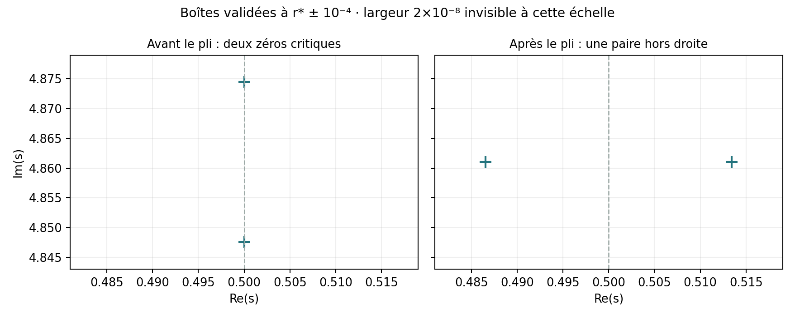
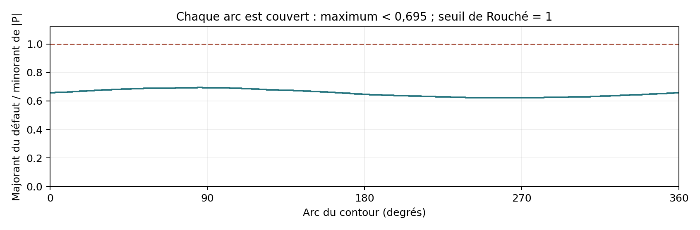
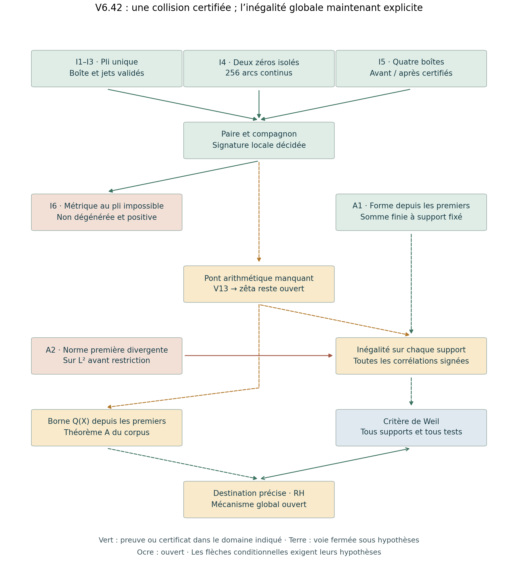

# V6.42 - Un pli certifié, sa paire et la porte arithmétique

**Document 66 · Vincent P. P. NOËL · 12 octobre 2026**

Dossier de recherche, preuves auxiliaires, certificat calculatoire et source LaTeX.

## 1. La suite a été exécutée : un passage local est maintenant validé

**La famille exacte V13 choisie possède un pli critique double unique dans
la boîte fixée.** Le contrôle de Rouché couvre le contour continu et tout
le petit intervalle radial : il contient exactement deux zéros avec
multiplicité. Aux paramètres $r_*\pm10^{-4}$, quatre boîtes de racines
sont validées uniformément malgré l’incertitude sur $r_*$ : deux zéros
critiques avant, une paire hors droite après.

Ce résultat dépasse un accord entre précisions : une borne analytique du
reste, une inclusion stricte et une contraction fournissent existence et
unicité. Le calcul repose sur le backend d’intervalles explicité ; une
validation indépendante de tout ce backend n’est pas revendiquée.

| Point | Résultat V6.42 | Portée |
|:--|:--|:--|
| Pli sélectionné | Validations à 50 puis 80 décimales | Même boîte et même recette ; projection réelle non nulle |
| Contour | 256 arcs, comparaison stricte de Rouché | Cercle continu, pour tout r du petit intervalle |
| Quatre racines | Quatre contractions uniformes et boîtes disjointes | Deux critiques par symétrie et unicité ; deux hors droite |
| Paire et opérateur | Signature locale certifiée avant et après | Pas de métrique positive non dégénérée au point double |
| Porte globale | Forme arithmétique et inégalité uniforme explicites | Le signe de la forme complète demeure ouvert |

**Une voie est fermée précisément.** Toute métrique hermitienne positive
symétrisant le compagnon réel exige μ>0. Elle dégénère ou devient non
uniformément bornée à l’approche du pli ; au double, le bloc de Jordan
interdit une métrique définie positive. C’est une impossibilité locale,
pas une impossibilité de prouver RH.

La cible RH et les deux portes globales gardent leur portée : le certificat
ne fournit ni le signe de Weil pour tous les tests, ni une borne suffisante
sur l’énergie arithmétique Q(X). Il certifie une composante choisie de V13.
Dans cette continuation radiale, $A=\cos r\,z_i$ varie ; le déploiement sur
une fibre à A constant reste une expérience distincte.

\newpage

## 2. Encadrements, marges et sens de la preuve

Le protocole sélectionne, parmi les six plis attribués V6.41, celui de plus
petite hauteur absolue : `fold_k1_plus_5`, famille `k1_rpi_6`, membre plus.
Les centres rationnels sont $r_0=0,243079394165$ et
$t_0=4,861023490998$, avec demi-largeur $10^{-9}$. Le verrou est antérieur
à toute nouvelle évaluation de fonction L.

| Contrôle | Valeur ou encadrement certifié |
|:--|:--|
| r* | [0.243079394165044055784476 ; 0.243079394165045645672933] |
| t* | [4.861023490998065424261169 ; 4.861023490998073695541661] |
| κ=−2 Hr/Htt | [-1.807995896101449197 ; -1.807983145236999804] |
| Contraction du pli, 50 décimales | q ≤ 0.000002849667 < 1 |
| Contraction du pli, 80 décimales | q ≤ 0.000004135641 < 1 |
| Module de comparaison sur le cercle | ≥ 0.0437791153 |
| Majorant du défaut sur les 256 arcs | ≤ 0.0303866506 |
| Marge uniforme de Rouché | ≥ 0.0133924647 > 0 |

Les décimales affichées du tableau sont des résumés. Les bornes complètes
et les endpoints binaires, exportés vers l’extérieur, figurent dans le
certificat JSON. Les quatre encadrements ci-dessous sont volontairement
élargis pour une lecture simple :

| Paramètre | Re(s) | Encadrement de Im(s) |
|:--|:--|:--|
| r*−10⁻⁴, racine haute | 1/2 exactement | [4,874488964703 ; 4,874488964747] |
| r*−10⁻⁴, racine basse | 1/2 exactement | [4,847596737039 ; 4,847596737084] |
| r*+10⁻⁴, racine gauche | [0,486553813589 ; 0,486553813637] | [4,861004131596 ; 4,861004131643] |
| r*+10⁻⁴, racine droite | [0,513446186366 ; 0,513446186408] | [4,861004131599 ; 4,861004131641] |

La criticité des deux premières ne vient pas d’un intervalle étroit autour
de 1/2 : chaque boîte est invariante par $s\mapsto1-\overline s$, et son
zéro unique est donc fixé par la symétrie fonctionnelle. Les deux autres
boîtes excluent la droite critique. Les quatre localisations sont uniformes
pour les intervalles de paramètres contenant les valeurs exactes
$r_*\pm10^{-4}$.





Une précision de travail de 80 décimales ne signifie pas 80 décimales
certifiées sur les coordonnées. La dépendance des intervalles dans une
boîte de largeur fixée reste dominante. Les encadrements obtenus sont
ceux du tableau et des données, avec leurs marges réellement calculées.

\newpage

## 3. Le graphe courant des acquis et des obstacles

{width=85%}

Le lecteur interactif `66_GRAPHE_DES_CERTIFICATS.html` relie chaque nœud à
ses preuves et à ses hypothèses. Le graphe historique du document 65 est
conservé. L’observation des 20 candidats V6.41 n’est pas transformée en
une certification des 20 : seul le pli sélectionné reçoit ce nouveau statut.

\newpage

## 4. Démonstrations locales et limites du compagnon

### 1. Objet exact et sélection avant calcul

Le verrou V6.42 reprend la recette Gauss/minor de `k1_rpi_6`, membre plus.
Parmi les six plis attribués de V6.41, la règle choisit celui de plus petite
hauteur absolue, `fold_k1_plus_5`. Les quatre graines de racines proviennent
des sorties V6.41. Aucun nouveau support, rayon de contour ou centre n’est
choisi selon une issue favorable.

La fonction est exactement
$F(r,s)=\cos r\,f_i(s)+\sin r\,f_u(s)$,
où $f_i=z_iL(s,\chi_i)$ et $f_u=\sum u_jz_jL(s,\chi_j)$.
Les $u_j$ sont les mineurs normalisés avec l’orientation du manifeste ;
ils sont réels, de norme un, et $\sum u_jz_j=0$ par l’identité des mineurs.
Le rayon varie : $A=\cos r\,z_i$ varie aussi. Ce travail ne déploie pas
encore un pli sur une fibre à A constant.

### 2. Lemme I1 - Un reste analytique et ses dérivées sont bornés

Pour $a>0$, $s\ne1$ et $\sigma+2M>1$, Euler-Maclaurin donne

\[
\begin{aligned}
\zeta(s,a)={}&\sum_{n=0}^{N-1}(n+a)^{-s}
+{(N+a)^{1-s}\over s-1}+\tfrac12(N+a)^{-s}\\
&+\sum_{k=1}^M {B_{2k}\over(2k)!}(s)_{2k-1}(N+a)^{1-s-2k}
+R_{N,M}(s,a).
\end{aligned}
\]

La série de Fourier des Bernoulli périodiques donne
$|\widetilde B_{2M}(x)|/(2M)!\le2\zeta(2M)/(2\pi)^{2M}$.
L’intégrale du reste implique donc

\[
|R_{N,M}(s,a)|\le
{2\zeta(2M)\over(2\pi)^{2M}}
{|(s)_{2M}|(N+a)^{1-\sigma-2M}\over\sigma+2M-1}.
\]

**Preuve.** Prendre le module dans l’intégrale du Bernoulli périodique
contre $(s)_{2M}(x+a)^{-s-2M}$, puis intégrer
$(x+a)^{-\sigma-2M}$ depuis N. Tous les facteurs sont explicitement
majorés ; $\zeta(2M)\le1+1/(2M-1)$ résulte du test intégral. □

Dans le rectangle déclaré, étendu d’une marge $\delta=1/8$, chaque facteur
$|s+j|$ est majoré à partir des bornes réelles et imaginaires. Pour une
série périodique de période 13,
$L(s)=13^{-s}\sum_{a=1}^{12}T_a\zeta(s,a/13)$,
la somme des modules des $T_a$ et $13^{-\sigma}$ donnent un majorant R
du reste sur ce rectangle étendu. La formule de Cauchy donne ensuite

\[
|\partial_s^k R_L(s)|\le k!R/\delta^k,\qquad k=0,1,2.
\]

Ces majorants s’ajoutent, dans les deux composantes, aux expressions finies
des jets. Une petite différence entre deux précisions n’est pas utilisée
à la place du reste. Les Bernoulli sont calculés par une récurrence rationnelle.
Les logarithmes portent sur des entiers positifs ; les exponentielles
complexes utilisent seulement exp, cos et sin réels avec intervalles.

Sources primaires des identités [Dlm26] : [DLMF 25.11(iii)](https://dlmf.nist.gov/25.11.iii)
et [DLMF 24.8(i)](https://dlmf.nist.gov/24.8.i). Les majorations ci-dessus
sont explicitées ici séparément.

### 3. Lemme I2 - Une projection réelle fixe préserve le pli

L’équation fonctionnelle commune donne sur la droite critique
$F(r,1/2+it)=e^{-i\theta(t)}Z(r,t)$, avec Z réel analytique.
Pour un complexe constant $\omega$, poser
$H(r,t)=\Re[\omega F(r,1/2+it)]=h(t)Z(r,t)$,
$h(t)=\Re[\omega e^{-i\theta(t)}]$.

Si $\Re[\omega f_i(1/2+it)]$ est séparé de zéro sur la boîte de hauteur,
h ne s’annule pas : ce terme est $h(t)Z_i(t)$. Alors

\[
H=H_t=0\iff Z=Z_t=0,
\quad H_r=hZ_r,\quad H_{tt}=hZ_{tt}
\quad\text{au zéro double}.
\]

**Preuve.** Diviser H par h ; au zéro de Z, dériver une première fois,
puis au zéro de $Z_t$ une seconde fois. La dérivée radiale ne dérive pas h.
La projection d’ancre non nulle sépare simultanément h et $Z_i$ de zéro. □

Ainsi $\kappa=-2H_r/H_{tt}=-2Z_r/Z_{tt}$. Les jets du système réel
$G=(H,H_t)$ sont évalués directement depuis $F,F_s,F_{ss}$ ; aucun jet
Gamma n’est évalué par intervalles. Une non-annulation de $H_{tt}$ prouve
aussi que le zéro de F en s est exactement double. Les phases exactes et
le facteur Gamma commun justifient l’équation fonctionnelle employée.

### 4. Théorème I3 - Inclusion et contraction donnent existence et unicité

Soit une boîte réelle B de centre rationnel $x_0$, et C une matrice
rationnelle inversible. Soient des intervalles contenant $G(x_0)$ et chaque
entrée de $DG(B)$. Définir

\[
K=x_0-CG(x_0)+(I-CDG(B))(B-x_0).
\]

Si $K\subset\operatorname{int}B$ et
$q=\sup\|I-CDG(B)\|_\infty<1$, G possède exactement un zéro dans B.

**Preuve.** Pour $T(x)=x-CG(x)$, la formule intégrale de la valeur moyenne
donne $T(B)\subset K\subset B$. La même borne matricielle donne
$\|T(x)-T(y)\|_\infty\le q\|x-y\|_\infty$ sur B. La boîte est complète ;
le théorème du point fixe fournit une unique solution de $T(x)=x$.
C étant inversible, elle équivaut à $G(x)=0$. Toute solution appartient à K. □

La borne q est la somme maximale des modules des entrées d’une ligne.
Les inclusions sont strictes, comparées comme fractions exactes aux bornes
rationnelles. Le préconditionneur provient de l’inverse rationnel d’un
jacobien arrondi selon la règle fixée ; il n’a pas besoin d’être un inverse
exact du vrai jacobien.

La même démonstration s’applique uniformément pour un paramètre r dans un
intervalle : pour chaque r, $T_r$ conserve la boîte et possède la même borne
de contraction. Pour un zéro complexe de F, le jacobien réel est
$\begin{pmatrix}\Re F_s&-\Im F_s\\\Im F_s&\Re F_s\end{pmatrix}$.

### 5. Lemme I4 - Rouché contrôle le contour continu et tout le paramètre

Prendre $w=-i(s-1/2)$, $w_0=t_0$ et le cercle $|w-w_0|=R=1/5$.
Choisir un complexe rationnel non nul α et $P(w)=\alpha(w-w_0)^2$.
Écrire $D=F-P$. Sur un arc de milieu $w_m$ et de distance maximale d,

\[
|D(w)|\le |D(w_m)|+|D_w(w_m)|d+\tfrac12 B_2d^2,
\quad B_2\ge\sup|D_{ww}|.
\]

**Preuve.** La formule de Taylor avec reste intégral sur le segment de
$w_m$ à w donne l’inégalité. Le segment reste dans le disque, couvert par
le rectangle déclaré. Pour n arcs égaux,
$d=2R\sin(\pi/(2n))$. Les jets sont majorés pour tout r de l’intervalle.
Si chaque majorant est strictement inférieur à $|\alpha|R^2$, Rouché
donne exactement deux zéros, avec multiplicité, pour chaque r. □

Le cercle entier est couvert, pas seulement ses points de grille. La
borne de dérivée seconde complète le calcul aux milieux des arcs. L’absence
de pôle dans le disque est justifiée par l’analyticité des fonctions L
et, même sans leur cancellation globale, par l’absence de s=1 dans ce disque.

### 6. Lemme I5 - Symétrie et unicité décident critique ou hors droite

Pour r réel, l’équation fonctionnelle associe à un zéro s son partenaire
$1-\overline s$, avec facteurs de complétion non nuls dans les boîtes.
Si une boîte centrée en $\Re s=1/2$ est invariante par cette symétrie et
contient un zéro unique, ce zéro est critique : son partenaire est le même.
Si une boîte exclut la droite critique, son zéro validé est hors droite.

**Preuve.** Le partenaire appartient à la même boîte invariante et est un
zéro ; l’unicité impose $s=1-\overline s$. Le second cas est immédiat. □

Deux boîtes disjointes incluses dans le cercle, avec les deux zéros uniques,
identifient toute la paire locale lorsque le compte de Rouché vaut deux.
On peut donc certifier le changement de configuration aux deux paramètres
$r_*\pm10^{-4}$, même si $r_*$ est fourni par un encadrement.

### 7. Portée de la certification et vérifications

Le certificat calculatoire repose sur les majorants analytiques démontrés,
les recettes exactes, et le backend mpmath 1.3.0 d’arithmétique élémentaire
par intervalles. La documentation qualifie son support d’expérimental :
aucune validation indépendante de tout le backend n’est présupposée.
Le constructeur de copie iv.mpc et l’involution complexe non supportés
sont évités ; les correctifs d’implémentation restent datés dans les données.
Les formules de jets sont recoupées avec Hurwitz en haute précision, avec
le même backend : ce contrôle est distinct du majorant analytique.

Un vérificateur rationnel relit séparément les intervalles du certificat,
recalcule inclusion, contraction et critères géométriques. Il vérifie le
calcul fini des inégalités ; il ne remplace pas une réévaluation indépendante
des primitives transcendantales. Les sorties et les refus des plans fixés
sont conservés.

Ce certificat concerne une famille V13, un pli, un contour et quatre boîtes.
Il ne certifie pas le premier zéro global, toutes les collisions ou la
positivité arithmétique de ζ. La métrique du compagnon dépend du discriminant
de la paire ; elle ne donne toujours pas le signe global de la forme de Weil.

### 8. Théorème I6 - Obstacle à toute métrique positive du compagnon au pli

Fixer l’unité de hauteur pour rendre les coordonnées adimensionnées. Pour
$H=\begin{pmatrix}a&1\\\mu&a\end{pmatrix}$ réel, une matrice symétrique
$G=\begin{pmatrix}p&q\\q&r\end{pmatrix}$ vérifie $H^TG=GH$ si et seulement
si $p=\mu r$. Un tel G défini positif existe si et seulement si $\mu>0$.

**Preuve.** La multiplication impose $p=\mu r$. La positivité exige $r>0$
et $pr-q^2=\mu r^2-q^2>0$, donc $\mu>0$. Réciproquement,
$G=\operatorname{diag}(\mu,1)$ convient. □

Pour une métrique hermitienne complexe, l’équation impose également
$q=\overline q$ ; le même calcul couvre donc ce cas.

Pour $0<\mu\le1$, le rapport des valeurs propres de G est au moins
$r/p=1/\mu$, par les quotients de Rayleigh sur les vecteurs de base.
Si $cI\le G\le CI$, on a $\mu=p/r\ge c/C$.
Une métrique uniformément positive et bornée ne peut donc accompagner ce
compagnon jusqu’à μ=0. Au double, le bloc de Jordan interdit toute métrique
définie positive ; après le pli, les valeurs propres complexes l’interdisent
aussi. Cela ferme la voie d’une positivité non dégénérée automatique de ce
compagnon à travers la collision. Cela ne ferme pas un programme distinct
pour ζ.

\newpage

## 5. L’inégalité globale et l’opérateur de translations

### 1. Fixer la convention

Employer les distributions Mellin de l’appendice B de Connes-Consani [CC21],
(149)-(151). Pour un test additif $f\in C_c^\infty(\mathbb R)$, poser
$k(u)=u^{-1/2}f(\log u)$. Avec $h=f*f^*$ et
$f^*(x)=\overline{f(-x)}$, on a
$k*\overline{k^\#}(u)=u^{-1/2}h(\log u)$, où
$k^\#(u)=u^{-1}k(u^{-1})$.
Les annulations de Mellin en 0 et 1 sont $\int f(x)e^{\pm x/2}dx=0$.
Le critère publié C.1 est une positivité de l’opposée de la somme locale
sur tous ces tests. Les lemmes suivants en déduisent une représentation
arithmétique et ses limites ; le signe requis reste ouvert.

### 2. Lemme A1 - La somme première est finie à support fixé

Si $\operatorname{supp}f\subset[-S,S]$, alors
$\operatorname{supp}h\subset[-2S,2S]$ et $h(-x)=\overline{h(x)}$.
La contribution des places finies vaut

\[
2\sum_{p^m\le e^{2S}}{\log p\over p^{m/2}}\Re h(m\log p).
\]

**Preuve.** Appliquer (150) à $g(u)=u^{-1/2}h(\log u)$.
Le terme $g(p^m)+g^\#(p^m)$ devient
$p^{-m/2}[h(m\log p)+h(-m\log p)]$.
Le support annule les termes $m\log p>2S$. □

Le changement $u=e^x$ dans (151) donne la contribution archimédienne

\[
\mathcal W(h)=(\log(4\pi)+\gamma_E)h(0)
+\int_0^\infty
{e^{-x/2}[h(x)+h(-x)]-2e^{-x}h(0)\over1-e^{-2x}}\,dx.
\]

La singularité à zéro est amovible. Au-delà de 2S, la queue est exactement
$-2h(0)\operatorname{artanh}(e^{-2S})$, par la substitution $v=e^{-x}$.
Cette expression emploie le signe de (151), distinct de l’opérateur de
signe opposé dans (153).

### 3. L’inégalité qui manque

Avec $Q_{\rm arch}(f)=-\mathcal W(f*f^*)$, le contrat est

\[
\boxed{
Q_{\rm arch}(f)\ge
2\sum_{p^m\le e^{2S}}{\log p\over p^{m/2}}\Re(f*f^*)(m\log p)}
\]

pour **chaque S>0** et chaque
$f=(\partial_x^2-1/4)\psi$, $\psi\in C_c^\infty((-S,S))$.
Par G1, tout test admissible possède cette représentation pour un S assez
grand. L’inégalité équivaut donc au signe global exigé, et ses quantités
se définissent depuis les premiers et le terme archimédien.

Les corrélations sont signées. À S fixé, une somme complète n’a pas de
queue de puissances premières au-delà du support. L’obstacle porte sur
tous les supports, tous les tests et les erreurs de compression ; ajouter
des premiers à un seul calcul fini ne remplit pas ce contrat.

### 4. Théorème A2 - Pas de norme uniforme de la partie première sur L²

Sur $L^2(\mathbb R)$, poser

\[
(U_\ell f)(x)=f(x-\ell),\qquad
K_X=\sum_{p^m\le X}{\log p\over p^{m/2}}
(U_{m\log p}+U_{-m\log p}),\qquad X\ge2.
\]

Cet opérateur est borné autoadjoint et

\[
\|K_X\|=2\sum_{p^m\le X}{\log p\over p^{m/2}}
\longrightarrow\infty.
\]

**Preuve.** Les translations sont unitaires et adjointes deux à deux.
L’inégalité triangulaire donne le majorant. Pour
$f_T=(2T)^{-1/2}1_{[-T,T]}$, la corrélation est
$\max(1-|\ell|/(2T),0)$. Son quotient de Rayleigh pour la somme finie
tend vers le majorant quand $T\to\infty$, d’où l’égalité.

La somme $\sum_p1/p$ diverge : sinon les produits finis
$\prod_{p\le X}(1-1/p)^{-1}$ seraient bornés, car
$-\log(1-1/p)\le2/p$. Mais leur développement contient la somme harmonique
jusqu’à X. Enfin $\log p/\sqrt p\ge1/p$ pour $p\ge3$ ; les seuls termes
$m=1$ font donc diverger la norme. □

Le théorème concerne L² avant restriction aux tests admissibles. Il ne
prouve aucune négativité de la forme complète. Il ferme le budget de norme
uniforme de cette seule somme de translations à coefficients positifs.
Le contrôle doit préserver les corrélations signées et la compensation
archimédienne, dans un domaine de forme approprié. Le lemme G4 sur les
opérateurs bornés ne s’applique pas automatiquement à cette limite.

### 5. Bilan de recherche

Le certificat local isole une paire et son changement de signature.
I6 exclut une métrique positive non dégénérée du compagnon au pli.
A1 fixe une forme arithmétique ; A2 exclut une norme uniforme de la seule
partie première. L’inégalité encadrée reste ouverte, comme la borne de
croissance suffisante du théorème A du corpus. Aucun signe global pour ζ
n’est obtenu ici.

Source primaire : A. Connes et C. Consani, *Weil positivity and Trace formula,
the archimedean place*, appendices A-C, (146), (149)-(151), proposition C.1.
[PDF auteur](https://alainconnes.org/wp-content/uploads/Selecta.pdf).

\newpage

## 6. Reproduction, contrôles et étapes ultérieures

Le verrou est écrit le 12 octobre 2026 à 17:06:48 UTC, avant les nouveaux
calculs L. Les deux plans (50 décimales, N=32 ; 80 décimales, N=48) utilisent
douze corrections Euler-Maclaurin. Le premier choix de projection ω=1
et la première grille de contour de 256 arcs passent : les choix de recours
ω=i et 512/1024 arcs n’ont pas été exécutés. Aucun refus n’est effacé.

Le reste uniforme du premier plan est inférieur à $1,1\times10^{-28}$ pour
la composante d’ancre ; ses dérivées jusqu’à deux sont majorées par Cauchy.
Il s’agit d’un reste analytique, distinct des erreurs d’arrondi englobées
par les intervalles. Les jets sont recoupés en trois points avec Hurwitz en
haute précision ; ce contrôle utilise le même backend. La relecture rationnelle
recalcule ensuite les inclusions et contractions sans les opérations iv.
Elle ne réévalue pas indépendamment les primitives transcendantales.

Les correctifs d’implémentation et d’export sont datés ; codes exécutés et
premier export restent archivés. Les paramètres et bornes sont conservés.
Le diagnostic rationnel reproduit les quatre certificats à l’identique.

| Chemin relatif à `3_Preuves_et_calculs` | Fonction |
|:--|:--|
| `data/prevision_v642_certification.md` | Sélection et critères avant évaluation L |
| `data/v642_protocole_verrouille.json` | Empreintes, boîtes, graines et plans |
| `src/v642_intervalles.py` | Jets validés, reste analytique et contraction |
| `scripts/run_v642_certification.py` | Calcul des certificats et des essais |
| `data/v642_certification.json` | Deux validations du même pli exact, contour et quatre boîtes |
| `scripts/check_v642_certificate.py` | Vérification rationnelle des inégalités finies |
| `data/v642_verification_rationnelle.json` | Relecture rationnelle et portée exacte |
| `data/v642_root_audit_inputs.json` | Diagnostics postérieurs reproduisant les certificats |
| `preuves/V642_CERTIFICATION_LOCALE.md` | I1-I6, existence, unicité, Rouché et métriques |
| `preuves/V642_CONTRAT_ARITHMETIQUE.md` | A1-A2, forme et obstacle à la norme uniforme |

Pour rejouer, extraire une copie et déplacer `v642_certification.json` dans
un autre dossier : le lanceur refuse de l’écraser. Conserver le protocole
et les données V6.39/V6.41. Le diagnostic de relecture est documenté dans
les données ; les états historiques et reçus restent dans le ZIP.

```bash
cd 3_Preuves_et_calculs
python scripts/run_v642_certification.py
python scripts/check_v642_certificate.py
python tests/run_all_tests.py
cd ..
python 2_Methode/Outils/build_v642_figures.py
python 2_Methode/Outils/build_v642_document.py
```

Dépendances : Python, NumPy/SciPy et mpmath 1.3.0 ; figures Matplotlib ;
PDF Pandoc et XeLaTeX. La documentation du backend [Mpm13] qualifie l’arithmétique
iv d’expérimentale ; les seules fonctions élémentaires utilisées, les
rectangles de calcul et les bornes d’erreur sont explicités.

**Suite locale :** choisir une des quatre directions de jets V6.41 et un
déplacement sur sa fibre exacte, à A, ancre et rayon constants ; fixer le
paramètre et les critères de transversalité avant calcul. La famille
radiale validée ici ne répond pas à cette autre question.

**Suite globale :** contrôler les corrélations signées et leur compensation
archimédienne sur la hiérarchie complète des tests admissibles. Le nouvel
opérateur de translations donne une cible calculable, mais sa norme sur L²
seul diverge. Une compression positive ou le compagnon local ne constitue
pas la borne uniforme exigée. L’autre porte, Q(X)=X^{o(1)} depuis les
premiers, demeure ouverte.

Les unités fictives du document 65 restent cohérentes : w porte T, les
moments m_k portent T^k et μ porte T². Les matrices et conditionnements
de I6 se lisent dans la base de hauteur normalisée par T. Les formes de
corrélation portent le carré de l’unité d’amplitude du test ; la traduction
en opérateurs n’identifie pas un Hamiltonien physique.

Le portail et ses indices couvrent les 66 documents. Le niveau de maturité
RH reste inchangé ; aucune relecture humaine nouvelle n’est revendiquée.

<!-- references:debut -->

## Références

Format : [clé] auteurs, *titre*, publication, lien. Fiches complètes et état de vérification : document 42 (registre des sources).

- [CC21] A. Connes, C. Consani. *Weil positivity and Trace formula, the archimedean place*. PDF auteur daté du 4 juillet 2021 ; arXiv:2006.13771. <https://alainconnes.org/wp-content/uploads/Selecta.pdf> — partiellement vérifié
- [Dlm26] NIST. *Digital Library of Mathematical Functions : 25.11 et 24.8*. Version en ligne consultée le 12 octobre 2026. <https://dlmf.nist.gov/25.11.iii> — partiellement vérifié
- [Mpm13] mpmath developers. *Contexts : interval arithmetic, documentation 1.3.0*. Documentation de la version utilisée, consultée le 12 octobre 2026. <https://mpmath.org/doc/current/contexts.html> — partiellement vérifié

<!-- references:fin -->
