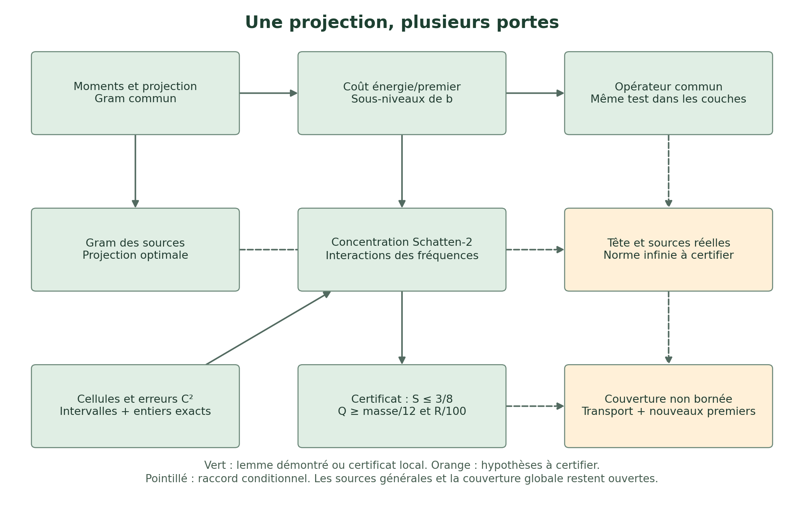

---
title: "Concentration projetée et opérateur commun"
subtitle: "Programme Riemann - V6.47 - Document 72"
author: "Vincent P. P. NOËL - dossier de recherche, rédaction assistée"
date: "13 octobre 2026"
---

# 1. Le résultat et le changement de représentation

**Théorème local certifié.** Pour tous les tests complexes admissibles dans
\(X_S\), et pour tout \(0<S\le3/8\),
\[
\boxed{Q_W(f)\ge\frac1{12}\|f\|_2^2,
\qquad Q_W(f)\ge\frac1{100}R(f).}
\]
Ici \(R(f)=\|f\|_2^2+\mathcal E(f)\) est une mesure quadratique ; sa racine
carrée est une norme. La preuve concerne un espace de dimension infinie.
Elle utilise des lemmes analytiques, des intervalles orientés vers l'extérieur
et des opérations entières exactes, sans données de zéros ni hypothèse RH.
La version 71 certifiait \(S\le0{,}347\) par le potentiel de bord ; elle est
conservée. La nouvelle construction certifie \(S\le0{,}375\) en tenant compte
des interactions entre fréquences. Il s'agit d'une famille bornée de supports.

L'enjeu conceptuel est double. La phase du déplacement premier reste dans le
coût énergétique, au lieu d'être remplacée par un coût maximal indépendant.
La projection qui retire les moments interdits sert à la fois aux fréquences
et aux sources des couplages. Un second pont, démontré comme inégalité mais
pas encore certifié à \(S=1/2\), conserve un même test à travers toutes les
couches en intégrant les opérateurs avant leur norme.

# 2. Ce que les objets veulent dire

Une fonction est une règle donnant une amplitude à chaque position. Le
support indique les positions où cette amplitude peut être non nulle. Une
fréquence décrit une oscillation : la transformation de Fourier exprime la
même fonction dans cette autre langue. Un sous-niveau rassemble les fréquences
dont le coût est inférieur à une valeur donnée ; ce rassemblement peut avoir
plusieurs morceaux. Un opérateur de concentration mesure combien d'un même
test peut entrer dans ces morceaux.

La trace additionne la taille de toutes les directions. La norme opératoire
cherche la direction la plus forte. La norme de Schatten-2, ou de
Hilbert-Schmidt, prend la racine de la somme des carrés des forces ; elle
majore la norme opératoire et peut être plus petite que la trace. Cette
distinction, plutôt qu'un simple raffinement de maillage, fournit le gain.

| Brique | Entrée | Sortie utile | Limite |
|---|---|---|---|
| Projection commune | Deux moments et leur Gram | Fréquences et sources sans composantes interdites | Le Gram doit correspondre à la métrique |
| Coût conjoint | Énergie et phase du premier 2 | Multiplicateur positif \(b\) | Le présent gabarit a un seul premier |
| Sous-niveaux | Coût \(b<u\) | Unions de bandes de fréquences | Inclure les cellules incertaines |
| Schatten-2 | Accords entre fréquences projetées | Borne de concentration avec erreurs | Majore la norme, ne la calcule pas exactement |
| Opérateur commun | Toutes les couches ensemble | Un seul test et une tête structurée | Norme infinie encore à certifier à \(S=1/2\) |

Les unités fictives suivent le calcul : \([f]=A_{\rm amp}\), tandis que
\(m,\mathcal E,Q_W,R\) portent \(A_{\rm amp}^2\). La position logarithmique et
les fréquences sont sans dimension. Aucune variable temporelle physique
n'est introduite ; aucune puissance physique n'est déduite de ces notations.

# 3. Domaine et identité conjointe

On prolonge les fonctions par zéro hors de \([-S,S]\), et l'on définit
\[
X_S=\left\{f\in L^2(\mathbb R):\operatorname{supp}f\subset[-S,S],\quad
\int f(x)e^{\pm x/2}\,dx=0,\quad\mathcal E(f)<\infty\right\}.
\]
La Fourier est unitaire :
\[
\widehat f(t)=(2\pi)^{-1/2}\int f(x)e^{-itx}\,dx,
\qquad m(f)=\int|f|^2=\int|\widehat f|^2.
\]
Avec \(U_df(x)=f(x-d)\),
\[
\mathcal E(f)=\int_0^\infty
\frac{e^{-d/2}}{1-e^{-2d}}\|U_df-f\|_2^2\,dd,
\quad C_0=\log(8\pi)+\gamma_E+\frac\pi2,
\quad Q_W=\mathcal E-C_0m-Q_{\rm pr}.
\]
Pour \(\log2<2S<\min(\log3,2\log2)\), le seul terme premier non nul est
\[
Q_{\rm pr}(f)=2w_2\Re\langle f,U_{\log2}f\rangle,
\qquad w_2=\frac{\log2}{\sqrt2}.
\]

**Lemme L1 - Conserver la phase.** Posons
\[
a(t)=\sum_{n\ge0}\frac{2t^2}{b_n(b_n^2+t^2)},\quad b_n=2n+\frac12,
\qquad b(t)=a(t)+2w_2(1-\cos(t\log2)).
\]
Alors \(b\ge a\ge0\), et
\[
\mathcal E_b(f):=\int_{\mathbb R}b(t)|\widehat f(t)|^2dt,
\qquad Q_W(f)=\mathcal E_b(f)-(C_0+2w_2)m(f).
\]
**Preuve.** Plancherel donne le multiplicateur
\(2(1-\cos(td))\) de \(\|U_df-f\|^2\). Développer le poids en
\(\sum_{n\ge0}e^{-(2n+1/2)d}\) donne la série de \(a\), par intégration de
termes positifs. Le déplacement premier a le multiplicateur \(\cos(t\log2)\).
Ajouter puis soustraire \(2w_2m\) fournit l'identité. L'intégration fréquentielle
emploie \(dt\), sans facteur \(1/(2\pi)\) supplémentaire.

# 4. Même projection, deux usages

Soit \(W=\operatorname{span}\{\cosh(x/2),\sinh(x/2)\}\), dans
\(L^2([-S,S])\), et \(P_W=I-\Pi_W\). Le Gram est diagonal :
\[
G=\operatorname{diag}(S+\sinh S,\sinh S-S).
\]
Dans les blocs pair et impair, posons
\(r_{+,t}=P_W\cos(tx)\), \(r_{-,t}=P_W\sin(tx)\),
\(d_\pm(t)=\|r_{\pm,t}\|^2\), et
\(k_\pm(t,v)=\langle r_{\pm,t},r_{\pm,v}\rangle\).
Ces fonctions sont réelles ; les tests eux-mêmes peuvent être complexes.

**Lemme L2 - Noyau explicite et parité.** Avec
\[
\begin{aligned}
z_S(t)&=\frac{2\sinh((1/2+it)S)}{1/2+it},
&c(t)&=\Re z_S(t),\quad s(t)=\Im z_S(t),\\
j_S(z)&=\frac{\sin(Sz)}{z},&j_S(0)&=S.
\end{aligned}
\]
on a
\[
\begin{aligned}
k_+(t,v)&=j_S(t-v)+j_S(t+v)-\frac{c(t)c(v)}{S+\sinh S},\\
k_-(t,v)&=j_S(t-v)-j_S(t+v)-\frac{s(t)s(v)}{\sinh S-S}.
\end{aligned}
\]
La forme, les moments et la concentration se décomposent sans couplage entre
les deux parités. **Preuve.** Intégrer les produits de cosinus et sinus, puis
soustraire leur projection sur le vecteur de même parité. Une intégrande
impaire a une intégrale nulle sur \([-S,S]\). Les mêmes calculs restent
valables après complexification des espaces.

Pour des sources \(\rho_i\), le même Gram fournit
\[
C_{\rm opt}=K-B^*G^{-1}B,
\quad K_{ij}=\langle\rho_i,\rho_j\rangle,
\quad B_{ai}=\langle w_a,\rho_i\rangle.
\]
C'est le Gram des sources projetées. Toute autre correction par des éléments
de \(W\) ajoute un Gram positif. Ce raccord algébrique est prouvé en V646 ;
les véritables sources et leurs erreurs doivent encore être certifiées dans
les problèmes de tête générale. Une métaphore ou un exemple de matrice ne
constitue pas cette certification.

# 5. Concentration et couches : deux lemmes

**Lemme L3 - Concentration projetée.** Pour un ensemble mesurable borné
\(\Omega\subset(0,\infty)\), définissons
\[
K_{\pm,\Omega}=\frac1\pi\int_\Omega
|r_{\pm,t}\rangle\langle r_{\pm,t}|\,dt.
\]
Cet opérateur est positif et de trace finie. Pour un test du bloc correspondant,
\[
\int_{\Omega\cup(-\Omega)}|\widehat f(t)|^2dt
=\langle f,K_{\pm,\Omega}f\rangle
\le\rho_{\pm,\Omega}m(f),
\]
où l'on peut prendre
\[
\rho_{\pm,\Omega}=\min\left(1,\frac1\pi\int_\Omega d_\pm(t)dt,
\sqrt{\frac1{\pi^2}\int_\Omega\!\int_\Omega|k_\pm(t,v)|^2dt\,dv}\right).
\]
**Preuve.** Dans chaque parité, la Fourier unitaire et la symétrie des
fréquences donnent le facteur \(1/\pi\). Les moments nuls permettent de
projeter les ondes. Pour un opérateur positif, la norme est majorée par la
trace et par la racine de la trace du carré. La borne 1 vient de Plancherel.

**Lemme L4 - Couches et sur-ensembles.** Pour \(u_j=j\Delta u\), soit
\(E_j\supset\{t>0:b(t)<u_j\}\). Si \(\rho_{\pm,j}\) majore la
concentration sur \(E_j\), alors
\[
\mathcal E_b(f)\ge\lambda_\pm m(f),\qquad
\lambda_\pm=\sum_{j=1}^J\Delta u(1-\rho_{\pm,j}).
\]
**Preuve.** L'identité des couches positives donne
\(\mathcal E_b=\int_0^\infty\int_{b\ge u}|\widehat f|^2dt\,du\).
Sur \((u_{j-1},u_j]\), la masse restante est au moins celle au niveau
\(u_j\). Agrandir le sous-niveau diminue cette borne, donc reste prudent.
On omet seulement des contributions positives après \(u_J\).
La borne valable pour tout test est \(\min(\lambda_+,\lambda_-)\).

# 6. Comment le calcul devient une garantie

**Lemme L5 - Erreurs d'intégration sur des unions de cellules.** La projection
est une contraction. Les ondes et leurs deux dérivées satisfont
\[
\|r_t\|\le\sqrt{2S},\quad
\|r'_t\|\le\sqrt{2S^3/3},\quad
\|r''_t\|\le\sqrt{2S^5/5}.
\]
Par dérivation des produits scalaires,
\[
|d''(t)|\le M_d=4S^3(1/3+1/\sqrt5),\qquad
|\partial_t^2|k(t,v)|^2|\le M_k=8S^4(1/3+1/\sqrt5),
\]
et la même borne vaut dans la variable \(v\). Pour une union de cellules de
largeur \(h\), de longueur totale \(A\), les règles des milieux donnent
\[
\varepsilon_{\rm trace}\le\frac{M_dAh^2}{24\pi},\qquad
\varepsilon_{{\rm HS}^2}\le\frac{M_kA^2h^2}{12\pi^2}.
\]
**Preuve.** La règle des milieux sur une cellule a une erreur au plus
\(Mh^3/24\). On somme sur les cellules ; pour les rectangles, on applique
successivement cette règle dans chaque variable. Aucune connexité de
l'union n'est nécessaire. Le code utilise les majorants rationnels
\(M_d\le47S^3/15\) et \(M_k\le94S^4/15\), car \(1/\sqrt5<9/20\).

Le protocole a été choisi après exploration, puis figé avant validation :
\(S=3/8\), \(T=40\), \(h=1/50\), \(U=36/5\),
\(\Delta u=1/50\), 160 bits pour les intervalles, 64 bits après la virgule
pour les opérations fixes. Il est conservé avec son empreinte dans le journal.

1. Pour chaque cellule \([ih,(i+1)h]\), une borne inférieure de \(b\) est
   construite avec \(a(ih)\) et un intervalle de cosinus sur toute la cellule.
   La cellule est incluse dès que cette borne est inférieure au niveau \(u_j\).
2. La série positive de \(a\) est tronquée après 64 termes. Si
   \(b_K=2K+1/2\), la queue est comprise entre
   \(\frac12\log(1+t^2/b_K^2)\) et cette intégrale plus son premier terme.
   Ce sont des bornes par série et intégrale décroissante, pas un ajustement.
3. La borne certifiée \(a(40)>7{,}2224>7{,}2\), avec \(b\ge a\) et la
   monotonie de \(a\), exclut tout sous-niveau utile au-delà de 40.
4. Les sinus, les moments et le Gram sont calculés en intervalles. Leurs
   extrémités sont arrondies vers l'extérieur sur la grille \(2^{-64}\).
   Les produits, les signes et les sommes de carrés sont ensuite des
   opérations entières exactes. Le carré est majoré par la plus grande
   valeur absolue des deux extrémités, même si le noyau change de signe.
5. Les deux erreurs ci-dessus sont ajoutées aux majorants avant de prendre
   la racine et le minimum des bornes. Les couches sont additionnées en
   fractions exactes.

# 7. Théorème numérique et constantes lisibles

| Quantité encadrée | Valeur décimale indicative |
|---|---|
| Énergie jointe, bloc pair | 6.438810486 |
| Énergie jointe, bloc impair | 6.767664845 |
| Seuil C₀+2w₂, majorant | 6.352929764 |
| Marge massique, minorant | 0.085880722 |
| Marge dans R, minorant | 0.012359283 |
| Marge avec trace seule, minorant | -0.053493809 |

Le dernier niveau inclut 970 des 2 000 cellules. L'accumulation exacte utilise
470 935 paires non ordonnées dans chaque parité ; les contributions hors
diagonale sont doublées. Cela ne remplace pas l'espace infini par 970 tests :
le lemme L3 borne la concentration de tout test dans les ensembles certifiés.

**Lemme L6 - Conversion dans la métrique R.** Les bandes d'attache du
premier 2 sont disjointes dans ce régime. L'inégalité de Cauchy appliquée à
la corrélation donne \(|Q_{\rm pr}|\le w_2m\). Donc
\[
Q_W\ge\mathcal E-Lm,\quad L=C_0+w_2,
\qquad Q_W\ge cm
\quad\Longrightarrow\quad
Q_W\ge\frac{c}{c+L+1}R.
\]
**Preuve.** On a \(m\le Q_W/c\) et
\(\mathcal E\le Q_W+Lm\). Additionner fournit l'inégalité.

Les intervalles établissent les trois bornes rationnelles lisibles
\[
\lambda_b\ge\frac{6438}{1000},\quad
C_0+2w_2\le\frac{6353}{1000},\quad C_0+w_2<6.
\]
Ainsi \(c\ge17/200>1/12\), et
\(c/(c+L+1)\ge17/1417>1/100\). Cela prouve le théorème à \(S=3/8\).
Le prolongement par zéro conserve les moments et les formes globales pour
chaque \(S\le3/8\), ce qui prouve toute la famille annoncée.
Le certificat utilisant seulement la trace a une marge inférieure négative :
il reste indéterminé. Le gain de Schatten-2 est donc essentiel à cet assemblage.

# 8. Le pont conceptuel : garder le même test

**Lemme L7 - Intégrer avant la norme.** Pour \(U>0\), posons
\[
B_{\pm,U}=\int_0^U K_{\pm,\{b<u\}}du
=\frac1\pi\int_0^\infty(U-b(t))_+
|r_{\pm,t}\rangle\langle r_{\pm,t}|dt.
\]
Ces opérateurs sont positifs et compacts. Pour tout test de la parité,
\[
\mathcal E_b(f)\ge Um(f)-\langle f,B_{\pm,U}f\rangle,
\qquad Q_W(f)\ge
\bigl(U-\|B_{\pm,U}\|-C_0-2w_2\bigr)m(f).
\]
**Preuve.** \(b\ge\min(b,U)=U-(U-b)_+\), puis le lemme L3 donne
l'identité opératoire. La croissance \(a(t)\to\infty\) borne le support
fréquentiel du poids ; son intégrale de trace est finie.
Enfin \(\|\int K_u du\|\le\int\|K_u\|du\). La première norme garde un
même test, tandis que la seconde autorise des directions maximales
différentes à chaque niveau. Cette perte peut être évitée.

Exemple élémentaire : deux opérateurs valent chacun 1 dans une direction et
0 dans l'autre, les directions étant perpendiculaires. La somme des normes
vaut 2, mais la norme de leur somme vaut 1. Ce pont organise les relations
entre couches ; il ne consiste pas à augmenter seulement leur nombre.

| Diagnostic uniquement | S=3/8 | S=1/2 |
|---|---|---|
| Trace par couches | -0.041432 | -0.189637 |
| Schatten-2 par couches | +0.100189 | -0.077095 |
| Norme de Nyström par couches | +0.318107 | -0.003069 |
| Norme de Nyström de l’opérateur commun | +0.325375 | +0.005903 |
| Schatten-2 de l’opérateur commun | +0.022349 | -0.393022 |

Les calculs exploratoires utilisent deux résolutions : 80 puis 120 nœuds
spatiaux, 40 000 puis 80 000 fréquences jusqu'à 100, des pas en niveau
\(1/80\) puis \(1/160\), jusqu'à \(U=8\). Leurs valeurs propres sont des
valeurs de Nyström, sans majorant certifié de norme infinie. À \(S=1/2\),
la marge de l'opérateur commun passe environ de 0,002866 à 0,005903 : la
différence 0,003037 est une mesure de stabilité, pas une borne d'erreur.
La positivité à \(S=1/2\) reste donc ouverte dans ce dossier.

# 9. L8 : une tête et ses sources issues du même opérateur

Pour une projection orthogonale finie \(P_N\), décomposons \(B_U\) en tête et queue.
Si l'on certifie
\[
\|P_NB_UP_N\|\le\alpha,\quad
\|(I-P_N)B_U(I-P_N)\|\le\delta,\quad
\|(I-P_N)B_UP_N\|^2\le\rho^2,
\]
alors
\[
\|B_U\|\le\frac{\alpha+\delta+
\sqrt{(\alpha-\delta)^2+4\rho^2}}2.
\]
**Preuve.** Pour les deux composantes d'un test, la valeur de la forme est
majorée par la matrice réelle \(\left[\begin{smallmatrix}\alpha&\rho\\
\rho&\delta\end{smallmatrix}\right]\). Sa plus grande valeur propre donne
la formule. La brique `head_tail_norm_bound` exécute cette algèbre en
intervalles ; elle ne fabrique pas les trois hypothèses analytiques.

Si \((e_i)\) est une base orthonormale de la tête, les colonnes
\((I-P_N)B_Ue_i\) sont précisément les sources du bloc croisé.
La plus grande valeur propre de leur Gram borne \(\rho^2\). Pour une base
quelconque, on doit employer
\(G_{\rm tête}^{-1/2}C_{\rm sources}G_{\rm tête}^{-1/2}\) ; oublier
le Gram de tête changerait la norme du couplage. La même construction propose donc une tête
calculable et les sources de sa dette. Certifier ces colonnes et une queue
complète peut apporter le prochain coup double. La positivité de
\((U-C_0-2w_2)I-B_U\) est une condition suffisante pour celle de \(Q_W\) ;
son échec ne prouve pas une direction négative de la forme complète.

Le minorant \(A_U=(U-C_0-2w_2)I-B_U\) est borné, avec un opérateur compact
à noyau lisse. Son approximation exige une erreur en norme opérateur L².
Le transport général de la forme non bornée \(Q_W\) garde, lui, ses exigences
de convergence dans la norme de graphe. Les deux contrats sont distincts.

Une variante mesure les résidus dans le dual énergétique :
\[
C^{\rm dual}_{ij}=\int_{\mathbb R}
\frac{\overline{\widehat\rho_i(t)}\widehat\rho_j(t)}{1+a(t)}dt.
\]
Elle exige la coercivité et la projection de la métrique correspondante.
Le poids \(1/(1+b)\) est aussi possible avec
\(R_b=m+\mathcal E_b\), mais sa constante est
\(\mu_b=c/(c+C_0+2w_2+1)\). Changer le poids ne conserve pas
automatiquement la constante ni le Gram de projection L².

# 10. Les quatre portes et la prochaine construction

| Porte | Acquis de cette version | Construction encore nécessaire |
|---|---|---|
| Arithmétique | Phase du premier 2 conservée, compensation locale certifiée | Étendre le coût conjoint aux puissances premières et obtenir une loi de signe couvrante |
| Tête praticable | Schatten-2 certifié sans tête brute ; opérateur commun compact | Compression finie et erreur de norme certifiées à \(S=1/2\) |
| Couplages | Même Gram de projection ; sources du bloc croisé identifiées | Colonnes réelles, Gram résiduel et queue complète encadrés |
| Couverture | Tous \(0<S\le3/8\) par inclusion | Règle de transport sur \(S_n\to\infty\), avec entrée des nouveaux premiers |

La priorité suivante est la compression certifiée de \(B_U\), avec ses
sources et son erreur de queue. Elle vise deux portes à la fois, plutôt
qu'une succession de compressions sans contrôle. Ensuite, le multiplicateur
multi-premiers peut réutiliser le principe des sous-niveaux. Enfin, une loi
d'agrandissement doit conserver les contrats en ajoutant les nouvelles
directions. Les coûts et probabilités éditoriaux du modèle de Bellman
historique ne sont pas recalculés ici et ne mesurent pas la probabilité de RH.

La destination mathématique est précise : le signe de la forme pertinente
sur tous les tests compacts, avec les moments requis. Le chemin vers cette
couverture reste inconnu. Une construction suffisante qui échoue ferme cette
construction, pas tous les chemins. Les passages entre branches, collisions
de zéros doubles et coefficient complexe A des anciennes familles gardent
leurs questions propres ; ce certificat local ne les résout pas.

# 11. Sources, statut et reproduction

Références primaires : [Connes et Consani](https://alainconnes.org/wp-content/uploads/Selecta.pdf),
*Weil positivity and Trace formula: the archimedean place* (2021), introduction
(4) et théorème 1 ; [NIST DLMF 5.9.16](https://dlmf.nist.gov/5.9#E16).
La lecture utilisée est partielle. Aucune positivité globale n'est transférée,
ni priorité bibliographique revendiquée. L'article est préparé pour relecture ;
aucune publication extérieure ni preuve formelle automatisée n'est annoncée.

Reproduction : depuis `3_Preuves_et_calculs`, lancer
`python scripts/v647_concentration_experiment.py`, puis
`python tests/run_all_tests.py`. Le diagnostic séparé est
`scripts/v647_operator_diagnostic.py`. Protocole et journal exact :
`data/v647_protocole_concentration.json` et
`data/v647_concentration_resultats.json`. Dépendances : mpmath ; NumPy et
SciPy pour le diagnostic.
