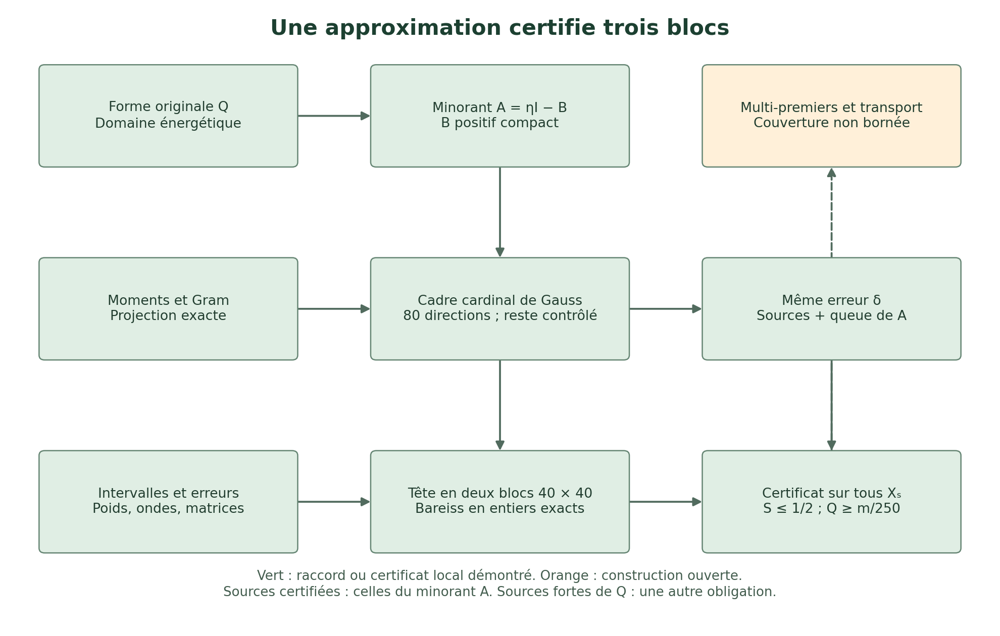

---
title: "Un opérateur commun : tête, sources et queue certifiées"
subtitle: "Programme Riemann - V6.48 - Document 73"
author: "Vincent P. P. NOËL - dossier de recherche, rédaction assistée"
date: "13 octobre 2026"
---

# 1. Résultat et portée

**Théorème local.** Pour tous les tests complexes admissibles de \(X_S\),
pour tout \(0<S\le1/2\),
\[
\boxed{Q_W(f)\ge\frac1{250}\|f\|_2^2,
\qquad Q_W(f)\ge\frac1{2000}R(f).}
\]
La métrique quadratique est \(R=m+\mathcal E\), avec \(m(f)=\|f\|_2^2\).
Sa racine carrée est une norme. Le domaine comprend les fonctions de support
\([-S,S]\), d'énergie finie, dont les deux moments exponentiels s'annulent.
Le certificat porte sur cet espace infini entier. Il ne repose pas sur une
liste de tests, ni sur des données de zéros, ni sur RH.

La marge massique complète est supérieure à 0,0047. La même construction
certifie une tête polynomiale de 80 dimensions, ses sources croisées et sa
queue, pour un **minorant borné** de la forme. Les véritables sources fortes
de la forme originale ne sont pas calculées par simple changement de nom.
Les bornes plus fortes de V647 sur \(S\le3/8\) restent disponibles.

La couverture reste bornée. Les nouveaux premiers, la règle de transport
jusqu'à l'infini, les anciennes branches, collisions et coefficient complexe
A gardent leurs questions ouvertes. Cette version établit un raccord local
exécuté ; elle ne revendique ni preuve de RH ni priorité bibliographique.

# 2. Pourquoi cette représentation a un sens

Le coût d'une oscillation et son accord avec un déplacement premier sont
gardés ensemble. Le plafond du coût fournit alors un opérateur compact. On
peut approcher cet opérateur par une matrice, à condition de mesurer tout ce
qui échappe à la matrice. La même erreur contrôle les directions de queue et
les attaches entre tête et queue : c'est le coup double recherché.

Le cadre de Gauss traduit une fonction polynomiale en valeurs à des repères
avec des poids précis. Il conserve exactement les produits scalaires des
polynômes concernés. Les valeurs aux repères seules ne donnent aucune
garantie sur une fonction quelconque : le reste d'interpolation fournit le
pont vers tout l'espace.

| Traduction | Conservé | Erreur ou garde |
|---|---|---|
| Fourier unitaire | Masse, phases et forme exacte | Intégration en \(dt\), sans facteur supplémentaire |
| Projection des moments | Toutes les directions admissibles | Gram de la métrique L² |
| Minorant borné | Implication suffisante vers le signe | Les sources exactes de Q ne sont pas identiques |
| Cadre cardinal de Gauss | Gram des polynômes, exactement | Nœuds, poids et reste à certifier |
| Matrice vers opérateur | Majorant de la plus grande valeur | Erreur en norme opérateur sur tout l'espace |
| Inclusion des supports | Moments et formes globales | Seulement les supports sous le plafond certifié |

Les coefficients opératoires sont sans dimension. Les amplitudes portent
\(A_{\rm amp}\), et \(m,\mathcal E,Q_W,R\) portent \(A_{\rm amp}^2\).
Ce suivi d'unités est une arithmétique de types, sans énergie physique ni
variable temporelle supposée.

# 3. L1-L2 : identité conjointe et projection

**Lemme L1.** À \(S=1/2\), seul le premier 2 agit. Avec la Fourier unitaire,
\[
\widehat f(t)=(2\pi)^{-1/2}\int f(x)e^{-itx}dx,
\quad w_2=\frac{\log2}{\sqrt2},\quad
C_0=\log(8\pi)+\gamma_E+\frac\pi2,
\]
\[
a(t)=\sum_{n\ge0}\frac{2t^2}{b_n(b_n^2+t^2)},\quad b_n=2n+\frac12,
\qquad b(t)=a(t)+2w_2(1-\cos(t\log2)),
\]
on a
\[
Q_W(f)=\int_{\mathbb R}b(t)|\widehat f(t)|^2dt-(C_0+2w_2)m(f).
\]
**Preuve.** Plancherel transforme les différences de translations en
\(2(1-\cos(td))\). L'expansion positive du poids
\(e^{-d/2}/(1-e^{-2d})\) donne \(a\). Le déplacement premier a le
multiplicateur \(\cos(t\log2)\). La condition \(2S=1<\log3\) exclut les
autres premiers. Ajouter puis soustraire \(2w_2m\) donne l'identité.

**Lemme L2.** Soit \(P_W=I-\Pi_W\), où
\(W=\operatorname{span}\{\cosh(x/2),\sinh(x/2)\}\). Le Gram est
\[
G_W=\operatorname{diag}(S+\sinh S,\sinh S-S).
\]
Les ondes projetées sont \(r_{+,t}=P_W\cos(tx)\) et
\(r_{-,t}=P_W\sin(tx)\). Les parités se séparent sans couplage. Les tests
admissibles sont conservés par \(P_W\).
**Preuve.** Les deux générateurs sont orthogonaux par parité. L'intégration
de leurs carrés donne le Gram. Les moments nuls signifient exactement
\(f\perp W\). Tous les produits de parités opposées ont une intégrale nulle.
Les mêmes relations valent sur les espaces complexifiés.

Les moments des ondes, notés \(c(t),s(t)\), viennent de
\[
z_S(t)=\frac{2\sinh((1/2+it)S)}{1/2+it},\quad
c(t)=\Re z_S(t),\quad s(t)=\Im z_S(t).
\]
Le programme les évalue par des formules réelles et le Gram exact. Il ne
substitue pas le Gram d'une grille à ce Gram des moments.

# 4. L3 : un minorant borné, identité moins compact

**Lemme L3.** Posons \(U=8\), \(\phi_U=(U-b)_+\). Dans chaque parité,
\[
B_U=\frac1\pi\int_0^\infty\phi_U(t)
|r_t\rangle\langle r_t|dt,
\qquad A_U=(U-C_0-2w_2)I-B_U.
\]
Alors \(Q_W(f)\ge\langle f,A_Uf\rangle\) sur son domaine. L'opérateur
\(B_U\) est positif, compact, à noyau lisse.
**Preuve.** \(b\ge\min(b,U)=U-(U-b)_+\), puis la Fourier et la parité
fournissent le facteur \(1/\pi\). Le multiplicateur \(a\) est croissant et
tend vers l'infini ; le poids \(\phi_U\) a donc un support fréquentiel
compact. L'intégrale d'opérateurs positifs de rang un a une trace finie.
Son noyau est lisse car les fréquences sont bornées.

La série positive et sa queue par intégrale donnent effectivement
\[
a(90)\in[8{,}0340523942,\,8{,}0341691405].
\]
Puisque \(b\ge a\), toutes les contributions au-delà de \(T=90\) sont
nulles. Il s'agit d'une exclusion globale certifiée, pas du minimum observé
sur une grille finie.

L'intégration des opérateurs conserve le même test dans toutes les couches.
La norme d'une somme peut être plus petite que la somme des normes, dont les
directions maximales pourraient différer. V647 démontrait ce pont ; cette
version certifie sa norme sur un espace complet.

# 5. L4 : le cadre cardinal de Gauss

**Lemme L4.** Soient \(\xi_i\) les racines du polynôme de Legendre \(p_N\),
\(x_i=S\xi_i\), et \(w_i\) les poids de Gauss sur \([-S,S]\). Si
\(l_i(x_j)=\delta_{ij}\) sont les polynômes cardinaux, alors
\[
\int l_i(x)l_j(x)dx=w_i\delta_{ij}.
\]
Les fonctions \(l_i/\sqrt{w_i}\) constituent une base orthonormale de
l'espace polynomial de degré inférieur à \(N\). Le vecteur de coordonnées
de l'interpolant d'une fonction \(r\) est \((\sqrt{w_i}r(x_i))_i\).
**Preuve.** Gauss intègre exactement tout polynôme de degré au plus
\(2N-1\). Le produit de deux cardinaux a degré au plus \(2N-2\). L'évaluer
aux nœuds donne immédiatement le Gram diagonal. La symétrie des nœuds sépare
les deux parités ; avec \(N=80\), chaque bloc a dimension 40.

Les nœuds proposés numériquement sont certifiés par des changements de signe
**exacts en entiers**. Quarante intervalles positifs disjoints, reflétés par
parité, donnent 80 racines distinctes d'un polynôme de degré 80 ; chaque
intervalle contient donc exactement une racine. Les poids sont encadrés par
\[
w_i=\frac{2S}{(1-\xi_i^2)p_N'(\xi_i)^2}.
\]
La dérivée est évaluée rationnellement au centre de l'intervalle. La borne
\(|p_N''|\le N^4\), issue de l'inégalité de Markov et de \(|p_N|\le1\),
encadre sa variation. Cela évite l'élargissement excessif d'une récurrence
intervalle près d'une racine. Les valeurs décimales de Nyström ne constituent
aucune prémisse de précision.

Si \(I_N\) désigne l'interpolation et
\(L_N=(2N)!/[2^N(N!)^2]\) le coefficient dominant de \(p_N\),
\[
\left|\prod_i(x-x_i)\right|\le\frac{S^N}{L_N}.
\]
Le reste de Lagrange des ondes réelles est donc majoré par
\((TS)^N/(N!L_N)\). Les dérivées oscillantes ont module au plus \(T^N\) ;
aucun facteur \(e^{TS}\) n'est ajouté. Les générateurs exponentiels donnent
une correction avec \(e^{S/2}(S/2)^N\).
À \(S=1/2\), \(\sinh(1/2)-1/2>1/48\) et \(e^{1/4}<4/3\), d'où
\[
\|r_t-I_Nr_t\|_2\le\varepsilon_N
=\frac{45^N+(28/3)(1/4)^N}{N!L_N},\quad N=80.
\]
**Preuve.** Appliquer le reste aux ondes puis aux deux générateurs. Le
coefficient de leur projection est majoré par Cauchy, au plus \(\sqrt{48}<7\).
Le produit avec \(e^{1/4}\) est inférieur à \(28/3\).

On interpole les ondes **après** leur projection sur les moments. Les deux
projections ne sont pas supposées commuter. La tête polynomiale appartient
au L² ambiant ; ses vecteurs n'ont pas à appartenir au domaine énergétique
de Q, puisqu'on n'y évalue que l'opérateur borné B.

# 6. L5 : aucune erreur ne disparaît dans la traduction

**Lemme L5.** Si l'approximation des ondes a une erreur uniforme
\(\varepsilon\) en L² et si \(\|r_t\|\le1\), le changement de l'opérateur
pondéré est au plus
\[
\frac{UT}{\pi}(2\varepsilon+\varepsilon^2).
\]
**Preuve.** La différence de deux produits de rang un a une norme au plus
\((\|r\|+\|v\|)\|r-v\|\). Intégrer et utiliser \(0\le\phi\le U\).
La même formule, avec \(1+\varepsilon_N\), couvre l'évaluation de
l'interpolant déjà approché.

Le poids est construit à partir d'une table encadrée de b, au pas
\(H=1/100\). Ses valeurs centrales sont quantifiées à \(2^{-44}\), puis
interpolées **en entiers exacts**. Les dérivées vérifient
\[
|b'|<13/2,\qquad |b''|<33.
\]
Pour les établir, on dérive la série positive :
\(\sup a'\le(21/16)\sum b_n^{-2}\),
\(\sum b_n^{-2}\le109/25\), et
\(\sup|a''|\le4\sum b_n^{-3}\le32{,}416\).
La phase première ajoute moins de 0,7 et 0,49 respectivement.

Si \(r_{\rm tab}\) est l'erreur maximale des valeurs tabulées, le poids
constant aux milieux du pas fréquentiel \(h=1/1000\) s'écarte du vrai poids
d'au plus
\[
\delta_\phi=r_{\rm tab}+33H^2/8+(13/2)h/2.
\]
La partie positive est 1-lipschitzienne. Plancherel et la contraction de
\(P_W\) donnent une erreur **opératoire** au plus \(\delta_\phi\), sans
facteur \(T/\pi\).

Pour le poids constant de chaque cellule, l'erreur des milieux de
\(|r_t\rangle\langle r_t|\) est majorée par
\[
\delta_{\rm milieux}\le
\frac{(47/15)S^3\,UT\,h^2}{24\pi}.
\]
On utilise la borne sur la dérivée seconde de ce produit de rang un, comme
dans V647. Le poids constant est borné entre 0 et U ; cette garde est testée.

Les sinus et cosinus sont évalués par Taylor sur \(z/64\), puis six
doublements d'angle. Les coefficients, les opérations et les restes sont
encadrés vers l'extérieur. Les exponentielles des générateurs sont traitées
par Taylor de degré 24. Les intervalles des nœuds et de leurs poids entrent
dans les **vecteurs pondérés**, avant calcul de leur erreur L².
Le certificat n'utilise ni les sinus de NumPy ni la digamma flottante.

La multiplication matricielle binaire64 a son propre budget. Avec
\(u=2^{-53}\), \(n_f=90\,000\),
\[
\gamma_k=\frac{ku}{1-ku},\quad k=2n_f+128,\qquad
\delta_{\rm matrice}\le32\gamma_kUT/\pi.
\]
**Justification.** Sous opérations IEEE correctement arrondies, un produit
de k facteurs d'erreur s'écarte de 1 d'au plus \(\gamma_k\). La longueur
choisie domine les produits, sommes, poids et accumulations par blocs. Les
produits absolus sont dominés par les sommes de normes des colonnes ; la
garde de norme et le facteur 32 couvrent ces sommes. La symétrisation et la
quantification matricielle ont aussi leur erreur explicite.
Ce modèle arithmétique est déclaré ; le format binaire64 et des cas de
contrôle de l'arrondi au plus proche sont vérifiés ;
il ne constitue pas une vérification formelle du compilateur ou du matériel.

| Erreur opératoire certifiée | Majorant décimal indicatif |
|---|---|
| Poids conjoint et cellules | 0.00372087309 |
| Milieux du noyau | 3.74014116e-06 |
| Interpolation spatiale | 1.52014444e-07 |
| Arrondis matriciels | 1.4666418e-07 |
| Vecteurs pondérés, bloc pair | 1.16287242e-10 |
| Total, bloc pair | 0.00372491202 |

# 7. L6 : le plafond matriciel devient un plafond infini

**Lemme L6.** La matrice quantifiée \(M_N\) est rationnelle et symétrique.
Le calcul entier de Bareiss vérifie
\[
\tau_+I-M_{N,+}\succ0,\quad \tau_+=1{,}63860;
\qquad \tau_-I-M_{N,-}\succ0,\quad \tau_-=1{,}48237.
\]
Alors \(\lambda_{\max}(M_N)<\tau\). Si l'erreur totale en norme de
l'opérateur est au plus \(\delta\),
\[
\|B_U\|\le\tau+\delta.
\]
**Preuve.** Les déterminants principaux calculés par Bareiss sont positifs,
avec toutes les divisions exactes ; le critère de Sylvester prouve les
inégalités. Le solveur flottant ne propose que les plafonds candidats.
Pour tout vecteur, la forme de B est majorée par celle de sa matrice plus
\(\delta\|f\|^2\). B étant positif, cela majore sa norme entière.
Une éventuelle petite valeur négative de la matrice arrondie ne change pas
cette argumentation.

| Quantité certifiée | Pair | Impair |
|---|---|---|
| Norme B, majorant | 1.642324912 | 1.486094912 |
| Erreur totale δ | 0.003724912 | 0.003724912 |
| Marge massique sur les deux blocs | 0.004745324 | même borne |
| Marge dans R sur les deux blocs | 0.000690978 | même borne |

# 8. L7 : signe, R et tous les sous-supports

**Lemme L7.** Avec \(C_1=C_0+2w_2\), le budget certifié donne
\(c=U-C_1-\max(\tau_\pm+\delta_\pm)>0{,}0047\). Donc \(Q_W\ge cm\).
Les bandes du déplacement log2 sont disjointes à ce support ; Cauchy donne
\(|Q_{\rm pr}|\le w_2m\), puis \(Q_W\ge\mathcal E-(C_0+w_2)m\).
En notant \(L=C_0+w_2\),
\[
Q_W\ge\frac{c}{c+L+1}R.
\]
**Preuve.** \(m\le Q_W/c\) et \(\mathcal E\le Q_W+Lm\). Additionner et
réarranger donne la formule. Les constantes lisibles
\(c\ge1/250\), \(L<6\) entraînent
\(Q_W\ge R/1751\ge R/2000\).
Le prolongement par zéro conserve les moments et les formes globales ; tous
les domaines \(X_S\), \(S\le1/2\), sont inclus dans le domaine certifié.
Les meilleures constantes déjà prouvées sur les supports plus petits
conservent leur portée.

# 9. L8 : tête, sources et queue du même minorant

**Lemme L8.** Soit \(\Pi_N\) la projection orthogonale sur le cadre
polynomial, et \(\widetilde B_N\) l'opérateur de matrice \(M_N\) dans sa
base orthonormale. La même borne
\(\|B_U-\widetilde B_N\|\le\delta\) donne
\[
\begin{aligned}
\|\Pi_NB_U\Pi_N\|&\le\tau+\delta,\\
\|(I-\Pi_N)B_U(I-\Pi_N)\|&\le\delta,\\
\|(I-\Pi_N)B_U\Pi_N\|&\le\delta.
\end{aligned}
\]
Pour les sources \(\rho_i=(I-\Pi_N)B_Ue_i\),
\[
\operatorname{Gram}(\rho_i)\preceq\delta^2 I.
\]
**Preuve.** Les blocs de queue et croisés de \(\widetilde B_N\) sont nuls.
Chaque bloc de la différence est donc une contraction de cette différence.
Le Gram des colonnes est le carré du bloc croisé. L'identité exige une base
orthonormale ; une autre base demande son Gram de tête.

Dans la métrique L² du minorant, posons \(\eta=U-C_1\). La tête de
\(A_U\) a un plancher \(\eta-\tau-\delta\), la queue a un plancher
\(\eta-\delta>0\), et le Schur satisfait
\[
\mathcal G_N\succeq
\left(\eta-\tau-\delta-\frac{\delta^2}{\eta-\delta}\right)I.
\]
Les trois bornes sont réellement assemblées en fractions exactes.

| Contrat du minorant A | Pair | Impair |
|---|---|---|
| Plancher de queue L² | 1.643345324 | 1.643345324 |
| Dette opératoire de Schur | 0.000008443 | 0.000008443 |
| Marge de Schur | 0.004736880 | 0.160966880 |

La tête finie, les sources et la queue sont donc certifiées ensemble pour
\(A_U\). Cela fournit une seconde vérification du raccord de signe.
La différence \(Q_W-A_U\) est positive, généralement non bornée : le signe
suffisant se transporte vers Q, mais les sources exactes de Q ne sont pas
celles de A. La norme opératoire L² suffit pour B ; le transport général de
Q conserve ses exigences propres de norme de graphe.

# 10. Les quatre portes et la suite

| Porte | Ce qui est acquis | Ce qui reste à construire |
|---|---|---|
| Arithmétique | Compensation du premier2 conservée et certifiée jusqu'à1/2 | Coût conjoint multi-premiers et loi de signe couvrante |
| Tête praticable | Cadre exact de Gauss ; 40 dimensions par parité | Cadres et plafonds opératoires lorsque de nouveaux premiers entrent |
| Couplages | Sources du minorant, Gram et dette de Schur certifiés | Sources fortes de Q dans la méthode générale ; transport entre supports |
| Couverture | Tous \(0<S\le1/2\) | Une famille non bornée, nouveaux premiers et convergence |

La prochaine construction porte sur le **coût conjoint multi-premiers**,
avec les mêmes tests de traduction et la même brique d'erreur opératoire.
L'objectif est un principe de compensation et de transport ; allonger
seulement la liste des supports ne fournit pas ce principe. Le pilote de
Bellman historique reste documentaire : aucun score ne mesure ici une
probabilité de démontrer RH.

# 11. Vérification et références

Les paramètres ont été choisis après exploration, puis figés avant
validation : \(S=1/2\), \(U=8\), \(T=90\), \(N=80\),
\(h=1/1000\), \(H=1/100\), 256 termes de série, 160 bits pour les
intervalles scalaires et 44 bits fixes pour les tables et matrices.
Le journal conserve le protocole, son empreinte, le code, les nœuds,
poids, tables, matrices entières et déterminants principaux.

Références primaires : [NIST DLMF 3.5(v)](https://dlmf.nist.gov/3.5#v),
quadrature de Gauss ; [DLMF 18.3](https://dlmf.nist.gov/18.3), polynômes
orthogonaux ; [NumPy finfo](https://numpy.org/doc/stable/reference/generated/numpy.finfo.html),
format binaire64. Les identités de Weil et les ponts précédents sont
démontrés dans les documents 71 et 72. Ce texte est préparé pour relecture,
sans publication extérieure ni vérification formelle automatisée annoncée.

Reproduction depuis `3_Preuves_et_calculs` : lancer
`python scripts/v648_common_certificate_experiment.py`, puis
`python tests/run_all_tests.py`. Le diagnostic séparé est
`scripts/v648_common_operator_diagnostic.py`. Les résultats sont dans
`data/v648_common_certificate_resultats.json` ; le protocole dans
`data/v648_protocole_operateur_commun.json`.
