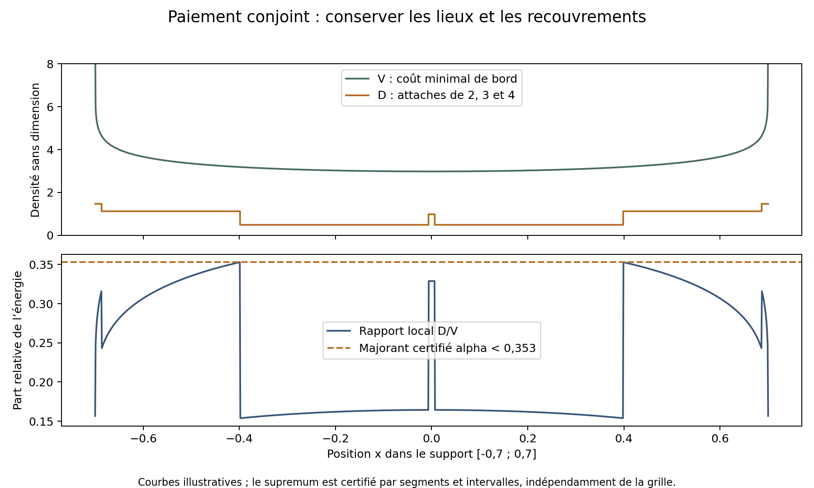

---
title: "Compensation multi-premiers : un paiement commun"
subtitle: "Programme Riemann - V6.49 - Document 74"
author: "Vincent P. P. NOËL - dossier de recherche, rédaction assistée"
date: "13 octobre 2026"
---

# 1. Ce qui est exécuté

**Théorème de paiement conjoint.** Pour toute fonction complexe portée par
\([-S,S]\), d'énergie archimédienne finie,
\[
|Q_{\rm pr}(f)|\le\alpha_S\mathcal E(f),\qquad
\alpha_S=\operatorname*{ess\,sup}_{|x|<S}\frac{D_S(x)}{V_S(x)}.
\]
Les bandes arithmétiques sont comptées avec leur multiplicité. Le programme
encadre ce supremum par intervalles, sans grille spatiale approximative.
La même énergie paie tous les premiers, une seule fois.

À \(S=1\), le calcul certifie \(\alpha_S<0{,}796\), tandis que la somme des
paiements séparés dépasse 1,24. Cette amélioration conserve une part positive
de l'énergie dans une borne de Q. Elle ne démontre pas le signe de Q : il faut
encore payer la masse soustraite. À \(S=2\), cette enveloppe dépasse 1 ; la
méthode suffisante perd sa réserve d'énergie, sans contredire RH.

Le certificat positif complet de V648 reste limité à \(S\le1/2\). Une petite
marge à \(S=0,55\) est observée sur l'opérateur conjoint ; elle est
**exploratoire**, sans intervalle opératoire complet. Aucune extension du
certificat positif ni preuve de RH n'est annoncée.



# 2. L1 : conserver les phases dans une même langue

Écrivons \(q=p^m<e^{2S}\), \(d_q=\log q\),
\(c_q=\log p/\sqrt q\), et \(h_f(d)=\int f(x)\overline{f(x-d)}dx\).
La convention de Fourier est unitaire, et
\[
Q_{\rm pr}=2\sum_q c_q\Re h_f(d_q),\qquad
Q_W=\mathcal E-C_0\|f\|_2^2-Q_{\rm pr}.
\]
Un terme au seuil exact \(d_q=2S\) est nul dans L² ; il peut être omis.

**Lemme L1.** Avec le multiplicateur archimédien a du document 73,
\[
b_S(t)=a(t)+\sum_q c_q|1-e^{itd_q}|^2,\qquad
C_S=C_0+2\sum_q c_q,
\]
\[
Q_W(f)=\int_{\mathbb R}[b_S(t)-C_S]|\widehat f(t)|^2dt.
\]
**Preuve.** Plancherel transforme chaque corrélation en cosinus. Puis
\(|1-e^{i\theta}|^2=2(1-\cos\theta)\). Ajouter les mêmes constantes à
b et C laisse exactement la forme originale. Les deux moments exponentiels
et leur Gram continuent de définir le même espace admissible.

Pour une phase fondamentale \(z_p=e^{it\log p}\), le terme de \(p^m\)
emploie \(z_p^m\), avec le poids \(\log p/p^{m/2}\).
Les termes 2 et 4 partagent une phase ; 4 n'est pas un nouveau premier.
Cette relation est un invariant symbolique et un invariant entre les
opérateurs : la translation de \(\log(p^m)\) est la m-ième puissance de la
translation de \(\log p\) sur la droite entière. La compression dans une
boîte ne commute pas automatiquement avec cette prise de puissance.

Les unités fictives sont inchangées : \([f]=A_{\rm amp}\),
\([Q_W]=[\mathcal E]=[R]=A_{\rm amp}^2\). Les coefficients et alpha sont
sans dimension. La positivité de b ne prouve pas celle de b moins C.

# 3. L2-L3 : les bandes et le coût de sortir

**Lemme L2.** La densité d'attaches est
\[
D_S(x)=\sum_q c_q\left[
\mathbf1_{[-S,S-d_q]}(x)+\mathbf1_{[d_q-S,S]}(x)\right].
\]
Alors \(|Q_{\rm pr}(f)|\le\int D_S(x)|f(x)|^2dx\).
**Preuve.** Pour chaque corrélation, appliquer \(2|uv|\le|u|^2+|v|^2\)
sur la zone où les deux copies se rencontrent. Les deux intégrales obtenues
sont exactement les deux bandes. Sommer les termes ne réutilise aucune
borne énergétique. Si \(d_q<S\), les bandes se recouvrent ; le point de
recouvrement reçoit deux contributions. À \(S=0,7\), c'est déjà le cas
pour le premier 2. Remplacer cette somme par une union serait faux.

**Lemme L3.** Pour \(w(t)=e^{-t/2}/(1-e^{-2t})\), définissons
\[
J(d)=\int_d^\infty w(t)dt
=\operatorname{atanh}(e^{-d/2})+\arctan(e^{-d/2}),
\]
\[
V_S(x)=J(S-x)+J(S+x).
\]
L'énergie vérifie \(\mathcal E(f)\ge\int V_S(x)|f(x)|^2dx\).
**Preuve.** Dans la norme de \(U_tf-f\), les déplacements qui sortent du
support rencontrent la valeur zéro. Leur contribution est le carré de f.
Tonelli additionne ces contributions positives. Le changement de variable
\(r=e^{-t/2}\) intègre \(2/(1-r^4)\) et donne J. Le poids w décroît ;
donc \(J'=-w\), \(J''=-w'>0\), et V est pair et convexe.
Il croît sur \([0,S)\).

En langage imagé, toutes les attaches empruntent la même caisse d'énergie.
La densité D est la facture locale, V le coût minimal déjà imposé à cet
endroit. Cette image explique le quotient ; les lemmes portent sa preuve.

# 4. L4 : un supremum calculable, sans échantillonnage

**Lemme L4.** Les changements de D sur \([0,S]\) sont situés aux
\(|d_q-S|\). Entre deux changements, D est constant. Son rapport à V
atteint son supremum essentiel au point le plus proche du centre, en prenant
la valeur de D du segment concerné.
**Preuve.** V est positif et croissant sur la demi-boîte. Les limites des
deux segments adjacents couvrent également les sauts de D. Les points isolés
n'affectent pas une forme L². Les lemmes L2 et L3 donnent alors le théorème.

Le programme calcule log, racines et J par intervalles. Il exige une
séparation certifiée des seuils d'activation et des points de changement.
Un seuil contenu dans un intervalle fermé est refusé, y compris aux
extrémités : un terme actif ne doit pas être silencieusement omis.
Les rapports de tous les segments sont conservés dans le journal.

| S | Termes actifs | Paiement joint, majorant | Somme séparée, majorant |
|---|---|---|---|
| 1/2 | 2 | 0.140411671 | 0.140411671 |
| 11/20 | 2, 3 | 0.188966655 | 0.253970450 |
| 3/5 | 2, 3 | 0.297479877 | 0.321336477 |
| 7/10 | 2, 3, 4 | 0.352902827 | 0.602731378 |
| 4/5 | 2, 3, 4 | 0.458218876 | 0.677493153 |
| 1 | 2, 3, 4, 5, 7 | 0.795208977 | 1.240835479 |
| 2 | 24 puissances | 4.499836209 | 8.823345064 |

Majorants décimaux arrondis vers le haut. Les fractions et intervalles binaires du journal sont les valeurs de calcul.


Les bornes inférieure et supérieure du journal encadrent le **supremum de
l'enveloppe D/V**. Elles ne sont pas des bornes inférieures de la norme
optimale du couplage arithmétique, car Cauchy peut perdre des phases.
L'enveloppe jointe conserve néanmoins la localisation et les recouvrements
que la somme des supremums séparés oublie.

# 5. L5 : changer de métrique au passage d'un seuil

**Lemme L5.** À l'entrée d'un terme q, posons
\(\delta=2S-d_q>0\), et supposons \(\delta\le S\). Alors
\[
|Q_q(f)|\le\frac{c_q}{J(\delta)+J(d_q)}\mathcal E(f).
\]
**Preuve.** Les deux bandes sont disjointes. V atteint sur chacune son
minimum au bord intérieur : ses distances aux extrémités sont delta et d.
L2 borne le couplage par \(c_q\) fois la masse des bandes ; L3 paie cette
masse avec \(J(\delta)+J(d_q)\). Les moments ne sont pas requis pour cette
majoration, donc elle vaut en particulier sur le domaine admissible.

Comme \(J(\delta)=\tfrac12\log(1/\delta)+O(1)\), le coefficient tend
vers zéro, au taux logarithmique. Ce n'est pas une borne linéaire en delta.
Le programme exécute cinq approches du seuil du premier 3.

La norme L² raconte une autre histoire. Pour un support juste après le
seuil, deux copies égales d'une bosse, portées par les deux bandes et de
masse totale 1, donnent \(Q_q=c_q\). Au seuil, le couplage est nul presque
partout. La norme de ce terme saute donc de zéro à \(c_q\) dans le L²
ambiant, sous identification par dilatation. Pour imposer les moments, deux
correcteurs lisses intérieurs indépendants ont des coefficients
\(O(\sqrt\delta)\) ; la norme admissible tend elle aussi vers \(c_q\).
Cette construction explique pourquoi la seule largeur des bandes ne fournit
pas une petite perturbation en L².

En revanche, \(|Q_q|\le\varepsilon_qR\), puisque \(\mathcal E\le R\).
Si une forme de base est **déjà certifiée sur le même support** par
\(Q_{\rm base}\ge\mu R\), ajouter q conserve
\(Q_W\ge(\mu-\varepsilon_q)R\) lorsque \(\varepsilon_q<\mu\).
Il reste à transporter la forme de base, les moments et la métrique entre
supports. Le certificat de V648 ne peut pas être utilisé sur un support plus
grand sans ce raccord.

# 6. L6-L7 : ce que les phases ne peuvent pas payer seules

**Lemme L6.** Pour une liste finie non vide de puissances premières et tout
T, le coût purement arithmétique vérifie
\[
\inf_{t\ge T}\sum_q c_q|1-e^{itd_q}|^2=0.
\]
**Preuve.** Choisir un premier de référence p0 et
\(t=2\pi n/\log p_0\). Sa phase et ses puissances sont exactement 1.
Le principe des tiroirs appliqué aux multiples des autres rapports
\(\log p/\log p_0\), dans un tore découpé en petits cubes, fournit des n
qui approchent simultanément des entiers. Ces n sont non bornés : avec deux
premiers distincts, une égalité exacte rendrait un rapport des logarithmes
rationnel, contraire à l'unicité de la factorisation. Avec un seul premier,
prendre ses périodes arbitrairement grandes. Les puissances conservent
l'approximation de leurs phases fondamentales. Le coût tend donc vers zéro.

Il n'existe ainsi aucune marge uniforme positive fournie par les seules
phases d'une liste finie. Le coût archimédien a reste nécessaire ; il croît
logarithmiquement et rend les sous-niveaux de b bornés. L6 ferme une voie
trop forte, sans fermer la compensation conjointe avec a.

**Lemme L7.** Si \(\alpha_S<1\) et si une borne indépendante
\(\mathcal E\ge\lambda m\) est certifiée, alors
\[
Q_W\ge[(1-\alpha_S)\lambda-C_0]m.
\]
**Preuve.** Conserver d'abord \((1-\alpha_S)\mathcal E\) dans la forme,
puis le minorer. On ne peut pas déduire
\(|Q_{\rm pr}|\le\alpha_S\lambda m\) d'une minoration de l'énergie.
Le programme expose cette algèbre comme une condition, sans authentifier
une borne énergétique arbitrairement fournie.

# 7. L8 : opérateur commun et queue fréquentielle

Avec \(\phi=(U-b_S)_+\), le même opérateur projeté que dans V648 donne
\(Q_W\ge[U-C_S-\|B_{S,U}\|]m\).
Tous les premiers partagent le même test, la même projection des moments et
la même matrice. Pour comparer une séparation, on partage explicitement
\(a/r\) et \(U/r\) entre les r termes. Alors
\[
\left(U-\sum_j b_j\right)_+\le\sum_j(U/r-b_j)_+.
\]
La norme de l'opérateur joint peut gagner deux fois : avant intégration par
cette inégalité, puis par des directions maximales distinctes.

| S | U=9 | U=9,5 | U=10 |
|---|---|---|---|
| 11/20 | -0.002935789 | -0.000454916 | +0.000583026 |
| 3/5 | -0.007295253 | -0.000854427 | -0.000111878 |
| 7/10 | -0.223780076 | -0.102567650 | -0.028217174 |


Ces nombres sont des diagnostics, non des plafonds de la norme infinie.
Deux résolutions sont exécutées pour chaque cas ; leur stabilité ne remplace
pas une erreur certifiée. Le petit signe positif à 0,55 n'est donc pas un
nouveau théorème de positivité. Augmenter U de 9 à 10 oblige ici à agrandir
la bande examinée de 300 à 700 et la tête spatiale correspondante.

**Lemme L8.** Découpons \(B=B_{\le T_0}+B_{>T_0}\). Comme \(b_S\ge a\),
\[
\|B_{>T_0}\|\le(U-a(T_0))_+.
\]
**Preuve.** Le poids de cette queue est majoré par le membre de droite.
Plancherel et la projection orthogonale contractante suffisent ; aucun
facteur proportionnel à la longueur de la queue n'est ajouté.

Pour les blocs tête H, queue K et croisement C d'un opérateur positif,
\(\|C\|^2\le\|H\|\,\|K\|\), par Cauchy appliqué à sa forme positive.
Ce raccord permettrait de traiter la haute fréquence par sa petite action
sur la tête, puis par Schur. Le contrôle effectif de cette action reste à
construire ; une borne globale grossière peut être insuffisante. La tête
polynomiale à bord discontinu n'offre pas gratuitement une décroissance
rapide. Il faudra comparer une tête lisse et le cadre cardinal existant.

# 8. Les quatre portes et le prochain protocole

| Porte | Brique acquise | Obligation suivante |
|---|---|---|
| Arithmétique | Coût conjoint exact ; enveloppe relative multi-premiers certifiée | Conserver davantage les phases et payer C0m |
| Tête | Diagnostic commun et comparaison à une séparation explicite | Tête basse fréquence et action de la haute fréquence certifiées |
| Couplages | Paiement des bandes avec multiplicité ; petite perturbation en R près d'un seuil | Sources exactes de Q et Schur du nouveau découpage |
| Couverture | Distinction rigoureuse entre saut L² et coût relatif petit | Transport des moments, formes et métriques entre supports |

Le prochain protocole fixe un support au-delà du seuil de 3, un découpage
fréquentiel et une tête, puis certifie leurs trois blocs. Une alternative
transporte la forme de base en norme R avant d'ajouter le nouveau premier.
Les deux stratégies réutilisent les mêmes gardes de traduction ; aucune ne
se résume à augmenter aveuglément le plafond de calcul.

Les questions historiques de branches, collisions et coefficient complexe A
restent ouvertes. Le registre de Bellman décrit des obligations de recherche,
sans probabilité annoncée de résoudre RH ni score réinventé après coup.

# 9. Reproduction et références

Depuis `3_Preuves_et_calculs`, exécuter :

```text
python scripts/v649_joint_payment_experiment.py
python scripts/v649_multi_prime_diagnostic.py
python tests/run_all_tests.py
```

Le paiement conserve les fractions et
intervalles binaires à 240 bits ; le diagnostic est distinct et flottant.
Le code, son empreinte, les segments et les comparaisons sont archivés.

Les identités de la forme et les certificats antérieurs sont détaillés dans
les documents 71 à 73. La croissance du multiplicateur employé est cohérente
avec l'expansion de la digamma : [NIST DLMF 5.11.2](https://dlmf.nist.gov/5.11#E2).
Les lemmes ci-dessus sont reconstruits avec leurs preuves ; aucune priorité
bibliographique ni vérification par assistant formel n'est revendiquée.
