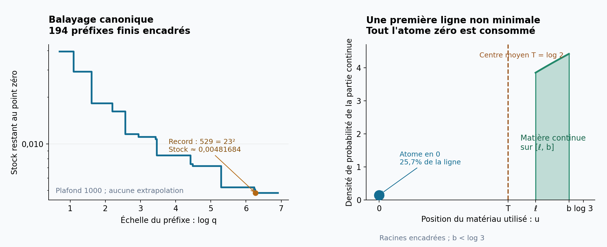

# Ce que cette passe apporte

Une contribution première devient une demande de masse située en un point.
La partie archimédienne fournit une matière continue. Un appariement positif
qui conserve le centre moyen de chaque demande impose le signe par convexité.
Le problème est de construire cet appariement pour **toutes** les demandes.

Nous avons maintenant trois briques avec leurs preuves : une sommation de
lignes compatible avec une réserve infinie ; un bilan qui relie le stock au
point zéro aux défauts de Fenchel ; une opération initiale non minimale qui
consomme entièrement ce stock et laisse intacte l'obligation globale suivante.
Les calculs finis et la confrontation indépendante accompagnent ces briques.

**Aucun signe global n'est démontré.** Un balayage qui réussirait à tous les
rangs serait équivalent à RH. La construction initiale ci-dessous est, elle,
établie sans RH dans le modèle d'intervalles déclaré.

# 1. Les objets, dans un ordre lisible

Le paramètre \(t\) désigne une échelle logarithmique. Il ne désigne pas
l'abscisse d'un zéro. Pour une puissance première \(q=p^k\), poser

\[
x_q=\log q,\qquad c_q=\frac{\log p}{\sqrt q}.
\]

Le signal arithmétique de Suzuki s'écrit

\[
S(t)=A(t)-\sum_{q=p^k}c_q(t-x_q)_+,\qquad t\ge0,
\]

\[
\begin{aligned}
A(t)&=4(e^{t/2}+e^{-t/2}-2)-\frac{C_0t}{2}
       +\sum_{n\ge0}\frac{1-e^{-b_nt}}{b_n^2},\\
C_0&=\log(8\pi)+\gamma_E+\frac{\pi}{2},
\qquad b_n=2n+\frac12.
\end{aligned}
\]

Le symbole \((z)_+\) signifie \(\max(z,0)\). Pour une mesure positive \(\lambda\),
son potentiel est

\[
\mathcal P_\lambda(t)=\int(t-u)_+\,\lambda(du).
\]

Les théorèmes 1.6 et 1.7 de Suzuki2023 donnent, pour ce signal précis,
\(RH\iff S\ge0\) partout et \(RH\iff S\) bornée. Son extension2025 permet
de demander seulement un signe après un seuil. Ce pont utilise la transformée
liée à \(\xi'/\xi\) et l'absence de zéros réels de la fonction complétée.
Un signal positif quelconque ne possède pas ce pouvoir.

Fixons \(T=\log2\). Une différentiation exacte donne

\[
\begin{aligned}
A'(t)&=2(e^{t/2}-e^{-t/2})-\frac{C_0}{2}
       +\operatorname{atanh}(e^{-t/2})+\arctan(e^{-t/2}),\\
\beta(t)&=A''(t)=e^{t/2}
                 -\frac{e^{-5t/2}}{1-e^{-2t}}>0\quad(t\ge T).
\end{aligned}
\]

Poser \(m=S(T)/T\) et \(a=S'(T+)\), la dérivée droite incluant \(q=2\).
Les encadrements donnent \(m>0\), \(a<0\). Ici les mesures se simplifient en

\[
\mu=m\delta_0+\mathbf1_{(T,\infty)}\beta(u)\,du,\qquad
\nu=(m-a)\delta_T+\sum_{q>2}c_q\delta_{x_q}.
\]

Elles sont positives, localement finies, de masse totale infinie. On a
\(\mathcal P_\mu-\mathcal P_\nu=S\) pour \(t\ge T\), et \(mt\) pour \(0\le t<T\).
Le raccord \((m-a)\delta_T\) a une masse d'environ \(0{,}35684525\) ;
ce n'est pas la masse première \(c_2\), d'environ \(0{,}49012907\).

Les unités fictives peuvent rendre le bilan lisible : si \([t]=L\) et
\([S]=E\), les masses \(c,m\) ont l'unité \(E/L\), le premier moment l'unité
\(E\), et la densité \(\beta\) l'unité \(E/L^2\). Cette convention ne crée
aucun signe.

# 2. Brique A : des lignes fixées une fois pour toutes

Écrire \(\nu=\sum_jc_j\delta_{x_j}\). Supposons que l'on construise des
mesures positives \(\eta_j\) telles que

\[
\eta_j(\mathbb R)=c_j,\qquad
\int u\,\eta_j(du)=c_jx_j,\qquad
\sum_{j\le N}\eta_j\le\mu\quad\text{pour tout }N.
\]

Alors \(\sigma=\sum_j\eta_j\le\mu\) est une mesure bien définie. Chaque
\(K_{x_j}=\eta_j/c_j\) est un noyau de probabilité de barycentre \(x_j\).
Par Jensen et sommation de quantités non négatives,

\[
\mathcal P_\mu(t)-\mathcal P_\nu(t)
\ge\sum_j\left[\mathcal P_{\eta_j}(t)-c_j(t-x_j)_+\right]\ge0.
\]

À \(t\) fixé, les deux potentiels sont finis : aucune soustraction de masses
globales infinies n'est faite. Fixer les lignes successivement évite la fuite
de premier moment qui peut survenir dans une limite de plans recalculés.

**Coup double conditionnel.** Ce sous-couplage suffirait au signe, donc à RH.
Il couvrirait ensuite automatiquement toute \(\mu\). En effet, son résidu
\(\rho=\mu-\sigma\ge0\) vérifie \(\mathcal P_\rho\le S\). Une masse positive
de \(\rho\) dans \([0,B]\) entraînerait
\(S(t)\ge(t-B)\rho([0,B])\), contrairement à la bornitude sous RH.

# 3. Brique B : un geste de transport et son vrai test

Pour un reliquat positif \(R\) de masse infinie, notons \(G_R(v)\) son quantile :
on compte la matière depuis la gauche et l'on lit la position de la
\(v\)-ième unité de masse.

Pour une demande \(c\delta_x\), un bloc de masse \(c\) existe si et seulement si

\[
\frac1c\int_0^cG_R(v)\,dv\le x.
\tag{A}
\]

Si (A) est satisfaite, on translate le bloc de masse jusqu'à trouver \(s\ge0\)
tel que

\[
\frac1c\int_s^{s+c}G_R(v)\,dv=x,\qquad
\eta=(G_R)_\#\bigl(\mathbf1_{[s,s+c]}dv\bigr).
\]

La moyenne du bloc est continue, non décroissante et tend vers l'infini.
Sa valeur initiale est la plus petite moyenne possible pour une
sous-mesure de masse \(c\). Cela prouve le critère et la conservation.
On retire \(\eta\) de \(R\), puis l'on traite la demande suivante.

La positivité du reliquat est automatique après un retrait admissible.
**L'admissibilité de la prochaine ligne ne l'est pas.** La théorie finie des
ombres et leur associativité, après troncature suffisamment grande,
montrent que la réussite à tous les rangs équivaut à
\(\mathcal P_\nu\le\mathcal P_\mu\) partout. Le test infini reste donc
exactement l'obligation de RH.

# 4. Brique C : le stock est un défaut arithmétique

Soit \(S_N=\mathcal P_\mu-\mathcal P_{\nu_N}\), où le préfixe inclut le raccord
en \(T\). Pour le balayage canonique réussi, le stock restant à zéro vaut

\[
r_N=(\mu-\sigma_N)\{0\}=\inf_{t>0}\frac{S_N(t)}t.
\tag{B}
\]

**Preuve élémentaire.** Jensen donne \(S_N(t)\ge r_Nt\). Considérons la dernière
ligne ayant pris de la matière en zéro, et son extrémité droite \(b\). Elle
épuise tout le reliquat entre zéro et \(b\), sauf \(r_N\delta_0\).
Les lignes précédentes ont leur extrémité droite au plus \(b\) : sinon
une ligne antérieure aurait un barycentre supérieur à celui de cette ligne,
car les intervalles déjà balayés ne contiennent plus de matière disponible.
Les lignes suivantes qui évitent zéro prennent leur masse au-delà de \(b\).
Au point \(b\), tous les écarts de Jensen concernés sont donc nuls :
\(S_N(b)=r_Nb\). Si aucune ligne ne prend en zéro, le rapport vaut \(m\)
avant le premier support positif.

Ordonner les puissances premières originales, y compris \(q=2\), et poser

\[
C_j=\sum_{i\le j}c_i,\qquad L_j=\sum_{i\le j}c_ix_i.
\]

La somme des charnières est le maximum des droites \(C_jt-L_j\). Ainsi,
indépendamment de l'existence d'un transport, le budget radial du préfixe est

\[
\widehat r_N=\min\{m,d_1,\ldots,d_N\},\qquad
d_j=\min_{t\ge T}\frac{A(t)-C_jt+L_j}{t}.
\tag{C}
\]

Pour les préfixes non vides de ce dossier, l'optimum est intérieur.
Son point \(\tau_j\) et sa valeur satisfont

\[
\tau_jA'(\tau_j)-A(\tau_j)=L_j,\qquad
d_j=A'(\tau_j)-C_j.
\]

L'équation est strictement croissante puisque sa dérivée vaut \(t\beta(t)>0\).
Le terme linéaire contenant \(C_0\) s'y annule exactement.

Le lien avec le défaut de Fenchel \(H_j=L_j-A_T^*(C_j)\) est précis.
Ici \(A_T^*(c)=\sup_{t\ge T}(ct-A(t))\).
Si \(A'(\theta_j)=C_j\), alors

\[
H_j=\int_{\theta_j}^{\tau_j}u\beta(u)\,du,\qquad
d_j=\int_{\theta_j}^{\tau_j}\beta(u)\,du.
\tag{D}
\]

Ils ont exactement le même signe. Le défaut de Fenchel devient donc un
stock de transport, et réciproquement. Si le transport existe, (B) et (C)
coïncident. La nonnégativité de tous les \(\widehat r_N\) reste à démontrer.

# 5. La bifurcation : traiter toute l'origine en une fois

Le balayage minimal laisse \(r_N>0\) après tout préfixe fini sous RH, alors
que son stock final doit être nul. Il lui faut donc une infinité de lignes
issues de positions arbitrairement grandes qui alimentent encore zéro.
**Ce balayage précis a nécessairement une portée non bornée.**
Cela ne s'applique pas à tous les noyaux possibles.

Une autre première ligne élimine ce stock immédiatement. Construire

\[
\eta=m\delta_0+\mathbf1_{[\ell,b]}\beta(u)\,du,
\]

avec

\[
\int_\ell^b\beta(u)\,du=-a,\qquad
\int_\ell^bu\beta(u)\,du=T(m-a).
\tag{E}
\]

Elle a la masse \(m-a\) et le barycentre \(T\). De plus \(\eta\le\mu\).
Le calcul par intervalles établit l'existence d'un couple exact tel que

\[
0{,}84097046\le\ell\le0{,}84097048,\qquad
1{,}02059031<b<1{,}02059034<\log3.
\]

**Justification de l'existence.** Pour chaque \(\ell\), l'équation de masse
détermine un unique \(b(\ell)\), car \(\beta>0\). À masse fixée, la dérivée
du premier moment par rapport à \(\ell\) est
\((b-\ell)\beta(\ell)>0\). Les deux bornes rationnelles de \(\ell\) donnent
des écarts de moment de signes opposés, encadrés strictement. Le théorème
des valeurs intermédiaires donne le couple exact de (E).
Les décimales ne sont pas utilisées comme des coefficients exacts du noyau.

Poser \(c=m-a\) et \(J=\mathcal P_\eta-c(t-T)_+\ge0\). Puisque toute la
ligne est supportée dans \([0,b]\), son écart \(J\) est nul pour \(t\ge b\).
Le nouveau problème porte sur

\[
\mu'=\mu-\eta,\qquad \nu'=\nu-c\delta_T.
\]

Son signal \(\mathcal P_{\mu'}-\mathcal P_{\nu'}\) est automatiquement
non négatif avant \(\log3\), car aucun atome de \(\nu'\) n'y intervient,
et il égale exactement \(S\) dès \(b\). L'obligation globale est conservée.

**Deux effets acquis sans RH :** toute la réserve en zéro est consommée ;
la première demande est satisfaite par une seule ligne de portée \(T\).
Il faut recalculer les lignes suivantes sur \(\mu'\). Les anciennes lignes
du balayage minimal ne peuvent pas être recopiées sans contrôle.

# 6. Ce que les calculs finis établissent

Le plafond \(q\le1000\) contient 193 puissances premières originales.
Le transport utilise 192 atomes \(q>2\) et un raccord en \(T\).
Le fichier de réserve encadre 194 préfixes, préfixe vide compris.

| Objet | Résultat | Portée |
|---|---|---|
| Réserve radiale minimale | Environ \(0{,}00481683660325\), record \(q=529=23^2\) | Préfixes finis, intervalles 400 bits |
| Position du record | Environ \(6{,}2777323555\) | Minimum du signal tronqué divisé par \(t\) |
| Noyaux continus explicites | Balayage à 60 chiffres, bilans exportés | Diagnostic, sans encadrement de chaque noyau |
| Première ligne non minimale | Racines de (E) encadrées, \(\eta\le\mu\) | Brique initiale sans RH |
| Signe scalaire original | Fenêtre \([\log2,\log1000]\) couverte | Ne couvre pas la queue ni toutes les formes de Weil |

La variante non minimale a été recalculée sur les trois plafonds suivants.
Les largeurs sont celles des supports des noyaux, hors ligne artificielle de bord.

| Plafond | Largeur maximale canonique | Largeur maximale après la nouvelle première ligne |
|---:|---:|---:|
| 10 | 2,275156 | 1,564702 |
| 100 | 4,515697 | 3,815500 |
| 1000 | 6,277732 | 5,580028 |

La réserve en zéro est nulle aux trois plafonds ; les préfixes communs de
la variante concordent dans les fichiers à 60 chiffres. Il reste à 1000
une réserve **diffuse** d'environ \(0{,}0054169160\) près de \(T\).
Le coût quadratique total du plan fermé est inchangé : les marginales
le déterminent. Le retrait de l'atome initial ne paie donc pas toute la
difficulté globale. Ces comparaisons restent des diagnostics.

Une fermeture finie permet aussi de vérifier les bilans au bord.
Pour \(L=\log X\), choisir \(U>L\) tel que

\[
\int_L^U(u-L)\beta(u)\,du=S_X(L),
\qquad D=S_X'(U)\ge0.
\]

Les mesures \(\mu|_{[0,U]}\) et \(\nu_X+D\delta_L\) ont alors mêmes masse
et premier moment. Après \(L\), leur différence de potentiels vaut
\(\int_t^U(u-t)\beta(u)\,du\), puis zéro après \(U\).
À \(X=1000\), \(U\) est environ \(6{,}9666484578\), et \(D\) environ
\(1{,}9417621728\).

**Le bord \(D\delta_L\) est artificiel.** Il ne peut pas représenter littéralement
une combinaison positive de futurs atomes situés strictement après \(L\) :
à masse \(D\) égale, leur moment serait strictement supérieur à \(DL\).
Il faut rouvrir ce bord et ajouter la nouvelle matière continue.

# 7. Ce que l'audit ferme, et ce qu'il laisse ouvert

Un noyau entièrement atomique ne peut fournir la densité \(\beta\,du\).
Une loi fixe de déplacement, centrée et de portée bornée, est également
impossible : le théorème des nombres premiers imposerait
\(\int e^{-z/2}k(dz)=1\), tandis que Jensen strict impose alors \(k=\delta_0\),
incompatible avec une cible diffuse.

Une portée bornée pour des noyaux **variables et non minimaux** n'est pas
exclue ici. En revanche, elle ne peut accompagner une variance uniformément
positive : la bornitude du signal sous RH impose une variance moyenne
pondérée qui tend vers zéro à grande échelle.

La brique initiale ne fournit pas le signe du résidu à toutes les échelles.
Les prochaines questions sont maintenant concrètes :

1. Construire une règle non minimale pour les demandes suivantes, en conservant
   exactement leurs masses et leurs moments.
2. Trouver un invariant arithmétique qui impose l'admissibilité de chaque ajout,
   sans supposer une borne sur les premiers déjà équivalente à RH.
3. Conserver les lignes déjà validées et payer explicitement le nouveau bord.
4. Obtenir toutes les échelles, sans marge positive uniforme : sous RH, le
   signal a un infimum nul au-delà de tout seuil.

La couverture logique est acquise pour une construction de toutes les lignes.
La **loi de signe arithmétique globale** reste le verrou. Ces briques donnent
un sens opératoire au transport ; elles ne remplacent pas sa preuve globale.

\newpage

# Sources, statut et reproduction

Les critères de Suzuki et la théorie finie des ombres sont des résultats
publiés. Les bilans, preuves auxiliaires, encadrements et variantes de ce
document constituent un dossier de travail non relu extérieurement.
Aucune priorité de découverte n'est revendiquée.

- M. Suzuki, *Aspects of the screw function corresponding to the Riemann
  zeta-function*, JLMS108 (2023), 1448-1487, théorèmes 1.6 et 1.7 :
  <https://arxiv.org/pdf/2206.03682>.
- M. Suzuki, *Screw functions of Dirichlet series in the extended Selberg
  class*, version2025, théorème 1.1 :
  <https://arxiv.org/pdf/2209.12832>.
- M. Beiglböck et N. Juillet, *On a problem of optimal transport under marginal
  martingale constraints*, Ann. Probab.44 (2016), 42-106, ombre d'un atome
  et associativité :
  <https://www.mat.univie.ac.at/~mathias/BJ_AOP.pdf>.
- M. Beiglböck, D. Hobson et D. Norgilas, *The potential of the shadow measure*
  (2020), théorèmes 2 et 3, lecture complémentaire :
  <https://arxiv.org/pdf/2008.09936>.

Avec mpmath1.3.0 et le mini-corpus fourni :

    python3 initial_block_certificate.py --corpus mini_corpus \
        --output bloc_initial_certificat.json
    python3 radial_reserve.py --corpus mini_corpus --cutoff 1000 \
        --output reserve_radiale_1000.json
    python3 exploration/shadow_sweep_high_precision.py 1000

Le dossier exploration contient aussi la variante
nonminimal_shadow_sweep.py et sa comparaison aux plafonds 10, 100 et 1000.

Les solveurs approchés proposent les positions. Les deux premiers scripts
contrôlent les signes par intervalles, avec encadrement d'Euler et queue
exponentielle géométrique. Le dernier fournit un diagnostic de noyaux à
60 chiffres. Aucun programme n'utilise de zéros de \(\zeta\).
