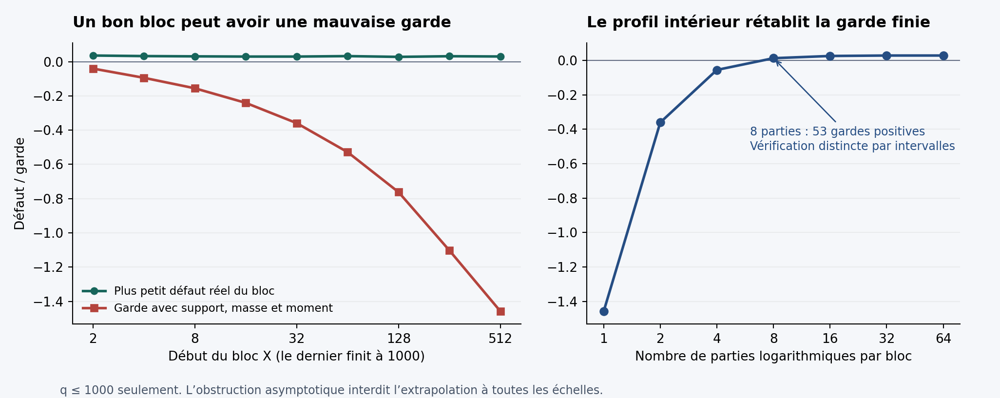

# Ce qui a été exécuté

Cette passe teste une règle de compensation au plafond déjà étudié, \(q\le1000\).
Elle ne prolonge pas seulement une liste de calculs : elle distingue un bon
bilan aux extrémités d'un défaut caché à l'intérieur d'un bloc. Deux approches
indépendantes ont construit puis confronté les identités et les contre-modèles.

Trois résultats auxiliaires sont démontrés dans ce dossier : une séparation
exacte entre crédit de courbure et phase arithmétique ; une garde optimale avec
les seules données de support, masse et premier moment ; une obstruction
asymptotique à cette garde pour des blocs de rapport fixe. Une seconde piste,
fondée sur la convolution de Selberg, reçoit un contre-modèle explicite même
en conservant le réservoir exponentiel exact.

**La positivité globale de Weil et RH restent ouvertes.** Aucune priorité de
découverte n'est revendiquée. Les preuves auxiliaires sont un dossier de travail,
avec confrontation indépendante mais sans relecture extérieure.

Le tableau de statuts en fin de note distingue les résultats publiés, les
preuves de travail, les certificats finis et l'obligation globale ouverte.

\newpage

# 1. Le but et les objets nécessaires

La destination reste la positivité de la forme de Weil pour tous les tests
admissibles. Pour la fonction spécifique de Suzuki [S23], le pont publié donne
\(RH\iff S(t)\ge0\) pour tout \(t\), et \(RH\iff S\) bornée. Ce pont
ne vaut pas pour un signal positif arbitraire.

Pour les puissances premières \(q=p^k\), poser
\[
x_q=\log q,\qquad c_q=\frac{\log p}{\sqrt q},\qquad T=\log2.
\]
Le signal exact est
\[
S(t)=A(t)-\sum_{q=p^k}c_q(t-x_q)_+,\qquad t\ge0,
\]
\[
A(t)=4(e^{t/2}+e^{-t/2}-2)-\frac{\kappa t}{2}
 +\sum_{n\ge0}\frac{1-e^{-b_nt}}{b_n^2},
\quad \kappa=\log(8\pi)+\gamma_E+\frac\pi2,\quad b_n=2n+\frac12.
\]
Ici \((y)_+=\max(y,0)\). Sur \([T,\infty)\),
\[
A'(t)=2(e^{t/2}-e^{-t/2})-\frac\kappa2
       +\operatorname{atanh}(e^{-t/2})+\arctan(e^{-t/2}),
\]
\[
\beta(t)=A''(t)=e^{t/2}-\frac{e^{-5t/2}}{1-e^{-2t}}>0.
\]

Ordonner les puissances premières et définir
\[
C_j=\sum_{i\le j}c_i,\qquad L_j=\sum_{i\le j}c_ix_i,
\qquad G(C)=\sup_{t\ge T}\{Ct-A(t)\},\qquad H_j=L_j-G(C_j).
\]
\(G\) est le dual convexe de la réserve continue. Sa dérivée \(\theta(C)\)
vaut \(T\) si \(C\le A'(T)\), puis l'unique solution de \(A'(\theta)=C\).
\(H_j\) est la plus petite distance verticale entre la courbe \(A\) et la
droite du préfixe. Il diffère de la réserve radiale \(r_j\) du document 78.

La somme des charnières est le maximum des droites \(C_jt-L_j\), préfixe vide
compris. Donc tous les \(H_j\ge0\), à tous les rangs, donnent le signe global
pour \(t\ge T\). Le domaine \([0,T]\) est déjà positif par [S23, théorème 4.1]. Demander
directement cette propriété est une reformulation de RH, pas sa loi de signe.

Une correction compacte dont la masse et le premier moment sont nuls a un
potentiel nul au-delà de son support : \(t\times0-0=0\). Les corrections
finies du document 78 doivent donc être accompagnées d'un lemme d'extension.

\newpage

# 2. Premier mécanisme : un crédit positif, une phase indéterminée

**Lemme 1.** Pour chaque nouvel atome, avec \(\theta_j=\theta(C_j)\),
\[
H_j-H_{j-1}=c_j(x_j-\theta_j)+B_j,
\qquad B_j=\int_{C_{j-1}}^{C_j}[\theta_j-\theta(v)]\,dv\ge0.
\]
**Preuve.** \(G(C_j)-G(C_{j-1})=\int_{C_{j-1}}^{C_j}\theta(v)\,dv\).
Ajouter et retrancher \(c_j\theta_j\). La monotonie de \(\theta\) donne le
signe du second terme. Cela reste valable lorsque \(\theta\) est saturée en \(T\).

Le premier terme mesure l'avance ou le retard de l'événement premier par
rapport à la position attendue par la réserve continue. Il peut avoir les
deux signes. Le second est un crédit de courbure, exactement positif.

**Lemme 2.** Sans supposer RH,
\[
\sum_j B_j<\infty.
\]
**Preuve.** \(\beta\) est croissante et positive sur \([T,\infty)\). Pour
les indices assez grands, \(\theta'(v)=1/\beta(\theta(v))\), d'où
\[
0\le B_j\le\frac{c_j^2}{2\beta(\theta_{j-1})}.
\]
Les bornes de Chebyshev donnent, par sommation partielle,
\(C_j\asymp\sqrt{q_j}\). Le saut
\(c_j\le\log q_j/\sqrt{q_j}\) est négligeable devant \(C_j\), donc
\(C_{j-1}\asymp\sqrt{q_j}\). Comme \(A'(u)\sim2e^{u/2}\),
\(\beta(\theta_{j-1})\asymp\sqrt{q_j}\). Ainsi
\[
B_j\ll\frac{(\log q_j)^2}{q_j^{3/2}}.
\]
La série converge même sur tous les entiers. Les premiers indices sont en
nombre fini. Ni la position des zéros ni RH n'interviennent.

**Conséquence exacte.** La positivité de la courbure n'offre pas un crédit
illimité. Il reste à contrôler le cumul signé des phases. Aucune convergence
de ce cumul n'est affirmée ici.

Au plafond 1000, le diagnostic à 60 chiffres donne :

| Quantité | Valeur approchée |
|---|---:|
| Nombre d'événements | 193 |
| Ajouts diminuant \(H\) / augmentant \(H\) | 89 / 104 |
| Crédit cumulé \(\sum B_j\) | 1,49092353 |
| Phase cumulée \(\sum c_j(x_j-\theta_j)\) | -1,49859252 |
| Défaut initial \(H_0=A(T)\) / final | 0,06355559 / 0,05588660 |
| Plus petit \(H_j\), atteint à \(q=199\) | 0,02802262 |

Ces chiffres organisent la compensation observée. Ils ne prouvent pas sa
poursuite infinie. Ils ne sont pas la réserve radiale dont le record était
\(q=529\) dans le document 78.

\newpage

# 3. Une brique réutilisable : la garde de toutes les coupures

Un bloc commence dans l'état \((C,L,H)\), avec \(H=L-G(C)\). Ses positions
sont dans \([a,b]\), sa masse totale est \(D>0\), son moment \(M\).
Un préfixe de masse \(d\in[0,D]\) a un moment \(\ell(d)\).

**Lemme 3.** On a
\[
\ell(d)\ge\max\{ad,\,M-b(D-d)\},
\]
\[
H_{\text{préfixe}}\ge
H+\max\{ad,M-b(D-d)\}-[G(C+d)-G(C)].
\]
Il suffit donc de vérifier les trois valeurs
\[
H,\qquad H_{\text{fin}}=H+M-[G(C+D)-G(C)],
\]
\[
K=H+a d_*-[G(C+d_*)-G(C)],\qquad d_* =\frac{bD-M}{b-a}.
\]
Si elles sont non négatives, tous les préfixes du bloc sont admissibles au
critère de Fenchel.

**Preuve.** Le préfixe a un moment au moins \(ad\). Le complément a un moment
au plus \(b(D-d)\), ce qui donne l'autre borne. Les deux droites se rencontrent
en \(d_*\). De chaque côté, le minorant est concave puisque \(G\) est convexe :
son minimum est à une extrémité. Les seules extrémités possibles sont
\(0,d_*,D\). Si le support se réduit à un point, les deux valeurs aux
extrémités suffisent.

La garde est optimale avec ces seules données agrégées : la mesure
\(d_*\delta_a+(D-d_*)\delta_b\) a la masse et le moment imposés et atteint
le minorant au coude. Un bloc réel mieux réparti peut
rester positif alors que cette garde est négative.

**Contre-modèle aux seuls bilans de bord.** Avec
\(A(t)=t^2/2\) sur \([0,3]\), prendre comme source la mesure de Lebesgue et
comme demande
\[
\nu=\tfrac32\delta_{1/4}+\tfrac32\delta_{11/4}.
\]
Les masses et moments coïncident, et le signal est nul aux deux bords. Pourtant
\(S(1)=-5/8\), et le premier défaut de Fenchel vaut \(-3/4\). Ce modèle
abstrait ne concerne pas les zéros de Riemann.

\newpage

# 4. Pourquoi le Lego agrégé de rapport fixe échoue

**Proposition 4.** Pour les vrais poids premiers, sur le bloc
\((X,e^hX]\) avec \(h>0\) fixé, la garde intérieure précédente satisfait,
sans RH,
\[
K(X)=-4\sqrt X\,\varphi(z)+o(\sqrt X),\qquad
\varphi(z)=(1+z)\log(1+z)-z>0,
\]
\[
z=\frac{2(e^{h/2}-1)}h-1>0.
\]
Elle devient donc négative pour tous les \(X\) assez grands. Le seuil n'est
pas chiffré ici. **La proposition réfute cette garde agrégée ; elle ne réfute
pas le signe du bloc réel ni RH.**

**Preuve.** Poser \(a=\log X\), \(b=a+h\), \(E=e^{h/2}\), \(r=E-1\).
Le théorème des nombres premiers \(\psi(X)\sim X\), par sommation partielle,
donne
\[
\frac{C(X)}{2\sqrt X}\to1,\quad
\frac{D}{2\sqrt X}\to r,\quad
\frac{M-aD}{2\sqrt X}\to hE-2r,\quad
\frac{d_*}{2\sqrt X}\to z.
\]
On a \(0<z<r\). De plus \(H(X)=o(\sqrt X)\). Pour le vérifier, l'intégration
par parties donne
\[
P(\log X)=\int_1^X\psi(u)u^{-3/2}
       [1+\tfrac12\log(X/u)]\,du.
\]
Après \(u=Xv\), le théorème des nombres premiers et la domination
\(\psi(u)\ll u\) donnent \(P(\log X)/\sqrt X\to4\). Comme
\(A(\log X)/\sqrt X\to4\), \(S(\log X)=o(\sqrt X)\).
Par ailleurs \(\theta(C(X))-a=o(1)\). La différence
\[
S(a)-H(X)=A(a)-A(\theta)-C(X)(a-\theta)
\]
est un reste de convexité d'ordre \(o(\sqrt X)\).

Pour éviter de multiplier une erreur par \(\log X\), écrire directement
\[
G(C(X)+d_*)-G(C(X))-a d_*
=\int_0^{d_*}[\theta(C(X)+s)-a]\,ds.
\]
Uniformément pour \(s/(2\sqrt X)\) dans un compact,
\[
\theta(C(X)+s)-a=2\log(1+s/(2\sqrt X))+o(1).
\]
L'intégration donne \(4\sqrt X\varphi(z)+o(\sqrt X)\), ce qui prouve
la proposition. Pour \(h=\log2\), le coefficient est environ \(-0,07165832\).

Tout nombre fixe de sous-blocs de rapport fixe finit par rencontrer la même
limite. Le profil intérieur apporte une information nécessaire ; son terme
principal issu du théorème des nombres premiers ne fixe pas encore le signe
de la fluctuation restante.

\newpage

# 5. L'expérience qui sépare le vrai défaut de la garde

Le plafond reste 1000. Les blocs principaux sont \((2,4],(4,8],\ldots,
(256,512],(512,1000]\). Le premier atome \(q=2\) est contrôlé séparément.

| Parties par bloc, en échelle logarithmique | Parties non vides | Gardes négatives, diagnostic | Plus petite garde approchée |
|---:|---:|---:|---:|
| 1 | 9 | 9 | -1,45843903 |
| 2 | 17 | 13 | -0,36085876 |
| 4 | 31 | 10 | -0,05558515 |
| 8 | 53 | 0 | 0,01254993 |
| 16 | 84 | 0 | 0,02539618 |

Le contraste quantifie l'information perdue dans le regroupement. Par exemple,
sur \((128,256]\), la garde globale vaut environ \(-0,76212829\), alors que
le plus petit défaut réel vaut environ \(0,02802262\).

Les diagnostics à 60 chiffres ont été recalculés à 75 chiffres. La récurrence
exacte, les masses, les préfixes communs et les signes ont été contrôlés.
Une vérification distincte par intervalles à 400 bits certifie :

- les neuf gardes principales sont strictement négatives ;
- les 53 gardes des huit subdivisions sont strictement positives ;
- le premier défaut \(q=2\) est strictement positif.

Les coupures utilisent une affectation entière exacte. Pour une frontière
\(((P-j)\log l+j\log u)/P\), un entier \(n\) est à gauche exactement si
\(n^P\le l^{P-j}u^j\). Les logarithmes sont ensuite évalués par intervalles.
La constante d'Euler a un encadrement avec reste explicite, et la queue
archimédienne une majoration géométrique. Les racines du dual sont encadrées
par deux signes stricts de \(A'(t)-C\). Les endpoints binaires sont archivés.

Cette preuve finie contrôle tous les préfixes tronqués correspondants pour
\(t\ge T\). Pour le signal original, la fenêtre couverte reste
\([\log2,\log1000]\), car d'autres puissances premières interviennent ensuite.
Elle ne certifie pas la forme de Weil pour toutes les fonctions tests.

La subdivision en huit n'est pas une règle globale. La proposition 4 interdit
de l'extrapoler comme un certificat uniforme à toutes les échelles.

\newpage

# 6. Deuxième mécanisme : traduire les produits, contrôler l'inversion

L'identité classique de Selberg relie les premiers à leurs produits :
\[
\Lambda_2(n)=\Lambda(n)\log n+(\Lambda*_{\!D}\Lambda)(n)
=\sum_{d\mid n}\mu_{\mathrm{M}}(d)\log^2(n/d)\ge0.
\]
\(*_{\!D}\) est la convolution de Dirichlet et \(\mu_{\mathrm{M}}\) la fonction
de Möbius. Cette identité se démontre à partir de \(\log=1*_{\!D}\Lambda\),
de la règle de Leibniz pour \(f(n)\mapsto f(n)\log n\), puis en convolant par
\(\mu_{\mathrm{M}}\). C'est un résultat classique, pas une découverte de cette passe.

Dans la variable logarithmique, poser
\[
\alpha(dx)=e^{x/2}\,dx\quad(x\ge0),\qquad
\nu=\sum_{n\ge2}\frac{\Lambda(n)}{\sqrt n}\delta_{\log n},\qquad R=\alpha-\nu.
\]
La convolution est maintenant additive. On a
\[
D=xR+(\alpha+\nu)*R=2xe^{x/2}\,dx-[x\nu+\nu*\nu].
\]
Avec \(Z=P_R\) et \(Q=P_D\), l'équation causale exacte est
\[
Q(t)=tZ(t)-2\int_0^tZ(s)\,ds+((\alpha+\nu)*Z)(t).
\]
Les intégrales sont finies sur tout compact. Le signal de Suzuki est
\(S=Z+E\), où
\[
E(t)=4e^{-t/2}-4+(2-\kappa/2)t
+\sum_{k\ge0}\frac{1-e^{-(2k+1/2)t}}{(2k+1/2)^2}.
\]
L'ancrage archimédien doit être conservé.

**Contre-modèle avec le même réservoir exponentiel.** Garder \(\alpha\) et
remplacer la demande par \(\nu=12\delta_{12/5}\). Alors
\[
Z(4)=4e^2-\frac{156}{5}<-\frac85<0,
\]
mais
\[
Q(t)=8[(t-4)e^{t/2}+t+4]
-\frac{144}{5}(t-12/5)_+-144(t-24/5)_+
\]
est positif pour tout \(t>0\).

**Preuve globale.** Avant \(12/5\), \(Q\) est le potentiel d'une mesure
positive. Sur \([12/5,24/5]\), \(Q''=2te^{t/2}\ge72/5\),
\(Q(3)\ge68/25\) et \(|Q'(3)|\le16/5\). La minoration quadratique donne
\(Q\ge532/225>0\). Après \(24/5\), \(Q''\ge96\),
\(Q(5)\ge1608/25\), \(|Q'(5)|\le104/5\), d'où \(Q\ge931/15>0\).
Les bornes exponentielles nécessaires sont contrôlées par Taylor rationnel
avec reste géométrique dans le programme fourni.

Ce contre-modèle réfute l'inversion positive générique, même avec la bonne
densité continue. Sa demande n'est pas celle des vrais \(\Lambda(n)\).
Il ne réfute ni RH ni une propriété supplémentaire des coefficients premiers.

\newpage

# 7. Le prochain énoncé à chercher

Le résultat actuel est un opérateur de contrôle : avant de déclarer un bloc
compatible, on vérifie une garde couvrant ses préfixes. Son usage est concret.
La proposition 4 montre aussi pourquoi une fiche contenant seulement la masse,
le moment et la portée ne peut soutenir le certificat global à rapport fixe.

Pour un bloc, définir le gain d'information intérieure
\[
J_B(d)=\ell_B(d)-\max\{ad,M-b(D-d)\}\ge0.
\]
La garde raffinée est l'identité exacte
\[
H_B(d)=H+\max\{ad,M-b(D-d)\}+J_B(d)-[G(C+d)-G(C)].
\]
**Obligation ouverte :** trouver une estimation indépendante et signée de ce
profil pour les vrais poids premiers, assez précise pour établir l'extension
à toutes les échelles. Le couplage avec les produits de premiers peut fournir
une information supplémentaire ; sa seule positivité ne suffit pas, comme le
montre le contre-modèle de la section 6.

Le contrôle du terme principal laisse encore une fluctuation. Sous RH,
\(0\le H_j\le S(x_j)\) est borné, tandis que le théorème des nombres premiers
ne donne ici que \(H_j=o(\sqrt{q_j})\). L'écart de précision explique le verrou.
Aucune marge positive uniforme n'est supposée.

Une estimation valable pour un atome artificiel ou pour un réservoir
arbitraire doit d'abord survivre aux contre-modèles. Une estimation imposant
directement tous les \(H_j\ge0\) doit être annoncée comme une reformulation.
La prochaine contribution décisive doit exploiter les coefficients premiers
pour contrôler le reste, plutôt que supposer le signe dans sa prémisse.

**Couverture conditionnelle.** Si une règle construit des lignes positives
fixées une fois pour toutes, conservant chaque masse et chaque barycentre,
avec somme des retraits inférieure à la source, le document 78 donne le signe
global puis la couverture complète. Si une règle démontre directement tous
les défauts de préfixes, le pont de Suzuki donne RH. Aucune de ces règles
infinies n'est construite ici.

# 8. Le pont opérateur et la littérature récente

Le préprint de Suzuki [S26], version 3 du 23 septembre 2026, doit être intégré
au dossier : il réalise l'opérateur de Weil localisé comme extension de
Friedrichs de \(D^*G_aD\), établit la continuité de sa plus petite valeur
propre et une positivité pour les petites portées. Ses théorèmes sont annoncés
sans RH. Son passage limite spectral reste conjectural. Le décalage
\(\lambda<\lambda_a\) permet une norme positive locale, mais n'établit pas
\(\lambda_a\ge0\) pour toute portée. La traduction opératorielle est donc
publiée ; la loi de signe reste à construire.

\newpage

# Reproduction, statuts et références

Les programmes n'utilisent aucun zéro de \(\zeta\). Les entiers du crible et
des coupures sont exacts. Les diagnostics flottants et les certificats par
intervalles sont conservés séparément.

Depuis la racine du complément, avec Python et mpmath 1.3.0 :

    python3 compensation_blocks.py --cutoff 1000 --digits 60 --output results
    python3 certify_block_guards.py --corpus mini_corpus \
      --output results/block_guard_certificate.json
    python3 verify_countermodels.py --output results/countermodels_exact.json

Pour régénérer le visuel, installer aussi matplotlib et lancer
`python3 figure_compensation.py`. La note et le PDF contiennent les preuves
entières des propositions ; le graphe dépend seulement des JSON archivés.

Les bilans cumulés, les compteurs de blocs et les gardes sont contrôlés par
un audit distinct fourni dans le dossier `agents`. Les SHA-256 du complément
figurent dans `CHECKSUMS.sha256`.

| Niveau | Contenu |
|---|---|
| Résultats publiés | Critères Suzuki, théorème des nombres premiers, identité Selberg, cadre opérateur 2026 |
| Preuves auxiliaires de ce dossier | Récurrence, crédit fini, garde sharp, obstruction à rapport fixe, contre-modèles |
| Certificat numérique fini | 53 gardes positives, 9 gardes négatives, premier défaut positif, modèle d'intervalles déclaré |
| Diagnostics | Sommes crédit/phase, variantes 2/4/16/32/64, recoupement à 75 chiffres |
| Ouvert | Contrôle signé du reste arithmétique et extension à toutes les échelles |

Les preuves d'obstruction ferment des mécanismes insuffisants. Elles ne
démontrent pas que la voie arithmétique entière est impossible.

- **[S23]** M. Suzuki, *Aspects of the screw function corresponding to the
  Riemann zeta-function*, JLMS 108 (2023), 1448-1487, théorèmes 1.6, 1.7 et 4.1.
  <https://arxiv.org/pdf/2206.03682>.
- **[S26]** M. Suzuki, *Weil's quadratic form via the screw function*,
  arXiv:2606.09096v3, septembre 2026, théorèmes 1.1, 1.3, 1.4 et passage
  limite conjectural. <https://arxiv.org/pdf/2606.09096>.
- **[Se49]** A. Selberg, *An elementary proof of the prime-number theorem*,
  Annals of Mathematics 50 (1949), 305-313. Source du théorème des nombres
  premiers et de la symétrie de Selberg ; les reformulations de cette note sont
  démontrées ci-dessus.
  <https://www.math.lsu.edu/~mahlburg/teaching/handouts/2014-7230/Selberg-ElemPNT1949.pdf>.
- **[T14]** T. Tao, *254A, Notes 1: Elementary multiplicative number theory*
  (2014), identités de \(\Lambda_k\) et bornes de Chebyshev.
  <https://terrytao.wordpress.com/2014/11/23/254a-notes-1-elementary-multiplicative-number-theory/>.
