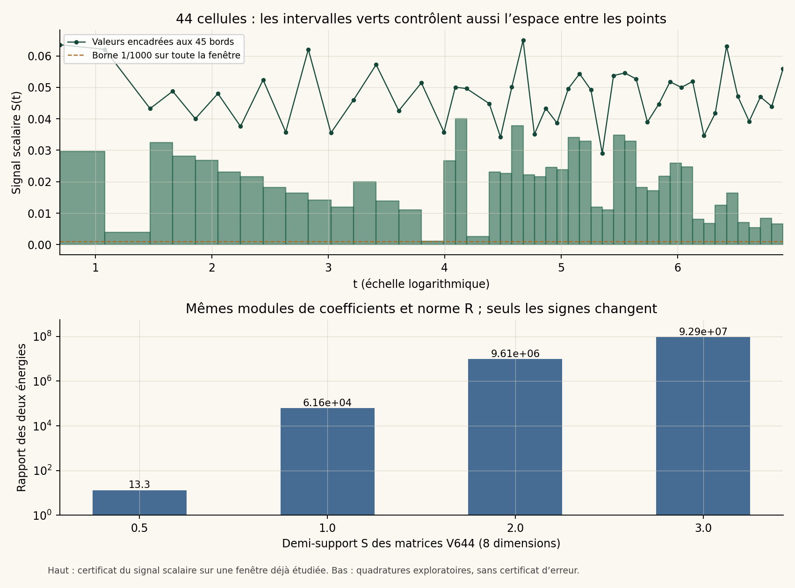

---
title: "Quelle information suffit pour porter le signe ?"
subtitle: "Complément au document 79 — Programme Riemann V6.57"
author: "Vincent P. P. NOËL — dossier de recherche, rédaction assistée"
date: "16 octobre 2026"
lang: fr
---

# 1. Résultat lisible avant les calculs

L'image d'une « bande passante trop étroite » reçoit deux tests exécutés, de statuts distincts.

**Certificat de résolution.** Pour le signal arithmétique scalaire du document79, 44 cellules adaptatives, fondées sur 45 valeurs de bords encadrées, démontrent
\[
S(t)>\frac1{1000}\qquad(\log2\le t\le\log1000).
\]
Les intervalles entiers sont contrôlés, même lorsqu'ils contiennent des puissances premières. La fenêtre était déjà traitée dans le document79 : il s'agit d'un contrôle différent de l'information omise, sans extension de portée.

**Diagnostic de couplages.** Dans les compressions arithmétiques V644, deux combinaisons gardant les mêmes modules de coefficients et la même norme $R$ donnent des énergies différant jusqu'à environ 92,9 millions de fois. Seuls les signes des coefficients changent. Les deux valeurs restent positives. Ces nombres réutilisent des quadratures exploratoires ; ils ne sont pas des certificats d'erreur sur la forme infinie.

Le document73 certifie déjà tous les tests d'un espace infini sur $S\le1/2$. Le corpus n'est donc pas limité à une collection d'échantillons. La question globale est la continuation d'une loi arithmétique et de ses contrôles sur des supports non bornés.

# 2. Ce que les amplitudes seules effacent

Nous réutilisons les matrices $G$ de huit tests admissibles de V644. La norme externe est $R=m+\mathcal E$, indépendante du signe cherché. Si $R=LL^T$, la matrice dans les coordonnées orthonormées est
\[
Q=L^{-1}GL^{-T}.
\]
Ce changement de coordonnées préserve le signe. Pour une amplitude $a_i\ge0$ fixée et des signes $\varepsilon_i\in\{-1,1\}$,
\[
q(\varepsilon\cdot a)=\sum_i Q_{ii}a_i^2
 +2\sum_{i<j}Q_{ij}a_ia_j\varepsilon_i\varepsilon_j.
\]
Les modules des coefficients, la norme $R=\sum a_i^2$ et l'observation diagonale sont identiques dans toutes ces configurations ; les couplages varient. Il ne s'agit pas d'une identité du module ponctuel des fonctions.

| Demi-support S | Énergie faible | Énergie élevée | Rapport approché |
|---:|---:|---:|---:|
| 1/2 | 0,00372113 | 0,0494504 | 13,3 |
| 1 | 2,18017 $\times 10^{-8}$ | 0,00134366 | 61 631 |
| 2 | 2,26562 $\times 10^{-11}$ | 0,000217698 | 9,61 $\times 10^6$ |
| 3 | 5,35415 $\times 10^{-13}$ | 0,0000497461 | 9,29 $\times 10^7$ |

Les amplitudes sont choisies après inspection d'une direction de petite énergie, puis les 128 configurations réelles distinctes à signe global près sont comparées. Ce sont des témoins exploratoires ciblés, pas un échantillon aléatoire représentatif de toutes les fonctions.

**Lemme de moyenne et de perte.** Pour des signes indépendants équiprobables et une matrice réelle symétrique,
\[
\mathbb E_\varepsilon q=\sum_iQ_{ii}a_i^2,
\qquad
\operatorname{Var}_\varepsilon q=4\sum_{i<j}Q_{ij}^2a_i^2a_j^2.
\]
**Preuve.** Chaque produit $\varepsilon_i\varepsilon_j$, $i\ne j$, a une espérance nulle. Dans le carré de la somme, deux paires distinctes laissent au moins un signe d'exposant impair ; seule chaque paire avec elle-même contribue. Les identités suivent. Le programme compare aussi ces expressions à l'énumération des 128 configurations. L'identité est algébrique ; les coefficients numériques du présent jeu restent exploratoires.

Une moyenne positive peut donc effacer exactement les interactions décisives pour les petites énergies. Le passage de $H^1$ à $R$ ne supprime pas cette sensibilité dans ces quatre matrices. Une loi universelle exige davantage qu'un bon comportement moyen.

# 3. L'information de signe et le rôle de Schur

**Proposition générique.** Une application linéaire $\mathcal L$ de matrices hermitiennes qui permettrait de décider la positivité de toute matrice doit être injective.

**Preuve.** S'il existe une matrice hermitienne $D\ne0$ dans son noyau, les matrices $cI$ et $cI+tD$ donnent les mêmes statistiques. La première est positive pour $c>0$. Une valeur propre non nulle de $D$ permet de choisir $t$ pour que la seconde ait une valeur propre négative. Les données ne décident donc pas les deux cas. Fin de preuve.

Cette proposition concerne les matrices arbitraires et les résumés linéaires. Une structure arithmétique prouvée peut réduire les données nécessaires pour Weil. Une statistique non linéaire telle que la plus petite valeur propre décide le signe une fois calculée ; elle n'est pas exclue par la proposition.

Pour une partition finie tête/complément,
\[
Q=\begin{pmatrix}H&B\\B^*&C\end{pmatrix},\quad C>0,
\qquad Q_{\mathrm{eff}}=H-BC^{-1}B^*.
\]
Le complément de Schur conserve exactement le pire effet du complément lorsque les coordonnées de tête sont fixées. Il constitue une compression pertinente pour le signe, à condition de disposer du complément complet ou d'une borne externe qui le remplace.

Pour $H>0$, la dette relative
\[
\rho=\lambda_{\max}\bigl(H^{-1/2}BC^{-1}B^*H^{-1/2}\bigr)
\]
est au plus un si et seulement si $Q_{\mathrm{eff}}\ge0$. Dans le diagnostic de huit dimensions, la partition 4+4 donne $\rho\simeq0,999999832$ à $S=3$. Cela mesure une compensation très fine dans cette représentation. Le complément de quatre coordonnées n'est pas la queue fonctionnelle infinie.

À l'inverse, les bornes déjà certifiées du document73 donnent pour son bloc pair une dette inférieure à 0,18 % de la marge de tête. L'absence de maîtrise des couplages n'est donc pas un diagnostic uniforme sur tout le corpus. Les contrats analytiques déterminent ce qui est effectivement contrôlé à chaque étape.

# 4. Une règle pour contrôler ce qui se passe entre deux points

Nous utilisons ici le signal précis de Suzuki [SuzSig23], noté $S$ dans les documents78–79, avec
\[
S(t)=A(t)-\sum_{q=p^k}c_q(t-\log q)_+,
\quad c_q=\frac{\log p}{\sqrt q}>0,
\]
\[
A''(t)=\beta(t)=e^{t/2}-\frac{e^{-5t/2}}{1-e^{-2t}}.
\]
Sur une fenêtre positive, sa dérivée seconde au sens des distributions vaut
\[
S''=\beta(t)dt-\sum_qc_q\delta_{\log q}\le B\,dt
\]
si $B\ge\sup\beta$. Les sauts premiers ont le bon sens pour cette borne, même s'il y a plusieurs atomes dans une cellule. Nous prenons la borne simple $B=e^{b/2}$ sur $[a,b]\subset[\log2,\infty)$.

**Lemme de cellule.** Si $L_S$ est la droite joignant $S(a)$ et $S(b)$,
\[
\boxed{S(t)\ge L_S(t)-\frac B2(t-a)(b-t)
\ge\min\{S(a),S(b)\}-\frac{B(b-a)^2}{8}.}
\]
**Preuve.** La fonction $S-L_S+\frac B2(t-a)(b-t)$ a une dérivée seconde négative ou nulle au sens des distributions, donc elle est concave. Elle vaut zéro aux deux bords, donc elle est positive ou nulle à l'intérieur. Le produit $(t-a)(b-t)$ est au plus $(b-a)^2/4$. Fin de preuve.

Le calcul garde deux nombres par cellule : une marge de bord minorée et une dette de courbure majorée. Si leur différence est positive, aucune vallée négative ne peut se cacher dans la cellule. Si cette différence est négative, le test est indécis ; il ne démontre pas une négativité du signal.

**Version plus précise.** Le potentiel premier $F=A-S$ est convexe. Sa majoration par sa corde donne aussi
\[
S(t)\ge L_S(t)-[L_A(t)-A(t)].
\]
Cette variante pourrait réduire les subdivisions ; elle n'est pas utilisée dans les nombres certifiés ci-dessous.

\newpage

# 5. Exécution avec les vrais poids premiers

Le programme reprend le crible exact et les primitives d'intervalles du corpus. Il inclut les 193 puissances premières jusqu'à 1000, les logarithmes et exponentielles dirigés, un encadrement d'Euler à partir du nombre harmonique d'ordre1024 et une queue géométrique après64 termes archimédiens. Les gardes finales et les positions de cellules sont conservées comme rationnels et extrémités binaires dans le JSON.

| Intervalles uniformes | Cellules certifiées | Cellules indécises |
|---:|---:|---:|
| 8 | 0 | 8 |
| 16 | 2 | 14 |
| 32 | 18 | 14 |
| 64 | 64 | 0 |
| 128 | 128 | 0 |

Tous les bords sont positifs dans ces diagnostics. La différence vient du budget nécessaire pour l'intervalle entier. La subdivision adaptative part d'une seule cellule et la coupe uniquement lorsque la garde ne conclut pas. Elle s'arrête avec **44 cellules et45 points**, et sa plus petite borne rationnelle est supérieure à $1/1000$ ; sa valeur approchée est 0,00103547477.

Les45 évaluations sont celles de l'exécution adaptative indépendante. Les grilles uniformes ont, séparément, demandé257 points distincts pour la comparaison jusqu'à256 subdivisions. Il ne s'agit donc pas de présenter l'ensemble des deux expériences comme un calcul à45 points.

Une seconde vérification utilise320 bits au lieu de240, la constante d'Euler d'intervalle au lieu de la formule harmonique, une somme directe au lieu de Horner et une factorisation indépendante des entiers. Elle recoupe les45 encadrements, les44 gardes et la couverture exacte des cellules. Ce contrôle s'appuie sur la même bibliothèque d'arithmétique d'intervalles ; ce n'est pas une formalisation dans un assistant de preuve.

# 6. Ce que signifie maintenant la « bande passante »

Avec une marge de bord $m>0$, la condition
\[
\Delta\le\sqrt{8m/B}
\]
suffit à garantir le signe dans la cellule. Comme $B$ est d'ordre $e^{t/2}$, une marge maintenue à taille comparable conduit, pour cette garde, à un pas d'ordre $e^{-t/4}$. C'est une condition suffisante de résolution de cette représentation, pas une nécessité universelle pour RH. Une autre identité arithmétique peut fournir une garde plus économique.

Sur un compact où le signal est strictement positif, la subdivision finit par réussir si les erreurs d'évaluation sont elles-mêmes raffinables. Elle peut ne pas terminer en présence d'un zéro de contact. Pour une négativité stricte, un raffinement assez fin finit par atteindre un point négatif, à précision suffisante.

La positivité du signal scalaire sur une fenêtre ne certifie pas la forme de Weil sur tous les tests de support comparable. Le théorème1.7 de [SuzSig23] porte sur le signe de ce signal sur l'axe entier. La fenêtre finie était déjà couverte dans79 ; aucune avancée de plafond ni preuve globale n'est revendiquée.

# 7. Décision de recherche et liens avec les outils

Le diagnostic conserve les matrices complètes et ajoute la dette relative ; il évite de décider à partir d'une seule moyenne. Le certificat adaptatif localise précisément les cellules où l'information disponible ne suffit pas encore. Les statistiques suggèrent où regarder ; une garde démontrée transforme une observation locale en conclusion sur tout un intervalle.

Pour passer au global, il manque une estimation arithmétique qui fournisse des marges contrôlées à toutes les échelles, ou une identité structurée qui remplace cette obligation. Une nouvelle liste de cellules positives ne remplit pas ce quantificateur.

Les fiches IDE-047 (dette), IDE-050 (couverture), IDE-051 (signe) et IDE-052 (Weil) reçoivent les pièces de cette passe ; les investigations de paquets et de dette reçoivent leur évaluation. Les niveaux des indicateurs restent inchangés : l'instrument de contrôle est amélioré, la loi de signe globale reste ouverte. Les coûts et les probabilités du Bellman documentaire ne sont pas modifiés par les rapports numériques.

# Références et fichiers reproductibles

- [SuzSig23] M. Suzuki, *Aspects of the screw function corresponding to the Riemann zeta-function*, J. London Math. Soc.108 (2023),1448–1487 ; arXiv:2206.03682v4. [PDF primaire](https://arxiv.org/pdf/2206.03682) ; [publication](https://doi.org/10.1112/jlms.12785). Consultation ciblée : formule1.1 et théorème1.7. Il s'agit d'une référence distincte du candidat d'opérateur global audité dans le complément76.
- Documents70,73,76,79 du corpus : contrats de dette, certificat d'espace complet, couverture et gardes intérieures.
- Dossier de calcul : `3_Preuves_et_calculs/signal_v657/`. Son README donne les commandes reproductibles.
- Certificat principal : `certifier_resolution.py` et `resolution_resultats.json`.
- Contrôle indépendant : `verifier_resolution_independant.py`.
- Diagnostic matriciel : programme et résultats nommés `v657_signal_couplings`.
- Figure : `figure_signal.py`. Les notes constructive et critique sont conservées à côté des résultats.

<!-- references:debut -->

## Références

Format : [clé] auteurs, *titre*, publication, lien. Fiches complètes et état de vérification : document 42 (registre des sources).

- [SuzSig23] M. Suzuki. *Aspects of the screw function corresponding to the Riemann zeta-function*. Journal of the London Mathematical Society108 (2023),1448–1487 ; arXiv:2206.03682v4. <https://arxiv.org/pdf/2206.03682> — vérifié en ligne

<!-- references:fin -->
