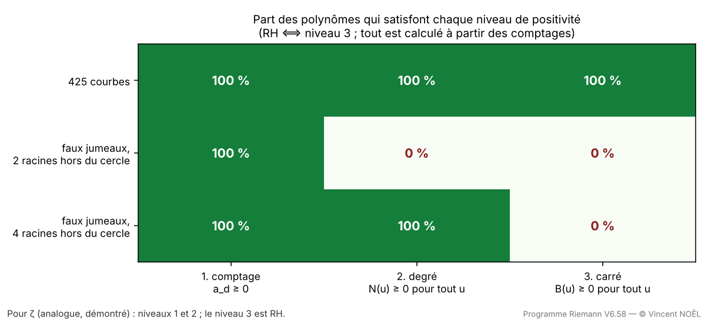

# V6.58 — D'où vient le signe : comptage, degré, ou carré ?

**Document 80 · Vincent P. P. NOËL · 17 octobre 2026**  
**Statut :** pièce 4 du plan du 17 octobre : « chercher la réalisation de Gram d'abord dans le Modèle réduit ». Calcul exact sur les 425 courbes et les 220 faux jumeaux du corpus, avec quatre prévisions écrites avant (`data/prevision_v658_gram.md`, 8 h 50 UTC). Les quatre sont justes. Les énoncés démontrés ici sont élémentaires ; les résultats de géométrie qu'ils éclairent (Weil 1948, positivité de Rosati) sont classiques et cités.  
**Demande de l'auteur :** « La 4 puis 2. »

## 1. La question

La positivité de Weil peut-elle s'écrire Q(f) = ‖Af‖², avec un A construit à partir de l'arithmétique sans supposer le signe ? Le document 77 l'a posée pour ζ. On la pose d'abord là où RH est un théorème : une courbe C de genre g sur 𝔽_q. On cherche quelle structure y impose le signe, et si les nombres premiers (ici, les comptages de points) suffisent à la fournir.

## 2. La forme de Weil d'une courbe, lue de trois façons

Soit P(u) = ∏(1 − αᵢu) le polynôme L, χ(T) = T^{2g}P(1/T) le polynôme caractéristique du Frobenius F, et Sₙ = Σ αᵢⁿ, donné par les comptages : Sₙ = qⁿ + 1 − Nₙ. Sur l'algèbre K = ℚ[T]/(χ), on pose l'involution ι(T) = q/T et la forme

  B(u) = Tr(u · ι(u)) = Σᵢ u(αᵢ)·u(q/αᵢ).

Dans la base 1, T, …, T^{2g−1}, sa matrice est **entière et ne dépend que des comptages** :

  B_{jk} = q^{min(j,k)} · S_{|j−k|}.

C'est la métrique de Weil du corpus (docs 29, 33), et, au signe près, la forme d'intersection de la surface C × C orthogonale aux fibres (doc. 46). Elle se lit de trois façons :

| Lecture | L'espace | L'application A | Ce qui donne le signe |
|---|---|---|---|
| spectrale | ℂ^{2g} (la cohomologie H¹) | u ↦ (u(αᵢ))ᵢ | \|αᵢ\| = √q (c'est RH) |
| algébrique | End(J) ⊗ ℝ, J la jacobienne | u ↦ u(F) | la positivité de l'involution de Rosati |
| géométrique | diviseurs de C × C orthogonaux aux fibres | u ↦ Σ uₙ Γₙ | l'indice de Hodge (une classe ample) |

**Une réalisation de Gram certifiée par les seuls comptages.** Pour les courbes, la décomposition exacte B = L·diag(d)·Lᵀ, en nombres rationnels, donne 2g pivots strictement positifs pour **424 courbes sur 425**. La dernière a des racines confondues : son pivot nul apparaît au rang 4 (q = 5, g = 3), comme le rang 2g manquant du document 46. Alors A = diag(√d)·Lᵀ vérifie B(u) = ‖Au‖² : la réalisation de Gram existe, et elle est construite avec N₁, …, N_g seulement. Pour les faux jumeaux, un pivot négatif apparaît (219) ou un pivot nul (1), dès le rang 2, 3 ou 4.

Mais cela ne dit pas **pourquoi** les pivots sont positifs. Pour le savoir, on sépare trois niveaux de positivité, tous calculables à partir des comptages.

## 3. Trois niveaux de positivité

1. **Le comptage.** Les nombres de points fermés a_d sont positifs.
2. **Le degré.** La forme norme N(u) = ∏ u(αᵢ) = Res(χ, u). Pour une vraie jacobienne, c'est le **degré de l'isogénie** u(F), c'est-à-dire le nombre de points de son noyau. Par exemple, N(1 − Tᵏ) est le nombre de points de J sur 𝔽_{qᵏ}.
3. **Le carré.** La forme B ci-dessus : la trace de u · ι(u), « u fois son adjoint ».

**Proposition (élémentaire, démontrée ici).** Soit χ réel, stable par α ↦ q/α.

- (a) N(u) ≥ 0 pour tout u réel si et seulement si toute racine réelle de χ a une multiplicité paire.
- (b) Si les racines sont distinctes, B a exactement r/2 directions négatives, où r est le nombre de racines hors du cercle |α| = √q. Donc B ≥ 0 si et seulement si RH.

*Preuve.* Posons zᵢ = u(αᵢ). Une racine non réelle forme une paire conjuguée, qui contribue |zᵢ|² ≥ 0 à N ; une racine réelle simple contribue zᵢ, de signe libre. Cela donne (a). Pour (b), on écrit B = Σ zᵢ·z_σ(i), où σ échange α et q/α, et on regroupe par orbites :

- une paire sur le cercle {α, ᾱ} donne 2|z|², de signature (2, 0) ;
- une paire réelle hors du cercle {α, q/α} donne 2z₁z₂, de signature (1, 1) ;
- un quadruplet complexe {α, ᾱ, q/α, q/ᾱ} donne 4·Re(z₁z₃), de signature (2, 2).

On conclut par la loi d'inertie de Sylvester, l'application u ↦ (zᵢ) étant injective (Vandermonde). ∎

## 4. Les résultats

| | Prévision | Résultat | Verdict |
|---|---|---|---|
| G1 | 425 courbes : N ≥ 0 et B ≥ 0 | 425/425 sans racine réelle de multiplicité impaire ; B sans direction négative pour 425/425 (rang 2g : 424) | **juste** |
| G2 | les 119 faux à 4 racines hors du cercle ont des degrés tous positifs ; les 101 faux à 2 racines hors du cercle (dont les 4 de genre 1) ont une racine réelle simple | 119/119 et 101/101 ; les 4 de genre 1 sont parmi les 101 | **juste** |
| G3 | pour ces 101, un u de coefficients ≤ 3 suffit pour N(u) < 0 | 101/101, avec des coefficients ≤ 1 (93 cas) ou ≤ 2 (8 cas) | **juste** |
| G4 | B indéfinie pour les 220 faux, avec r/2 directions négatives | 220/220 | **juste** |

**Une isogénie de degré −1.** Le faux jumeau P = 1 − 4u + 3u² (q = 3, genre 1) a N₁ = 0 point, un comptage positif. Mais χ(T) = T² − 4T + 3, et l'isogénie F − 2 aurait pour degré χ(2) = −1 : un noyau de −1 point. C'est impossible, et cela suffit à l'exclure. En genre 1, le niveau 2 vaut le niveau 3 : c'est la démonstration classique de la borne de Hasse, par la positivité du degré.

**En genre 2, le degré ne suffit plus.** Les 119 faux jumeaux à quadruplet complexe ont tous leurs comptages positifs **et** tous leurs « degrés » positifs, et pourtant RH y est fausse. Ce qui les exclut n'est pas un comptage, mais un **carré** : la trace de u · ι(u). Pour une vraie jacobienne, c'est la positivité de l'involution de Rosati (Tr(u u†) > 0). Weil la tire de l'inégalité de Castelnuovo–Severi, c'est-à-dire de l'indice de Hodge sur C × C [Wei48] ; voir aussi [Mum70], §21. Cette positivité vient d'une **classe ample**, la polarisation de la jacobienne, et non d'un dénombrement.

## 5. Ce que cela dit pour ζ

On transpose les trois niveaux.

- **Niveau 1, démontré.** Λ(n) ≥ 0 : les « comptages » de ζ sont positifs.
- **Niveau 2, démontré.** ξ(σ) > 0 pour tout σ réel, car ζ n'a aucun zéro réel dans ]0, 1[. Pour σ > 1, chaque facteur de ξ(s) = ½ s(s − 1) π^{−s/2} Γ(s/2) ζ(s) est positif ; pour 0 < σ < 1, ζ(σ) < 0 et s(s − 1) < 0 ; le reste suit par symétrie. Dans la correspondance s ↦ α = q^s (à 2πi/log q près), une racine réelle hors du cercle d'une courbe correspond à un zéro réel hors de la droite. ζ n'en a pas : comme les 119 faux jumeaux à quadruplet complexe, ζ passe les niveaux 1 et 2.
- **Niveau 3 : c'est RH.** La forme de Weil côté premiers (la matrice G_L du corpus) est l'analogue exact de B pour ζ, calculé sans aucun zéro.

**Conclusion.** Tout ce qui se compte est positif pour ζ, et cela ne suffit pas, exactement comme pour les 119 faux jumeaux. **Ce qui manque n'est pas un comptage, c'est un carré.** Il faudrait une involution « de Rosati » sur une algèbre de correspondances arithmétiques, dont la trace serait positive pour une raison de structure : une polarisation, une classe ample. L'involution existe pour ζ, c'est f ↦ f*(x) = f̄(−x) dans la forme de Weil. Ce qui manque est la raison de la positivité de la trace. C'est la place exacte du « plus grand » de l'hypothèse de l'auteur.

**Conséquences pour les pièces suivantes.**

- Aucun argument de type comptage ou degré ne peut remplacer la positivité de Weil : G2 en donne 119 contre-exemples exacts.
- Les certificats par fenêtres (docs 71 à 73) prouvent le niveau 3 sur des fenêtres. Ils sont du bon type, mais locaux.
- Une stratégie globale doit exhiber un carré, Q = ‖Af‖², où A vient d'une polarisation. Dans les programmes de Connes–Consani, c'est la positivité sur le carré du site arithmétique (doc. 51).

## 6. Démontré, mesuré, supposé

| | Énoncé |
|---|---|
| **Démontré (élémentaire, ici)** | La proposition du §3. B_{jk} = q^{min(j,k)} S_{|j−k|}. ξ(σ) > 0 sur ℝ. |
| **Classique (cité)** | Positivité de Rosati et indice de Hodge [Wei48], [Mum70] ; degré d'une isogénie = taille du noyau. |
| **Mesuré (exact)** | G1 à G4 sur 645 polynômes. Réalisation de Gram certifiée par pivots rationnels pour 424 courbes. |
| **Supposé** | Que l'analogue pour ζ d'une polarisation existe. C'est le cœur du problème, et il reste ouvert. |

## 7. Lecture selon l'hypothèse de travail

Dans le Modèle réduit, la nécessité a un nom : la jacobienne polarisée. Les comptages ne la voient pas : des faux jumeaux les imitent. Les degrés non plus : 119 faux jumeaux les imitent aussi. Seule la trace d'un carré la distingue, et ce carré n'existe que parce qu'il y a un objet géométrique derrière, avec une classe ample. Pour ζ, tout ce qui se compte est déjà en place. Ce qui rendrait RH nécessaire serait l'objet qui fournit le carré.

<!-- references:debut -->

## Références

Format : [clé] auteurs, *titre*, publication, lien. Fiches complètes et état de vérification : document 42 (registre des sources).

- [Mum70] D. Mumford. *Abelian Varieties*. Tata Institute of Fundamental Research Studies in Mathematics 5, Oxford University Press (1970). — partiellement vérifié
- [Wei48] A. Weil. *Sur les courbes algébriques et les variétés qui s'en déduisent*. Actualités Sci. Ind. 1041, Hermann, Paris (1948). <https://denisevellachemla.eu/Weil-courbes-varietes.pdf> — partiellement vérifié. **Correctif V6.18 :** Le mémoire Sur les courbes… établit directement la positivité par correspondances, intersections et Riemann–Roch. La fiche précédente le résumait trop exclusivement par la jacobienne ; ne pas confondre ce mémoire et celui sur les variétés abéliennes.

<!-- references:fin -->
