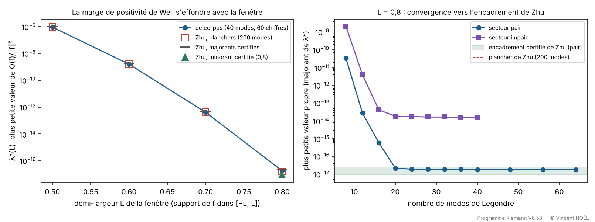

# V6.58 — Zhu reproduit : la positivité de Weil jusqu'à la fenêtre [−0,8 ; 0,8]

**Document 81 · Vincent P. P. NOËL · 17 octobre 2026**  
**Statut :** pièce 2 du plan du 17 octobre, phase A. Reproduction indépendante, par une autre méthode, des valeurs de Zhu [Zhu26] (arXiv:2608.24827 v2, définitions et tableaux 1 et 3 relus dans le PDF). Le calcul est fait en précision de 60 chiffres, mais il n'est pas certifié par intervalles. Quatre prévisions avaient été écrites avant le calcul (`data/prevision_v658_zhu.md`, 9 h 10 UTC) : les quatre sont justes. Une cinquième (Z5, 9 h 47 UTC), sur le raccord avec le document 75, est juste aussi. En plus, une mesure non prévue situe les certificats du corpus (docs 71 à 75) par rapport à ceux de Zhu.  
**Demande de l'auteur :** « La 4 puis 2. »

## 1. L'objet

Zhu étudie λ*(L), le plus petit quotient Q(f)/‖f‖² pour les fonctions réelles f de support [−L, L]. Ici, Q est la forme de Weil complète, pôle compris :

  Q(f) = 2F(i/2)F(−i/2) + (1/2π) ∫ |F(t)|² [Re ψ(¼ + it/2) − log π − Σ_{log n < 2L} 2Λ(n) n^{−1/2} cos(t log n)] dt,  avec F = f̂.

RH équivaut à λ*(L) ≥ 0 pour tout L. Zhu certifie 8,9·10⁻¹⁸ ≤ λ*(0,8) ≤ 2,27·10⁻¹⁷.

## 2. Une méthode indépendante : la forme en variable x

Au lieu de calculer en fréquence t, on réécrit Q avec l'autocorrélation g(x) = ∫ f(y) f(y − x) dy, qui est paire et portée par [−2L, 2L]. On part de la représentation de Gauss ψ(z) = ∫₀^∞ (e^{−u}/u − e^{−zu}/(1 − e^{−u})) du, puis on échange les intégrales. Avec w(x) = x·e^{x/2}/sinh x, on obtient

  Q(f) = 2F(i/2)F(−i/2) + g(0)·C₀(L) + ∫₀^{2L} (g(0) − g(x))·w(x)/x dx − Σ_{log n < 2L} 2Λ(n) n^{−1/2} g(log n),

où C₀(L) = −log π + E₁(4L) + ∫₀^{2L} (e^{−2x} − w(x))/x dx.

Toutes les intégrales portent sur un intervalle borné, avec des intégrandes analytiques. Une quadrature de Gauss converge donc très vite. Les fonctions-tests sont développées sur les polynômes de Legendre de [−L, L], secteur pair ou impair. La plus petite valeur propre de la matrice obtenue est un **majorant** de λ*(L) dans chaque secteur.

**Contrôle par les zéros (prévision Z1).** Pour une bosse lisse f = cos⁴(πx/2L), à L = 0,8, cette formule donne Q(f) = 7,2014036·10⁻⁶. La somme Σ 2|F(γ)|² sur les 1 070 zéros connus jusqu'à 1 500 donne la même valeur, à **1,9·10⁻¹³ près en relatif**. La formule en x est donc juste, pôle et constantes compris.

## 3. Les résultats

| L | Ce corpus (40 modes) | Zhu, plancher (200 modes) | Zhu, majorant certifié | Rapport |
|---|---|---|---|---|
| 0,5 | 9,346·10⁻⁷ | 9,34·10⁻⁷ | 1,05·10⁻⁶ | 1,001 |
| 0,6 | 1,610·10⁻⁹ | 1,61·10⁻⁹ | 1,82·10⁻⁹ | 1,000 |
| 0,7 | 4,206·10⁻¹³ | 4,18·10⁻¹³ | 4,99·10⁻¹³ | 1,006 |
| 0,8 | 1,809·10⁻¹⁷ (1,775·10⁻¹⁷ à 64 modes) | 1,65·10⁻¹⁷ | 2,27·10⁻¹⁷ | 1,08 |

Secteur impair à L = 0,8 : 1,59·10⁻¹⁴. Zhu l'encadre entre 8,2·10⁻¹⁵ et 2,35·10⁻¹⁴ ; le pair est donc environ 900 fois plus bas.

| | Prévision | Résultat | Verdict |
|---|---|---|---|
| Z1 | formule en x = somme sur les zéros, à 10⁻⁸ près | 1,9·10⁻¹³ | **juste** |
| Z2 | à 40 modes, dans un facteur 1,5 des planchers de Zhu aux quatre valeurs de L | facteurs 1,001 à 1,10 | **juste** |
| Z3 | à L = 0,8, valeur dans l'encadrement certifié [8,9·10⁻¹⁸ ; 2,27·10⁻¹⁷] | 1,81·10⁻¹⁷, puis 1,77·10⁻¹⁷ à 64 modes | **juste** |
| Z4 | impair au moins 30 fois au-dessus du pair | environ 900 fois | **juste** |

**Ce qui est reproduit.** Les valeurs de Zhu, par une méthode indépendante (en variable x plutôt qu'en fréquence), sur toute la gamme 0,5 à 0,8. La courbe s'effondre comme Zhu l'indique : d'un facteur environ 600 entre 0,5 et 0,6, puis 4 000 et 23 000 à chaque pas de 0,1.

**Ce qui n'est pas reproduit.** La **certification** :

- le minorant 8,9·10⁻¹⁸, c'est-à-dire la positivité elle-même, qui demande le traitement de toute la dimension infinie (l'enveloppe de Zhu au-delà de T♯) ;
- le majorant certifié, qui demande d'évaluer le quotient d'un vecteur d'essai en arithmétique d'intervalles, avec des bornes d'erreur de quadrature.

Nos valeurs sont des majorants calculés en haute précision, pas des certificats.

## 4. Une mesure non prévue : le noyau des moments

Les théorèmes du corpus (docs 71 à 75) portent sur les fonctions dont les deux moments exponentiels s'annulent : F(i/2) = F(−i/2) = 0, ce qui supprime le terme du pôle. Leur forme Q_W a la même normalisation que celle de Zhu (Fourier unitaire, a(t) − C₀ = Re ψ(¼ + it/2) − log π, doc. 75). On a calculé la plus petite valeur de Q sur ce sous-espace, en 32 modes (40 à L = 0,8) ; le calcul est scripté (`run_zhu_reproduction.py --noyau`) :

| L | Tous les f (λ*) | Noyau des moments, secteur pair | Noyau, secteur impair | Certificat du corpus |
|---|---|---|---|---|
| 0,347 | 1,3·10⁻³ | 0,546 | 0,842 | ≥ 1/25 (doc. 71) |
| 0,5 | 9,35·10⁻⁷ | 0,0119 | 0,190 | ≥ 1/250 (doc. 73) |
| 0,55 | — | 9,20·10⁻⁴ | 0,0320 | ≥ 3/10000 (doc. 75) |
| 0,6 | 1,61·10⁻⁹ | 6,6·10⁻⁵ | — | — |
| 0,7 | 4,2·10⁻¹³ | 5,6·10⁻⁸ | — | — |
| 0,8 | 1,8·10⁻¹⁷ | 5,40·10⁻¹² (5,42 à 32 modes, 6,13 à 24) | 1,09·10⁻⁹ | — |

**Prévision Z5 (écrite avant).** À 11/20, la valeur du noyau tombe entre le minorant certifié du document 75 et la valeur à 0,5, entre 6·10⁻⁴ et 3·10⁻³ : mesuré 9,20·10⁻⁴, **juste**. Le certificat de 11/20 laisse donc un facteur 3 entre ce qu'il prouve et ce qui est vrai ; à 1/2, le facteur est 3 aussi (0,004 contre 0,0119).

**Le secteur pair est le plus serré.** Sur le noyau, le secteur impair est au-dessus, de 1,5 fois (0,347) à 200 fois (0,8) : c'est le secteur pair qui fixe la marge, comme pour λ*.

*Note de méthode.* La base du sous-espace à moments nuls est prise dans un réflecteur de Householder. Une orthogonalisation de Gram–Schmidt est instable ici, car les composantes du moment décroissent plus vite que toute exponentielle : un premier essai de cette façon donnait des valeurs non monotones en N, et il a été écarté. Avec le réflecteur, les valeurs décroissent avec N, comme il se doit pour une méthode variationnelle.

Deux conséquences.

- **Les théorèmes des documents 71, 73 et 75 sont cohérents avec ce calcul.** Leurs minorants certifiés (1/25, 1/250, 3/10000) sont sous les valeurs calculées sur le même sous-espace (0,546 ; 0,0119 ; 9,2·10⁻⁴), d'un facteur 3 à 14.
- **La direction presque nulle de Zhu est celle du pôle.** Sur le noyau des moments, la marge à 0,8 est environ 300 000 fois plus grande. Prolonger la méthode des documents 71 à 75 jusqu'à S = 0,8, où entrent les premiers 2, 3 et 4, demande donc une marge certifiée d'environ 5·10⁻¹², et non de 10⁻¹⁷.
- **Correctif (même jour) : ce que ce prolongement apporterait.** Le minorant certifié de Zhu, λ*(0,8) ≥ 8,9·10⁻¹⁸, vaut pour *toutes* les fonctions de support [−0,8 ; 0,8], donc aussi pour celles du noyau. La positivité sur le noyau jusqu'à 0,8 est donc déjà acquise par Zhu, et elle domine en portée les certificats 71 à 75 (S ≤ 11/20). Un certificat du corpus à 0,8 apporterait une marge indépendante et environ 10⁵ fois plus forte sur le noyau (≈ 5·10⁻¹² contre 8,9·10⁻¹⁸), par une autre méthode, mais aucune fenêtre nouvelle. L'action `v658_certificat_noyau_S08` reste enregistrée avec cette portée corrigée ; elle ne rapproche pas de RH.

## 5. Démontré, mesuré, supposé

| | Énoncé |
|---|---|
| **Démontré (ici)** | La forme en variable x du §2 (calcul direct à partir de la représentation de Gauss de ψ), contrôlée par les zéros à 2·10⁻¹³ près. |
| **Mesuré (60 chiffres, non certifié)** | Les tableaux du §3 et du §4. Prévisions Z1 à Z5 justes. |
| **Cité** | L'encadrement certifié de Zhu ; ses planchers à 200 modes. |
| **Supposé** | Que la marge du noyau des moments à 0,8 reste vers 5,4·10⁻¹² au-delà de 40 modes, et qu'elle puisse être certifiée avec les outils des documents 71 à 75. Ce certificat renforcerait la marge, pas la portée : la positivité à 0,8 suit déjà du minorant de Zhu. |

## 6. Lecture selon l'hypothèse de travail

Le document 80 a dit que ce qui manque pour ζ est un carré. Ici, on mesure à quel point ce carré est fin quand on l'observe par une fenêtre : sa plus petite valeur perd de trois à plus de quatre ordres de grandeur à chaque élargissement de 0,1, et la perte s'accélère. Aucune fenêtre ne démontrera RH : la positivité pour toutes les fenêtres *est* RH, et la marge s'effondre trop vite pour une approche fenêtre par fenêtre. Ce que les fenêtres disent, et que les certificats rendront vérifiable, c'est que le carré est là, partout où on peut regarder.

<!-- references:debut -->

## Références

Format : [clé] auteurs, *titre*, publication, lien. Fiches complètes et état de vérification : document 42 (registre des sources).

- [Zhu26] X. Zhu. *Weil positivity in compact windows: a finite reduction, certified two-sided bounds, and a Landau–Widom decay law*. arXiv:2608.24827 (v2, sept. 2026). <https://arxiv.org/abs/2608.24827> — vérifié en ligne. **Correctif V6.18 :** λ*(L) est un infimum variationnel sur toutes les fonctions test de support [−L, L] ; la plus petite valeur propre d'une matrice de Weil de taille finie en est un majorant (Zhu, remarque 2.2).

<!-- references:fin -->
