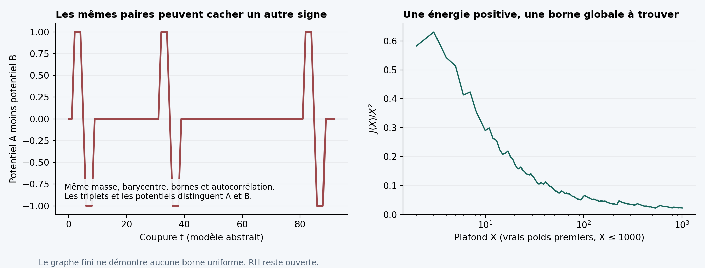

# La question et le résultat de cette passe

Les trois idées proposées ont des fonctions distinctes : identifier exactement
les vrais coefficients premiers ; mesurer leurs fluctuations sans perdre les
coupures ; transférer une borne énergétique en information sur les zéros.

Le pont retenu est classique : pour les vrais poids de von Mangoldt,
la borne globale \(J(X)=O(X^2)\), où
\[
J(X)=\int_1^X(\psi(x)-x)^2\,dx,
\]
équivaut à RH. Les corrélations ancrées permettent d'écrire exactement cette
énergie. La carte d'identité garantit que sa transformée détecte les zéros.

**Aucune borne globale nouvelle de cette force n'est obtenue.** Cette note
organise une reprise de recherche, avec preuves auxiliaires, contre-modèles
et expériences finies. La réduction est connue ; aucune priorité n'est revendiquée.

Le corpus récupéré citait déjà Cramér et Brent–Platt–Trudgian dans les documents
37 et 45. Les théorèmes A et B du dossier utilisent aussi des moyennes
quadratiques, au second ordre. Nous retrouvons donc un fil existant. Le travail
présent précise l'ancrage des corrélations et le rôle indispensable de
l'identité arithmétique ; il ne fournit pas l'estimation qui manquait à ce fil.

## Les deux éléments repris dans V6.54

**Type de document :** note de recherche et dossier de preuves auxiliaires,
accompagnés des programmes, résultats et audits. Le critère énergétique et
l'identité de diviseurs sont classiques ; aucune preuve nouvelle de RH n'est
revendiquée.

| Élément | Travail écrit et exécuté | Obligation restante |
|---|---|---|
| Carte d'identité des vrais poids premiers | Preuve de l'identité de diviseurs, unicité, inversion de Möbius et contrôle exact jusqu'à 1000 ; contre-modèle qui explique son rôle indispensable. | L'identité ne donne pas une estimation quantitative des fluctuations. |
| Énergie ancrée J | Développement exact en corrélations, critère classique de Cramér, preuve du sens borne vers RH, bilan logarithmique ; calculs recoupés à 85 et 90 chiffres. | Établir une constante indépendante de X dans la borne quadratique globale. |

Les deux éléments sont reliés par \(-\zeta'/\zeta\). L'identité identifie cette
série de Dirichlet ; la borne d'énergie donnerait l'holomorphie qui exclut
les zéros à droite de la ligne critique, comme le détaille la preuve du §4.
Le critère de Weil
donnerait alors la positivité sur tous les tests admissibles.

La passe a d'abord été livrée sous le nom « complément V6.53 » ; V6.54 corrige
ce suivi éditorial. Les journaux de calcul originaux et leurs audits sont
conservés avec leur provenance, sans nouveau calcul scientifique prétendu.

# 1. Des statistiques qui conservent l'information utile

Un poids \(\Lambda(n)\) vaut \(\log p\) si \(n=p^k\), et zéro sinon.
La fonction \(\psi(x)=\sum_{n\le x}\Lambda(n)\) cumule ces poids.
Son écart à la densité moyenne est \(E(x)=\psi(x)-x\).

L'énergie \(J\) est positive par définition, quel que soit le signe de \(E\).
Son intérêt pour RH vient d'une limite de croissance, pas de cette positivité.

**Identité de corrélation ancrée.** Pour tout \(X\ge1\),
\[
\begin{aligned}
J(X)={}&\sum_{m,n\le X}\Lambda(m)\Lambda(n)(X-\max(m,n))\\
&-\sum_{n\le X}\Lambda(n)(X^2-n^2)+\frac{X^3-1}{3}.
\end{aligned}
\]
**Preuve.** Développer \((\psi(x)-x)^2\), puis intégrer les indicatrices
\(\mathbf1_{x\ge n}\). Les conventions aux entiers n'affectent pas l'intégrale.
Le noyau quadratique est un Gram :
\[
X-\max(m,n)=\int_1^X\mathbf1_{x\ge m}\mathbf1_{x\ge n}\,dx.
\]
Il conserve les positions absolues et le plafond. La somme quadratique positive
ne domine pas automatiquement le terme croisé. Les trois grandes contributions,
de taille \(X^3\), doivent se compenser jusqu'à une énergie \(O(X^2)\).

On peut aussi séparer la diagonale et les décalages :
\[
\sum_{m,n\le X}\Lambda(m)\Lambda(n)(X-\max(m,n))
=\sum_{n\le X}\Lambda(n)^2(X-n)
+2\sum_{h\ge1}\sum_{n\le X-h}\Lambda(n)\Lambda(n+h)(X-n-h).
\]
Une information moyenne sur les paires doit contrôler précisément ces poids
et les erreurs restantes pour servir à la borne globale.

# 2. Pourquoi les corrélations par écarts ne suffisent pas

Voici un modèle exact, construit par convolution de petites briques :
\[
P=\{0,30,80\},\quad Q=\{0,1,6,8,10\},\quad Q'=10-Q,
\quad A=P+Q,\quad B=P+Q'.
\]
Toutes les sommes sont distinctes. Les deux configurations ont 15 points,
un premier moment 625, les mêmes bornes 0 et 90 et exactement les mêmes
différences signées avec multiplicité.

**Preuve de l'autocorrélation identique.** Pour les mesures de points,
\(\nu_A=\nu_P*\nu_Q\), \(\nu_B=\nu_P*\nu_{Q'}\). La réflexion-translation
\(Q'=10-Q\) conserve l'autocorrélation de \(Q\). La factorisation
\((\nu_P*\nu_Q)*(\check\nu_P*\check\nu_Q)\) donne donc le résultat.
Le barycentre de \(Q\) vaut 5, ce qui conserve aussi le premier moment.

Pourtant, avec \(P_\nu(t)=\sum_u(t-u)_+\),

| Coupure | \(P_A\) | \(P_B\) | Différence |
|---:|---:|---:|---:|
| 3 | 5 | 4 | 1 |
| 7 | 14 | 15 | -1 |

Avec la même source \(\mu=\nu_A\), le signal associé à A est nul, et celui
associé à B vaut -1 en 7. Une triple corrélation distingue aussi les modèles :
le nombre de triplets \((u,u+1,u+6)\) est 3 pour A et zéro pour B.
Cela vérifie une perte de phase précise ; cela ne prétend pas identifier les
premiers ni donner une propriété universelle de toutes les triples corrélations.

# 3. Une carte d'identité exacte, sans RH

La bonne signature arithmétique est
\[
\sum_{d\mid n}\Lambda(d)=\log n\qquad(n\ge1).
\]
**Preuve.** Si \(n=\prod p^{k_p}\), ses diviseurs qui contribuent sont
\(p,p^2,\ldots,p^{k_p}\). Leur somme est \(\sum k_p\log p=\log n\).
La relation détermine récursivement chaque coefficient, ou par inversion de
Möbius : \(\Lambda=\mu_{\mathrm M}*_{D}\log\).

Cette rigidité vérifie deux choses : l'objet est celui des vrais nombres
premiers ; sa série de Dirichlet est \(-\zeta'/\zeta\), dont chaque zéro
produit un pôle. Une reconstruction exacte ne donne pas encore une borne
d'énergie, mais elle rend valide le transfert vers les zéros.

**Contre-modèle à une énergie sans identité.** Prendre
\(a(1)=0\), \(a(n)=1\) pour tous les \(n\ge2\). Alors
\[
\psi_a(x)=\lfloor x\rfloor-1,\qquad J_a(X)\le4(X-1)\le4X^2.
\]
Cette borne est globale et inconditionnelle. Pourtant, si l'on garde la
partie archimédienne A du signal de Suzuki et remplace seulement les poids,
\[
S_a(t)=A(t)-\sum_{n\ge2}\frac{a(n)}{\sqrt n}(t-\log n)_+,
\]
le certificat par intervalles donne
\[
-1{,}337356282503885<S_a(\log1000)<-1{,}337356282503858.
\]
Sa carte d'identité échoue déjà en \(n=2\) : 1 diffère de \(\log2\).
Sa transformée fait apparaître \(\zeta(s)-1\), et non \(-\zeta'/\zeta\).
L'holomorphie de \(\zeta\) reste compatible avec ses zéros. Ce profil est
un contre-modèle au transfert générique, pas un contre-exemple à RH.

Une propagation d'erreur exacte complète la carte. Si
\(r(n)=\sum_{d\mid n}a(d)-\log n\), alors \(a-\Lambda=\mu_{\mathrm M}*_{D}r\)
et
\[
P_a(t)-P_\Lambda(t)=\sum_{m\le e^t}\frac{r(m)}{\sqrt m}
K_\mu(t-\log m),
\quad K_\mu(v)=\sum_{d\le e^v}\frac{\mu_{\mathrm M}(d)}{\sqrt d}(v-\log d).
\]
La vérification par intervalles établit
\(-0{,}038<K_\mu(\log15)<-0{,}037\). Cette inversion ne conserve donc pas
automatiquement le signe d'un défaut positif. Elle reste une identité utile
de contrôle et de reconstruction.

# 4. La réduction globale vers RH et Weil

**Critère classique.** Pour les vrais coefficients,
\[
RH\quad\Longleftrightarrow\quad J(X)=O(X^2).
\]
Le sens RH vers la borne est le résultat classique de Cramér, présenté dans
Brent–Platt–Trudgian. Leur borne sur \(\int_X^{2X}E(x)^2dx\) donne la borne
cumulative par sommation dyadique. Les constantes qu'ils établissent sous RH
ne peuvent pas être utilisées comme données indépendantes pour prouver RH.

**Preuve du sens inverse.** Supposer \(J(X)\le CX^2\). Pour \(\sigma>1/2\),
Cauchy–Schwarz sur \([2^k,2^{k+1}]\) donne
\[
\int_{2^k}^{2^{k+1}}|E(x)|x^{-\sigma-1}\,dx
\ll_\sigma\sqrt C\,2^{-k(\sigma-1/2)}.
\]
La série est sommable. Ainsi
\(F(s)=\int_1^\infty E(x)x^{-s-1}dx\) est holomorphe sur \(\Re s>1/2\).
Pour \(\Re s>1\), l'identité arithmétique donne
\[
-\frac{\zeta'}{\zeta}(s)=\frac{s}{s-1}+sF(s).
\]
Le membre de droite est holomorphe dans le demi-plan visé, sauf en 1.
Un zéro de \(\zeta\) y donnerait un pôle non nul à gauche. Il n'y en a donc
aucun ; la symétrie fonctionnelle donne RH. Le critère de Weil fournit ensuite
la positivité pour tous les tests admissibles. Le pont spécifique de Suzuki
redonne le signe global de notre signal.

La condition plus souple \(J(X)=O_\varepsilon(X^{2+\varepsilon})\) pour tout
\(\varepsilon>0\) suffit aussi : choisir \(\varepsilon<2\sigma-1\) dans
la même preuve. Elle reste d'une force équivalente à RH.

La moyenne ne doit pas converger vers un plateau : Brent–Platt–Trudgian
établissent l'absence de limite du ratio dyadique normalisé. La cible est
une enveloppe uniforme, comprenant toutes les échelles et leurs exceptions.

# 5. Une équation de bilan en échelle logarithmique

Définir
\[
f(y)=e^{-y/2}E(e^y),\qquad R(Y)=e^{-2Y}J(e^Y).
\]
Le changement de variable donne exactement
\[
R(Y)=\int_0^Y e^{-2(Y-u)}f(u)^2\,du,
\qquad R'(Y)=f(Y)^2-2R(Y)\quad\text{presque partout}.
\]
C'est un réservoir positif avec une entrée quadratique et une fuite fixe.
La dérivée peut avoir les deux signes. La question de RH devient la bornitude
de ce réservoir pour les vrais coefficients.

Un contrôle uniforme \(\int_Y^{Y+1}f(u)^2du\le K\) suffit à cette bornitude,
par découpage du noyau exponentiel en intervalles unitaires. Réciproquement,
si \(0\le R\le M\), intégrer l'équation sur un intervalle unitaire donne
\(\int_Y^{Y+1}f^2\le3M\). Ce bilan donne une forme locale de l'obligation
globale ; il ne démontre pas le contrôle arithmétique de l'entrée.

# 6. Retour au corpus et prochaine obligation

Le document 37 utilisait déjà la construction
\(c=\Lambda*_{D}\Lambda-\Lambda\log+2\gamma_E\Lambda\) et une énergie
quadratique de ses sommes cumulées. Si \(q=-\zeta'/\zeta\), son opérateur
\(q^2+q'+2\gamma_Eq\) a, en un zéro de multiplicité m, un coefficient de
pôle double \(m(m+1)>0\). Cette identité locale est indépendante de RH.
Elle garantit la détection des zéros ; elle ne borne pas l'énergie globale.
Les théorèmes A et B du dossier sont des résultats de travail antérieurs,
avec leur propre statut de relecture, pas des résultats nouvellement validés ici.

Le point à travailler est donc une conséquence quantitative de l'identité
arithmétique qui contrôle l'énergie ancrée à l'exposant 2. Les corrélations
de produits de premiers, les décompositions par diviseurs ou des fenêtres
multiplicatives doivent payer explicitement le reste et les bords. Supposer
une covariance déjà connue seulement sous RH rendrait la preuve circulaire.

La moyenne issue du théorème des nombres premiers donne ici seulement
\(J(X)=o(X^3)\). Le passage à \(O(X^2)\) concentre toujours la difficulté.
Identifier l'objet et reconstruire sa phase ne remplace pas cette estimation.

# Expériences, statut et reproduction

Au plafond déjà utilisé de 1000, les calculs à 70 chiffres, recoupés à
85 et 90 chiffres indépendamment, donnent :

| X | \(J(X)/X^2\), diagnostic |
|---:|---:|
| 10 | 0,2904035120 |
| 100 | 0,06227792917 |
| 1000 | 0,02295477333 |

Ces trois valeurs vérifient le calcul, pas une tendance ni une borne infinie.
Le programme vérifie exactement les identités de diviseurs jusqu'à 1000,
le modèle homométrique et les deux potentiels. Les signes du noyau de Möbius
et du profil unitaire sont contrôlés par intervalles à 400 bits.

Depuis le dossier, avec mpmath 1.3.0 :

    python3 anchored_correlations.py --output results

Pour le visuel, avec matplotlib 3.10.8 :

    python3 figure_correlations.py

L'audit indépendant et les données sont fournis dans le complément ZIP.
Les énergies des vrais premiers sont des diagnostics ; les contre-modèles
entiers et les identités sont exacts ; aucune borne globale de niveau RH
n'est certifiée.

## Sources et provenance

- R. P. Brent, D. J. Platt, T. S. Trudgian, *The mean square of the error term
  in the prime number theorem*, JNT 238 (2022), 740–762 :
  <https://maths-people.anu.edu.au/~brent/pd/rpb274-final.pdf>.
- T. Tao, *254A, Notes 1: Elementary multiplicative number theory* (2014),
  identité de diviseurs et transformées de Dirichlet :
  <https://terrytao.wordpress.com/2014/11/23/254a-notes-1-elementary-multiplicative-number-theory/>.
- M. Suzuki, *Aspects of the screw function corresponding to the Riemann
  zeta-function*, critères de positivité : <https://arxiv.org/pdf/2206.03682>.
- Corpus récupéré : document 37, *Pré-relecture : les Théorèmes A et B et
  l'Archipel d'Euler*, et document 45, *Le palier recalculé et les redécouvertes*.
- Les preuves courtes et exemples de cette note ont été construits et
  confrontés dans cette passe. Ils ne constituent pas une percée sur RH.
