# Liste des figures

Auteur et titulaire des droits : Vincent NOËL. Page produite par `python 2_Methode/Figures/build_figures.py`.

82 figures dans les documents, 28 figures de calcul, 4 figures d'articles.

## Figures des documents

### Fig. 1. Carte du lexique

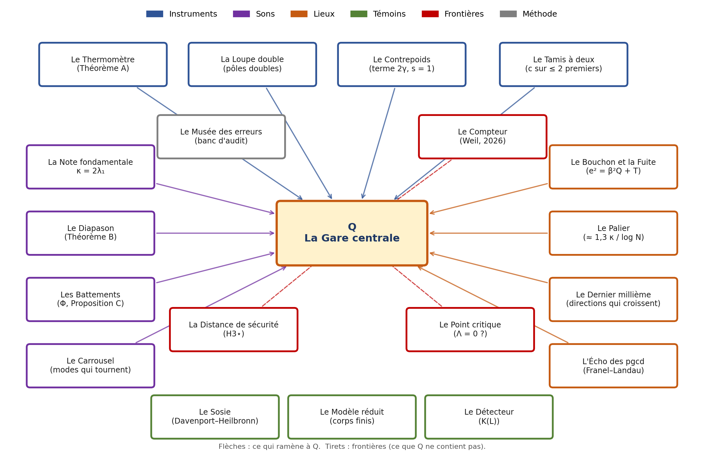

document 20 : [V6 — Registre canonique des métaphores et mécanismes](../1_Presentation/20_Registre_metaphores_V6.md)

### Fig. 2. Les différences entre zéros évitent les zéros de ζ

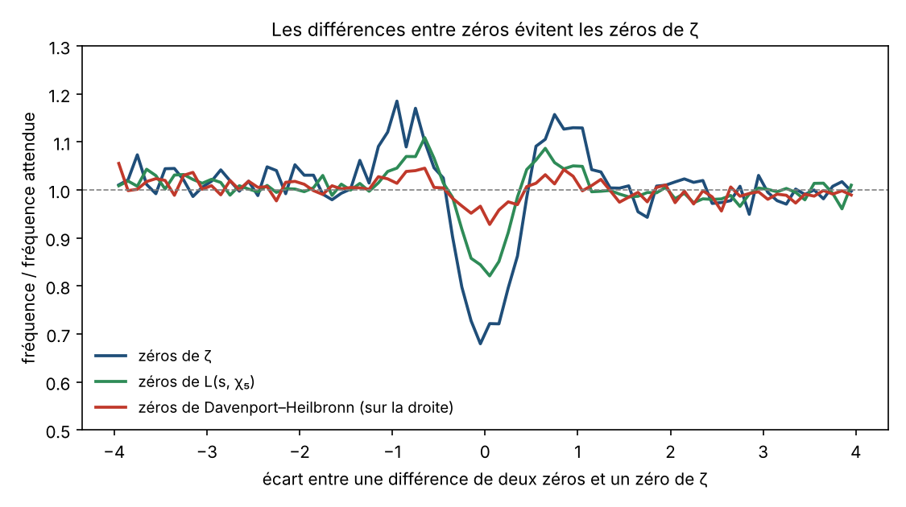

document 24 : [V6.3d/e/f — Ce que chaque instrument voit réellement](../1_Presentation/24_CLASSEMENT_DES_INSTRUMENTS_V6_3D.pdf)

### Fig. 3. Largeur du creux : mesure et modèle

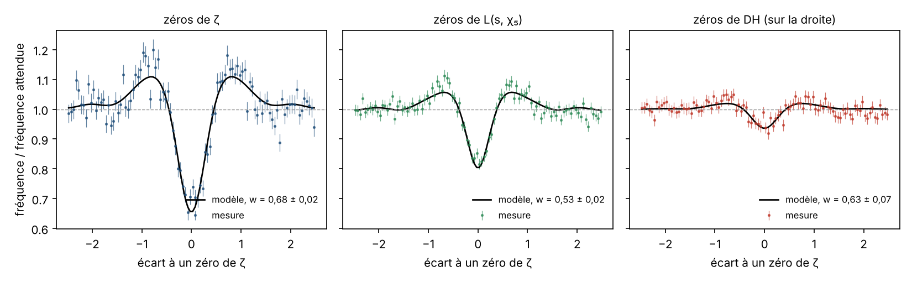

document 24 : [V6.3d/e/f — Ce que chaque instrument voit réellement](../1_Presentation/24_CLASSEMENT_DES_INSTRUMENTS_V6_3D.pdf)

### Fig. 4. La largeur du creux selon la hauteur

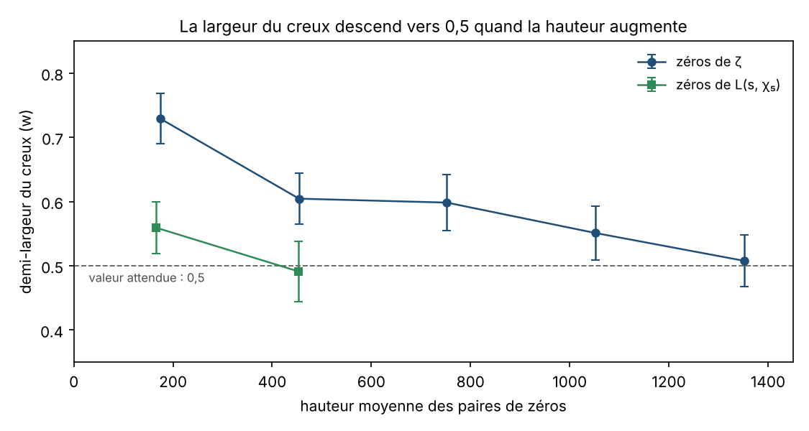

document 24 : [V6.3d/e/f — Ce que chaque instrument voit réellement](../1_Presentation/24_CLASSEMENT_DES_INSTRUMENTS_V6_3D.pdf)

### Fig. 5. Le seuil τ_c

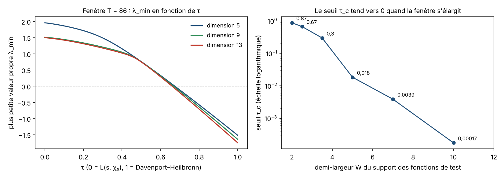

document 26 : [V6.4 — Le seuil τ_c : exécution du test prioritaire de l'Atlas](../1_Presentation/26_SEUIL_TAU_C_TEST_DE_L_ATLAS.pdf)

### Fig. 6. La famille modulo 7

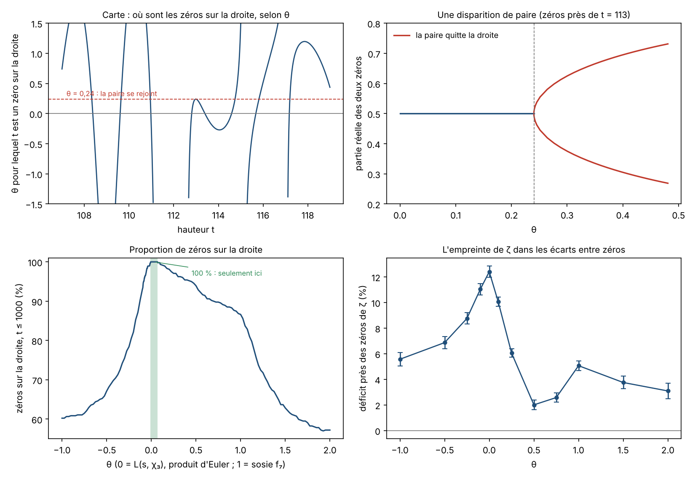

document 27 : [V6.5 — Là où les zéros bougent : RH ne tient qu'au point d'Euler](../1_Presentation/27_FAMILLE_MODULO_7_POINT_D_EULER.pdf)

### Fig. 7. Le Modèle réduit

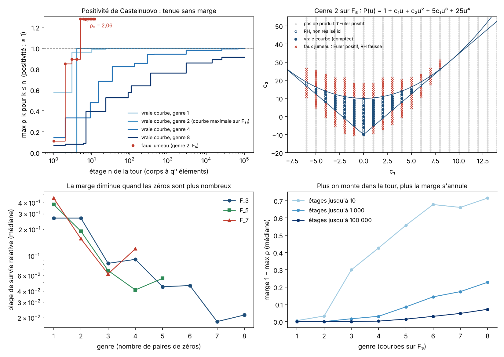

document 28 : [V6.6 — Le Modèle réduit : à quoi ressemble une nécessité démontrée](../1_Presentation/28_MODELE_REDUIT_NECESSITE_DEMONTREE.pdf)

### Fig. 8. La loi de rang

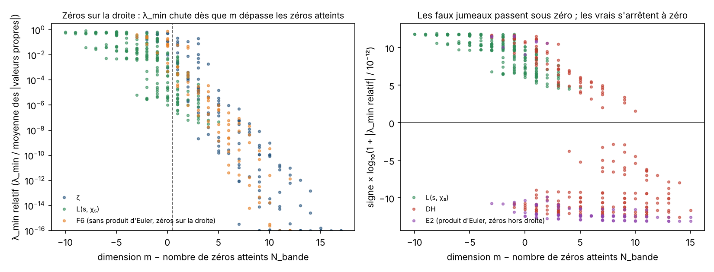

document 29 : [V6.7 — STABILITY-RADIUS : la marge de la forme et la marge de l'objet](../1_Presentation/29_STABILITY_RADIUS_MARGE_DE_LA_FORME_ET_DE_L_OBJET.pdf)

### Fig. 9. Le Modèle réduit : deux marges

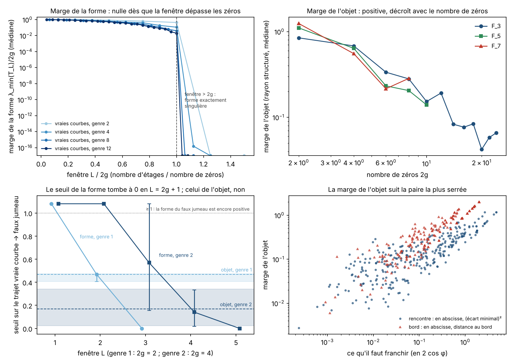

document 29 : [V6.7 — STABILITY-RADIUS : la marge de la forme et la marge de l'objet](../1_Presentation/29_STABILITY_RADIUS_MARGE_DE_LA_FORME_ET_DE_L_OBJET.pdf)

### Fig. 10. Seuil de l'objet contre seuil de la forme

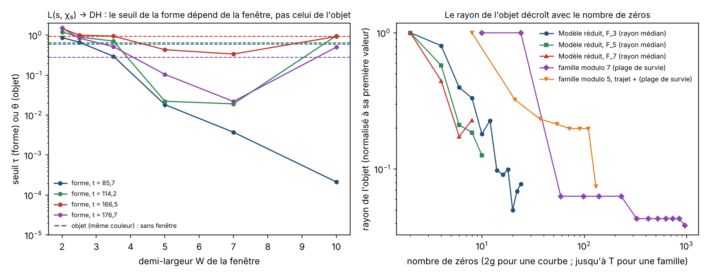

document 29 : [V6.7 — STABILITY-RADIUS : la marge de la forme et la marge de l'objet](../1_Presentation/29_STABILITY_RADIUS_MARGE_DE_LA_FORME_ET_DE_L_OBJET.pdf)

### Fig. 11. L'Archipel d'Euler

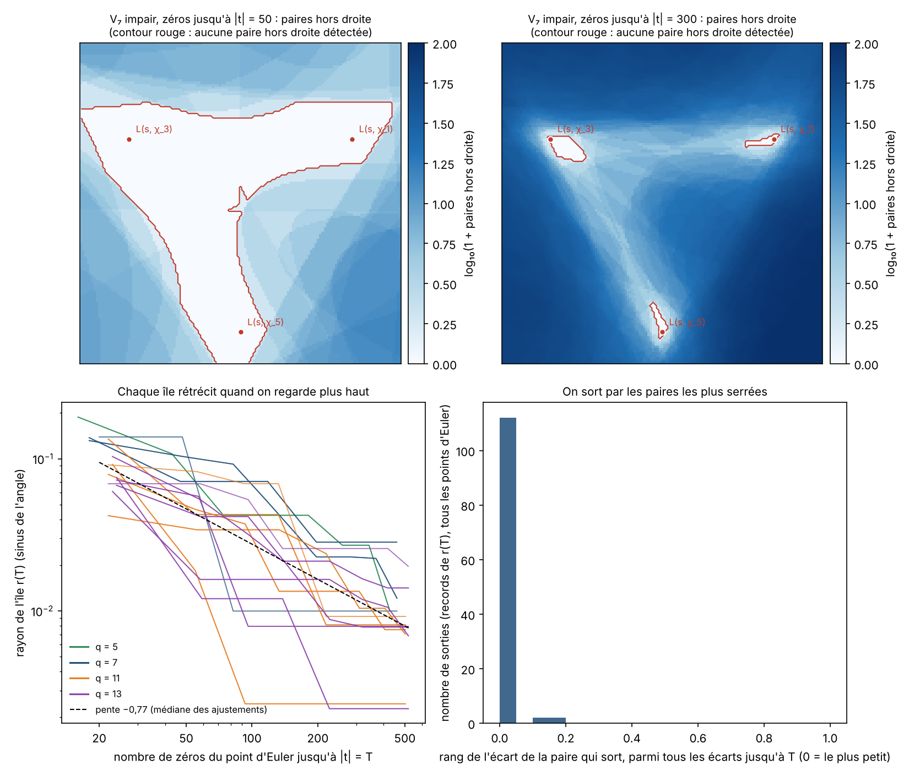

document 30 : [V6.8 — L'Archipel d'Euler : parmi les fonctions qui ont l'équation fonctionnelle, RH n'existe qu'aux points d'Euler](../1_Presentation/30_ARCHIPEL_D_EULER.pdf)

### Fig. 12. Le chaînon

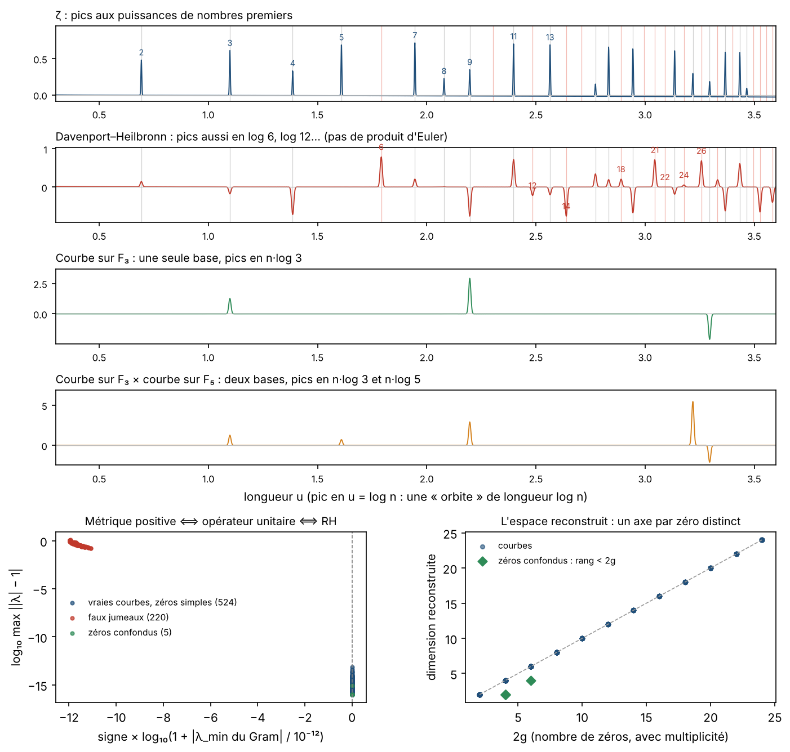

document 32 : [V6.9 — Le chaînon : du Frobenius discret au flot continu](../1_Presentation/32_LE_CHAINON_DU_DISCRET_AU_CONTINU.pdf)

### Fig. 13. Le générateur des premiers

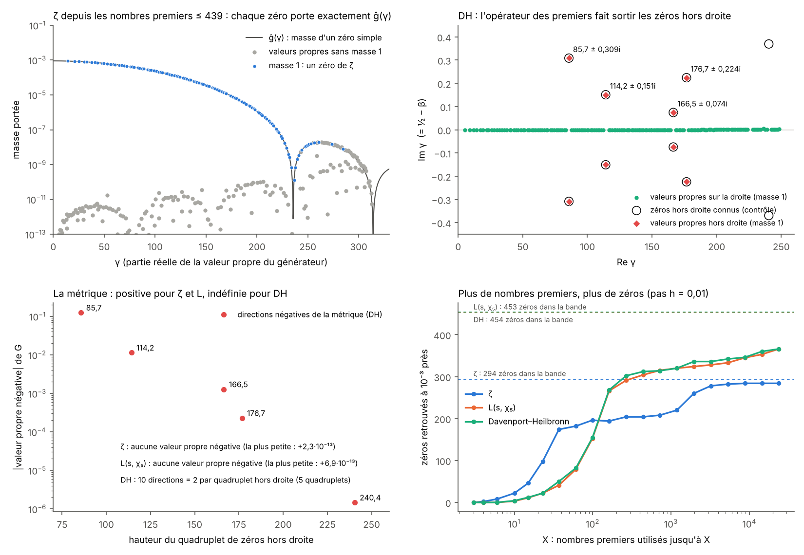

document 33 : [V6.10 — Le générateur des premiers : l'opérateur de ζ reconstruit sans aucun zéro](../1_Presentation/33_LE_GENERATEUR_DES_PREMIERS.pdf)

### Fig. 14. La base comme pas de temps

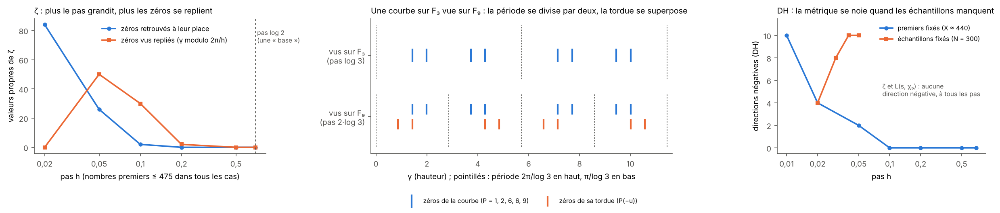

document 35 : [V6.11 — La base comme pas de temps](../1_Presentation/35_LA_BASE_COMME_PAS_DE_TEMPS.pdf)

### Fig. 15. Les idées rejetées relues

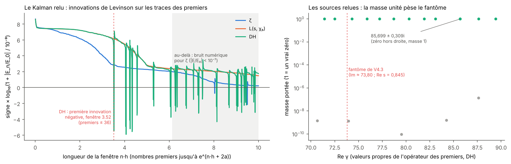

document 36 : [V6.12 — Relecture : les trois idées rejetées relues, et les priorités refaites](../1_Presentation/36_LES_IDEES_REJETEES_RELUES.pdf)

### Fig. 16. Le seuil de détection

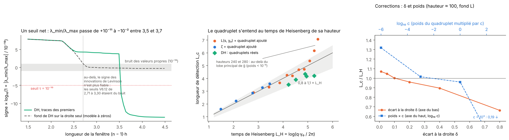

document 38 : [V6.14 — La loi de seuil : un quadruplet hors droite s'entend au temps de Heisenberg de sa hauteur](../1_Presentation/38_LA_LOI_DE_SEUIL_LE_TEMPS_DE_HEISENBERG.pdf)

### Fig. 17. Le degré 2 : la longueur de détection double

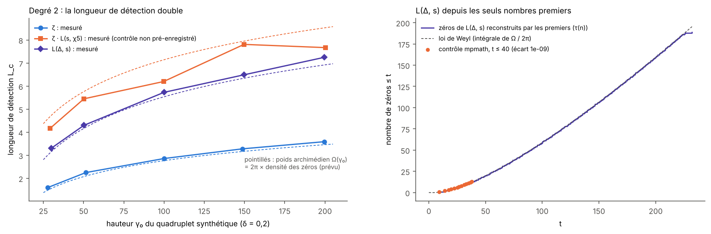

document 39 : [V6.15 — Le degré 2 et le recensement : la loi de seuil avec Δ de Ramanujan [Ram16], et les quadruplets de DH comptés par les premiers](../1_Presentation/39_LE_DEGRE_2_ET_LE_RECENSEMENT.pdf)

### Fig. 18. Le recensement de DH par les premiers

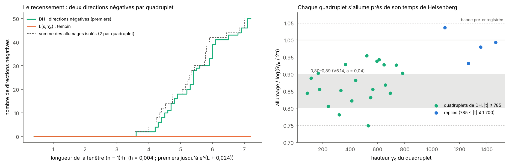

document 39 : [V6.15 — Le degré 2 et le recensement : la loi de seuil avec Δ de Ramanujan [Ram16], et les quadruplets de DH comptés par les premiers](../1_Presentation/39_LE_DEGRE_2_ET_LE_RECENSEMENT.pdf)

### Fig. 19. La Rencontre à trois

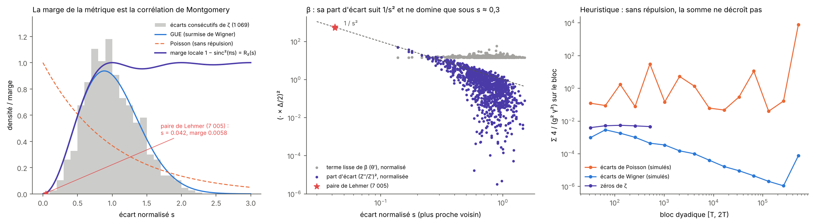

document 40 : [V6.16 — La Rencontre à trois, et les croisements dans l'indicateur](../1_Presentation/40_LA_RENCONTRE_A_TROIS.pdf)

### Fig. 20. La Rencontre en degré 2

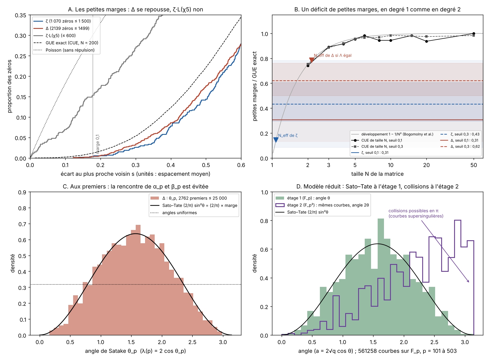

document 41 : [V6.17 — La Rencontre en degré 2, et son pendant dans le Modèle réduit](../1_Presentation/41_LA_RENCONTRE_EN_DEGRE_2.pdf)

### Fig. 21. La Rencontre à trois en 3D

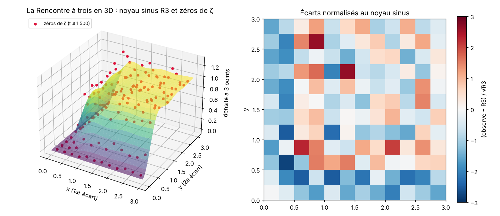

document 43 : [V6.19 — Plan de recherche : la Rencontre à n et la matrice des théories (adapté en V6.20 à V6.29)](../1_Presentation/43_PLAN_DE_RECHERCHE_LA_RENCONTRE_A_N.pdf)

### Fig. 22. Le Palier recalculé

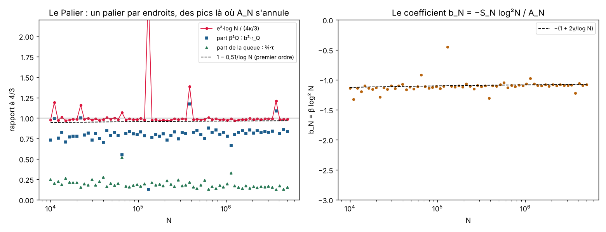

document 45 : [V6.20 — Le Palier 4/3 recalculé, et ce que le programme a retrouvé](../1_Presentation/45_LE_PALIER_RECALCULE_ET_LES_REDECOUVERTES.pdf)

### Fig. 23. La surface virtuelle

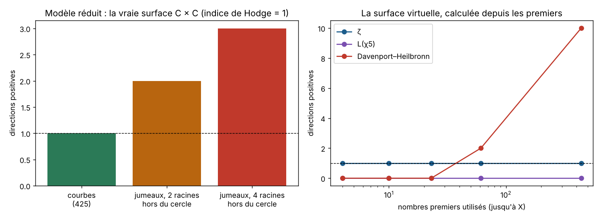

document 46 : [V6.21 — Axe J : la surface virtuelle](../1_Presentation/46_LA_SURFACE_VIRTUELLE.pdf)

### Fig. 24. Le Riemann–Roch virtuel

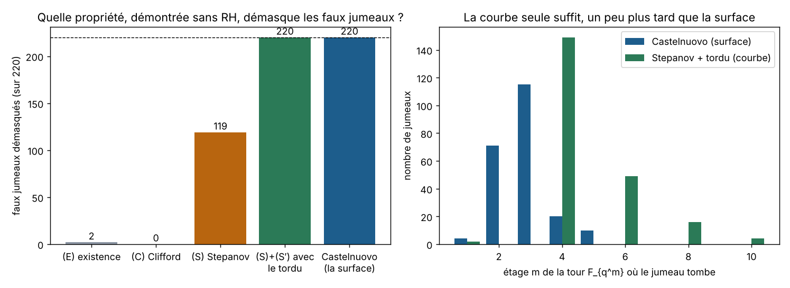

document 47 : [V6.22 — Axe J2 : le Riemann–Roch virtuel](../1_Presentation/47_LE_RIEMANN_ROCH_VIRTUEL.pdf)

### Fig. 25. Le Frobenius

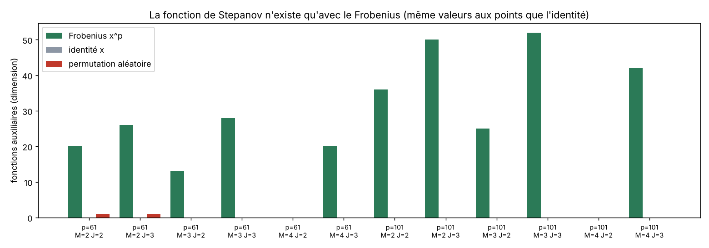

document 48 : [V6.23 — Axe J5 : le Frobenius qui n'est pas un morphisme](../1_Presentation/48_LE_FROBENIUS_QUI_N_EST_PAS_UN_MORPHISME.pdf)

### Fig. 26. Le même calcul

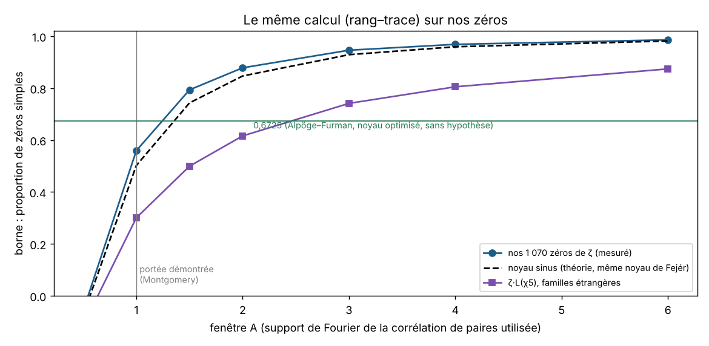

document 49 : [V6.24 — Analyse de risques, J3 simplifié, et « le même calcul » que les deux tiers](../1_Presentation/49_ANALYSE_DE_RISQUES_J3_ET_LES_DEUX_TIERS.pdf)

### Fig. 27. Le carré en continu

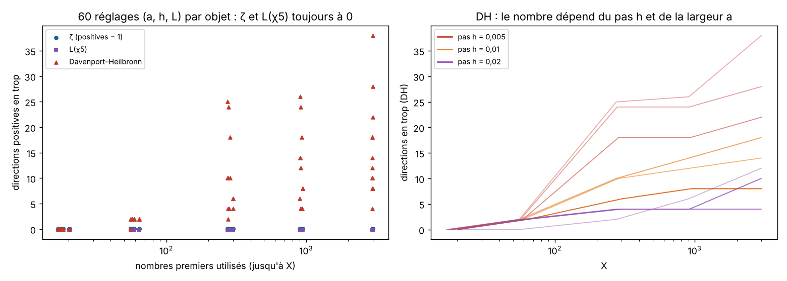

document 52 : [V6.27 — J6 : le carré, en continu](../1_Presentation/52_J6_LE_CARRE_EN_CONTINU.pdf)

### Fig. 28. Le trou à trois, lu

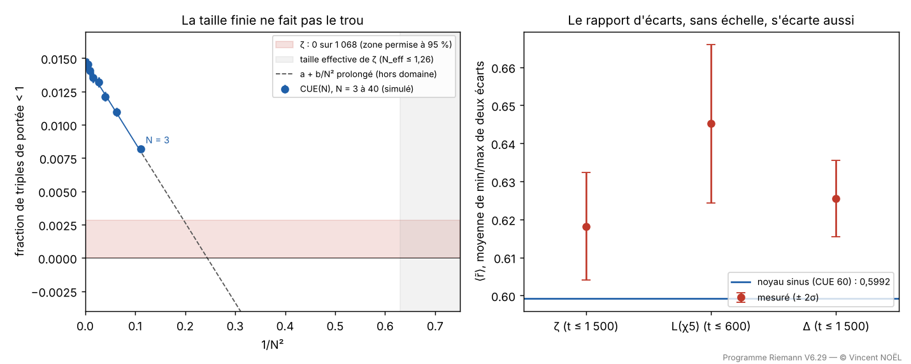

document 54 : [V6.29 — Le trou à trois, lu ; les proportions de 2026 ; la matrice complétée](../1_Presentation/54_LE_TROU_A_TROIS_LU.pdf)

### Fig. 29. Le relief de l'archipel

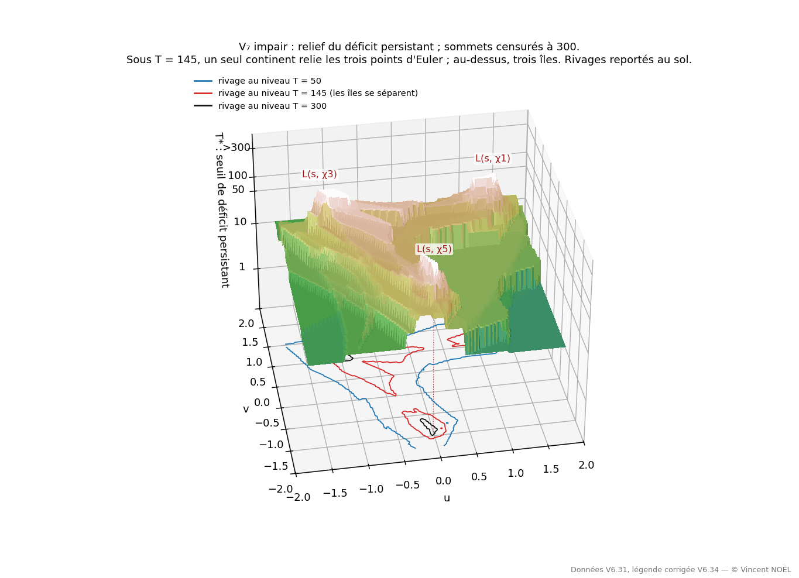

document 56 : [V6.31 — Le relief de l'archipel : une seule vue 3D](../1_Presentation/56_LE_RELIEF_DE_L_ARCHIPEL.pdf)

### Fig. 30. La force du relief

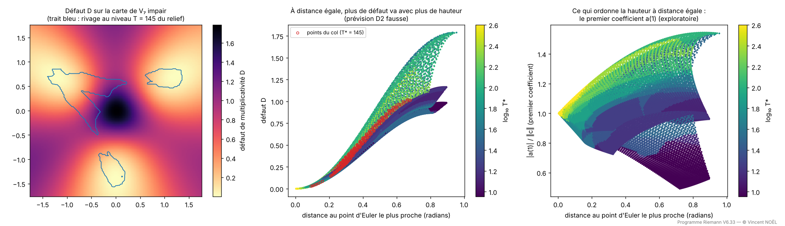

document 57 : [V6.33 — La force qui abaisse le relief : le défaut de multiplicativité, puis le premier coefficient](../1_Presentation/57_LA_FORCE_DU_RELIEF.pdf)

### Fig. 31. Validation directe et borne des jets

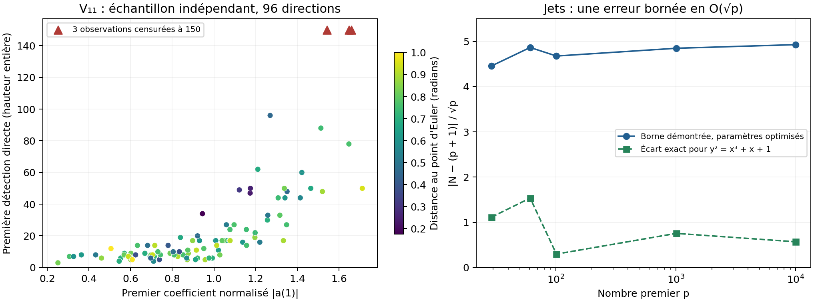

document 58 : [V6.34 - Validation directe du relief et lemme des jets](../1_Presentation/58_VALIDATION_DIRECTE_DU_RELIEF_ET_LEMME_DES_JETS.pdf)

### Fig. 32. Comptages directs normalisés et racines inverses normalisées de quatre courbes elliptiques.

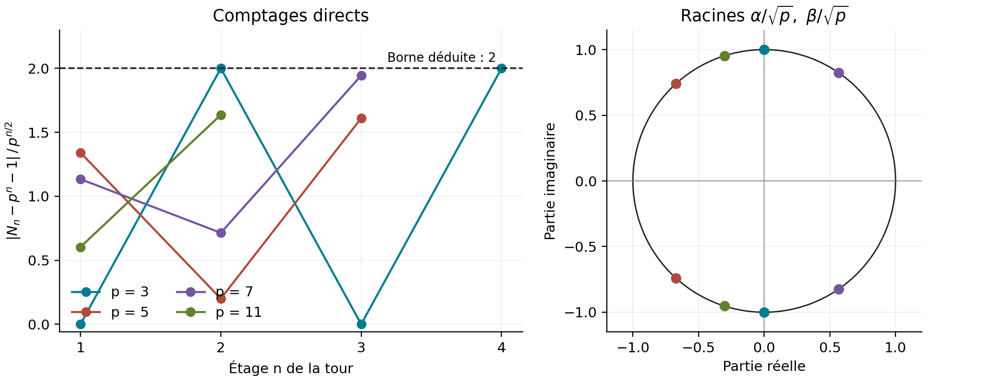

document 59 : [V6.35 — De la tour finie à la borne spectrale](../1_Presentation/59_DE_LA_TOUR_FINIE_A_LA_BORNE_SPECTRALE.pdf)

### Fig. 33. Spectre numérique de la fenêtre DH et sous-espace de 25 vecteurs dont la compression est validée négative. Les autres signes ne sont pas certifiés ici.

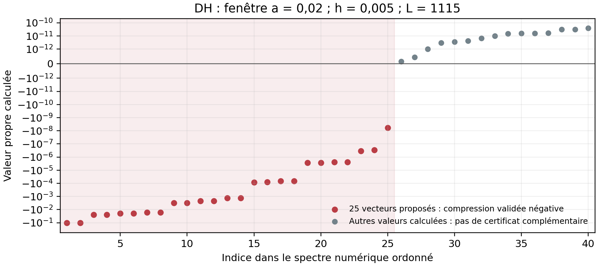

document 60 : [V6.36 — Trois articles et un certificat de négativité](../1_Presentation/60_ARTICLES_ET_CERTIFICAT_DE_NEGATIVITE.pdf)

### Fig. 34. Ordres de détection par bras et plafond. Les couleurs décrivent la variation de la hauteur quand la variable comparée augmente.

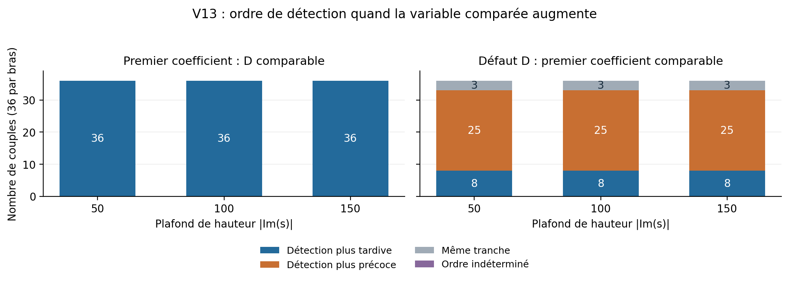

document 61 : [V6.37 - Ancrage apparié V13](../1_Presentation/61_ANCRAGE_APPARIE_V13.pdf)

### Fig. 35. Ordres par ancre et rayon à hauteur 150. Dans chaque cellule : tardif / précoce / sans ordre strict ; deux couples par cellule.

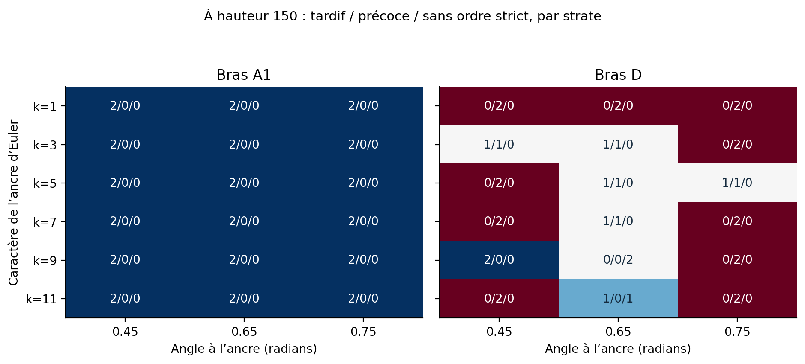

document 61 : [V6.37 - Ancrage apparié V13](../1_Presentation/61_ANCRAGE_APPARIE_V13.pdf)

### Fig. 36. Présence dans tous les portefeuilles optimaux, sur 243 profils de poids. Ces fréquences ne sont pas des probabilités.

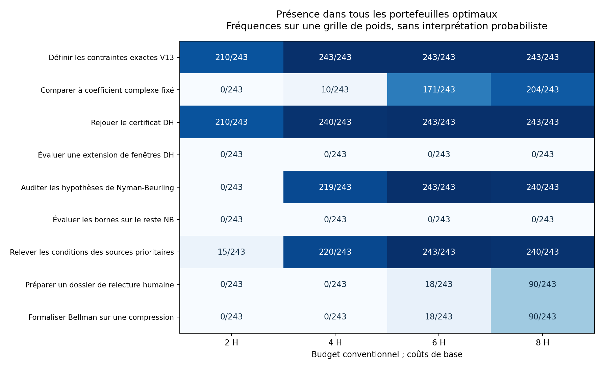

document 62 : [V6.38 - Atlas des décisions et équations de Bellman](../1_Presentation/62_ATLAS_DES_DECISIONS_BELLMAN.pdf)

### Fig. 37. Écarts construits entre les deux scores D. Seules les trois ancres représentatives sont tracées. Le seuil 0,25 est celui de V6.37.

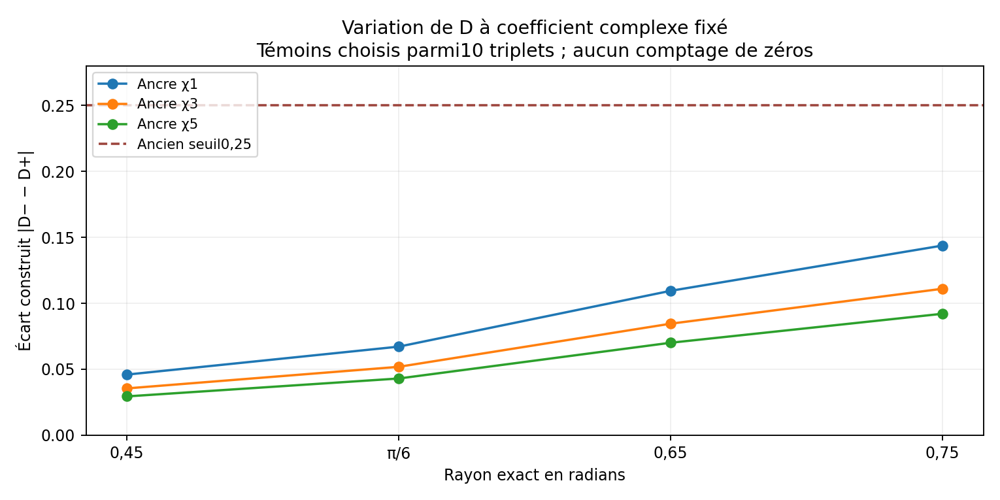

document 63 : [V6.39 - Contraintes exactes V13 : comparaison faisable](../1_Presentation/63_CONTRAINTES_EXACTES_V13.pdf)

### Fig. 38. Premières tranches des déficits numériques : D haut détecte plus tard pour χ₁ et plus tôt pour χ₃, χ₅. Les lignes relient seulement quatre rayons calculés ; elles ne suivent pas une branche de racines.

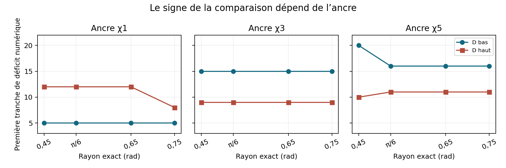

document 64 : [V6.40 — Comparaison exacte V13 : le signe dépend de l’ancre](../1_Presentation/64_COMPARAISON_EXACTE_V13.pdf)

### Fig. 39. Modèle courant : neuf actions restantes après les trois actions V13 achevées. La fréquence sur 243 profils est une sensibilité aux poids conventionnels, pas une probabilité de succès.

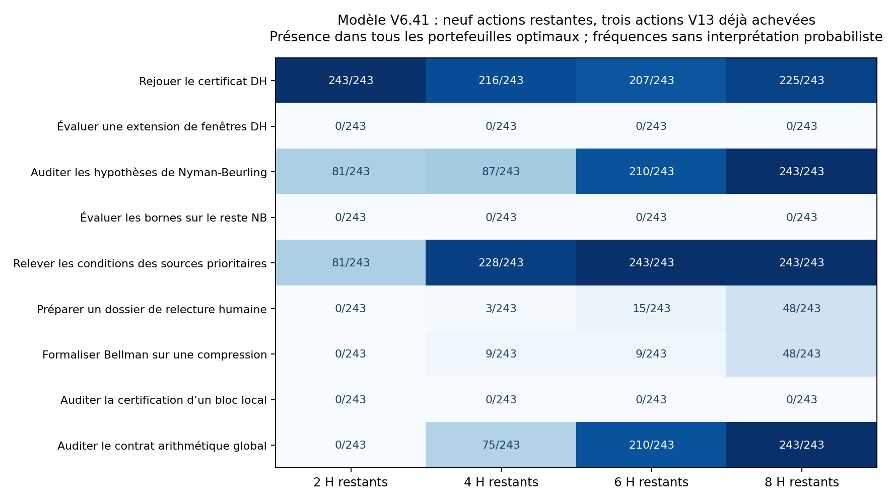

document 65 : [V6.41 — Fibres, plis et positivité : le graphe des passages](../1_Presentation/65_FIBRES_PLIS_ET_POSITIVITE.pdf)

### Fig. 40. Les six branches suivies et leurs plis attribués. Les points sont des localisations numériques ; les lignes relient la continuation fine. La trajectoire radiale fait varier A.

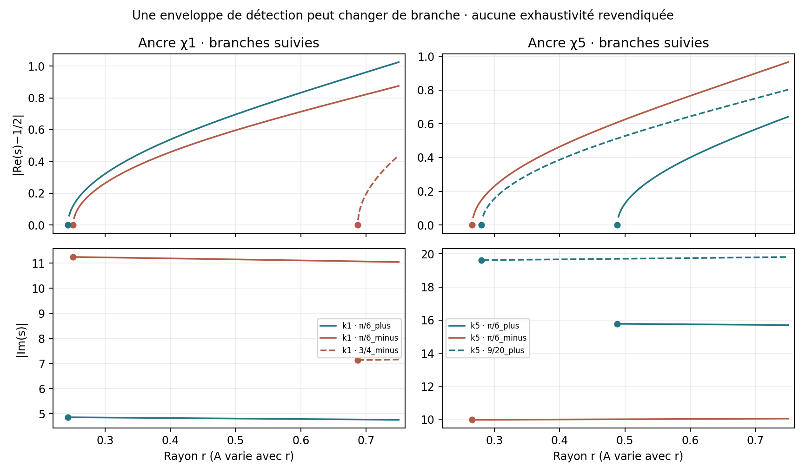

document 65 : [V6.41 — Fibres, plis et positivité : le graphe des passages](../1_Presentation/65_FIBRES_PLIS_ET_POSITIVITE.pdf)

### Fig. 41. Moments de contour et modèle linéaire du jet autour des six plis. Au rayon central, un petit discriminant numérique n’est pas présenté comme une annulation exacte.

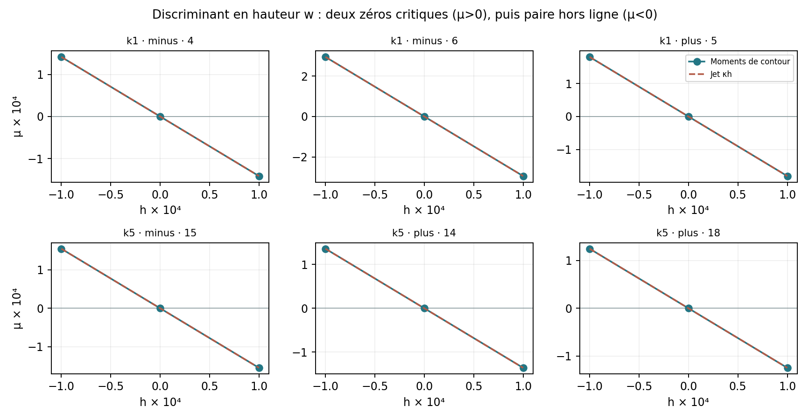

document 65 : [V6.41 — Fibres, plis et positivité : le graphe des passages](../1_Presentation/65_FIBRES_PLIS_ET_POSITIVITE.pdf)

### Fig. 42. Ellipses à r=13/20 et A=0 intérieur pour les trois ancres représentatives. Les phases sont évaluées pour la figure ; les encadrements de faisabilité sont conservés dans le certificat.

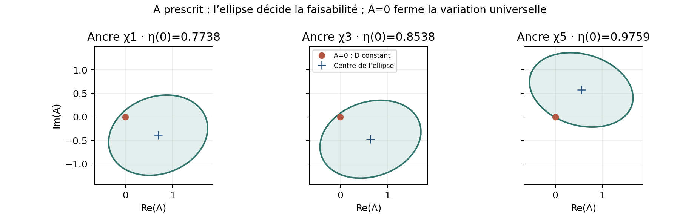

document 65 : [V6.41 — Fibres, plis et positivité : le graphe des passages](../1_Presentation/65_FIBRES_PLIS_ET_POSITIVITE.pdf)

### Fig. 43. Graphe des idées, énoncés, mesures et obstacles. Les flèches conditionnelles exigent les hypothèses indiquées ; les ponts ouverts ne sont pas des implications.

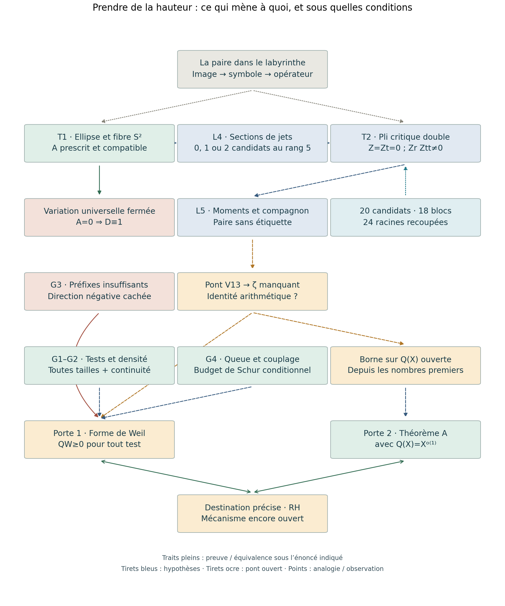

document 65 : [V6.41 — Fibres, plis et positivité : le graphe des passages](../1_Presentation/65_FIBRES_PLIS_ET_POSITIVITE.pdf)

### Fig. 61. Graphe des passages

document 65 : [V6.41 — Fibres, plis et positivité : le graphe des passages](../1_Presentation/65_FIBRES_PLIS_ET_POSITIVITE.pdf)

### Fig. 44. Bellman sensibilite

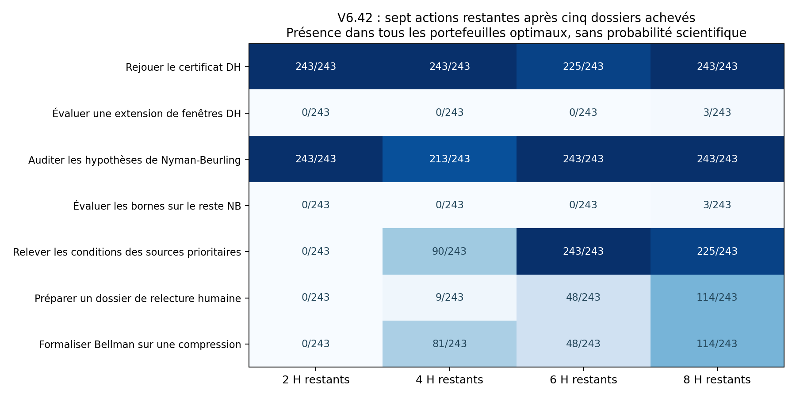

document 66 : [V6.42 - Un pli certifié, sa paire et la porte arithmétique](../1_Presentation/66_UN_PLI_CERTIFIE_ET_SA_PAIRE.pdf)

### Fig. 45. Majorants sur les 256 arcs : la borne inclut tous les points de chaque arc et tout le petit intervalle radial. Ce tracé représente une borne, pas des échantillons du module exact.

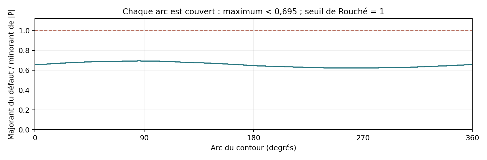

document 66 : [V6.42 - Un pli certifié, sa paire et la porte arithmétique](../1_Presentation/66_UN_PLI_CERTIFIE_ET_SA_PAIRE.pdf)

### Fig. 46. Un pli et une paire sont validés ; le compagnon rencontre une impossibilité de métrique au double ; les deux portes arithmétiques globales restent ouvertes.

document 66 : [V6.42 - Un pli certifié, sa paire et la porte arithmétique](../1_Presentation/66_UN_PLI_CERTIFIE_ET_SA_PAIRE.pdf)

### Fig. 62. Graphe des certificats

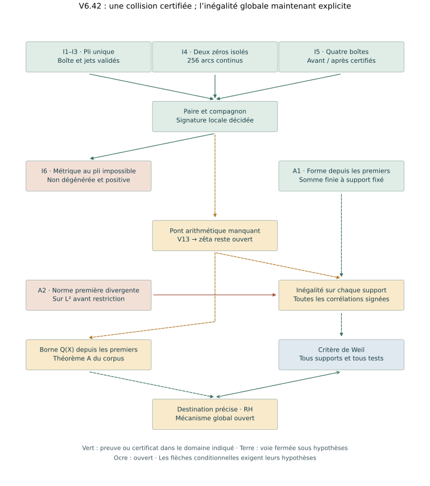

document 66 : [V6.42 - Un pli certifié, sa paire et la porte arithmétique](../1_Presentation/66_UN_PLI_CERTIFIE_ET_SA_PAIRE.pdf)

### Fig. 47. Deux configurations certifiées de la même paire. Les centres sont marqués ; les boîtes de validation ont largeur 2×10⁻⁸ et sont invisibles à cette échelle.

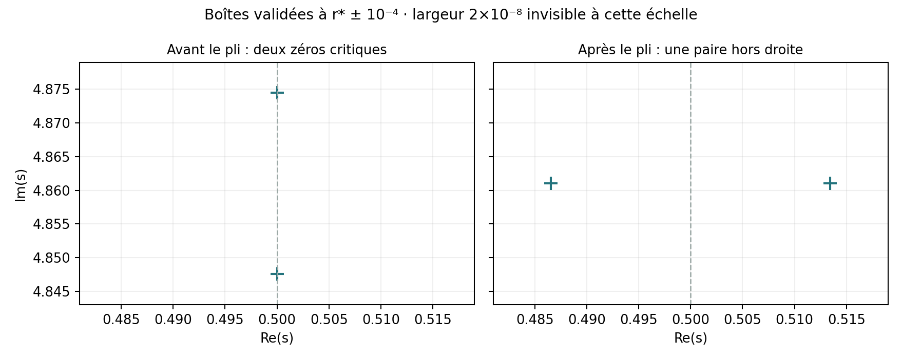

document 66 : [V6.42 - Un pli certifié, sa paire et la porte arithmétique](../1_Presentation/66_UN_PLI_CERTIFIE_ET_SA_PAIRE.pdf)

### Fig. 48. Carte des constructions : les obligations ouvertes gardent leur statut.

document 67 : [V6.43 - Construire des ponts avec Bellman](../1_Presentation/67_CONSTRUIRE_DES_PONTS_AVEC_BELLMAN.pdf)

### Fig. 63. PONTS ET OBLIGATIONS

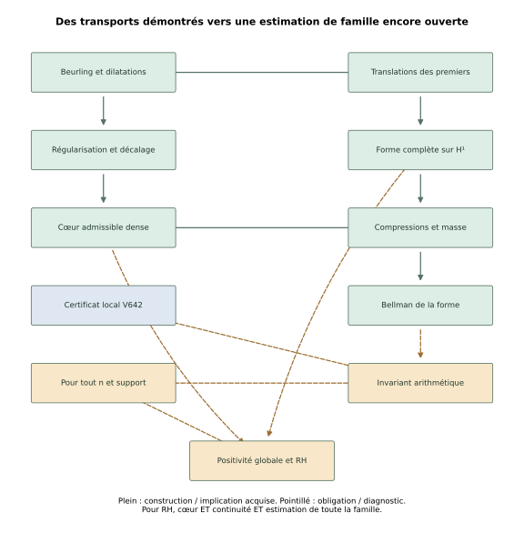

document 67 : [V6.43 - Construire des ponts avec Bellman](../1_Presentation/67_CONSTRUIRE_DES_PONTS_AVEC_BELLMAN.pdf)

### Fig. 49. Les traductions et leurs obligations.

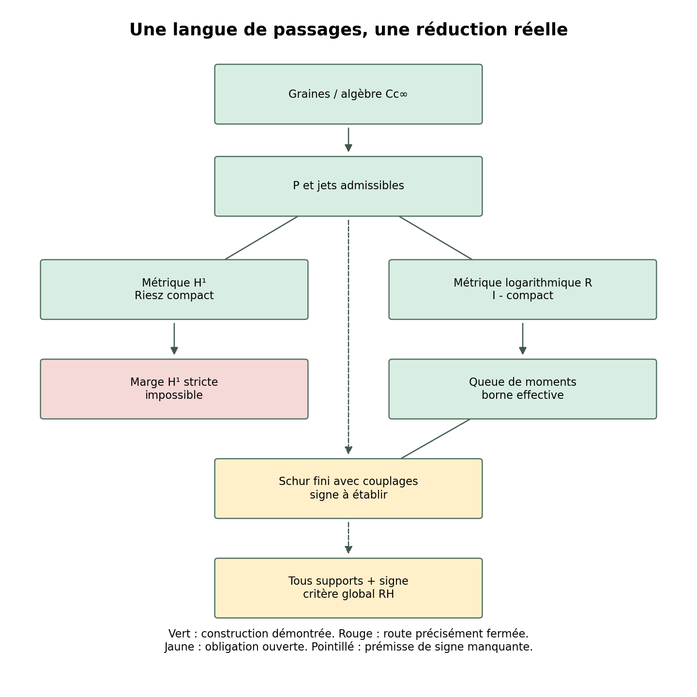

document 68 : [1. Résultat et destination](../1_Presentation/68_ARITHMETIQUE_DES_PASSAGES_ET_QUEUE_EFFECTIVE.pdf)

### Fig. 64. GRAPHE LANGUE

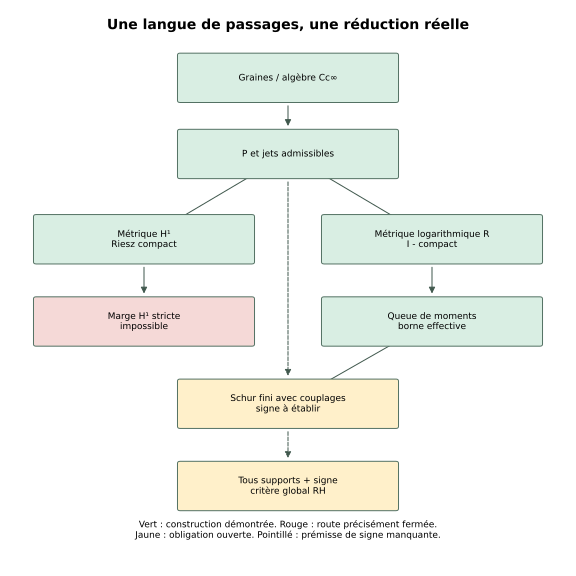

document 68 : [1. Résultat et destination](../1_Presentation/68_ARITHMETIQUE_DES_PASSAGES_ET_QUEUE_EFFECTIVE.pdf)

### Fig. 50. Compensation dans les directions proposées.

document 70 : [1. Le résultat de cette étape](../1_Presentation/70_PONT_ARITHMETIQUE_ET_DETTE_DE_COUPLAGE.pdf)

### Fig. 65. COMPENSATION ARITHMETIQUE

document 70 : [1. Le résultat de cette étape](../1_Presentation/70_PONT_ARITHMETIQUE_ET_DETTE_DE_COUPLAGE.pdf)

### Fig. 51. Les raccords du Lego et leurs limites.

document 71 : [1. Faisabilité : une construction exécutée](../1_Presentation/71_LEGO_REUTILISABLE_ET_PREMIER_CERTIFICAT_COMPLET.pdf)

### Fig. 66. GRAPHE LEGO

document 71 : [1. Faisabilité : une construction exécutée](../1_Presentation/71_LEGO_REUTILISABLE_ET_PREMIER_CERTIFICAT_COMPLET.pdf)

### Fig. 52. Le graphe des preuves, des calculs et des raccords ouverts.

document 72 : [1. Le résultat et le changement de représentation](../1_Presentation/72_CONCENTRATION_PROJETEE_ET_OPERATEUR_COMMUN.pdf)

### Fig. 67. GRAPHE CONCENTRATION

document 72 : [1. Le résultat et le changement de représentation](../1_Presentation/72_CONCENTRATION_PROJETEE_ET_OPERATEUR_COMMUN.pdf)

### Fig. 53. Le même cadre fournit la tête, les sources et la queue.

document 73 : [1. Résultat et portée](../1_Presentation/73_OPERATEUR_COMMUN_TETE_SOURCES_ET_QUEUE.pdf)

### Fig. 68. GRAPHE OPERATEUR COMMUN

document 73 : [1. Résultat et portée](../1_Presentation/73_OPERATEUR_COMMUN_TETE_SOURCES_ET_QUEUE.pdf)

### Fig. 54. Un même paiement conserve les recouvrements.

document 74 : [1. Ce qui est exécuté](../1_Presentation/74_COMPENSATION_MULTI_PREMIERS.pdf)

### Fig. 69. PAIEMENT CONJOINT

document 74 : [1. Ce qui est exécuté](../1_Presentation/74_COMPENSATION_MULTI_PREMIERS.pdf)

### Fig. 55. Carte des résultats, obligations et destination.

document 75 : [1. Ce qui a été retrouvé et ce qui a été reconstruit](../1_Presentation/75_RECUPERATION_TRANSPORT_ET_RH.pdf)

### Fig. 70. CARTE RH

document 75 : [1. Ce qui a été retrouvé et ce qui a été reconstruit](../1_Presentation/75_RECUPERATION_TRANSPORT_ET_RH.pdf)

### Fig. 56. Deux grammaires couvrantes ; la loi universelle de signe reste ouverte.

document 76 : [1. Hypothèses initiales et questions ouvertes](../1_Presentation/76_RECONSTRUIRE_LA_PISTE_GLOBALE_DE_WEIL.pdf)

### Fig. 71. CARTE PISTES GLOBALES

document 76 : [1. Ce qui change dans la direction de recherche](../1_Presentation/76_COMPLEMENT_COUP_DOUBLE.pdf)

### Fig. 57. Le stock du balayage canonique et une autre façon de traiter la première ligne.

document 78 : [Ce que cette passe apporte](../1_Presentation/78_TRANSPORT_POSITIF_RESERVE_ET_BRIQUE_INITIALE.pdf)

### Fig. 72. CARTE TRANSPORT

document 78 : [Ce que cette passe apporte](../1_Presentation/78_TRANSPORT_POSITIF_RESERVE_ET_BRIQUE_INITIALE.pdf)

### Fig. 58. Ce que la garde perd en regroupant les premières contributions, puis récupère en connaissant les sous-blocs.

document 79 : [Ce qui a été exécuté](../1_Presentation/79_COMPENSATION_PROFILS_ET_OBSTRUCTIONS.pdf)

### Fig. 73. COMPENSATION VISUEL

document 79 : [Ce qui a été exécuté](../1_Presentation/79_COMPENSATION_PROFILS_ET_OBSTRUCTIONS.pdf)

### Fig. 79. En haut, les cellules certifiées contrôlent les intervalles entre les points ; en bas, la perte des couplages change fortement l'énergie observée.

document 79 : [1. Résultat lisible avant les calculs](../1_Presentation/79_SIGNAL_COUPLAGES_ET_RESOLUTION.pdf)

### Fig. 80. SIGNAL RESOLUTION VISUEL

document 79 : [1. Résultat lisible avant les calculs](../1_Presentation/79_SIGNAL_COUPLAGES_ET_RESOLUTION.pdf)

### Fig. 81. Trois niveaux de positivité

document 80 : [V6.58 — D'où vient le signe : comptage, degré, ou carré ?](../1_Presentation/80_D_OU_VIENT_LE_SIGNE.pdf)

### Fig. 82. Zhu reproduit

document 81 : [V6.58 — Zhu reproduit : la positivité de Weil jusqu'à la fenêtre [−0,8 ; 0,8]](../1_Presentation/81_ZHU_REPRODUIT.pdf)

### Fig. 59. CARTE DES PARCOURS

### Fig. 74. CARTE DES PARCOURS

### Fig. 76. Énergie et amplification V6.55

document SUP : [Énergie et amplification V6.55 — graphe des idées](../00_Carte_des_idees.html)

### Fig. 77. Ponts, témoins et voies limitées

document SUP : [Ponts, témoins et voies limitées — graphe des idées](../00_Carte_des_idees.html)

### Fig. 78. Weil : signe ET couverture

document SUP : [Weil : signe ET couverture — graphe des idées](../00_Carte_des_idees.html)

### Fig. 60. CORRELATIONS VISUEL

### Fig. 75. CORRELATIONS VISUEL

document SUP : [Dossier des parcours](../1_Presentation/CORRELATIONS_IDENTITE_ET_ENERGIE.pdf)

## Figures de calcul

| | Figure | Script |
|---|---|---|
| C1 | [archipelago](../3_Preuves_et_calculs/data/archipelago.png) | [script](../3_Preuves_et_calculs/scripts/run_euler_archipelago.py) |
| C2 | [attack iter figure](../3_Preuves_et_calculs/data/attack_iter_figure.png) | — |
| C3 | [base step](../3_Preuves_et_calculs/data/base_step.png) | [script](../3_Preuves_et_calculs/scripts/run_base_change.py) |
| C4 | [chain](../3_Preuves_et_calculs/data/chain.png) | [script](../3_Preuves_et_calculs/scripts/run_frobenius_chain.py) |
| C5 | [dark residual amplification](../3_Preuves_et_calculs/data/dark_residual_amplification.png) | [script](../3_Preuves_et_calculs/scripts/run_dark_residual.py) |
| C6 | [dark zeta tomo2 defect scan](../3_Preuves_et_calculs/data/dark_zeta_tomo2_defect_scan.png) | — |
| C7 | [dark zeta tomo3 defect scan](../3_Preuves_et_calculs/data/dark_zeta_tomo3_defect_scan.png) | — |
| C8 | [dark zeta tomo3 surrogate calibration](../3_Preuves_et_calculs/data/dark_zeta_tomo3_surrogate_calibration.png) | — |
| C9 | [degre2](../3_Preuves_et_calculs/data/degre2.png) | [script](../3_Preuves_et_calculs/scripts/run_rencontre_degre2.py) |
| C10 | [delta heisenberg](../3_Preuves_et_calculs/data/delta_heisenberg.png) | [script](../3_Preuves_et_calculs/scripts/run_delta_heisenberg.py) |
| C11 | [dual lock scan](../3_Preuves_et_calculs/data/dual_lock_scan.png) | [script](../3_Preuves_et_calculs/scripts/run_dual_lock.py) |
| C12 | [family mod7](../3_Preuves_et_calculs/data/family_mod7.png) | [script](../3_Preuves_et_calculs/scripts/run_family_mod7.py) |
| C13 | [generator](../3_Preuves_et_calculs/data/generator.png) | [script](../3_Preuves_et_calculs/scripts/run_prime_generator.py) |
| C14 | [hauteur](../3_Preuves_et_calculs/data/hauteur.png) | [script](../3_Preuves_et_calculs/scripts/run_metric_height.py) |
| C15 | [object vs form](../3_Preuves_et_calculs/data/object_vs_form.png) | [script](../3_Preuves_et_calculs/scripts/run_object_vs_form.py) |
| C16 | [pole cancellation figure](../3_Preuves_et_calculs/data/pole_cancellation_figure.png) | — |
| C17 | [prime lock DH scaling](../3_Preuves_et_calculs/data/prime_lock_DH_scaling.png) | — |
| C18 | [prime lock chi dh scan](../3_Preuves_et_calculs/data/prime_lock_chi_dh_scan.png) | — |
| C19 | [rank law](../3_Preuves_et_calculs/data/rank_law.png) | [script](../3_Preuves_et_calculs/scripts/run_rank_law.py) |
| C20 | [reduced model](../3_Preuves_et_calculs/data/reduced_model.png) | [script](../3_Preuves_et_calculs/scripts/run_reduced_model.py) |
| C21 | [rencontre](../3_Preuves_et_calculs/data/rencontre.png) | [script](../3_Preuves_et_calculs/scripts/run_rencontre_a_trois.py) |
| C22 | [reread](../3_Preuves_et_calculs/data/reread.png) | [script](../3_Preuves_et_calculs/scripts/run_rejected_reread.py) |
| C23 | [seuil](../3_Preuves_et_calculs/data/seuil.png) | [script](../3_Preuves_et_calculs/scripts/run_detection_threshold.py) |
| C24 | [stability model](../3_Preuves_et_calculs/data/stability_model.png) | [script](../3_Preuves_et_calculs/scripts/run_stability_model.py) |
| C25 | [tau threshold](../3_Preuves_et_calculs/data/tau_threshold.png) | [script](../3_Preuves_et_calculs/scripts/run_tau_threshold.py) |
| C26 | [zero difference profile](../3_Preuves_et_calculs/data/zero_difference_profile.png) | [script](../3_Preuves_et_calculs/scripts/run_zero_difference_resonances.py) |
| C27 | [zero difference width](../3_Preuves_et_calculs/data/zero_difference_width.png) | [script](../3_Preuves_et_calculs/scripts/run_dip_width_full.py) |
| C28 | [zero difference width heights](../3_Preuves_et_calculs/data/zero_difference_width_heights.png) | [script](../3_Preuves_et_calculs/scripts/run_dip_width_heights.py) |

## Figures des articles

- A1. [Article 1 : rapport Q(X)/((4κ/3) log³ X) et modèle à deux termes](../1_Presentation/articles/art1_fig1.pdf) — article : [PDF](../1_Presentation/articles/article1_mean_square_double_poles.pdf) · [LaTeX](../1_Presentation/articles/article1_mean_square_double_poles.tex)
- A2. [Article 1 : famille de Nyman–Beurling, e_N² log N/κ](../1_Presentation/articles/art1_fig2.pdf) — article : [PDF](../1_Presentation/articles/article1_mean_square_double_poles.pdf) · [LaTeX](../1_Presentation/articles/article1_mean_square_double_poles.tex)
- A3. [Article 2 : directions positives en trop sur 180 réglages](../1_Presentation/articles/art2_fig1.pdf) — article : [PDF](../1_Presentation/articles/article2_prime_side_weil_forms.pdf) · [LaTeX](../1_Presentation/articles/article2_prime_side_weil_forms.tex)
- A4. [Article 2 : plus petites valeurs propres de G_L pour ζ, L(χ5) et DH](../1_Presentation/articles/art2_fig2.pdf) — article : [PDF](../1_Presentation/articles/article2_prime_side_weil_forms.pdf) · [LaTeX](../1_Presentation/articles/article2_prime_side_weil_forms.tex)
