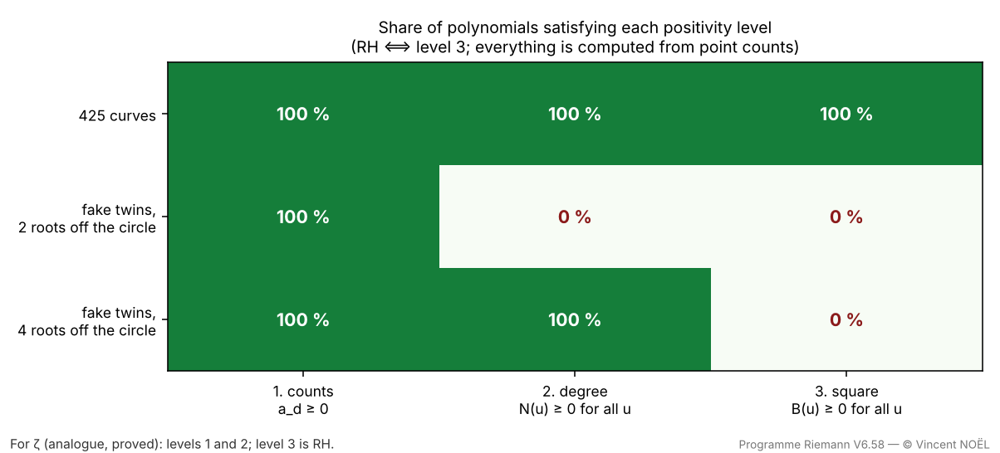

# Where does the sign come from: counts, degrees, or a square?

**Document 80 (English version) · Vincent P. P. NOËL · 17 October 2026**  
**Status:** exact computation on the 425 curves and 220 "fake twins" of the corpus, with four predictions written before the computation (`3_Preuves_et_calculs/data/prevision_v658_gram.md`, 08:50 UTC); all four came out true. The statements proved here are elementary. The geometric results they illuminate (Weil 1948, positivity of the Rosati involution) are classical and cited. The French original is [document 80](../80_D_OU_VIENT_LE_SIGNE.pdf); in case of discrepancy, the French text prevails.

## 1. The question

Can Weil positivity be written as Q(f) = ‖Af‖², with an operator A built from arithmetic alone and without assuming the sign? Document 77 asked this for ζ. We first ask it where RH is a theorem: a curve C of genus g over 𝔽_q. Which structure imposes the sign there, and can the primes (here, the point counts) supply it?

## 2. The Weil form of a curve, read in three ways

Let P(u) = ∏(1 − αᵢu) be the L-polynomial, χ(T) = T^{2g}P(1/T) the characteristic polynomial of Frobenius F, and Sₙ = Σ αᵢⁿ, which is given by the counts: Sₙ = qⁿ + 1 − Nₙ. On the algebra K = ℚ[T]/(χ), set the involution ι(T) = q/T and the form

  B(u) = Tr(u · ι(u)) = Σᵢ u(αᵢ)·u(q/αᵢ).

In the basis 1, T, …, T^{2g−1}, its matrix is **integral and depends only on the counts**:

  B_{jk} = q^{min(j,k)} · S_{|j−k|}.

This is the Weil metric of the corpus (documents 29 and 33) and, up to sign, the intersection form of the surface C × C orthogonal to the fibres (document 46). It can be read in three ways:

| Reading | Space | Map A | What gives the sign |
|---|---|---|---|
| spectral | ℂ^{2g} (the cohomology H¹) | u ↦ (u(αᵢ))ᵢ | \|αᵢ\| = √q (this is RH) |
| algebraic | End(J) ⊗ ℝ, J the Jacobian | u ↦ u(F) | positivity of the Rosati involution |
| geometric | divisors on C × C orthogonal to the fibres | u ↦ Σ uₙ Γₙ | the Hodge index theorem (an ample class) |

**A Gram realization certified by the counts alone.** For the curves, the exact decomposition B = L·diag(d)·Lᵀ over the rationals gives 2g strictly positive pivots for **424 of the 425 curves**. The remaining one has repeated roots: its zero pivot appears at rank 4 (q = 5, g = 3), matching the missing rank 2g of document 46. Then A = diag(√d)·Lᵀ satisfies B(u) = ‖Au‖². The Gram realization exists, and it is built from N₁, …, N_g only. For the fake twins, a negative pivot (219 cases) or a zero pivot (1 case) appears as early as rank 2, 3 or 4.

This does not explain **why** the pivots are positive. To see why, we separate three levels of positivity, all computable from the counts.

## 3. Three levels of positivity

1. **Counts.** The numbers of closed points a_d are non-negative.
2. **Degree.** The norm form N(u) = ∏ u(αᵢ) = Res(χ, u). For a genuine Jacobian it is the **degree of the isogeny** u(F), the number of points of its kernel. For instance, N(1 − Tᵏ) is the number of points of J over 𝔽_{qᵏ}.
3. **Square.** The form B above: the trace of u · ι(u), "u times its adjoint".

**Proposition (elementary, proved here).** Let χ be real and stable under α ↦ q/α.

- (a) N(u) ≥ 0 for every real u if and only if every real root of χ has even multiplicity.
- (b) If the roots are distinct, B has exactly r/2 negative directions, where r is the number of roots off the circle |α| = √q. Hence B ≥ 0 if and only if RH holds.

*Proof.* Put zᵢ = u(αᵢ). A non-real root belongs to a conjugate pair, which contributes |zᵢ|² ≥ 0 to N; a simple real root contributes zᵢ, whose sign is free. This gives (a). For (b), write B = Σ zᵢ·z_σ(i), where σ exchanges α and q/α, and group by orbits:

- a pair on the circle {α, ᾱ} gives 2|z|², of signature (2, 0);
- a real pair off the circle {α, q/α} gives 2z₁z₂, of signature (1, 1);
- a complex quadruple {α, ᾱ, q/α, q/ᾱ} gives 4·Re(z₁z₃), of signature (2, 2).

Sylvester's law of inertia concludes, since u ↦ (zᵢ) is injective (Vandermonde). ∎

## 4. Results

| | Prediction | Result | Verdict |
|---|---|---|---|
| G1 | 425 curves: N ≥ 0 and B ≥ 0 | 425/425 without a real root of odd multiplicity; B has no negative direction for 425/425 (rank 2g: 424) | **true** |
| G2 | the 119 fakes with 4 roots off the circle have all degrees positive; the 101 fakes with 2 roots off the circle (including the 4 of genus 1) have a simple real root | 119/119 and 101/101; the 4 of genus 1 are among the 101 | **true** |
| G3 | for these 101, some u with coefficients ≤ 3 gives N(u) < 0 | 101/101, with coefficients ≤ 1 (93 cases) or ≤ 2 (8 cases) | **true** |
| G4 | B indefinite for all 220 fakes, with r/2 negative directions | 220/220 | **true** |

**An isogeny of degree −1.** The fake twin P = 1 − 4u + 3u² (q = 3, genus 1) has N₁ = 0 points, a non-negative count. But χ(T) = T² − 4T + 3, and the isogeny F − 2 would have degree χ(2) = −1: a kernel with −1 points. This is impossible, and it is enough to exclude it. In genus 1, level 2 is level 3: this is the classical proof of Hasse's bound through the positivity of degrees.

**In genus 2, the degree is no longer enough.** The 119 fake twins with a complex quadruple have all their counts positive **and** all their "degrees" positive, yet RH fails for them. What excludes them is not a count but a **square**: the trace of u · ι(u). For a genuine Jacobian this is the positivity of the Rosati involution (Tr(u u†) > 0). Weil derives it from the Castelnuovo–Severi inequality, that is, from the Hodge index theorem on C × C [Wei48]; see also [Mum70], §21. This positivity comes from an **ample class**, the polarization of the Jacobian, and not from a count.

## 5. What this says about ζ

Transposing the three levels:

- **Level 1, proved.** Λ(n) ≥ 0: the "counts" of ζ are non-negative.
- **Level 2, proved.** ξ(σ) > 0 for every real σ, because ζ has no real zero in ]0, 1[. For σ > 1, each factor of ξ(s) = ½ s(s − 1) π^{−s/2} Γ(s/2) ζ(s) is positive; for 0 < σ < 1, ζ(σ) < 0 and s(s − 1) < 0; the rest follows by symmetry. Under the correspondence s ↦ α = q^s (up to 2πi/log q), a real root off the circle for a curve corresponds to a real zero off the line. ζ has none. Like the 119 fake twins with a complex quadruple, ζ passes levels 1 and 2.
- **Level 3 is RH.** The prime-side Weil form (the corpus matrix G_L) is the exact analogue of B for ζ, computed without any zero.

**Conclusion.** Everything that can be counted is positive for ζ, and that is not enough, exactly as for the 119 fake twins. **What is missing is not a count; it is a square.** One would need a "Rosati" involution on an algebra of arithmetic correspondences whose trace is positive for a structural reason: a polarization, an ample class. The involution exists for ζ: it is f ↦ f*(x) = f̄(−x) in the Weil form. What is missing is the reason for the positivity of the trace. This is the precise place of the "something larger" in the author's working hypothesis.

**Consequences for the next steps.**

- No argument based on counts or degrees can replace Weil positivity: G2 gives 119 exact counterexamples.
- The window certificates (documents 71–75) prove level 3 on windows. They are of the right type, but local.
- A global strategy must exhibit a square, Q = ‖Af‖², where A comes from a polarization. In the Connes–Consani programmes, this is positivity on the square of the arithmetic site (document 51).

## 6. Proved, measured, assumed

| | Statement |
|---|---|
| **Proved (elementary, here)** | The proposition of §3. B_{jk} = q^{min(j,k)} S_{|j−k|}. ξ(σ) > 0 on ℝ. |
| **Classical (cited)** | Rosati positivity and the Hodge index theorem [Wei48], [Mum70]; degree of an isogeny = size of its kernel. |
| **Measured (exact)** | G1 to G4 on 645 polynomials. Gram realization certified by rational pivots for 424 curves. |
| **Assumed** | That an analogue of a polarization exists for ζ. This is the heart of the problem, and it remains open. |

## 7. Reading according to the working hypothesis

In the reduced model, necessity has a name: the polarized Jacobian. Counts do not see it: fake twins imitate them. Degrees do not see it either: 119 fake twins imitate them too. Only the trace of a square tells them apart, and that square exists only because there is a geometric object behind it, with an ample class. For ζ, everything that can be counted is already in place. What would make RH necessary is the object that supplies the square.

## References

- [Wei48] A. Weil, *Sur les courbes algébriques et les variétés qui s'en déduisent*, Hermann, Paris, 1948. Partially verified (targeted reading of the 2022 transcription).
- [Mum70] D. Mumford, *Abelian Varieties*, Tata Institute / Oxford University Press, 1970, §21 (Theorem 1 and its proof, which give the positivity of the Rosati involution). Book not consulted; the reference is confirmed indirectly by an online note that cites it this way.
- Full records, verification status and corrections: [document 42](../42_REGISTRE_DES_SOURCES.md) and [ranked references](../../REFERENCES_RANKED.md).
