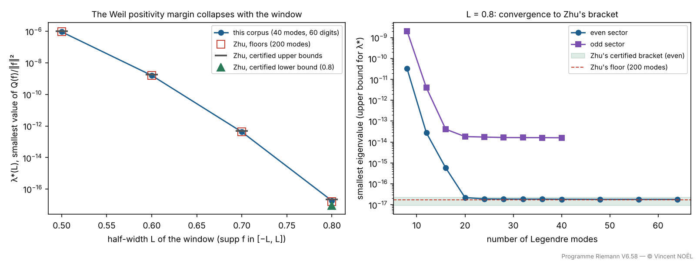

# Zhu reproduced: Weil positivity up to the window [−0.8, 0.8]

**Document 81 (English version) · Vincent P. P. NOËL · 17 October 2026**  
**Status:** independent reproduction, by a different method, of Zhu's values [Zhu26] (arXiv:2608.24827 v2; definitions and Tables 1 and 3 read in the PDF). The computation uses 60-digit precision but is **not** certified with interval arithmetic. Four predictions were written before the computation (`3_Preuves_et_calculs/data/prevision_v658_zhu.md`, 09:10 UTC); all four came out true. A fifth one (Z5, 09:47 UTC), about the connection with document 75, also came out true. An unplanned measurement locates the corpus certificates (documents 71–75) relative to Zhu's. The French original is [document 81](../81_ZHU_REPRODUIT.pdf); in case of discrepancy, the French text prevails.

## 1. The object

Zhu studies λ*(L), the smallest value of Q(f)/‖f‖² over real functions f supported in [−L, L]. Here Q is the full Weil form, pole included:

  Q(f) = 2F(i/2)F(−i/2) + (1/2π) ∫ |F(t)|² [Re ψ(¼ + it/2) − log π − Σ_{log n < 2L} 2Λ(n) n^{−1/2} cos(t log n)] dt,  with F = f̂.

RH is equivalent to λ*(L) ≥ 0 for every L. Zhu certifies 8.9·10⁻¹⁸ ≤ λ*(0.8) ≤ 2.27·10⁻¹⁷.

## 2. An independent method: the form in the variable x

Instead of working in the frequency t, we rewrite Q with the autocorrelation g(x) = ∫ f(y) f(y − x) dy, which is even and supported in [−2L, 2L]. Starting from Gauss's representation ψ(z) = ∫₀^∞ (e^{−u}/u − e^{−zu}/(1 − e^{−u})) du and exchanging integrals, with w(x) = x·e^{x/2}/sinh x, we obtain

  Q(f) = 2F(i/2)F(−i/2) + g(0)·C₀(L) + ∫₀^{2L} (g(0) − g(x))·w(x)/x dx − Σ_{log n < 2L} 2Λ(n) n^{−1/2} g(log n),

where C₀(L) = −log π + E₁(4L) + ∫₀^{2L} (e^{−2x} − w(x))/x dx.

All integrals are over a bounded interval with analytic integrands, so Gauss quadrature converges very fast. Test functions are expanded on the Legendre polynomials of [−L, L], in the even or odd sector. The smallest eigenvalue of the resulting matrix is an **upper bound** for λ*(L) in each sector.

**Check against the zeros (prediction Z1).** For a smooth bump f = cos⁴(πx/2L) at L = 0.8, this formula gives Q(f) = 7.2014036·10⁻⁶. The sum Σ 2|F(γ)|² over the 1,070 known zeros up to height 1,500 gives the same value, to **1.9·10⁻¹³ in relative terms**. The x-form is therefore correct, pole and constants included.

## 3. Results

| L | This corpus (40 modes) | Zhu, floor (200 modes) | Zhu, certified upper bound | Ratio |
|---|---|---|---|---|
| 0.5 | 9.346·10⁻⁷ | 9.34·10⁻⁷ | 1.05·10⁻⁶ | 1.001 |
| 0.6 | 1.610·10⁻⁹ | 1.61·10⁻⁹ | 1.82·10⁻⁹ | 1.000 |
| 0.7 | 4.206·10⁻¹³ | 4.18·10⁻¹³ | 4.99·10⁻¹³ | 1.006 |
| 0.8 | 1.809·10⁻¹⁷ (1.775·10⁻¹⁷ with 64 modes) | 1.65·10⁻¹⁷ | 2.27·10⁻¹⁷ | 1.08 |

Odd sector at L = 0.8: 1.59·10⁻¹⁴. Zhu brackets it between 8.2·10⁻¹⁵ and 2.35·10⁻¹⁴, so the even sector is about 900 times lower.

| | Prediction | Result | Verdict |
|---|---|---|---|
| Z1 | x-form = sum over zeros, to 10⁻⁸ | 1.9·10⁻¹³ | **true** |
| Z2 | with 40 modes, within a factor 1.5 of Zhu's floors at the four values of L | factors 1.001 to 1.10 | **true** |
| Z3 | at L = 0.8, value inside the certified bracket [8.9·10⁻¹⁸, 2.27·10⁻¹⁷] | 1.81·10⁻¹⁷, then 1.77·10⁻¹⁷ with 64 modes | **true** |
| Z4 | odd sector at least 30 times above the even one | about 900 times | **true** |

**What is reproduced.** Zhu's values, by an independent method (in the variable x rather than in frequency), over the whole range 0.5 to 0.8. The curve collapses as Zhu reports: by a factor of about 600 between 0.5 and 0.6, then by 4,000 and 23,000 at each step of 0.1.

**What is not reproduced.** The **certification**:

- the lower bound 8.9·10⁻¹⁸, i.e. positivity itself, which requires handling the whole infinite dimension (Zhu's envelope beyond T♯);
- the certified upper bound, which requires evaluating the quotient of a trial vector in interval arithmetic, with quadrature error bounds.

Our values are upper bounds computed in high precision, not certificates.

## 4. An unplanned measurement: the moment kernel

The corpus theorems (documents 71–75) concern functions whose two exponential moments vanish, F(i/2) = F(−i/2) = 0, which removes the pole term. Their form Q_W has the same normalization as Zhu's (unitary Fourier transform; a(t) − C₀ = Re ψ(¼ + it/2) − log π, document 75). We computed the smallest value of Q on this subspace with 32 modes (40 at L = 0.8); the computation is scripted (`run_zhu_reproduction.py --noyau`):

| L | All f (λ*) | Moment kernel, even sector | Kernel, odd sector | Corpus certificate |
|---|---|---|---|---|
| 0.347 | 1.3·10⁻³ | 0.546 | 0.842 | ≥ 1/25 (doc. 71) |
| 0.5 | 9.35·10⁻⁷ | 0.0119 | 0.190 | ≥ 1/250 (doc. 73) |
| 0.55 | — | 9.20·10⁻⁴ | 0.0320 | ≥ 3/10000 (doc. 75) |
| 0.6 | 1.61·10⁻⁹ | 6.6·10⁻⁵ | — | — |
| 0.7 | 4.2·10⁻¹³ | 5.6·10⁻⁸ | — | — |
| 0.8 | 1.8·10⁻¹⁷ | 5.40·10⁻¹² (5.42 with 32 modes, 6.13 with 24) | 1.09·10⁻⁹ | — |

**Prediction Z5 (written before).** At 11/20, the kernel value lies between the certified lower bound of document 75 and the value at 0.5, between 6·10⁻⁴ and 3·10⁻³: measured 9.20·10⁻⁴, **true**. The 11/20 certificate therefore leaves a factor of 3 between what it proves and the actual value; at 1/2 the factor is also 3 (0.004 versus 0.0119).

**The even sector is the tightest.** On the kernel, the odd sector lies above it, by a factor of 1.5 (at 0.347) up to 200 (at 0.8). The even sector sets the margin, as for λ*.

*Note on method.* The basis of the zero-moment subspace is taken from a Householder reflector. Gram–Schmidt orthogonalization is unstable here, because the components of the moment decay faster than any exponential. A first attempt done that way gave values that were not monotone in N, and it was discarded. With the reflector, the values decrease with N, as they must for a variational method.

Two consequences, and a correction.

- **The theorems of documents 71, 73 and 75 are consistent with this computation.** Their certified lower bounds (1/25, 1/250, 3/10000) lie below the values computed on the same subspace (0.546, 0.0119, 9.2·10⁻⁴), by factors of 3 to 14.
- **Zhu's almost-null direction is the pole direction.** On the moment kernel, the margin at 0.8 is about 300,000 times larger. Extending the method of documents 71–75 to S = 0.8, where the primes 2, 3 and 4 enter, would require a certified margin of about 5·10⁻¹², not 10⁻¹⁷.
- **Correction (same day): what such an extension would add.** Zhu's certified lower bound, λ*(0.8) ≥ 8.9·10⁻¹⁸, holds for *all* functions supported in [−0.8, 0.8], hence also on the kernel. Positivity on the kernel up to 0.8 is therefore already established by Zhu, and in range it dominates the certificates of documents 71–75 (S ≤ 11/20). A corpus certificate at 0.8 would give an independent margin on the kernel about 10⁵ times stronger (≈ 5·10⁻¹² versus 8.9·10⁻¹⁸), by another method, but no new window. The navigator action `v658_certificat_noyau_S08` keeps this corrected scope; it does not bring RH closer.

## 5. Proved, measured, assumed

| | Statement |
|---|---|
| **Proved (here)** | The x-form of §2 (direct computation from Gauss's representation of ψ), checked against the zeros to 2·10⁻¹³. |
| **Measured (60 digits, not certified)** | The tables of §3 and §4. Predictions Z1–Z5 true. |
| **Cited** | Zhu's certified bracket; his 200-mode floors. |
| **Assumed** | That the moment-kernel margin at 0.8 stays near 5.4·10⁻¹² beyond 40 modes, and that it could be certified with the tools of documents 71–75. Such a certificate would strengthen the margin, not the range: positivity at 0.8 already follows from Zhu's lower bound. |

## 6. Reading according to the working hypothesis

Document 80 said that what is missing for ζ is a square. Here we measure how thin that square is when seen through a window: its smallest value loses three to more than four orders of magnitude at each widening by 0.1, and the loss accelerates. No window will prove RH: positivity for all windows *is* RH, and the margin collapses too fast for a window-by-window approach. What the windows say, and what certificates make checkable, is that the square is there wherever we can look.

## References

- [Zhu26] X. Zhu, *Weil positivity in compact windows: a finite reduction, certified two-sided bounds, and a Landau–Widom decay law*, arXiv:2608.24827 (v2, September 2026), <https://arxiv.org/abs/2608.24827>. Verified online; λ*(L) is a variational infimum, and the smallest eigenvalue of a finite Weil matrix is an upper bound for it (Zhu, Remark 2.2).
- Full records: [document 42](../42_REGISTRE_DES_SOURCES.md) and [ranked references](../../REFERENCES_RANKED.md).
